# Haute disponibilité v2 — Sarah Home : une copie conforme, sans journal sur disque

Date : 23 octobre 2026. Statut : **proposition, aucune modification du code**. Base analysée :
`main` au commit `a835893`. **Remplace la [v1 du même jour](haute-disponibilite.md)**, gardée pour
l'historique. Proposition à part : elle ne modifie ni l'[analyse
V7](isolation-reactivite-runtime-v7.md) ni l'[étude mémoire v2](memoire-v2.md) ; elle dit à la fin
ce qu'elle leur changerait (§ 19).

Ta demande, après lecture de la v1 :

1. **Pas de journal sur disque** : il écrirait trop.
2. **Une réplique de secours locale, et une distante.**
3. **Les données critiques, et les moins critiques** : ne pas les traiter pareil.
4. **Le pont MQTT gère les tampons** ; de l'autre côté, la donnée se met à jour en direct.
5. **Les workflows** : leur état passe en messages MQTT, et leur journal d'exécution, rangé en base,
   aussi.
6. **Le maximum par MQTT** ; pas les flux vidéo, ni les gros documents.
7. **Des schémas clairs, arrondis, en relief** : les modes, le cœur, les clients, et le passage de
   l'un à l'autre.

Et une précision en chemin : **le pont est un module que l'on fabrique**, à deux bouts, justement
pour gérer les tampons et les problèmes. Oui, c'est ce que cette v2 décrit (§ 6.4).

Les questions, reformulées pour être tranchables (« comment pourrait-on… ») :

| # | Comment pourrait-on… | § |
|---|---|---|
| 1 | tenir chez les secours une copie **exacte** de la mémoire, **sans journal sur disque** ? | 6 |
| 2 | ranger chaque donnée dans la bonne classe : exacte, au mieux, hors MQTT ? | 3, 8 |
| 3 | faire passer les **workflows** par MQTT, leur état comme leur journal d'exécution ? | 7 |
| 4 | laisser le pont gérer tampons et coupures **sans jamais perdre en silence** ? | 6.4 à 6.7 |
| 5 | **redémarrer** sans journal : d'où repart la mémoire, et que perd-on ? | 11 |
| 6 | combien d'**écritures disque** reste-t-il, et où ? | 10 |

Méthode, et techniques employées, nommées au fil du texte :

- **premiers principes** : à quoi sert un journal sur disque, et qui d'autre peut le rendre ?
- **inversion** (le pré-mortem) : « comment perdre une donnée sans journal ? », « comment vider les
  copies par erreur ? » ; chaque réponse devient une règle ou un test ;
- **analogies** : la réplication de Redis (une file en mémoire, la reprise au rang par `PSYNC`,
  au-delà une resynchronisation complète envoyée sans disque, et son piège du maître qui redémarre
  vide) ; les rangs de lecture de Kafka ; la règle d'élection de Raft (le plus à jour l'emporte) ;
  le *claim check* des intégrations d'entreprise (le message porte une référence, les octets
  voyagent ailleurs) ;
- **analyse morphologique** : où mettre le tampon, options côte à côte (§ 6.7) ;
- **sélection à critères visibles** : exactitude, écritures, perte, simplicité ;
- **un banc** : les deux vrais courtiers `rumqttd` 0.20 de la v1, le relais qui coupe, retarde et
  bat, la mémoire de la v2 reprise telle quelle, les exécutions mêlées aux valeurs ; et, pour
  comparer, un vrai pont Mosquitto 2 en conteneurs. Linux musl, 2 CPU et 128 Mio, trois essais par
  mesure ; 15 tests. Rangé dans `tools/haute-dispo-banc/` (annexe A).

Vocabulaire :

- l'**actif** porte l'**époque** : la seule machine qui agit. Le **secours local** est dans la
  maison et peut tout reprendre ; le **secours distant** est dehors, relié par NetBird ; il copie,
  alerte, et peut reprendre le cloud ;
- une **sortie critique** est ce que l'actif publie et dont il dépend : valeurs, santé, annuaire,
  occurrences, état des workflows, coffre, fichiers métier, époque. Son **rang** `s` est son numéro,
  sans trou, **un seul pour tout** ;
- la **file** : les dernières sorties critiques, gardées **en mémoire** par l'actif (et par chaque
  secours, pour ses propres abonnés) ;
- l'**état complet** : toute la mémoire critique à un rang `s0`, construite en mémoire et envoyée
  par MQTT ;
- le **battement** : le rang du bout, publié toutes les 500 ms ;
- le **pont maison** : le module de Sarah Home qui relie les deux courtiers, à deux bouts ;
- l'**instantané** : l'état complet, écrit sur disque (à l'arrêt, avant une mise à jour, chaque
  heure) ;
- **sceller** un secret : le chiffrer pour une machine précise.

## 1. Le verdict en bref

- **Oui : une copie conforme, sans aucun journal sur disque. La durabilité vient des autres
  machines, pas du disque.** C'est ce que fait la réplication de Redis : une file en mémoire, la
  reprise au rang quand le retard y tient, et au-delà une resynchronisation complète, envoyée sans
  passer par le disque.
- **Trois mécanismes, tous en mémoire.** Un seul rang `s` pour toutes les sorties critiques ; une
  file des 10 000 dernières sorties (0,45 Mio) qui comble les trous courts ; au-delà, l'**état
  complet**, 100 Ko au banc, par MQTT en morceaux de 4 Kio. Un battement toutes les 500 ms révèle
  même la perte de la dernière sortie (§ 6).
- **Mesuré.** Deux coupures de 5 et 10 s : aucune perte, rattrapées par la file en 110 et 207 ms.
  Une coupure de 60 s, plus longue que la file : « hors file », l'état complet, puis la suite ;
  aucune perte, rattrapée en 404 ms. Dans tous les cas, la mémoire du secours et celle de son abonné
  local finissent identiques à l'actif, **exécutions comprises**.
- **Une journée d'absence se recopie au lieu de se rejouer** : 1,8 s à 1 Mbit/s pour 101 Ko, contre
  69 s et 7,7 Mo en rejouant le journal de la v1 (§ 14.3).
- **Le pont gère les tampons, à condition d'être le nôtre.** Le courtier ne fait que transporter. Le
  pont de `rumqttd` perd 3 011 messages sur 8 000 sous deux coupures. Un pont Mosquitto, session
  persistante et QoS 1, en perd 960 sur une coupure de 10 s avec sa file par défaut, et 2 000 si son
  courtier redémarre, **sans que l'abonné le sache**. Le pont maison voit chaque trou au rang `s` et
  le comble, quelle qu'en soit la taille (§ 6.7).
- **Trois classes de données.** **Critique** : exacte à tout instant, rang `s`, comblée.
  **Historique** : au mieux en direct, complète plus tard, avec le rang `seq` de la base de l'actif.
  **Hors MQTT** : la vidéo et les gros fichiers ont leur chemin ; MQTT ne porte que leur référence
  (§ 3, § 8).
- **Les workflows passent par MQTT** : leur état (`wf/`) dans le même rang que les valeurs, leur
  journal d'exécution (`run/`, puis `hist/`) avec l'historique. Le journal de réplication de la v1,
  son second rang `j` et sa dépendance disparaissent (§ 7).
- **Sur disque, il ne reste que l'instantané** : 48 fsync et 5,7 Mo par jour s'il est pris chaque
  heure. La v1 aurait ajouté jusqu'à 165 000 fsync par jour ; aujourd'hui, `state.json` en coûte
  2 880 et 236 Mo, et l'instantané peut le remplacer (§ 10).
- **Le prix : une panne de tout, d'un coup, sans onduleur ni distant.** Sans journal, ce qui n'était
  que dans les mémoires est perdu jusqu'au dernier instantané : des exécutions et des attentes ; les
  valeurs, les appareils les redonnent. Avec un onduleur (arrêt figé) ou un distant à jour : rien
  (§ 11).
- **Redémarrer : la mémoire d'un pair d'abord, l'instantané ensuite ; jamais actif avec moins qu'un
  pair.** C'est la règle d'élection de Raft, et la parade au piège de Redis : un maître sans
  persistance qui redémarre vide, et ses répliques qui se recopient sur lui (§ 11.3).
- **Six modes et une seule porte** vers l'actif : l'époque (§ 4).
- **Ce qui reste de la v1, tel quel** : copier les sorties et jamais les entrées, les familles
  d'intégrations, un seul renouveleur par jeton, le coffre scellé par destinataire, NetBird, les
  deux époques et l'époque sur chaque ordre, l'arrêt figé.


## 2. Ce qui change depuis la v1, et pourquoi

### 2.1 Les documents, par date

Quand deux documents se contredisent, le plus récent l'emporte :

| Document | Date | Ce qu'il apporte ici |
|---|---|---|
| **Cette v2** | 23 octobre, après-midi | la copie sans journal sur disque, les trois classes, les workflows par MQTT, les modes |
| [Haute disponibilité v1](haute-disponibilite.md) | 23 octobre, matin | le pont à reprise, la copie par les sorties, les intégrations, les jetons, le coffre, NetBird, les époques, l'arrêt figé |
| [Étude mémoire v2](memoire-v2.md) | 23 octobre | numéros fixes (`n` dans `meta/`, `i` dans `val/`), deux horloges, exécutions de 64 o, attentes de 24 o, moteur du temps, agendas |
| [Analyse V7](isolation-reactivite-runtime-v7.md) | 22 octobre | le courtier `rumqttd` embarqué, l'arbre `moli/v1/`, le rang `s`, 4 Kio par message sur le réseau, l'époque, le bail, le témoin, les radios, 19 tests de reprise |
| [Analyses V4 et V5](isolation-reactivite-runtime-v4.md) | 22 octobre | la bascule jouée de bout en bout, le journal et l'instantané |
| D13 ([ARCHITECTURE](../ARCHITECTURE.md)) | 17 octobre, approuvée le 18 | le journal d'export immuable, son rang `seq`, l'archive et ses accusés |

### 2.2 De la v1 à la v2

| Sujet | v1 (le matin) | v2 | Pourquoi |
|---|---|---|---|
| Le tampon | le journal de l'actif, sur disque, 7 jours | **une file en mémoire** de 10 000 sorties ; au-delà, **l'état complet** par MQTT | aucune écriture pour copier (§ 6, § 10) |
| Ce qui n'était pas sur MQTT | un journal de réplication, avec son rang `j` et une dépendance à `s` | **tout passe par MQTT, dans le même rang `s`** : `wf/`, `conf/`, `repl/coffre/` | un seul ordre, plus de dépendance à tenir (§ 7) |
| Un secours absent longtemps | rejouer le journal | recopier l'état complet | mesuré : 1,8 s contre 69 s (§ 14.3) |
| La durabilité | le journal, plus l'instantané | **les autres machines**, plus l'instantané | écritures (§ 10), pannes (§ 11) |
| Le redémarrage | l'instantané, puis le journal | la mémoire d'un pair ; sinon l'instantané le plus avancé | la mémoire la plus fraîche est chez les pairs (§ 11.2) |
| L'historique du secours | les opérations de l'actif, par le journal | les opérations de l'actif, **par MQTT** (`hist/`, rang `seq`) ; un trou se comble depuis la base de l'actif | la base existe déjà (§ 9) |
| Le journal d'exécution des workflows | dans la base, hors réplication | **publié sur MQTT** (`run/`), rangé par chaque base qui tient l'historique | ta demande (§ 7.2) |
| La perte de la dernière sortie | invisible jusqu'à la suivante | le **battement** la révèle | trouvé au banc (§ 6.6) |
| Le pont | « à reprise », côté secours | **le pont maison, à deux bouts** : file, état complet et battement côté actif | § 6.4 |

### 2.3 Ce qui reste de la v1

Copier par les sorties du hub, jamais par ses entrées (mesuré, § 6.2) ; le porteur de l'époque seul
à agir ; tout ce qui quitte une machine en heure murale ; les quatre leçons de `rumqttd` ;
l'empreinte ; les sept familles d'intégrations et le mode passif ; un seul renouveleur par jeton qui
tourne ; le coffre scellé par destinataire ; le secours distant par NetBird ; les deux époques,
maison et cloud, et l'époque sur chaque ordre ; le format de l'instantané. La v1 en garde le
détail ; cette v2 les reprend en bref aux § 12 à 16.

### 2.4 Ce que fait le code aujourd'hui

Les faits de la v1 tiennent toujours (vérifiés au commit `a835893`) :

| Fait | Où | Conséquence |
|---|---|---|
| **Aucun mode passif, aucun verrou d'instance** : toute instance lancée démarre ses pilotes et son moteur | `moli-os/src/main.rs:440-448` | le mode passif est à créer (§ 5) |
| Le coffre est lu **une fois**, à son ouverture, puis servi depuis la mémoire | `moli-runtime/src/secrets.rs:117-140` | le secours doit appliquer chaque secret en mémoire (§ 13) |
| Netatmo range son nouveau jeton **avant** de s'en servir | `moli-netatmo/src/actor.rs:245-256` | la bonne règle d'écriture existe déjà |
| Bambu, Frigate et Zigbee2MQTT prennent un identifiant MQTT fixe | `moli-bambu/src/lib.rs:285`, `moli-z2m/src/lib.rs:74-78` | deux instances se chassent du courtier |
| À l'arrêt, tout est annulé d'un coup ; les automatismes ne reprennent jamais | `moli-os/src/main.rs:483-507`, `moli-automation/src/engine.rs:99-113` | l'arrêt figé est à écrire (§ 16) |

Et un fait de plus, qui compte pour les écritures :

| Fait | Où | Conséquence |
|---|---|---|
| **`state.json` est réécrit chaque minute** quand une valeur a changé : le ménage tourne toutes les 15 s, l'état part un tour sur quatre, en entier, avec `fsync` du fichier puis du dossier | `moli-os/src/main.rs:710-712` et `950-955`, `moli-runtime/src/labels.rs:28-47` | c'est aujourd'hui le premier écrivain de l'état ; l'instantané peut le remplacer (§ 10) |
| L'historique (`history.db`) écrit en SQLite, WAL, `synchronous = NORMAL` | `moli-history/src/store.rs:279` | il existe déjà ; la v2 ne lui ajoute rien |

## 3. Trois classes de données

**Premiers principes** : une donnée est **critique** si l'actif décide avec elle et que les
appareils ne la redonnent pas d'eux-mêmes. Le reste est de l'**historique** (utile, pas décisif), ou
des **octets** qui ont déjà leur chemin.


| | Critique | Historique | Hors MQTT |
|---|---|---|---|
| Ce qu'elle porte | valeurs et instants, santé, annuaire, occurrences ; état des workflows (exécutions, attentes, horaires, minuteries, baux, approbations, agendas) ; coffre ; fichiers métier ; époque | relevés pour les courbes, heures d'énergie, journal d'exécution, notifications envoyées, audit | flux vidéo et audio, enregistrements, médias, documents, sauvegardes, archive Parquet, micrologiciels |
| Garantie | **exacte à tout instant**, dans l'ordre | au mieux en direct, **complète plus tard** | les octets intacts (empreinte), quand on en a besoin |
| Sujets | `val/` `vu/` `avail/` `meta/` `evt/` `wf/` `conf/` `repl/coffre/` `sys/` | `run/` `hist/` | aucun : une **référence** (empreinte, taille, adresse) dans un message critique ou historique |
| Rang | `s` : un seul, sans trou, donné par l'actif | `seq` : celui de D13, donné par la base de l'actif | — |
| Un trou | comblé tout de suite : la file, sinon l'état complet | comblé en arrière-plan, depuis la base de l'actif, à débit borné | redemandé ; l'empreinte vérifie |
| Sur disque | l'instantané seulement | la base d'historique, qui existe déjà | là où ils sont déjà (NAS, archive) |

Trois règles :

1. **Le flux critique ne s'arrête jamais pour l'historique.** Deux rangs, deux files : un trou de
   `seq` ne retient aucune sortie critique.
2. **Le maximum passe par MQTT.** La V7 borne un message à 4 Kio sur le réseau (§ 6.4 de la V7) : un
   objet d'état plus grand se découpe en morceaux (l'état complet, un fichier métier jusqu'à 1 Mio).
3. **Hors MQTT : ce qui coule en continu, ou n'est pas de l'état.** Le message porte la référence ;
   les octets passent par HTTP avec reprise, `rsync` ou le protocole de l'archive (§ 8).

## 4. Les modes, et le passage de l'un à l'autre

Une machine de Sarah Home a six modes. Les deux machines locales ont les mêmes ; le secours distant
n'en a que deux.

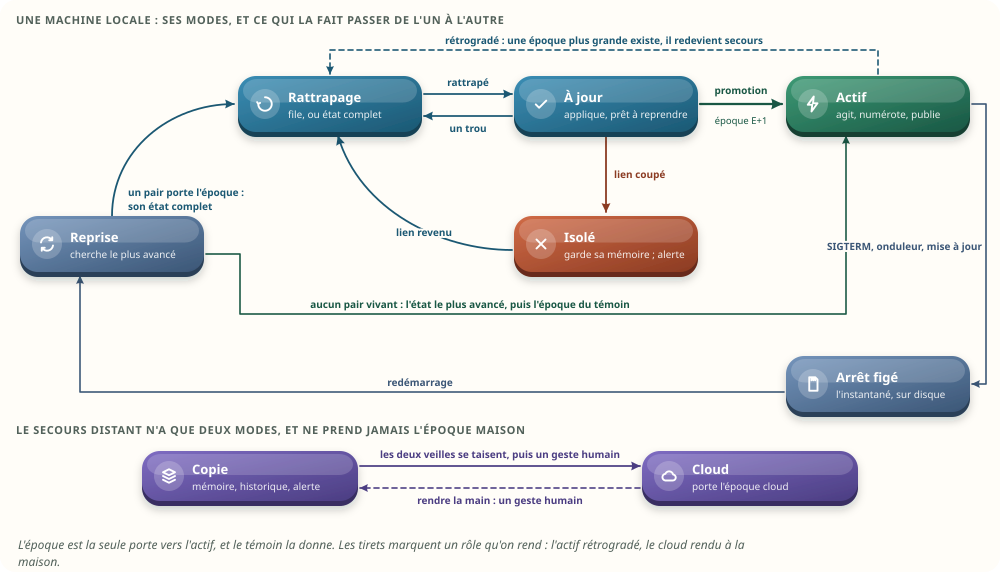

| Mode | Pilotes, radios | Moteur des workflows | API, écrans | Le pont | Disque |
|---|---|---|---|---|---|
| **Reprise** (démarrage) | arrêtés | chargé, rien ne part | fermés | cherche les pairs | lit l'instantané |
| **Rattrapage** | arrêtés | applique | lecture seule | bout secours : demande tronçons ou état | rien |
| **À jour** | arrêtés | applique, ne réveille rien | lecture seule, « secours » | bout secours : applique en direct | rien |
| **Isolé** | arrêtés | figé au dernier rang | lecture seule, « isolé » | se reconnecte | rien |
| **Actif** | en marche | agit | lecture et écriture | bout actif : file, état complet, battement | l'instantané (heure, mise à jour) |
| **Arrêt figé** | s'arrêtent | figé | « arrêt en cours » | relève, si un secours est à jour | écrit l'instantané |

| Passage | Déclencheur | Ce qui passe par MQTT | Durée |
|---|---|---|---|
| Reprise → rattrapage | un pair porte l'époque | `sys/etat`, puis l'état complet | 1,8 s à 1 Mbit/s (banc) |
| Rattrapage → à jour | rang égal au bout, même empreinte | les sorties, les tronçons | sous la seconde (banc) |
| À jour → rattrapage | un trou au rang `s`, ou au battement | demande, tronçons | 110 à 207 ms (banc) |
| À jour → isolé | plus de battement depuis 2 s | — | 2 s |
| Isolé → rattrapage | le lien revient | tronçons, ou « hors file » puis l'état complet | 404 ms après 60 s coupé (banc) |
| À jour → actif (promotion) | le bail de l'actif a expiré ; le témoin donne `E + 1` | `sys/epoque` | le bail, 3 s (V7) |
| Actif → rattrapage (rétrogradé) | une époque plus grande existe | `sys/epoque` | — |
| Actif → arrêt figé | SIGTERM, onduleur, mise à jour | `sys/arret`, puis la relève | 2 s visées (§ 16) |
| Arrêt figé → reprise | redémarrage | — | — |
| Reprise → actif | aucun pair vivant ; l'état le plus avancé, puis le témoin | — | 10 s d'attente des pairs |
| Distant : copie → cloud | les deux veilles se taisent, puis un geste humain | `sys/epoque/cloud` | humain |

Deux règles tiennent ces passages : **l'époque est la seule porte vers l'actif**, et un secours ne
quitte jamais « à jour » de lui-même pour agir. Un isolé ne prend rien : il garde sa mémoire,
alerte, et attend le lien ou le témoin.

## 5. Les deux systèmes : le cœur, les courtiers, les clients

Chaque machine a la même application et son courtier embarqué ; seul le mode change. Sur l'actif, le
**séquenceur** donne le rang `s` à chaque sortie critique, que la publie le hub (valeurs, santé) ou
le moteur (workflows) ; la **file** garde les dernières en mémoire ; la **base d'historique** est un
abonné comme un autre. Sur le secours, le **bout secours du pont** est le seul éditeur de son
courtier ; le hub, le moteur et la mémoire appliquent ; rien ne part vers un appareil.


En mode passif (rattrapage, à jour, isolé) :

| Composant | Démarré ? |
|---|---|
| Le hub, le courtier, le pont, la mémoire, la file du secours | oui |
| Le moteur des workflows : programme compilé, exécutions et attentes appliquées depuis `wf/` | oui, **sans aucun réveil qui agit** |
| La base d'historique : applique `hist/` par `seq` | oui ; n'exporte pas |
| Les pilotes, les ponts radio, l'assistant, les notifications | **non** |
| L'API et les écrans | en lecture seule, avec la mention « secours » |

Un verrou de fichier (`flock`, comme `moli-archive`) empêche deux instances sur une même machine.

## 6. La copie conforme, sans journal sur disque

### 6.1 Premiers principes : où vit la durabilité ?

Un journal sur disque sert à deux choses : **rejouer** après un arrêt, et **combler** le retard
d'une copie. Les deux se font sans lui, tant qu'une autre machine a la mémoire :

- combler : l'actif garde en mémoire ses dernières sorties ; au-delà, il envoie son état complet,
  qu'il construit à la demande ;
- rejouer : une machine qui redémarre prend la mémoire d'un pair, plus fraîche que tout disque ; le
  disque ne sert que si personne d'autre ne vit, et l'instantané suffit alors (§ 11).

La durabilité passe donc **du disque aux autres machines**. Le prix est le cas où toutes tombent
d'un coup (§ 11.1).

### 6.2 Copier les sorties, pas les entrées

Inchangé depuis la v1, et toujours mesuré : le secours recopie ce que le hub de l'actif **publie**
(valeurs, instants, rang), il ne retraite jamais ce que les modules envoient. Sur une heure de la
maison, copiée par les sorties, la mémoire est identique et les 86 attentes « depuis 10 min » se
revérifient toutes après une bascule ; copiée par les entrées, elle diffère sur 1 480 fiches et
**aucune** attente ne se revérifie : le hub est la seule horloge de la maison.

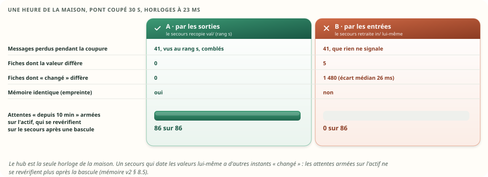

### 6.3 Un seul rang pour tout ce qui est critique

Le séquenceur de l'actif donne `s + 1` à **chaque** sortie critique, quel que soit son sujet : une
valeur, un rapport identique, une santé, un point nouveau, un pas de workflow, un secret, un fichier
métier, une époque. Un abonné qui lit plusieurs filtres reçoit leurs messages entrelacés (le
courtier tient un journal par filtre) : il les remet dans l'ordre de `s`, après une grâce de 200 ms.

Ce seul rang remplace le second rang `j` de la v1 et sa règle de dépendance : « attente armée » (`s`
= 1042) ne peut pas être appliquée avant « porte ouverte » (`s` = 1041), par construction.

Au banc, le hub mêle des exécutions aux valeurs : 582 sur 8 000 sorties dans le cas des coupures. La
mémoire comparée à la fin compte les valeurs, la santé **et** les exécutions.

### 6.4 Le pont maison, à deux bouts

Oui : **le pont est un module de Sarah Home**, pas celui d'un courtier. Les courtiers ne servent que
de transport (QoS 0, session propre) ; tout ce qui demande de la mémoire ou une décision est au
pont.


| Bout | Ce qu'il fait |
|---|---|
| **Actif** | numérote (le séquenceur) ; garde la file des 10 000 dernières sorties, en binaire ; répond aux demandes de tronçons, ou « hors file » ; construit l'état complet à la demande et l'envoie en morceaux ; publie le battement ; lit les accusés |
| **Secours** | s'abonne aux sorties ; les remet dans l'ordre de `s` ; garde ce qui arrive en avance ; voit un trou au rang ou au battement ; demande un tronçon, sinon l'état complet ; le réassemble et l'applique ; publie chaque sortie sur le courtier du secours ; garde sa propre file pour les abonnés locaux ; accuse son rang toutes les 500 ms |

**Les deux machines portent les deux bouts** : c'est le même module, et le mode décide lequel
travaille. Chaque bout a ses tampons : la file et l'état complet côté actif ; la remise en ordre, la
réception de l'état et sa propre file côté secours. À la promotion, le secours passe au bout actif :
sa file contient déjà les dernières sorties, il la sert telle quelle et `s` continue sans rupture ;
l'ancien actif qui revient prend le bout secours, et se comble par cette file, sinon par l'état
complet. Vers le secours distant, c'est le même pont, avec les mêmes tampons des deux côtés du lien
NetBird.

Bloc technique — les sujets (proposés, dans l'arbre de la V7 ; tous en QoS 0 : le pont gère les
pertes) :

```text
moli/v1/val/<appareil>/<point>      hub → tous             valeur, instants, s, i                      critique
moli/v1/vu/<appareil>/<point>       hub → tous             le rapport identique : observé, reçu, s, i  critique
moli/v1/avail/  meta/  evt/         hub → tous             santé, annuaire, occurrences, avec s        critique
moli/v1/wf/<exécution>              moteur → tous          une exécution, une attente, un horaire…, s  critique
moli/v1/conf/<fichier>              cœur → secours         un fichier métier, morceaux de 4 Kio, s     critique
moli/v1/repl/coffre/<secours>       cœur → un secours      un secret scellé pour lui, s                critique
moli/v1/repl/bout                   actif → tous           {"s": …}, toutes les 500 ms (battement)
moli/v1/repl/demande                secours → actif        {"de": s} : un tronçon de la file
moli/v1/repl/troncon/<secours>      actif → secours        en-tête (bout, fin de fenêtre ou « hors file ») + 64 sorties de 46 o
moli/v1/etat/demande                secours → actif        l'état complet
moli/v1/etat/reponse/<secours>      actif → secours        (s0, morceau k sur n) + jusqu'à 4 Kio
moli/v1/repl/accuse/<secours>       secours → actif        {"s": …}, toutes les 500 ms
moli/v1/run/<exécution>             moteur → tous          une ligne du journal d'exécution            historique
moli/v1/hist/ops                    base de l'actif → copies   un lot validé : seq de début et de fin, opérations   historique
moli/v1/hist/demande                copie → base de l'actif    {"de": seq}                             historique
```

Le compte MQTT « secours » lit les sorties et ces sujets ; il n'écrit que `repl/demande`,
`repl/accuse`, `etat/demande` et `hist/demande`. Jamais `in/`, `req/`, `cmd/` ni `res/`.

### 6.5 Un trou : la file, ou l'état complet

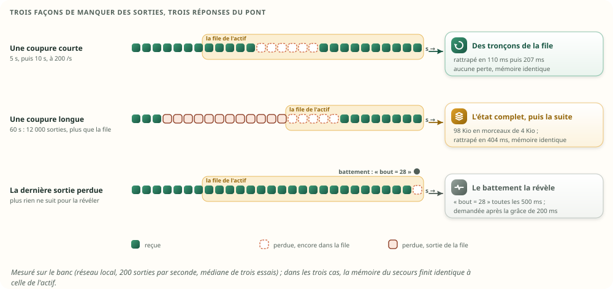

- **Un trou court** : les sorties manquantes sont encore dans la file. Le bout secours demande
  `{"de": s}` ; l'actif répond par une fenêtre de 32 tronçons de 64 sorties (≈ 94 Kio), une à la
  fois, sous le journal du filtre des tronçons : le courtier ne saute jamais une fenêtre.
- **Un trou long** : le rang demandé est sorti de la file. L'actif répond « hors file » ; le bout
  secours demande l'état complet ; l'actif le construit **en mémoire** au rang `s0` et l'envoie en
  morceaux de 4 Kio ; le secours garde ce qui arrive en direct pendant ce temps, applique l'état,
  puis la suite. Au banc : 100 132 octets, 1 état demandé par le pont, 1 par l'abonné local, aucune
  perte.
- **Combien garder ?** Une sortie pèse 46 o en binaire ; l'état complet du banc vaut donc 2 177
  sorties, et l'instantané réel (233 Kio, § 16) environ 5 186. Au-delà de ce nombre de sorties
  manquées, l'état complet coûte **moins** d'octets que les tronçons : une file plus longue que
  10 000 ne servirait à rien. 10 000 sorties, c'est 0,45 Mio de mémoire, 50 s de la pointe de 200
  par seconde, une heure et demie au rythme moyen.

L'état complet et l'instantané sont **le même format** (§ 16.2) : l'un voyage, l'autre s'écrit.

### 6.6 Le battement

Un trou ne se voit qu'à la sortie suivante. Si la dernière se perd et que rien ne suit (la maison
est calme), personne ne le voit. Le banc l'a trouvé : un secours revenu après une absence, l'état
complet pris, n'avait plus aucune sortie pour lui révéler qu'il restait un retard. D'où le
**battement** : toutes les 500 ms, l'actif publie `repl/bout {"s": …}` ; le bout secours fait de
même sur son propre courtier pour ses abonnés. Un bout plus loin que soi est un trou, demandé après
la grâce. Coût : deux messages de quelques octets par seconde.

### 6.7 Les tampons : où ils sont, et pourquoi pas ceux du courtier

**Analyse morphologique** : où garder ce qui passe pendant une coupure ?

| Où | Exemple | Limite | Verdict |
|---|---|---|---|
| La session MQTT du courtier | Mosquitto, `cleansession false`, QoS 1, `max_queued_messages` | bornée, en mémoire, perdue au redémarrage du courtier, **silencieuse** | non : mesuré ci-dessous |
| Un journal sur disque | la v1 | les écritures | non : ta contrainte |
| Un cache dans le pont du courtier | NanoMQ, cache SQLite | un second stockage, sur disque | non |
| **La mémoire de l'actif, par rang**, et l'état complet au-delà | Redis : file de réplication et `PSYNC` | aucune : l'état complet couvre tout retard | **retenu** |

Où sont les tampons du pont maison :

| Tampon | Où | Taille | Ce qu'il fait |
|---|---|---|---|
| La file | mémoire de l'actif | 10 000 sorties, 0,45 Mio | sert les tronçons à tous les secours, chacun à son rang (comme les rangs de lecture de Kafka) |
| L'état complet | construit à la demande | 100 Ko au banc | couvre tout retard, même une semaine |
| La remise en ordre | bout secours | 9 sorties au plus, mesurées | garde ce qui arrive en avance d'un trou |
| La file du secours | mémoire du secours | 10 000 sorties | sert ses abonnés locaux (moteur, base, écrans) |
| Le courtier | transit | 64 Kio × 4 par filtre (V7) | on ne compte jamais sur lui |

Pourquoi pas la session persistante d'un courtier ? Le banc a monté un vrai pont **Mosquitto 2**
(session persistante, QoS 1, persistance coupée comme pour un disque économe) entre deux conteneurs,
et coupé le lien du secours 10 s pendant qu'un éditeur publiait 200 messages par seconde :


| Mosquitto, coupure de 10 s | Perdus | L'abonné le sait-il ? |
|---|---|---|
| File par défaut (`max_queued_messages` = 1 000) | **960** sur 6 000 | non : une ligne au journal du courtier |
| File de 100 000 | 0 | — |
| File de 100 000, courtier de l'actif redémarré pendant la coupure | **2 000** sur 6 000 | non |

Une grande file suffit tant que rien ne redémarre ; un redémarrage la vide, et **rien ne dit au
secours ce qu'il a manqué**. Avec un rang, le trou se voit toujours ; avec l'état complet, il se
comble toujours. C'est pour cela que le pont est le nôtre.

### 6.8 Ce que le banc mesure

Deux courtiers `rumqttd` 0.20 dans un même processus, un relais TCP qui imite le lien, le hub qui
publie à 200 messages par seconde (la pointe des deux maisons est de 239, V7 § 6.2), des exécutions
mêlées aux valeurs. Les deux courtiers, le pont, le relais et la réplique partagent 2 CPU : le 99e
centile mesure surtout cette cohabitation.


| Réseau local, 200 sorties par seconde | Pont de `rumqttd` | **Pont maison** |
|---|---|---|
| Régime : délai de la copie, médiane / 99e centile / pire | — | **2,0 / 35,8 / 56 ms** |
| Deux coupures, 5 s et 10 s : perdus | 3 011 sur 8 000 | **0** |
| … rattrapage après chaque coupure | jamais | **110 et 207 ms**, par la file (3 054 sorties) |
| Une coupure de 60 s (16 000 sorties) : perdus | — | **0**, par l'état complet |
| … rattrapage | — | **404 ms** |
| Mémoire du secours, et de son abonné local, identiques à l'actif (exécutions comprises) | non | **oui, oui** |

### 6.9 Cinq leçons de `rumqttd` pour l'implémentation

Les quatre de la v1, que le banc a rencontrées, et une cinquième :

1. **L'ordre entre deux filtres n'est pas gardé** : tout abonné à plusieurs filtres remet l'ordre
   par `s`, après une grâce de 200 ms ; d'où `s` sur toutes les sorties critiques.
2. **Un abonné local qui a plus de ~1 400 messages de retard saute en avant, sans le savoir** (V7
   § 6.1) : tout abonné local du secours comble par la file du secours, ou par son état complet.
3. **Un lien local mis en pause doit répondre** : le routeur envoie `Unschedule` et ne reprend le
   lien que sur `wake`.
4. **La boucle d'un client MQTT ne s'interrompt jamais** : une reconnexion abandonnée laisse une
   connexion à moitié ouverte, jusqu'à `max_connections`.
5. **Un trou ne se voit qu'à la sortie suivante** : d'où le battement (§ 6.6).

### 6.10 L'empreinte

Un rang égal ne prouve pas une mémoire égale. L'actif publie chaque minute l'**empreinte** de sa
mémoire critique au rang `s` : un CRC-32 par bloc de 256 points, plus un bloc pour la santé des
appareils, plus un bloc pour les exécutions. Le secours calcule la sienne au même rang ; un bloc qui
diffère se recopie seul (une partie de l'état complet). Coût : 30 µs à ×1. Les échéances monotones
n'y entrent pas : elles appartiennent à chaque machine.

## 7. Les workflows par MQTT


### 7.1 L'état : `wf/`, critique

Chaque changement d'état d'une exécution part sur `wf/`, avec son rang `s`, comme une valeur :

| Message `wf/` | Taille | Quand | Source |
|---|---|---|---|
| Une exécution : départ, pas, attente, issue, fin | la fiche de 64 o | à chaque pas | mémoire v2 § 8.4 |
| Une attente de déclencheur à durée | 24 o | à l'armement, au départ | mémoire v2 § 8.5 |
| L'état d'une fiche horaire | 25 o | à chaque occurrence | mémoire v2 § 10.4 |
| Une minuterie | 24 o | à l'armement, à l'arrêt | mémoire v2 § 10.8 |
| Un bail « pendant », une approbation en attente | quelques dizaines d'o | à l'ouverture, à la fin | V7 § 18.2.2 |
| La table d'un agenda | 24 o par événement | à chaque lecture de l'agenda | mémoire v2 § 10.9 |

Le moteur du secours applique `wf/` dans l'ordre de `s` : il tient chaque exécution **au même nœud,
avec la même échéance**, en heure murale, et ne réveille rien. À la bascule, il reprend là où
l'actif en était ; ce qui tombe pendant le bail est « incertain », jamais rejoué (§ 15).

Le moteur d'alarme n'est pas encore câblé (`moli-alarm`, `restore.rs` sans appelant) : quand il le
sera, sa phase et ses minuteries suivront le même chemin.

### 7.2 Le journal d'exécution : `run/`, puis `hist/`

Ta demande : le journal d'exécution, rangé en base, passe aussi par MQTT. Il le fait deux fois, pour
deux usages :

1. **`run/<exécution>`, en direct** : le moteur publie chaque ligne (« pas 2 : la lampe ; issue :
   réussie ») ; les écrans la montrent, la base de l'actif la range. Si une ligne se perd en route
   vers un écran, rien n'est faux : c'est de l'historique.
2. **`hist/ops`, rangé** : la base de l'actif valide ses lots (D13) et donne à chaque opération son
   rang `seq` ; elle publie chaque lot validé. La base d'un secours applique ces lots **par `seq`**,
   sans rien dériver elle-même : mêmes opérations, mêmes rangs, et elle peut reprendre l'export vers
   l'archive après une bascule (§ 9).

Bloc technique — une ligne du journal d'exécution, puis le lot qui la range (proposé) :

```text
moli/v1/run/87          {"x": 87, "pas": 2, "quoi": "lumière salon", "issue": "ok", "t": 1792778523120}
moli/v1/hist/ops        {"de": 418231, "a": 418240, "ops": [ … dix opérations, dont la ligne ci-dessus … ]}
```

Un trou de `seq` chez une copie se redemande (`hist/demande {"de": seq}`) à la base de l'actif, qui
le lit dans son journal d'export (D13, 7 jours) : une lecture, aucune écriture de plus. Le flux
critique n'attend jamais l'historique.

### 7.3 Ce que cela change par rapport à la v1

La v1 envoyait l'état des workflows par un journal de réplication, avec un second rang `j` et une
règle de dépendance (« un enregistrement `j` attend la valeur `s` dont il dépend »). Avec un seul
rang, la règle disparaît : l'ordre est donné par construction. Le journal de réplication sur disque
disparaît avec elle.

## 8. Ce qui ne passe pas par MQTT

| Quoi | Pourquoi pas MQTT | Le chemin | MQTT porte |
|---|---|---|---|
| Flux vidéo et audio (caméras, Frigate, interphone) | continu, des Mbit/s | les caméras restent des appareils : après une bascule, le nouvel actif s'y connecte | l'état de la caméra, ses occurrences (`evt/`) |
| Enregistrements, captures | des Mo par fichier | le NAS, où Frigate écrit déjà | la référence : empreinte, taille, adresse, instant |
| Médias, documents (factures, notices) | des Mo, rarement lus | le NAS, ou une synchronisation de fichiers (`rsync`) | la référence |
| Sauvegardes | des centaines de Mo | `moli-os` les écrit sur le NAS ; le distant peut les tirer | la date et l'empreinte de la dernière |
| L'archive Parquet | des Go | le protocole de l'archive de D13 (lots rejouables, accusés) | l'avancement (`durable_upto`) |
| Micrologiciels | des Mo | téléchargés par le pilote qui les installe | la version |

C'est le *claim check* des intégrations d'entreprise : le message garde une référence, les octets
voyagent par leur propre chemin, et l'empreinte vérifie qu'ils sont les bons. Un fichier métier
n'est pas dans ce tableau : c'est de l'état critique, il passe par MQTT en morceaux (`conf/`).

## 9. Plusieurs stockages

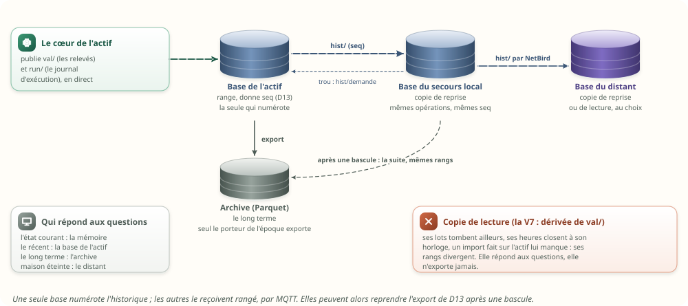

- **L'état courant** n'a pas besoin d'une base pour être copié : il est en mémoire, chez chaque
  copie, au même rang. Sur disque, l'instantané.
- **L'historique ne se dérive pas.** La v1 l'a mesuré : deux bases qui dérivent chacune leur
  historique du même flux numérotent autrement (lots à d'autres instants, heures closes à leur
  propre horloge, imports faits d'un seul côté). Sur une heure, l'actif a 3 827 opérations, le
  secours 3 777, et leurs rangs divergent dès le 1 974e ; après une bascule, l'archive de D13
  refuserait la suite. Une copie qui doit pouvoir reprendre l'export **reçoit les opérations de
  l'actif, avec leur rang** : en v2, par `hist/ops` (§ 7.2). Reprise possible ainsi : oui ; en
  dérivant : non.
- **Une copie de lecture** peut dériver de `val/` (c'était la V7) : elle répond aux questions, elle
  n'exporte jamais.
- **Un stockage déporté** (NAS, VPS) est un abonné de plus, par le même pont, avec le même
  protocole.
- Ne jamais copier un fichier SQLite à chaud : `history.db` se croit alors « sale » et suspend ses
  purges (`moli-history/src/store.rs:648-673`).

| Question | Qui répond |
|---|---|
| L'état courant | la mémoire de l'actif ; d'un secours, à son rang |
| Une courbe récente | la base de l'actif ; à défaut, celle du secours, qui devient l'actif |
| Le long terme | l'archive (D13) |
| La maison est éteinte : « qu'est-ce qui s'est passé hier ? » | le secours distant |

## 10. Les écritures sur disque


Calculé à partir des tailles mesurées au banc, à ×1 (l'instantané, 233 Kio ; les valeurs en JSON
comme `state.json`, 160 Kio) et d'une journée du banc (165 000 sorties) :

| Par jour, à ×1 | fsync | Octets écrits |
|---|---|---|
| v1 : le journal de réplication, validé toutes les 100 ms | jusqu'à 165 000 (864 000 au plafond) | au moins 0,68 Go (un bloc de 4 Kio par fsync) |
| Aujourd'hui : `state.json`, réécrit chaque minute | 2 880 | 236 Mo |
| v2 : l'instantané toutes les 15 min | 192 | 22,9 Mo |
| **v2 : l'instantané toutes les heures** | **48** | **5,7 Mo** |
| v2 : la copie elle-même | **0** | **0** |

Ce qui reste sur le disque, en v2 :

- **l'instantané** : à l'arrêt, avant une mise à jour, et à intervalle fixe ; écrit comme
  aujourd'hui (fichier voisin, `fsync`, renommage, `fsync` du dossier) ;
- **le coffre et les fichiers métier**, à chaque changement, comme aujourd'hui, sur chaque machine
  qui les reçoit : quelques écritures par jour ;
- **la base d'historique**, qui existe déjà ; la v2 ne lui ajoute rien.

**L'instantané peut remplacer `state.json`** : il contient les valeurs, et bien plus. Avec un
secours à jour, la mémoire la plus fraîche est chez lui : une heure suffit. Sans secours, 15 minutes
bornent ce qu'une panne franche ferait perdre (§ 11).

## 11. Sans journal : que perd-on, et comment redémarrer

### 11.1 Inversion : comment perdre une donnée sans journal ?


| Panne | Où est la mémoire | Ce qui est perdu |
|---|---|---|
| L'actif tombe | chez le secours local, à jour | ce qui était en vol : le délai du pont, 36 ms au 99e centile |
| Les deux machines locales tombent | chez le distant | son retard : 58 ms en médiane, à la cadence de la maison |
| Coupure de courant, **avec onduleur** | l'instantané d'arrêt, pris au signal de l'onduleur (NUT) | rien |
| Coupure franche, **sans onduleur ni distant** | le dernier instantané | au plus sa période d'exécutions, d'attentes, d'horaires ; les valeurs, les appareils les redonnent ; une seule alerte le dit |
| Le lien du distant tombe une journée | le distant garde sa mémoire, figée | rien : l'état complet au retour |
| Un actif redémarre vide (§ 11.3) | chez les secours | tout, s'il redevenait actif : **interdit** |

Le seul cas qui coûte est la panne franche de tout, sans onduleur ni distant. Trois parades, au
choix : un onduleur (un petit modèle suffit pour 2 s d'arrêt figé), le secours distant, ou un
instantané plus fréquent.

### 11.2 Redémarrer sans journal

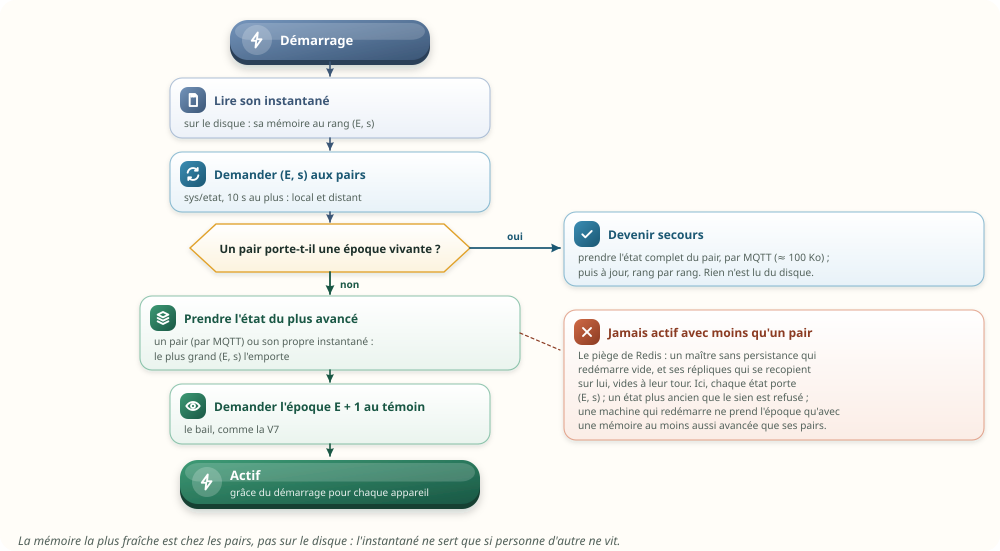

Bloc technique — la reprise (proposée) :

```text
1. lire son instantané : sa mémoire au rang (E, s), et son époque
2. demander (E, s) aux pairs, local et distant (sys/etat), 10 s au plus
3. un pair porte une époque vivante → devenir secours : son état complet par MQTT, puis à jour
4. sinon → prendre l'état du plus avancé : un pair (par MQTT) ou son propre instantané
5. demander l'époque E + 1 au témoin ; le distant ne prend jamais l'époque maison
6. actif : chaque appareil reçoit la grâce du démarrage (mémoire v2 § 6.5)
```

**La mémoire la plus fraîche est chez les pairs, pas sur le disque** : après une panne de l'actif,
le secours a tout ; après une coupure des deux machines locales, le distant aussi. L'instantané ne
sert que si personne d'autre ne vit.

### 11.3 Le piège de Redis

La documentation de Redis décrit ce mode de panne : un maître **sans persistance** redémarre
automatiquement, **vide** ; ses répliques se resynchronisent sur lui et se vident à leur tour. Les
règles qui l'empêchent ici :

- **chaque état porte `(E, s)`** : l'époque et le rang ; une copie refuse un état plus ancien que le
  sien ;
- **une machine qui redémarre commence en reprise**, jamais en actif ; elle ne demande l'époque
  qu'avec une mémoire au moins aussi avancée que celle de tous les pairs qu'elle joint (la règle
  d'élection de Raft) ;
- **le témoin ne donne l'époque qu'une fois le bail expiré**, comme dans la V7 : un actif vivant ne
  se fait jamais remplacer par une machine qui redémarre.

### 11.4 Les règles de la v2 font le reste

Une fois la mémoire reprise, les règles de la mémoire v2 s'appliquent sans une ligne de plus, que
l'arrêt ait duré une minute ou une semaine : les valeurs gardent leurs instants et leur fraîcheur ;
une exécution en retard de plus de 2 min est « interrompue », à l'heure elle reprend ; les heures
tombées pendant l'arrêt partent si elles ont 2 min de retard au plus, sinon une seule alerte les dit
manquées ; un rappel d'agenda part tant que son rendez-vous n'a pas commencé.

## 12. Les intégrations : qui peut tourner deux fois

Inchangé depuis la v1 (§ 7 de la v1) ; en bref :

- **Thread n'a rien à basculer** : un routeur de bordure sur chaque boîtier radio, un même jeu de
  données ; il est actif des deux côtés, nativement (V7 § 18.1). Ce qui n'a qu'un écrivain, c'est le
  coordinateur Zigbee et le contrôleur Matter : attachés à l'époque, avec clôture de l'ancien.
- **Une seule instance active par intégration, toujours ; le secours est prêt, pas branché.** Il a
  déjà les valeurs, par le pont ; un second client userait le compte (rotation, bannissement,
  session chassée), doublerait les effets et les quotas.
- **Pour les API à authentification forte** (les mails) : quand le fournisseur accepte plusieurs
  autorisations pour un compte, **donner au secours la sienne** supprime toute copie de jeton
  tournant (0 échec sur 1 000 au banc) ; sinon, un seul renouveleur.

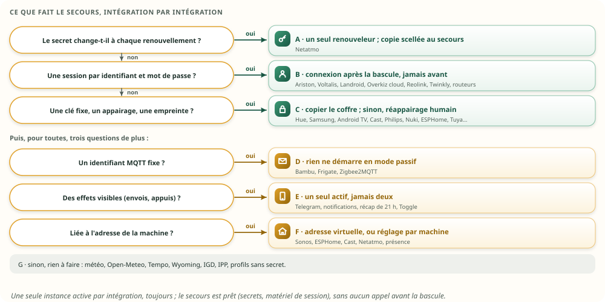

| Famille | Intégrations | Le secours |
|---|---|---|
| **A. Un jeton qui tourne** | Netatmo | le jeton, copié à chaque rotation ; il ne renouvelle qu'après la bascule |
| **B. Une session par identifiant** | Ariston, Voltalis, Landroid, Overkiz (cloud), Reolink, Twinkly, routeurs | les identifiants au coffre ; connexion **après** la prise de l'époque |
| **C. Une clé fixe, un appairage, une empreinte** | Hue, Samsung, Android TV, Cast, Philips, Nuki, Roborock, Tapo, Bambu, ESPHome, Tuya, Sonos… | le coffre, copié à chaque changement |
| **D. Un identifiant MQTT fixe** | Bambu, Frigate, Zigbee2MQTT | rien ne démarre en mode passif |
| **E. Des effets visibles** | Telegram, notifications, récap de 21 h, accueil, `Toggle` | un seul actif |
| **F. Liée à la machine** | Sonos et ESPHome (`media_base`), Netatmo (`public_origin`), Cast, présence | l'adresse virtuelle de l'actif (VRRP), ou un réglage par machine |
| **G. Sans état ni session** | météo, Open-Meteo, Tempo, Wyoming, IGD, IPP | rien |

## 13. Les sessions et les jetons

Décidé le 23 octobre : **au coffre, et en direct au secours** ; « mémoire seule » au cas par cas.
Inchangé depuis la v1, sauf le chemin : le journal de réplication devient un message MQTT
`repl/coffre/<secours>`, dans le rang `s`.


| Le banc, 30 jours, un renouvellement toutes les 3 h | Échecs |
|---|---|
| Les deux machines renouvellent chacune de leur côté | **1 000 sur 1 000** (RFC 9700 § 4.14.2) |
| L'actif seul renouvelle, et copie au secours local | **0 sur 10 000 bascules** |
| Pareil, vers un secours distant hors ligne 1 h par jour | 429 sur 10 000 |
| Une autorisation par machine | 0 sur 1 000 |

Bloc technique — un jeton renouvelé, sur l'actif (proposé) :

```text
1. le fournisseur répond : un nouveau couple (accès, refresh), version n+1
2. le coffre l'écrit (fichier, fsync, renommage, fsync du dossier) — la règle de Netatmo aujourd'hui
3. repl/coffre/<secours> emporte la version n+1, scellée pour chaque secours qui y a droit, rang s
4. le pilote s'en sert
```

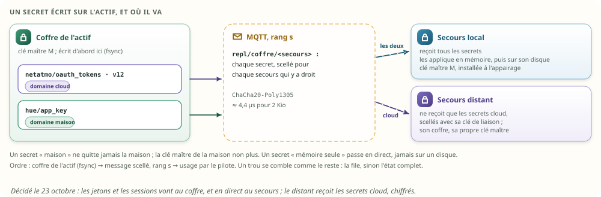

- Chaque écriture du coffre devient un message scellé pour chaque secours qui y a droit ; le secours
  l'applique **dans son coffre en mémoire**, puis sur son disque. Un trou se comble comme le reste :
  la file, sinon l'état complet, dont la section du coffre est **scellée pour celui qui le
  demande**.
- Le secours local partage la clé maître de la maison, installée à l'appairage ; le distant ne
  reçoit que les secrets du domaine cloud, scellés avec sa clé : **la clé maître de la maison ne
  quitte jamais la maison**.
- Un secret « mémoire seule » passe en direct, jamais sur un disque, ni dans un instantané : il
  survit à une bascule, pas à un arrêt des deux machines.
- Sceller un jeton de 2 Kio coûte 4,4 µs (ChaCha20-Poly1305, comme le coffre).
- Les sessions des personnes suivent le coffre ; le secours doit répondre à la même adresse
  (l'adresse virtuelle), sinon chacun se reconnecte.

## 14. Le secours distant

Décidé le 23 octobre : **copie, alerte et cloud**.

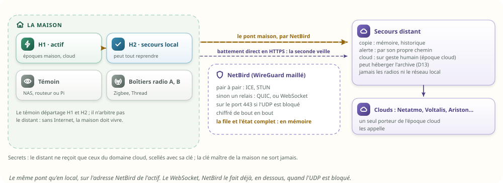

### 14.1 Ce qu'il fait

Il tient la mémoire et l'historique à jour par le même pont ; prévient si la maison se tait, par son
propre chemin ; reprend les intégrations cloud **sur geste humain**, avec l'époque cloud ; peut
héberger l'archive. Il ne reprend jamais les radios ni le réseau local. Il sert surtout quand **la
maison a du courant et Internet, mais plus de cerveau** ; et, sans journal, il devient aussi **la
copie hors site de la mémoire** : après une coupure des deux machines locales, c'est chez lui
qu'elle est la plus fraîche (§ 11.2).

### 14.2 Le lien

**NetBird** (WireGuard maillé) : pair à pair par ICE et STUN ; sinon par un relais, en QUIC ou, si
l'UDP est bloqué, en **WebSocket sur le port 443**, toujours chiffré de bout en bout. Le pont reste
celui du réseau local, vers l'adresse NetBird de l'actif, en TLS. Le WebSocket que tu évoquais,
NetBird le fait déjà, en dessous, quand il le faut. Une sortie `val/` pèse 149 octets sur le lien du
banc ; avec TLS, TCP, IP et WireGuard, environ deux fois plus.

### 14.3 Le tampon, sans disque

Le lien tombera. Une coupure courte se comble par la file ; une longue, par l'état complet. Le
retour après une absence, mesuré :


| Le secours revient après… | Lien | v1 : rejouer le journal | **v2 : l'état complet** |
|---|---|---|---|
| une heure (6 882 sorties) | réseau local | 79 ms | **81 ms** (dans la file) |
| une journée (165 000 sorties) | réseau local | 1,1 s | **0,8 s** |
| une journée | 10 Mbit/s, 40 ms | 13,4 s | **0,7 s** |
| une journée | 1 Mbit/s, 40 ms | 69 s, 7,7 Mo | **1,8 s, 101 Ko** |

En v2, l'essentiel du temps local est la détection (un battement de 500 ms, puis la grâce de
200 ms) : l'état lui-même passe en quelques dizaines de millisecondes. Après une semaine, le coût
serait le même qu'après une journée : l'état complet ne dépend pas de la durée de l'absence.
L'historique manqué se comble ensuite, en arrière-plan, depuis la base de l'actif.

### 14.4 Un lien qui bat

Le lien du banc : 40 ms de délai, 20 ms de gigue, 1 Mbit/s, coupé 3 s toutes les 15 s, pendant que
le hub publie 20 sorties par seconde (dix fois la cadence moyenne de la maison) :

| Lien distant qui bat | Mesuré |
|---|---|
| Sorties perdues | **0** sur 1 500 |
| Reconnexions | 5 |
| Rattrapage après chaque coupure | 324 à 358 ms |
| Délai de la copie, médiane / 99e centile | 55 / 69 ms |
| À la cadence de la maison, sans coupure | 58 / 71 ms |
| Mémoire identique à la fin | oui |

Pour un lien vraiment instable : une reconnexion à attente croissante (1 s à 5 min, avec gigue,
comme le client de l'archive de D13), et l'alerte de retard, à partir du rang accusé.

### 14.5 Le cloud repris par le distant

Sur un geste humain seulement, quand **ses deux veilles** se taisent : le pont (par NetBird) et un
battement direct en HTTPS vers son adresse publique ; si une seule se tait, c'est le lien, pas la
maison. L'époque cloud passe au distant ; la maison qui revient ne relance pas le cloud avant
d'avoir lu l'époque cloud chez lui ; rendre la main est un geste, lui aussi. Un distant hors ligne
pendant une rotation de jeton n'a pas le dernier : 4,3 % d'échecs pour un distant absent 1 h par
jour ; parades : l'alerte de retard, une autorisation propre au distant, sinon la réautorisation
humaine.

## 15. La bascule : l'époque, le témoin, l'incertain

Inchangé depuis la v1 : une époque, un bail renouvelé chaque seconde auprès d'un témoin, la
rétrogradation de l'actif à 2 s, l'époque suivante accordée au secours après les 3 s du bail, la
clôture de l'ancien (V7 § 18). Deux domaines, **maison** et **cloud** : le secours local prend les
deux, le distant seulement le cloud, sur geste humain.

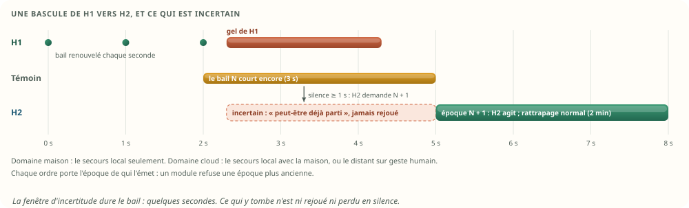

Chaque `cmd/` porte l'époque de qui l'a émis ; un module garde la plus grande vue et refuse un ordre
plus ancien : le **jeton de clôture** des systèmes distribués.


| Ce qui était en cours à la bascule | Après |
|---|---|
| Un ordre envoyé, sans issue | « incertain » (V7 § 20.7) ; jamais renvoyé |
| Une heure ou un rappel dû entre la dernière sortie reçue et la fin du bail | ni rejoué ni perdu en silence : « peut-être déjà parti », une alerte |
| Une heure due après la fin du bail | rattrapée normalement (2 min) |
| Une exécution qui attendait | reprise au même nœud, avec la même échéance |

Le pont va toujours du porteur de l'époque vers les autres, jamais dans les deux sens : aucune
boucle. L'ancien actif qui revient apprend l'époque suivante, redevient secours et prend l'état du
nouvel actif.

## 16. L'arrêt figé

### 16.1 La procédure

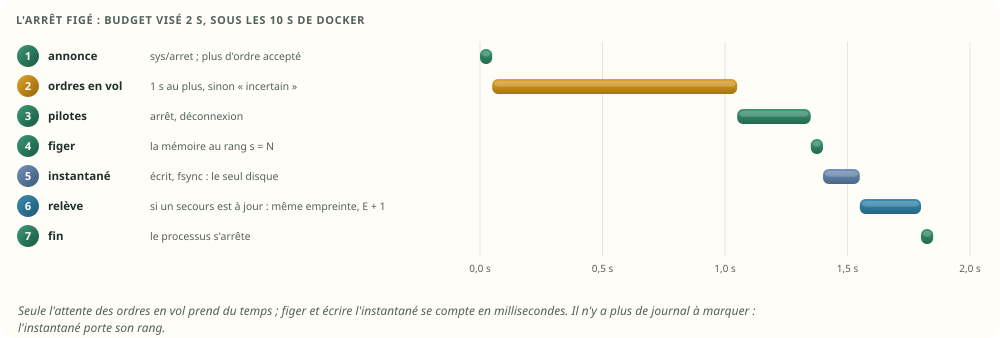

Bloc technique — l'arrêt figé (proposé ; budget visé : 2 s, sous les 10 s de Docker) :

```text
1. sys/arret publié : les écrans le montrent ; toute nouvelle demande d'ordre est refusée
2. les ordres en vol ont 1 s pour aboutir ; au-delà, leur issue est « incertaine » (V7 § 20.7)
3. les pilotes s'arrêtent, dans l'ordre inverse du démarrage, avec déconnexion quand le protocole en a une
4. le hub vide in/, puis la mémoire se fige au rang s = N
5. l'instantané est écrit : toute la mémoire au rang N, échéances en heure murale, sans aucun secret
6. relève : si un secours est à jour, il confirme N et la même empreinte ; le témoin lui donne E + 1
7. fin du processus
```

Il n'y a plus de « marque d'arrêt propre » à écrire dans un journal : l'instantané porte son rang et
sa raison.

### 16.2 Le format, et ce que le banc mesure

L'instantané est **l'état complet, écrit** : un en-tête (`SHI1`, version, raison, rang, époque,
instant mural, version du programme, empreinte de l'annuaire, CRC) puis des sections (annuaire,
valeurs, santé, échéances en heure murale, exécutions, attentes, horaires, minuteries, agendas,
aides). Une version plus récente lit les anciennes, jamais l'inverse ; un instantané abîmé ou
tronqué est refusé.

| Instantané d'arrêt | ×1 | ×10 |
|---|---|---|
| Taille | 233 Kio | 2,3 Mio |
| Compressé (LZ4) | 102 Kio | 1 002 Kio |
| Figer (construire les octets) | 132 µs | 1,2 ms |
| Écrire, avec `fsync` | 3,0 ms | 10,8 ms |
| Relire, vérifier, reprendre sur une horloge neuve | 272 µs | 2,5 ms |
| Mémoire reprise identique | oui | oui |
| Pour comparer : les seules valeurs, en JSON comme `state.json` | 160 Kio | 1 612 Kio |

Écarté, comme en v1 : figer le processus entier (CRIU) ; ses connexions ne valent plus rien quelques
minutes plus tard, il exige les droits root, et son image est liée au binaire exact.

## 17. Les tests

Les 19 tests de la V7 restent. Ceux-ci s'ajoutent ; ceux marqués « banc » passent déjà sur le banc,
les autres sont à écrire avec l'implémentation.

| # | Scénario | Réussi si | État |
|---|---|---|---|
| 20 | Le secours recopie une heure de la maison, pont coupé 30 s | empreinte identique ; toutes les attentes armées sur l'actif se revérifient | banc |
| 21 | Deux coupures du pont local, de 5 s et 10 s, exécutions mêlées aux valeurs | aucune perte ; rattrapage sous la seconde par la file ; mémoire identique, exécutions comprises | banc |
| 22 | Une coupure de 60 s, plus longue que la file | « hors file », l'état complet, puis la suite ; aucune perte ; le secours et sa réplique identiques à l'actif | banc |
| 23 | Le pont de `rumqttd`, sous les coupures (contre-épreuve) | il perd ce qui passe pendant les coupures : le test sait échouer | banc |
| 24 | Un pont Mosquitto : file par défaut, puis courtier redémarré (contre-épreuve) | il perd au-delà de sa file, et tout au redémarrage, sans prévenir l'abonné | banc (Mosquitto) |
| 25 | Lien distant de 40 ± 20 ms à 1 Mbit/s, coupé 3 s toutes les 15 s | aucune perte ; mémoire identique | banc |
| 26 | Le secours revient après une journée d'absence | l'état complet, en moins de 3 s à 1 Mbit/s ; mémoire identique | banc |
| 27 | Une copie a manqué la fin, et plus rien ne suit | le battement révèle le retard ; il est comblé | banc |
| 28 | Un abonné local du secours prend plus de 1 400 messages de retard | il comble par la file du secours, sinon par son état complet ; il répond à `Unschedule` | banc |
| 29 | Deux filtres entrelacés par le courtier | aucun tronçon demandé pendant la grâce de 200 ms ; l'ordre de `s` rétabli | banc |
| 30 | Un état complet plus ancien que la mémoire déjà reçue | refusé | à écrire |
| 31 | Une machine redémarre vide pendant qu'un pair porte l'époque | elle devient secours et prend l'état du pair ; jamais actif | à écrire |
| 32 | Coupure de courant des deux machines locales, distant à jour | reprise depuis l'état du distant ; rien de perdu au-delà de son retard | à écrire |
| 33 | Coupure franche, sans onduleur ni distant | reprise du dernier instantané ; une seule alerte pour ce qui manque | à écrire |
| 34 | Un trou dans l'historique (`seq`) d'une copie | comblé depuis la base de l'actif, sans retenir le flux critique | à écrire |
| 35 | Deux machines renouvellent le même jeton qui tourne (contre-épreuve) | révocation ; avec un seul renouveleur, aucune | banc |
| 36 | SIGTERM | instantané pris en moins de 2 s ; reprise sans rien rejouer ; exécutions reprises à l'heure | à écrire (format : banc) |
| 37 | Instantané abîmé, tronqué ou d'une version future | refusé ; reprise par un pair, sinon à froid | banc |
| 38 | Relève planifiée | le secours prend l'époque avec la même empreinte ; aucune valeur perdue | à écrire |
| 39 | Après une promotion, l'ancien actif revient | il prend le bout secours et se comble par la file du nouvel actif, sinon par son état complet ; `s` continue sans rupture | à écrire |
| 40 | Bascule pendant un renouvellement Netatmo | le secours a le nouveau jeton, ou une réautorisation est demandée ; jamais une révocation | à écrire |
| 41 | Le distant est promu pour le cloud, puis la maison revient | elle ne relance pas le cloud avant d'avoir lu l'époque cloud | à écrire |
| 42 | Une seconde instance lancée par erreur | verrou : elle refuse de démarrer ; en passif, aucun pilote ni identifiant MQTT en double | à écrire |
| 43 | L'export vers l'archive reprend après une bascule | l'archive accepte la suite : mêmes rangs, mêmes octets | banc (modèle) |
| 44 | Le compte « secours » publie sur `cmd/` ou s'abonne à `in/` | refusé par l'ACL du courtier | à écrire |
| 45 | Une heure fixe tombe pendant la bascule | partie une fois, ou notée « peut-être déjà partie » ; jamais deux fois | à écrire |
| 46 | Un ordre d'une époque ancienne arrive à un module | refusé | à écrire |

## 18. Les choix

Décidé ici, parce que la mesure, le code ou une décision antérieure le tranche :

| Sujet | Décision | Pourquoi |
|---|---|---|
| Ce que le secours recopie | les sorties de l'actif, jamais les entrées | mesuré (§ 6.2) |
| Le rang | un seul, `s`, pour toutes les sorties critiques, workflows compris | § 6.3, § 7 |
| Le tampon | une file en mémoire de 10 000 sorties ; au-delà, l'état complet par MQTT | mesuré (§ 6.5, § 14.3) ; au-delà de ~2 000 à 5 000 sorties, l'état coûte moins |
| Le pont | un module de Sarah Home, à deux bouts ; les courtiers transportent en QoS 0 | mesuré : `rumqttd` et Mosquitto perdent (§ 6.7) |
| Le battement | `repl/bout` toutes les 500 ms | trouvé au banc (§ 6.6) |
| Les classes | critique (rang `s`), historique (rang `seq`), hors MQTT (une référence) | § 3 |
| Le journal d'exécution | `run/` en direct, puis `hist/ops` rangé par la base de l'actif | ta demande ; D13 (§ 7.2) |
| L'historique du secours | une copie de reprise applique `hist/ops` par `seq` ; une copie de lecture peut dériver | mesuré (§ 9) |
| Le disque | l'instantané seulement ; aucun journal de réplication | § 10 |
| Le redémarrage | la mémoire d'un pair d'abord ; le plus avancé l'emporte ; jamais actif vide | Redis, Raft (§ 11) |
| Les intégrations, les jetons, le coffre, NetBird, les époques, l'arrêt | comme la v1 | § 12 à 16 |

Décidé par toi le 23 octobre :

| Question | Ta réponse | Ce qui en découle |
|---|---|---|
| Un secours distant, que doit-il pouvoir faire ? | **Copie, alerte et cloud** | l'époque cloud ; les secrets `cloud` scellés pour lui ; reprise sur geste humain ; jamais les radios |
| Où ranger par défaut les jetons et les sessions ? | **Au coffre, et en direct au secours** | `repl/coffre/<secours>` dans le rang `s` ; « mémoire seule » au cas par cas |
| Un journal sur disque ? | **Non** | la file en mémoire, l'état complet, le battement ; la durabilité par les autres machines |
| Le pont ? | **Fait maison, il gère les tampons** | § 6.4 à 6.7 |

À trancher :

| Question | Recommandation |
|---|---|
| La période de l'instantané | 1 h avec un secours à jour ; 15 min sans |
| Un onduleur pour les machines locales ? | oui : c'est la parade la moins chère à la panne de tout, et l'arrêt figé tient en 2 s |
| L'instantané remplace-t-il `state.json` ? | oui : il contient les valeurs et le reste, et il écrit beaucoup moins (§ 10) |
| La taille de la file | 10 000 sorties ; plus ne servirait à rien (§ 6.5) |
| Quel appareil sert de témoin ? | un appareil toujours allumé, hors des deux domaines de panne (NAS, routeur, Pi) |
| Pour quels fournisseurs donner au secours sa propre autorisation ? | ceux qui l'acceptent sans limite gênante : à vérifier compte par compte |
| La promotion du secours local devient-elle automatique ? | après les tests 2, 7, 8 et 9 de la V7 sur le matériel réel, comme la V7 le prévoit |

## 19. Ce que la v2 changerait dans la V7 et la mémoire v2

Si elle est retenue ; rien n'est modifié dans ces documents aujourd'hui.

| Document, section | Changement |
|---|---|
| V7 § 6.4 (configuration du courtier) | le compte « secours » écrit `repl/demande`, `repl/accuse`, `etat/demande`, `hist/demande` ; des segments propres aux tronçons et à l'état complet (1 Mio × 4) |
| V7 § 7.1 et § 7.3 (sujets, charge) | `s` sur toutes les sorties critiques, `wf/` compris ; `vu/` ; `conf/` ; l'arbre `repl/` et `etat/` ; `run/` et `hist/` |
| V7 § 10.3 (les trous) | un abonné qui lit plusieurs filtres remet l'ordre par `s`, après une grâce ; il comble par la file, sinon par l'état complet ; le battement |
| V7 § 12.3 (la base) | la copie de reprise applique `hist/ops` par `seq` |
| V7 § 18.2.2 (la secours) | le pont maison à deux bouts ; plus de journal de réplication |
| V7 § 20.6 (journal, instantané, époque) | plus de journal ; l'instantané est l'état complet écrit ; `(E, s)` sur chaque état ; deux domaines d'époque |
| Mémoire v2 § 6.5 (deux horloges) | tout ce qui quitte une machine est en heure murale |
| Mémoire v2 § 11 (redémarrage) | la mémoire d'un pair d'abord ; l'instantané ensuite |

## 20. Le plan

Chaque marche est utile seule, dans l'ordre :

1. **Le mode passif et le verrou d'instance** (§ 5) : utile dès aujourd'hui.
2. **L'instantané à la place de `state.json`, et l'arrêt figé** (§ 10, § 16) : moins d'écritures, et
   des mises à jour sans rien perdre, avec ou sans secours.
3. **Les secrets au coffre, et le coffre complet dans la sauvegarde** (v1 § 8.7).
4. **Le séquenceur : `s` sur toutes les sorties critiques, `wf/` compris** (§ 6.3, § 7).
5. **Le pont maison** : la file, les tronçons, l'état complet, le battement, sur le réseau local,
   avec les cinq leçons de `rumqttd` (§ 6).
6. **L'époque, le témoin, l'époque dans `cmd/`** (V7 § 18, § 15), puis les radios.
7. **La reprise par les pairs** (§ 11).
8. **Le coffre répliqué et les jetons** (§ 13).
9. **L'historique : `run/`, `hist/ops`, la copie de reprise** (§ 7.2, § 9).
10. **Le secours distant** : NetBird, l'époque cloud, les deux veilles, l'alerte (§ 14).

## Annexe A — Le banc

### A.1 Comment il a été joué

- **Où** : `tools/haute-dispo-banc/`, crate hors workspace. Il reprend tels quels, par inclusion de
  fichiers, la maison, la mémoire des valeurs et les outils du banc mémoire : la réplique tient
  exactement la mémoire de la v2, plus les cases d'exécution du moteur.
- **Le courtier** : `rumqttd` 0.20.0, réglé comme la V7 (64 Kio × 4 par filtre ; 1 Mio × 4 pour les
  tronçons et l'état complet). Le bout secours du pont est un client `rumqttc` 0.25 ; le bout actif,
  un lien en mémoire.
- **Le lien** : un relais TCP qui coupe, retarde, ajoute une gigue et limite le débit.
- **Mosquitto** : deux courtiers `eclipse-mosquitto:2` (Mosquitto 2.1.2) sur un réseau Docker ; le
  secours tire `moli/v1/#` en QoS 1, session persistante ; persistance coupée ; le lien du secours
  est coupé par `docker network disconnect`. Essai unique par cas : `sh
  tools/haute-dispo-banc/scripts/mosquitto.sh`.
- **La série** : Linux musl (`rust:1-alpine`), chaque mesure dans trois conteneurs neufs de 2 CPU et
  128 Mio, sans échange ; la médiane des trois, et le pire des trois pour un pire cas. 15 tests
  passent dans le conteneur de compilation. Rejouer : `sh tools/haute-dispo-banc/scripts/linux.sh`
  (environ 30 min).

### A.2 Les limites

- Les deux courtiers partagent un processus et une machine : le délai local mesure le logiciel, pas
  un réseau.
- La machine de mesure est un Apple M4 partagé ; un Pi sera plusieurs fois plus lent. Les rapports
  tiennent ; les valeurs absolues sont à refaire sur la carte.
- L'état complet du banc porte les valeurs, la santé et les exécutions ; le vrai porte aussi
  l'annuaire, les attentes, les horaires et les agendas (la taille de l'instantané, § 16.2).
- Le banc des jetons simule un fournisseur qui suit la RFC 9700 ; le comportement réel de chaque
  fournisseur est à vérifier sur un compte.
- Les bascules elles-mêmes (époque, témoin, radios) ont été jouées par la V4 et sont spécifiées par
  la V7 ; ce banc ne les rejoue pas.
- `fsync` : mesuré sur le disque du conteneur ; une carte SD est plus lente. Les écritures par jour
  (§ 10) sont calculées, pas mesurées sur la carte.

### A.3 Les résultats bruts

Sortie brute — `copie-x1.txt` :

```text
RESULTAT|copie|1|sorties_heure|6882.000|messages
RESULTAT|copie|1|vu_heure|3115.000|messages
RESULTAT|copie|1|octets_mqtt_heure|822083.000|o
RESULTAT|copie|1|octets_mqtt_jour|19729992.000|o
RESULTAT|copie|1|octets_journal_jour|7597728.000|o
RESULTAT|copie|1|a_perdues_au_pont|41.000|messages
RESULTAT|copie|1|a_trous_combles|1.000|trous
RESULTAT|copie|1|a_identique|1.000|booléen
RESULTAT|copie|1|a_fiches_differentes|0.000|fiches
RESULTAT|copie|1|b_perdues|41.000|messages
RESULTAT|copie|1|b_valeur_differente|5.000|fiches
RESULTAT|copie|1|b_change_different|1480.000|fiches
RESULTAT|copie|1|b_autre_different|150.000|fiches
RESULTAT|copie|1|b_ecart_change_ms_median|26.000|ms
RESULTAT|copie|1|b_faux_changements|3.000|fiches
RESULTAT|copie|1|attentes|86.000|attentes
RESULTAT|copie|1|a_attentes_tenues|86.000|attentes
RESULTAT|copie|1|b_attentes_tenues|0.000|attentes
RESULTAT|copie|1|appliquer_une_sortie|39.475|ns
RESULTAT|copie|1|ecrire_et_relire_une_charge|100.831|ns
RESULTAT|copie|1|empreinte|29.917|µs
RESULTAT|copie|1|empreinte_blocs|10.000|blocs
RESULTAT|copie|1|rss_fin|1356.000|Kio
CONTENEUR|false|0
CONTENEUR|false|0
CONTENEUR|false|0
```

Sortie brute — `copie-x10.txt` :

```text
RESULTAT|copie|10|sorties_heure|65246.000|messages
RESULTAT|copie|10|vu_heure|29372.000|messages
RESULTAT|copie|10|octets_mqtt_heure|8004681.000|o
RESULTAT|copie|10|octets_mqtt_jour|192112344.000|o
RESULTAT|copie|10|octets_journal_jour|72031584.000|o
RESULTAT|copie|10|a_perdues_au_pont|535.000|messages
RESULTAT|copie|10|a_trous_combles|1.000|trous
RESULTAT|copie|10|a_identique|1.000|booléen
RESULTAT|copie|10|a_fiches_differentes|0.000|fiches
RESULTAT|copie|10|b_perdues|535.000|messages
RESULTAT|copie|10|b_valeur_differente|74.000|fiches
RESULTAT|copie|10|b_change_different|14332.000|fiches
RESULTAT|copie|10|b_autre_different|1596.000|fiches
RESULTAT|copie|10|b_ecart_change_ms_median|27.000|ms
RESULTAT|copie|10|b_faux_changements|45.000|fiches
RESULTAT|copie|10|attentes|839.000|attentes
RESULTAT|copie|10|a_attentes_tenues|839.000|attentes
RESULTAT|copie|10|b_attentes_tenues|0.000|attentes
RESULTAT|copie|10|appliquer_une_sortie|41.662|ns
RESULTAT|copie|10|ecrire_et_relire_une_charge|100.869|ns
RESULTAT|copie|10|empreinte|283.042|µs
RESULTAT|copie|10|empreinte_blocs|90.000|blocs
RESULTAT|copie|10|rss_fin|1412.000|Kio
CONTENEUR|false|0
CONTENEUR|false|0
CONTENEUR|false|0
```

Sortie brute — `distant-x1.txt` :

```text
RESULTAT|distant|1|flappant_messages|1500.000|messages
RESULTAT|distant|1|flappant_executions|143.000|messages
RESULTAT|distant|1|flappant_appliques|1500.000|messages
RESULTAT|distant|1|flappant_perdus|0.000|messages
RESULTAT|distant|1|flappant_identique|1.000|booléen
RESULTAT|distant|1|flappant_memoire_secours_identique|1.000|booléen
RESULTAT|distant|1|flappant_lat_p50|54.659|ms
RESULTAT|distant|1|flappant_lat_p99|68.975|ms
RESULTAT|distant|1|flappant_lat_max|3261.566|ms
RESULTAT|distant|1|flappant_via_file|265.000|messages
RESULTAT|distant|1|flappant_etats_pont|0.000|états
RESULTAT|distant|1|flappant_etats_locaux|0.000|états
RESULTAT|distant|1|flappant_octets_etat|0.000|o
RESULTAT|distant|1|flappant_demandes_pont|5.000|demandes
RESULTAT|distant|1|flappant_demandes_locales|0.000|demandes
RESULTAT|distant|1|flappant_connexions|5.000|connexions
RESULTAT|distant|1|flappant_rattrapage_1|323.846|ms
RESULTAT|distant|1|flappant_rattrapage_2|335.875|ms
RESULTAT|distant|1|flappant_rattrapage_3|349.280|ms
RESULTAT|distant|1|flappant_rattrapage_4|308.361|ms
RESULTAT|distant|1|flappant_rattrapage_max|358.456|ms
RESULTAT|distant|1|flappant_duree|77.010|s
RESULTAT|distant|1|flappant_octets_retour|164651.000|o
RESULTAT|distant|1|flappant_octets_aller|6520.000|o
RESULTAT|distant|1|flappant_octets_par_message|109.767|o
RESULTAT|distant|1|flappant_ecritures_retour|1358.000|écritures
RESULTAT|distant|1|flappant_tampon_max|0.000|messages
RESULTAT|distant|1|flappant_pauses_routeur|0.000|pauses
RESULTAT|distant|1|cadence_maison_messages|120.000|messages
RESULTAT|distant|1|cadence_maison_executions|14.000|messages
RESULTAT|distant|1|cadence_maison_appliques|120.000|messages
RESULTAT|distant|1|cadence_maison_perdus|0.000|messages
RESULTAT|distant|1|cadence_maison_identique|1.000|booléen
RESULTAT|distant|1|cadence_maison_memoire_secours_identique|1.000|booléen
RESULTAT|distant|1|cadence_maison_lat_p50|57.659|ms
RESULTAT|distant|1|cadence_maison_lat_p99|71.408|ms
RESULTAT|distant|1|cadence_maison_lat_max|73.586|ms
RESULTAT|distant|1|cadence_maison_via_file|0.000|messages
RESULTAT|distant|1|cadence_maison_etats_pont|0.000|états
RESULTAT|distant|1|cadence_maison_etats_locaux|0.000|états
RESULTAT|distant|1|cadence_maison_octets_etat|0.000|o
RESULTAT|distant|1|cadence_maison_demandes_pont|1.000|demandes
RESULTAT|distant|1|cadence_maison_demandes_locales|0.000|demandes
RESULTAT|distant|1|cadence_maison_connexions|1.000|connexions
RESULTAT|distant|1|cadence_maison_rattrapage_max|0.000|ms
RESULTAT|distant|1|cadence_maison_duree|61.567|s
RESULTAT|distant|1|cadence_maison_octets_retour|17880.000|o
RESULTAT|distant|1|cadence_maison_octets_aller|4479.000|o
RESULTAT|distant|1|cadence_maison_octets_par_message|149.000|o
RESULTAT|distant|1|cadence_maison_ecritures_retour|253.000|écritures
RESULTAT|distant|1|cadence_maison_tampon_max|0.000|messages
RESULTAT|distant|1|cadence_maison_pauses_routeur|0.000|pauses
RESULTAT|distant|1|rss_fin|7168.000|Kio
CONTENEUR|false|0
CONTENEUR|false|0
CONTENEUR|false|0
```

Sortie brute — `instantane-x1.txt` :

```text
RESULTAT|instantane|1|octets|238562.000|o
RESULTAT|instantane|1|octets_annuaire|92808.000|o
RESULTAT|instantane|1|octets_valeurs|86032.000|o
RESULTAT|instantane|1|octets_executions|25600.000|o
RESULTAT|instantane|1|octets_horaires|10000.000|o
RESULTAT|instantane|1|figer|131.501|µs
RESULTAT|instantane|1|ecrire_fsync|2.961|ms
RESULTAT|instantane|1|relire_et_reprendre|272.251|µs
RESULTAT|instantane|1|repris_identique|1.000|booléen
RESULTAT|instantane|1|octets_lz4|104336.000|o
RESULTAT|instantane|1|octets_json_valeurs_aujourdhui|163597.000|o
RESULTAT|instantane|1|json_valeurs_ecrire_fsync|2.394|ms
RESULTAT|instantane|1|rss_fin|1488.000|Kio
CONTENEUR|false|0
CONTENEUR|false|0
CONTENEUR|false|0
```

Sortie brute — `instantane-x10.txt` :

```text
RESULTAT|instantane|10|octets|2403042.000|o
RESULTAT|instantane|10|octets_annuaire|946888.000|o
RESULTAT|instantane|10|octets_valeurs|860320.000|o
RESULTAT|instantane|10|octets_executions|256000.000|o
RESULTAT|instantane|10|octets_horaires|100000.000|o
RESULTAT|instantane|10|figer|1191.671|µs
RESULTAT|instantane|10|ecrire_fsync|10.780|ms
RESULTAT|instantane|10|relire_et_reprendre|2483.760|µs
RESULTAT|instantane|10|repris_identique|1.000|booléen
RESULTAT|instantane|10|octets_lz4|1026233.000|o
RESULTAT|instantane|10|octets_json_valeurs_aujourdhui|1650361.000|o
RESULTAT|instantane|10|json_valeurs_ecrire_fsync|5.740|ms
RESULTAT|instantane|10|rss_fin|1556.000|Kio
CONTENEUR|false|0
CONTENEUR|false|0
CONTENEUR|false|0
```

Sortie brute — `jetons-x1.txt` :

```text
RESULTAT|jetons|1|a_deux_renouveleurs_revoques|1000.000|sur 1 000
RESULTAT|jetons|1|a_jours_avant_revocation_max|0.250|jours
RESULTAT|jetons|1|b_local_echecs|0.000|sur 10 000 bascules
RESULTAT|jetons|1|c_distant_hors_ligne_1h_jour_echecs|429.000|sur 10 000 bascules
RESULTAT|jetons|1|d_par_machine_echecs|0.000|sur 1 000
RESULTAT|jetons|1|sceller_2kio|4.433|µs
RESULTAT|jetons|1|ouvrir_2kio|4.301|µs
RESULTAT|jetons|1|octets_scelles_2kio|2064.000|o
RESULTAT|jetons|1|rss_fin|1040.000|Kio
CONTENEUR|false|0
CONTENEUR|false|0
CONTENEUR|false|0
```

Sortie brute — `machine.txt` :

```text
machine : Apple M4
docker : 29.2.1 · 4 CPU · 8309014528 o
conteneurs : 2 CPU, 128 Mio sans échange, trois essais par mesure (médiane ; le pire pour _max)
charge à la fin de la série : 5.68 5.39 5.46
```

Sortie brute — `mosquitto.txt` :

```text
mosquitto : version 2.1.2
RESULTAT|mosquitto|1|file_defaut_file|1000|messages
RESULTAT|mosquitto|1|file_defaut_publies|6000|messages
RESULTAT|mosquitto|1|file_defaut_recus|5040|messages
RESULTAT|mosquitto|1|file_defaut_perdus|960|messages
RESULTAT|mosquitto|1|file_defaut_doublons|0|messages
RESULTAT|mosquitto|1|file_defaut_alertes_courtier|1|lignes
RESULTAT|mosquitto|1|grande_file_file|100000|messages
RESULTAT|mosquitto|1|grande_file_publies|6000|messages
RESULTAT|mosquitto|1|grande_file_recus|6000|messages
RESULTAT|mosquitto|1|grande_file_perdus|0|messages
RESULTAT|mosquitto|1|grande_file_doublons|0|messages
RESULTAT|mosquitto|1|grande_file_alertes_courtier|0|lignes
RESULTAT|mosquitto|1|redemarrage_file|100000|messages
RESULTAT|mosquitto|1|redemarrage_publies|6000|messages
RESULTAT|mosquitto|1|redemarrage_recus|4000|messages
RESULTAT|mosquitto|1|redemarrage_perdus|2000|messages
RESULTAT|mosquitto|1|redemarrage_doublons|0|messages
RESULTAT|mosquitto|1|redemarrage_alertes_courtier|0|lignes
```

Sortie brute — `pont-x1.txt` :

```text
RESULTAT|pont|1|regime_messages|6000.000|messages
RESULTAT|pont|1|regime_executions|476.000|messages
RESULTAT|pont|1|regime_appliques|6000.000|messages
RESULTAT|pont|1|regime_perdus|0.000|messages
RESULTAT|pont|1|regime_identique|1.000|booléen
RESULTAT|pont|1|regime_memoire_secours_identique|1.000|booléen
RESULTAT|pont|1|regime_lat_p50|1.968|ms
RESULTAT|pont|1|regime_lat_p99|35.815|ms
RESULTAT|pont|1|regime_lat_max|55.516|ms
RESULTAT|pont|1|regime_via_file|0.000|messages
RESULTAT|pont|1|regime_etats_pont|0.000|états
RESULTAT|pont|1|regime_etats_locaux|0.000|états
RESULTAT|pont|1|regime_octets_etat|0.000|o
RESULTAT|pont|1|regime_demandes_pont|1.000|demandes
RESULTAT|pont|1|regime_demandes_locales|0.000|demandes
RESULTAT|pont|1|regime_connexions|1.000|connexions
RESULTAT|pont|1|regime_rattrapage_max|0.000|ms
RESULTAT|pont|1|regime_duree|32.000|s
RESULTAT|pont|1|regime_octets_retour|712517.000|o
RESULTAT|pont|1|regime_octets_aller|2527.000|o
RESULTAT|pont|1|regime_octets_par_message|118.753|o
RESULTAT|pont|1|regime_ecritures_retour|5635.000|écritures
RESULTAT|pont|1|regime_tampon_max|3.000|messages
RESULTAT|pont|1|regime_pauses_routeur|0.000|pauses
RESULTAT|pont|1|coupures_messages|8000.000|messages
RESULTAT|pont|1|coupures_executions|582.000|messages
RESULTAT|pont|1|coupures_appliques|8000.000|messages
RESULTAT|pont|1|coupures_perdus|0.000|messages
RESULTAT|pont|1|coupures_identique|1.000|booléen
RESULTAT|pont|1|coupures_memoire_secours_identique|1.000|booléen
RESULTAT|pont|1|coupures_lat_p50|1.963|ms
RESULTAT|pont|1|coupures_lat_p99|35.324|ms
RESULTAT|pont|1|coupures_lat_max|54.854|ms
RESULTAT|pont|1|coupures_via_file|3054.000|messages
RESULTAT|pont|1|coupures_etats_pont|0.000|états
RESULTAT|pont|1|coupures_etats_locaux|0.000|états
RESULTAT|pont|1|coupures_octets_etat|0.000|o
RESULTAT|pont|1|coupures_demandes_pont|3.000|demandes
RESULTAT|pont|1|coupures_demandes_locales|0.000|demandes
RESULTAT|pont|1|coupures_connexions|3.000|connexions
RESULTAT|pont|1|coupures_rattrapage_1|109.612|ms
RESULTAT|pont|1|coupures_rattrapage_2|206.599|ms
RESULTAT|pont|1|coupures_rattrapage_max|210.133|ms
RESULTAT|pont|1|coupures_duree|41.998|s
RESULTAT|pont|1|coupures_octets_retour|731218.000|o
RESULTAT|pont|1|coupures_octets_aller|3617.000|o
RESULTAT|pont|1|coupures_octets_par_message|91.402|o
RESULTAT|pont|1|coupures_ecritures_retour|4678.000|écritures
RESULTAT|pont|1|coupures_tampon_max|3.000|messages
RESULTAT|pont|1|coupures_pauses_routeur|13.000|pauses
RESULTAT|pont|1|longue_messages|16000.000|messages
RESULTAT|pont|1|longue_executions|1154.000|messages
RESULTAT|pont|1|longue_appliques|16000.000|messages
RESULTAT|pont|1|longue_perdus|0.000|messages
RESULTAT|pont|1|longue_identique|1.000|booléen
RESULTAT|pont|1|longue_memoire_secours_identique|1.000|booléen
RESULTAT|pont|1|longue_lat_p50|2.002|ms
RESULTAT|pont|1|longue_lat_p99|35.712|ms
RESULTAT|pont|1|longue_lat_max|46.711|ms
RESULTAT|pont|1|longue_via_file|0.000|messages
RESULTAT|pont|1|longue_etats_pont|1.000|états
RESULTAT|pont|1|longue_etats_locaux|1.000|états
RESULTAT|pont|1|longue_octets_etat|100132.000|o
RESULTAT|pont|1|longue_demandes_pont|3.000|demandes
RESULTAT|pont|1|longue_demandes_locales|2.000|demandes
RESULTAT|pont|1|longue_connexions|2.000|connexions
RESULTAT|pont|1|longue_rattrapage_1|403.871|ms
RESULTAT|pont|1|longue_rattrapage_max|415.054|ms
RESULTAT|pont|1|longue_duree|81.999|s
RESULTAT|pont|1|longue_octets_retour|576424.000|o
RESULTAT|pont|1|longue_octets_aller|6413.000|o
RESULTAT|pont|1|longue_octets_par_message|36.026|o
RESULTAT|pont|1|longue_ecritures_retour|3728.000|écritures
RESULTAT|pont|1|longue_tampon_max|9.000|messages
RESULTAT|pont|1|longue_pauses_routeur|0.000|pauses
RESULTAT|pont|1|rumqttd_messages|8000.000|messages
RESULTAT|pont|1|rumqttd_executions|582.000|messages
RESULTAT|pont|1|rumqttd_appliques|2000.000|messages
RESULTAT|pont|1|rumqttd_perdus|3011.000|messages
RESULTAT|pont|1|rumqttd_identique|0.000|booléen
RESULTAT|pont|1|rumqttd_memoire_secours_identique|0.000|booléen
RESULTAT|pont|1|rumqttd_lat_p50|0.000|ms
RESULTAT|pont|1|rumqttd_lat_p99|0.000|ms
RESULTAT|pont|1|rumqttd_lat_max|0.000|ms
RESULTAT|pont|1|rumqttd_via_file|0.000|messages
RESULTAT|pont|1|rumqttd_etats_pont|0.000|états
RESULTAT|pont|1|rumqttd_etats_locaux|0.000|états
RESULTAT|pont|1|rumqttd_octets_etat|0.000|o
RESULTAT|pont|1|rumqttd_demandes_pont|0.000|demandes
RESULTAT|pont|1|rumqttd_demandes_locales|27.000|demandes
RESULTAT|pont|1|rumqttd_connexions|0.000|connexions
RESULTAT|pont|1|rumqttd_rattrapage_max|0.000|ms
RESULTAT|pont|1|rumqttd_duree|72.008|s
RESULTAT|pont|1|rumqttd_octets_retour|595260.000|o
RESULTAT|pont|1|rumqttd_octets_aller|144.000|o
RESULTAT|pont|1|rumqttd_octets_par_message|74.407|o
RESULTAT|pont|1|rumqttd_ecritures_retour|5053.000|écritures
RESULTAT|pont|1|rumqttd_tampon_max|0.000|messages
RESULTAT|pont|1|rumqttd_pauses_routeur|0.000|pauses
RESULTAT|pont|1|rss_fin|29716.000|Kio
CONTENEUR|false|0
CONTENEUR|false|0
CONTENEUR|false|0
```

Sortie brute — `rattrapage-x1.txt` :

```text
RESULTAT|rattrapage|1|heure_local_messages|6882.000|messages
RESULTAT|rattrapage|1|heure_local_executions|511.000|messages
RESULTAT|rattrapage|1|heure_local_appliques|6882.000|messages
RESULTAT|rattrapage|1|heure_local_perdus|0.000|messages
RESULTAT|rattrapage|1|heure_local_identique|1.000|booléen
RESULTAT|rattrapage|1|heure_local_memoire_secours_identique|1.000|booléen
RESULTAT|rattrapage|1|heure_local_lat_p50|0.000|ms
RESULTAT|rattrapage|1|heure_local_lat_p99|0.000|ms
RESULTAT|rattrapage|1|heure_local_lat_max|0.000|ms
RESULTAT|rattrapage|1|heure_local_via_file|6882.000|messages
RESULTAT|rattrapage|1|heure_local_etats_pont|0.000|états
RESULTAT|rattrapage|1|heure_local_etats_locaux|0.000|états
RESULTAT|rattrapage|1|heure_local_octets_etat|0.000|o
RESULTAT|rattrapage|1|heure_local_demandes_pont|4.000|demandes
RESULTAT|rattrapage|1|heure_local_demandes_locales|0.000|demandes
RESULTAT|rattrapage|1|heure_local_connexions|1.000|connexions
RESULTAT|rattrapage|1|heure_local_rattrapage_1|78.569|ms
RESULTAT|rattrapage|1|heure_local_rattrapage_max|111.234|ms
RESULTAT|rattrapage|1|heure_local_duree|0.381|s
RESULTAT|rattrapage|1|heure_local_octets_retour|321898.000|o
RESULTAT|rattrapage|1|heure_local_octets_aller|301.000|o
RESULTAT|rattrapage|1|heure_local_octets_par_message|46.774|o
RESULTAT|rattrapage|1|heure_local_ecritures_retour|25.000|écritures
RESULTAT|rattrapage|1|heure_local_tampon_max|0.000|messages
RESULTAT|rattrapage|1|heure_local_pauses_routeur|27.000|pauses
RESULTAT|rattrapage|1|jour_local_messages|165000.000|messages
RESULTAT|rattrapage|1|jour_local_executions|10895.000|messages
RESULTAT|rattrapage|1|jour_local_appliques|165000.000|messages
RESULTAT|rattrapage|1|jour_local_perdus|0.000|messages
RESULTAT|rattrapage|1|jour_local_identique|1.000|booléen
RESULTAT|rattrapage|1|jour_local_memoire_secours_identique|1.000|booléen
RESULTAT|rattrapage|1|jour_local_lat_p50|0.000|ms
RESULTAT|rattrapage|1|jour_local_lat_p99|0.000|ms
RESULTAT|rattrapage|1|jour_local_lat_max|0.000|ms
RESULTAT|rattrapage|1|jour_local_via_file|165000.000|messages
RESULTAT|rattrapage|1|jour_local_etats_pont|0.000|états
RESULTAT|rattrapage|1|jour_local_etats_locaux|0.000|états
RESULTAT|rattrapage|1|jour_local_octets_etat|0.000|o
RESULTAT|rattrapage|1|jour_local_demandes_pont|81.000|demandes
RESULTAT|rattrapage|1|jour_local_demandes_locales|346.000|demandes
RESULTAT|rattrapage|1|jour_local_connexions|1.000|connexions
RESULTAT|rattrapage|1|jour_local_rattrapage_1|1118.704|ms
RESULTAT|rattrapage|1|jour_local_rattrapage_max|1729.429|ms
RESULTAT|rattrapage|1|jour_local_duree|1.431|s
RESULTAT|rattrapage|1|jour_local_octets_retour|7716471.000|o
RESULTAT|rattrapage|1|jour_local_octets_aller|3189.000|o
RESULTAT|rattrapage|1|jour_local_octets_par_message|46.766|o
RESULTAT|rattrapage|1|jour_local_ecritures_retour|539.000|écritures
RESULTAT|rattrapage|1|jour_local_tampon_max|0.000|messages
RESULTAT|rattrapage|1|jour_local_pauses_routeur|694.000|pauses
RESULTAT|rattrapage|1|jour_10mbit_messages|165000.000|messages
RESULTAT|rattrapage|1|jour_10mbit_executions|10895.000|messages
RESULTAT|rattrapage|1|jour_10mbit_appliques|165000.000|messages
RESULTAT|rattrapage|1|jour_10mbit_perdus|0.000|messages
RESULTAT|rattrapage|1|jour_10mbit_identique|1.000|booléen
RESULTAT|rattrapage|1|jour_10mbit_memoire_secours_identique|1.000|booléen
RESULTAT|rattrapage|1|jour_10mbit_lat_p50|0.000|ms
RESULTAT|rattrapage|1|jour_10mbit_lat_p99|0.000|ms
RESULTAT|rattrapage|1|jour_10mbit_lat_max|0.000|ms
RESULTAT|rattrapage|1|jour_10mbit_via_file|165000.000|messages
RESULTAT|rattrapage|1|jour_10mbit_etats_pont|0.000|états
RESULTAT|rattrapage|1|jour_10mbit_etats_locaux|0.000|états
RESULTAT|rattrapage|1|jour_10mbit_octets_etat|0.000|o
RESULTAT|rattrapage|1|jour_10mbit_demandes_pont|81.000|demandes
RESULTAT|rattrapage|1|jour_10mbit_demandes_locales|0.000|demandes
RESULTAT|rattrapage|1|jour_10mbit_connexions|1.000|connexions
RESULTAT|rattrapage|1|jour_10mbit_rattrapage_1|13414.631|ms
RESULTAT|rattrapage|1|jour_10mbit_rattrapage_max|13428.353|ms
RESULTAT|rattrapage|1|jour_10mbit_duree|13.725|s
RESULTAT|rattrapage|1|jour_10mbit_octets_retour|7717267.000|o
RESULTAT|rattrapage|1|jour_10mbit_octets_aller|4082.000|o
RESULTAT|rattrapage|1|jour_10mbit_octets_par_message|46.771|o
RESULTAT|rattrapage|1|jour_10mbit_ecritures_retour|573.000|écritures
RESULTAT|rattrapage|1|jour_10mbit_tampon_max|0.000|messages
RESULTAT|rattrapage|1|jour_10mbit_pauses_routeur|158.000|pauses
RESULTAT|rattrapage|1|jour_1mbit_messages|165000.000|messages
RESULTAT|rattrapage|1|jour_1mbit_executions|10895.000|messages
RESULTAT|rattrapage|1|jour_1mbit_appliques|165000.000|messages
RESULTAT|rattrapage|1|jour_1mbit_perdus|0.000|messages
RESULTAT|rattrapage|1|jour_1mbit_identique|1.000|booléen
RESULTAT|rattrapage|1|jour_1mbit_memoire_secours_identique|1.000|booléen
RESULTAT|rattrapage|1|jour_1mbit_lat_p50|0.000|ms
RESULTAT|rattrapage|1|jour_1mbit_lat_p99|0.000|ms
RESULTAT|rattrapage|1|jour_1mbit_lat_max|0.000|ms
RESULTAT|rattrapage|1|jour_1mbit_via_file|165000.000|messages
RESULTAT|rattrapage|1|jour_1mbit_etats_pont|0.000|états
RESULTAT|rattrapage|1|jour_1mbit_etats_locaux|0.000|états
RESULTAT|rattrapage|1|jour_1mbit_octets_etat|0.000|o
RESULTAT|rattrapage|1|jour_1mbit_demandes_pont|81.000|demandes
RESULTAT|rattrapage|1|jour_1mbit_demandes_locales|0.000|demandes
RESULTAT|rattrapage|1|jour_1mbit_connexions|1.000|connexions
RESULTAT|rattrapage|1|jour_1mbit_rattrapage_1|69245.413|ms
RESULTAT|rattrapage|1|jour_1mbit_rattrapage_max|69334.692|ms
RESULTAT|rattrapage|1|jour_1mbit_duree|69.557|s
RESULTAT|rattrapage|1|jour_1mbit_octets_retour|7720985.000|o
RESULTAT|rattrapage|1|jour_1mbit_octets_aller|8379.000|o
RESULTAT|rattrapage|1|jour_1mbit_octets_par_message|46.794|o
RESULTAT|rattrapage|1|jour_1mbit_ecritures_retour|711.000|écritures
RESULTAT|rattrapage|1|jour_1mbit_tampon_max|0.000|messages
RESULTAT|rattrapage|1|jour_1mbit_pauses_routeur|129.000|pauses
RESULTAT|rattrapage|1|rss_fin|45372.000|Kio
CONTENEUR|false|0
CONTENEUR|false|0
CONTENEUR|false|0
```

Sortie brute — `resync-x1.txt` :

```text
RESULTAT|resync|1|heure_local_messages|6882.000|messages
RESULTAT|resync|1|heure_local_executions|511.000|messages
RESULTAT|resync|1|heure_local_appliques|6882.000|messages
RESULTAT|resync|1|heure_local_perdus|0.000|messages
RESULTAT|resync|1|heure_local_identique|1.000|booléen
RESULTAT|resync|1|heure_local_memoire_secours_identique|1.000|booléen
RESULTAT|resync|1|heure_local_lat_p50|0.000|ms
RESULTAT|resync|1|heure_local_lat_p99|0.000|ms
RESULTAT|resync|1|heure_local_lat_max|0.000|ms
RESULTAT|resync|1|heure_local_via_file|6882.000|messages
RESULTAT|resync|1|heure_local_etats_pont|0.000|états
RESULTAT|resync|1|heure_local_etats_locaux|0.000|états
RESULTAT|resync|1|heure_local_octets_etat|0.000|o
RESULTAT|resync|1|heure_local_demandes_pont|4.000|demandes
RESULTAT|resync|1|heure_local_demandes_locales|0.000|demandes
RESULTAT|resync|1|heure_local_connexions|1.000|connexions
RESULTAT|resync|1|heure_local_rattrapage_1|81.428|ms
RESULTAT|resync|1|heure_local_rattrapage_max|301.492|ms
RESULTAT|resync|1|heure_local_duree|0.392|s
RESULTAT|resync|1|heure_local_octets_retour|321898.000|o
RESULTAT|resync|1|heure_local_octets_aller|301.000|o
RESULTAT|resync|1|heure_local_octets_par_message|46.774|o
RESULTAT|resync|1|heure_local_ecritures_retour|25.000|écritures
RESULTAT|resync|1|heure_local_tampon_max|0.000|messages
RESULTAT|resync|1|heure_local_pauses_routeur|29.000|pauses
RESULTAT|resync|1|jour_local_messages|165000.000|messages
RESULTAT|resync|1|jour_local_executions|10895.000|messages
RESULTAT|resync|1|jour_local_appliques|165000.000|messages
RESULTAT|resync|1|jour_local_perdus|0.000|messages
RESULTAT|resync|1|jour_local_identique|1.000|booléen
RESULTAT|resync|1|jour_local_memoire_secours_identique|1.000|booléen
RESULTAT|resync|1|jour_local_lat_p50|0.000|ms
RESULTAT|resync|1|jour_local_lat_p99|0.000|ms
RESULTAT|resync|1|jour_local_lat_max|0.000|ms
RESULTAT|resync|1|jour_local_via_file|0.000|messages
RESULTAT|resync|1|jour_local_etats_pont|1.000|états
RESULTAT|resync|1|jour_local_etats_locaux|1.000|états
RESULTAT|resync|1|jour_local_octets_etat|100132.000|o
RESULTAT|resync|1|jour_local_demandes_pont|2.000|demandes
RESULTAT|resync|1|jour_local_demandes_locales|2.000|demandes
RESULTAT|resync|1|jour_local_connexions|1.000|connexions
RESULTAT|resync|1|jour_local_rattrapage_1|806.922|ms
RESULTAT|resync|1|jour_local_rattrapage_max|807.786|ms
RESULTAT|resync|1|jour_local_duree|1.113|s
RESULTAT|resync|1|jour_local_octets_retour|101272.000|o
RESULTAT|resync|1|jour_local_octets_aller|265.000|o
RESULTAT|resync|1|jour_local_octets_par_message|0.614|o
RESULTAT|resync|1|jour_local_ecritures_retour|12.000|écritures
RESULTAT|resync|1|jour_local_tampon_max|0.000|messages
RESULTAT|resync|1|jour_local_pauses_routeur|0.000|pauses
RESULTAT|resync|1|jour_10mbit_messages|165000.000|messages
RESULTAT|resync|1|jour_10mbit_executions|10895.000|messages
RESULTAT|resync|1|jour_10mbit_appliques|165000.000|messages
RESULTAT|resync|1|jour_10mbit_perdus|0.000|messages
RESULTAT|resync|1|jour_10mbit_identique|1.000|booléen
RESULTAT|resync|1|jour_10mbit_memoire_secours_identique|1.000|booléen
RESULTAT|resync|1|jour_10mbit_lat_p50|0.000|ms
RESULTAT|resync|1|jour_10mbit_lat_p99|0.000|ms
RESULTAT|resync|1|jour_10mbit_lat_max|0.000|ms
RESULTAT|resync|1|jour_10mbit_via_file|0.000|messages
RESULTAT|resync|1|jour_10mbit_etats_pont|1.000|états
RESULTAT|resync|1|jour_10mbit_etats_locaux|1.000|états
RESULTAT|resync|1|jour_10mbit_octets_etat|100132.000|o
RESULTAT|resync|1|jour_10mbit_demandes_pont|2.000|demandes
RESULTAT|resync|1|jour_10mbit_demandes_locales|2.000|demandes
RESULTAT|resync|1|jour_10mbit_connexions|1.000|connexions
RESULTAT|resync|1|jour_10mbit_rattrapage_1|707.897|ms
RESULTAT|resync|1|jour_10mbit_rattrapage_max|805.874|ms
RESULTAT|resync|1|jour_10mbit_duree|1.019|s
RESULTAT|resync|1|jour_10mbit_octets_retour|101272.000|o
RESULTAT|resync|1|jour_10mbit_octets_aller|265.000|o
RESULTAT|resync|1|jour_10mbit_octets_par_message|0.614|o
RESULTAT|resync|1|jour_10mbit_ecritures_retour|10.000|écritures
RESULTAT|resync|1|jour_10mbit_tampon_max|0.000|messages
RESULTAT|resync|1|jour_10mbit_pauses_routeur|0.000|pauses
RESULTAT|resync|1|jour_1mbit_messages|165000.000|messages
RESULTAT|resync|1|jour_1mbit_executions|10895.000|messages
RESULTAT|resync|1|jour_1mbit_appliques|165000.000|messages
RESULTAT|resync|1|jour_1mbit_perdus|0.000|messages
RESULTAT|resync|1|jour_1mbit_identique|1.000|booléen
RESULTAT|resync|1|jour_1mbit_memoire_secours_identique|1.000|booléen
RESULTAT|resync|1|jour_1mbit_lat_p50|0.000|ms
RESULTAT|resync|1|jour_1mbit_lat_p99|0.000|ms
RESULTAT|resync|1|jour_1mbit_lat_max|0.000|ms
RESULTAT|resync|1|jour_1mbit_via_file|0.000|messages
RESULTAT|resync|1|jour_1mbit_etats_pont|1.000|états
RESULTAT|resync|1|jour_1mbit_etats_locaux|1.000|états
RESULTAT|resync|1|jour_1mbit_octets_etat|100132.000|o
RESULTAT|resync|1|jour_1mbit_demandes_pont|2.000|demandes
RESULTAT|resync|1|jour_1mbit_demandes_locales|2.000|demandes
RESULTAT|resync|1|jour_1mbit_connexions|1.000|connexions
RESULTAT|resync|1|jour_1mbit_rattrapage_1|1804.124|ms
RESULTAT|resync|1|jour_1mbit_rattrapage_max|1813.009|ms
RESULTAT|resync|1|jour_1mbit_duree|2.111|s
RESULTAT|resync|1|jour_1mbit_octets_retour|101338.000|o
RESULTAT|resync|1|jour_1mbit_octets_aller|346.000|o
RESULTAT|resync|1|jour_1mbit_octets_par_message|0.614|o
RESULTAT|resync|1|jour_1mbit_ecritures_retour|13.000|écritures
RESULTAT|resync|1|jour_1mbit_tampon_max|0.000|messages
RESULTAT|resync|1|jour_1mbit_pauses_routeur|0.000|pauses
RESULTAT|resync|1|rss_fin|11704.000|Kio
CONTENEUR|false|0
CONTENEUR|false|0
CONTENEUR|false|0
```

Sortie brute — `stockage-x1.txt` :

```text
RESULTAT|stockage|1|ops_actif|3827.000|opérations
RESULTAT|stockage|1|ops_secours_derivees|3777.000|opérations
RESULTAT|stockage|1|premier_rang_different|1974.000|rang
RESULTAT|stockage|1|rangs_differents|1854.000|rangs
RESULTAT|stockage|1|reprise_export_si_derivee|0.000|booléen
RESULTAT|stockage|1|reprise_export_si_expediee|1.000|booléen
RESULTAT|stockage|1|rss_fin|1352.000|Kio
CONTENEUR|false|0
CONTENEUR|false|0
CONTENEUR|false|0
```

Sortie brute — `tests.txt` :

```text
test flux::tests::la_replique_comble_un_trou_et_ecarte_les_doublons ... ok
test flux::tests::une_charge_se_relit_a_l_identique ... ok
test flux::tests::un_etat_complet_remplace_un_trou_trop_long_sans_disque ... ok
test copie::tests::sans_coupure_ni_decalage_b_garde_quand_meme_le_delai_du_pont ... ok
test jetons::tests::deux_renouveleurs_se_font_toujours_revoquer ... ok
test jetons::tests::le_fournisseur_revoque_quand_un_vieux_jeton_revient ... ok
test instantane::tests::un_instantane_se_reprend_a_l_identique_sur_une_horloge_neuve ... ok
test pont::tests::hors_file_l_etat_complet_puis_la_suite ... ok
test instantane::tests::un_instantane_abime_ou_d_une_version_inconnue_est_refuse ... ok
test pont::tests::une_fenetre_finie_en_retard_demande_la_suivante ... ok
test copie::tests::la_copie_par_les_sorties_est_exacte_celle_par_les_entrees_ne_l_est_pas ... ok
test stockage::tests::sans_import_ni_ecart_d_horloge_les_releves_seuls_se_suivent ... ok
test jetons::tests::un_seul_renouveleur_tient_si_la_copie_arrive ... ok
test pont::tests::le_rattrapeur_remet_dans_l_ordre_et_attend_la_grace ... ok
test stockage::tests::une_base_derivee_ne_peut_pas_reprendre_l_export_une_base_expediee_si ... ok
test result: ok. 15 passed; 0 failed; 0 ignored; 0 measured; 0 filtered out; finished in 1.86s
rustc 1.99.1 (58cf8f9c3 2026-10-13)
```

