# Haute disponibilité — Sarah Home : une maison en double, tenue par MQTT

**Version remplacée.** Cette v1 est remplacée par la [v2](haute-disponibilite-v2.md), du même jour : plus
de journal sur disque (une file en mémoire, l'état complet par MQTT, un pont fait maison), trois classes
de données, les workflows par MQTT, les modes et leurs passages. Elle reste pour l'historique ; ses
chiffres viennent de la première série du banc, gardée dans `tools/haute-dispo-banc/sorties/linux-v1/`.

Date : 23 octobre 2026. Statut : **proposition, aucune modification du code**. Base analysée :
`main` au commit `a835893`. Proposition à part : elle ne modifie ni l'[analyse
V7](isolation-reactivite-runtime-v7.md) ni l'[étude mémoire v2](memoire-v2.md). Elle s'appuie sur
elles, et dit à la fin ce qu'elle leur changerait si elle est retenue (§ 14).

Ton idée, en six phrases :

1. **Un pont MQTT entre le principal et le secours.** Le secours reçoit les mêmes informations et
   garde en mémoire une copie quasi parfaite de la maison.
2. **Plusieurs stockages**, éventuellement déportés : le principal répond aux questions ; un
   secondaire enregistre de son côté, puisqu'il reçoit les mêmes messages.
3. **Des intégrations qu'on ne peut pas doubler, d'autres en actif et passif**, comme Thread : actif
   sur le principal, passif sur le secours, prêt à basculer.
4. **Les API à authentification forte** (les mails, par exemple) : deux clients qui tournent, ou un
   qui attend sur le secours.
5. **Les sessions** : chaque nouveau jeton est transmis en direct au secours, et rangé en base pour
   une reprise à froid, si on l'accepte.
6. **Un arrêt qui fige la mémoire** à un état précis, sur disque, pour la ressortir plus tard.

Tu as ajouté, en chemin, deux remarques et deux décisions :

- **Le secours distant** : un pont MQTT ne va pas de lui-même hors du réseau local. Pour un secours
  distant, il faut un pont par WebSocket, ou par un tunnel WireGuard du genre NetBird, et penser au
  tampon, parce que le lien peut être instable.
- **Les dates** : quand deux documents se contredisent, le plus récent l'emporte ; la mémoire a
  beaucoup évolué en v2 (§ 2).
- **Décidé le 23 octobre : le secours distant fait la copie, l'alerte et le cloud.** Il tient la
  mémoire et l'historique, prévient si la maison se tait, et peut reprendre les intégrations cloud
  sur décision humaine ; il reçoit pour cela leurs jetons, chiffrés.
- **Décidé le 23 octobre : les jetons et les sessions vont au coffre, et en direct au secours.** Ils
  sont chiffrés sur disque pour une reprise à froid et transmis aussitôt ; « mémoire seule » reste
  possible, intégration par intégration.

Les six questions, reformulées pour être tranchables (« comment pourrait-on… ») :

| # | Comment pourrait-on… | § |
|---|---|---|
| 1 | tenir sur une autre machine une copie **exacte** de la mémoire, sans qu'elle agisse ? | 3, 4, 5 |
| 2 | avoir plusieurs stockages qui enregistrent la même chose, et dont un puisse **reprendre** ? | 6 |
| 3 | reprendre chaque intégration **sans jamais la faire tourner deux fois** ? | 7 |
| 4 | garder les sessions vivantes d'une machine à l'autre, rangées ou non ? | 8 |
| 5 | figer la mémoire à un instant précis, et la **ressortir** plus tard, ailleurs, ou après une mise à jour ? | 9 |
| 6 | tenir un secours **loin de la maison**, sur un lien qui tombe ? | 10 |

Méthode, et techniques employées, nommées au fil du texte :

- **premiers principes** : qu'est-ce qu'un état, d'où vient-il, qui a le droit de l'écrire ;
- **inversion** (le pré-mortem) : « comment avoir deux maîtres ? », « comment perdre une
  session ? », « comment faire partir deux fois la même heure ? » ; chaque réponse devient une règle
  ou un test ;
- **analyse morphologique** : pour chaque question, les options côte à côte ;
- **analogies** : la réplication de PostgreSQL (le secours rejoue le journal du principal, il ne
  rejoue pas les requêtes), les rangs de lecture de Kafka, le contrat cœur–archive de D13 (lots
  rejouables, accusés), les jetons de clôture des systèmes distribués (*fencing tokens*), le cache
  hors ligne du pont de NanoMQ ;
- **sélection à critères visibles** : exactitude, perte, simplicité, sécurité, coût ;
- **un inventaire du code** : les 50 crates relues pour savoir ce que chaque intégration supporte
  d'une seconde instance (§ 7) ;
- **un banc** : deux vrais courtiers `rumqttd` 0.20 (celui de la V7), un relais qui imite le lien
  (coupures, délai, gigue, débit), la mémoire des valeurs de la v2 reprise telle quelle, Linux musl
  dans des conteneurs de 2 CPU et 128 Mio, trois essais par mesure ; 13 tests. Il est rangé dans le
  dépôt : `tools/haute-dispo-banc/` (annexe A).

Vocabulaire :

- l'**actif** (le principal) est la machine qui porte l'**époque** : la seule qui agit ;
- le **secours local** est dans la maison, sur le même réseau ; il peut tout reprendre, radios
  comprises (avec le second boîtier de la V7, § 18.1) ;
- le **secours distant** est hors de la maison, relié par NetBird ; il copie, alerte, et peut
  reprendre le cloud ;
- une **sortie** est ce que le hub publie (`val/`, `avail/`, `meta/`, `evt/`) ; son **rang** `s` est
  son numéro dans le flux du hub, sans trou ;
- le **journal** range les sorties et ce qui ne passe pas par MQTT ; un **tronçon** en est un
  morceau, demandé pour combler un trou ;
- le **pont** recopie sur le courtier du secours ce que publie l'actif ;
- un **instantané** est toute la mémoire, figée à un rang ;
- **sceller** un secret, c'est le chiffrer pour une machine précise.

## 1. Le verdict en bref

- **Ton idée tient, à une condition : le secours recopie les sorties du hub, pas ses entrées.**
  Recevoir les mêmes messages des modules et les traiter soi-même donne une copie fausse : le hub
  date tout avec son horloge, et le secours avec la sienne. Le banc le montre sur une heure de la
  maison : copiée par les sorties, la mémoire est identique à l'octet près, et ses 86 attentes
  « depuis 10 min » se revérifient toutes ; copiée par les entrées, elle diffère sur 1 480 fiches,
  et **aucune** de ces attentes ne se revérifie après une bascule (§ 4.1).
- **Copiée ainsi, la mémoire n'est pas « quasi » parfaite : elle est exacte**, et une empreinte de
  29 µs le prouve à tout moment (§ 4.7). Le « quasi » vient seulement du lien : ce qui manque
  pendant une coupure se voit au rang `s` et se comble par le journal.
- **Le pont de `rumqttd` ne suffit pas, il faut un pont à reprise.** Celui de `rumqttd` 0.20 prend
  un seul filtre, ouvre une session propre codée en dur et ne garde rien pendant une coupure : sur
  8 000 messages et deux coupures, il en perd 3 009. Le pont à reprise n'en perd aucun, rattrape en
  191 ms au plus et garde 35,4 ms de délai au 99e centile (§ 4).
- **Le tampon, c'est le journal de l'actif, sur disque, pas le courtier.** Une journée entière de la
  maison se rattrape en 1,1 s sur le réseau local, 13 s à 10 Mbit/s, 69 s à 1 Mbit/s, pour 7,7 Mo
  (§ 10.3).
- **Ce qui ne passe pas par MQTT** (exécutions, attentes, état des horaires, minuteries, baux,
  approbations, agendas, coffre, fichiers métier) va par le **journal de réplication**, dans le même
  pont, avec un second rang `j` ; chaque enregistrement dit le rang `s` dont il dépend (§ 5).
- **Plusieurs stockages : oui pour l'état courant, non tel quel pour l'historique.** Une base qui
  dérive son historique du flux numérote ses opérations autrement que celle de l'actif ; après une
  bascule, l'archive de D13 refuserait la suite. Sur une heure, les rangs divergent dès le 1 974e.
  Une base qui doit pouvoir reprendre l'export reçoit les opérations de l'actif, avec leur rang
  (§ 6).
- **Les intégrations : une seule instance active, toujours ; le secours est prêt, pas branché.**
  L'inventaire du code le confirme : un jeton qui tourne (Netatmo), des comptes qui bannissent les
  connexions répétées (Somfy, Worx), des identifiants MQTT fixes (Bambu, Frigate, Zigbee2MQTT), des
  effets visibles en double (Telegram, notifications, récap de 21 h). Et le secours a déjà les
  valeurs, par le pont (§ 7).
- **Thread n'est pas un cas d'actif et passif : il est actif des deux côtés**, nativement (un
  routeur de bordure sur chaque boîtier radio, un même jeu de données, V7 § 18.1). C'est le
  contrôleur Matter qui n'a qu'un écrivain.
- **Les jetons qui tournent ne supportent qu'un renouveleur.** Deux machines qui renouvellent
  chacune le même compte se font révoquer 1 000 fois sur 1 000, en 6 h au plus (RFC 9700 § 4.14.2).
  L'actif seul renouvelle, range au coffre, puis scelle le nouveau jeton pour le secours : 0 échec
  sur 10 000 bascules (§ 8).
- **L'arrêt fige toute la mémoire en 0,1 ms**, l'écrit en 2,0 ms et la reprend à l'identique en
  0,3 ms, sur une horloge neuve : 233 Kio pour la maison. Les règles de la v2 suffisent pour la
  ressortir des jours plus tard (§ 9).
- **Le secours distant passe par NetBird, avec le même pont** : quand l'UDP est bloqué, NetBird
  relaie déjà par WebSocket sur le port 443 ; il n'y a pas de MQTT sur WebSocket à écrire. Sur un
  lien de 40 ms qui tombe 3 s toutes les 15 s, aucune perte, 53 ms de délai médian (§ 10).
- **Deux époques, pas une** : « maison » et « cloud ». Le secours local prend les deux ; le distant,
  seulement le cloud, et seulement sur un geste humain (§ 11).
- **Le code d'aujourd'hui n'a pas de mode passif** : toute instance lancée agit. C'est la première
  marche, utile même sans secours (§ 2.4, § 15).

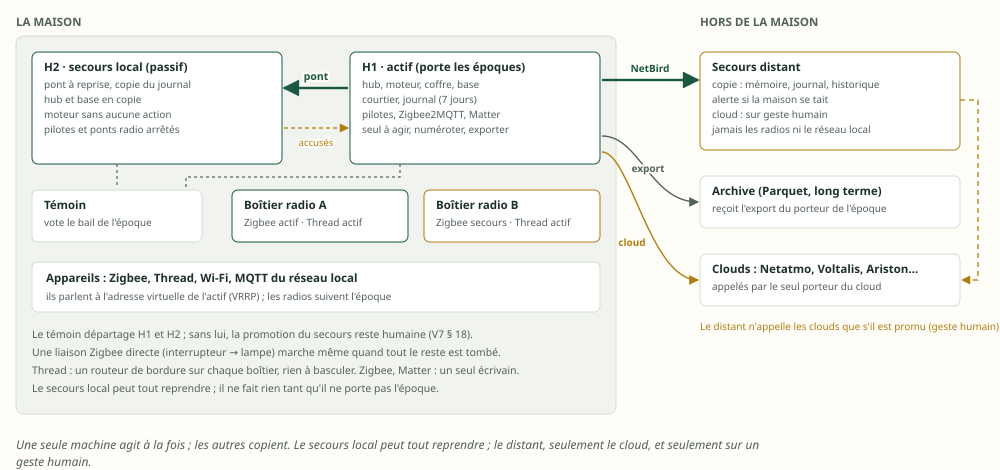

## 2. Ce qui existe déjà, et ce qui fait foi

### 2.1 Les documents, par date

Quand deux documents se contredisent, le plus récent l'emporte. Ceux qui comptent ici :

| Document | Date | Ce qu'il apporte à la haute dispo |
|---|---|---|
| [Étude mémoire v2](memoire-v2.md) | 23 octobre | numéros fixes (`n` dans `meta/`, `i` dans `val/`), deux horloges, exécutions de 64 o, attentes de 24 o, moteur du temps, agendas ; ce qui survit à un redémarrage (§ 11) |
| [Analyse V7](isolation-reactivite-runtime-v7.md) | 22 octobre | le courtier `rumqttd` embarqué, l'arbre `moli/v1/`, le rang `s`, la secours abonnée, l'époque, le bail, le témoin, les radios, 19 tests de reprise (§ 6, § 7, § 10.3, § 18, § 20) |
| [Analyses V4 et V5](isolation-reactivite-runtime-v4.md) | 22 octobre | la bascule jouée de bout en bout (RPO 0, reprise en ~1 s), le journal et l'instantané (V4 § 6, § 7.6) |
| [Stockage V3](valeurs-appareils-stockage-v3.md) | 21 octobre | quatre étages : mémoire, `maison.db`, `moli.db`, archive Parquet |
| D13 ([ARCHITECTURE](../ARCHITECTURE.md)) | 17 octobre, approuvée le 18 | le journal d'export immuable, son rang `seq`, l'archive et ses accusés |
| Inventaire de la persistance (mémoire du projet) | 21 octobre | les fichiers de `data/`, le coffre, ce que la sauvegarde oublie |

### 2.2 Ce que la V7 a déjà décidé

La V7 a une haute disponibilité complète (§ 18). Cette proposition la garde, et la prolonge là où
ton idée va plus loin.

| La V7 (§ 18) | Gardé ? |
|---|---|
| Deux domaines de panne : chacun son hôte, son boîtier radio, son switch PoE, sa prise | gardé |
| Une époque, un bail auprès d'un **témoin** (un troisième appareil déjà présent), la rétrogradation à 2 s, le bail de 3 s ; promotion humaine par défaut, automatique après les tests sur le matériel réel | gardé ; une seconde époque pour le cloud (§ 11) |
| Thread actif/actif ; Zigbee actif/secours (sauvegarde, clôture de l'ancien par le port PoE, restauration) ; Matter : un seul écrivain | gardé |
| Le courtier : un par hôte, sans état à répliquer | gardé ; le pont s'ajoute (§ 4) |
| La secours abonnée au courtier actif, en lecture seule, l'état complet d'abord, puis `val/` avec `s` | **prolongé** : un pont à reprise et une copie du journal (§ 4) |
| Un journal de réplication pour ce que MQTT ne porte pas | **précisé** : son contenu, un second rang, la dépendance à `s` (§ 5) |
| La secours écrit sa propre `maison.db` et sa propre `moli.db` | **corrigé** pour `moli.db` (§ 6) |
| Seul le porteur de l'époque exporte vers l'archive | gardé |
| Écrans : deux adresses ou une adresse virtuelle ; appareils MQTT du réseau : une adresse virtuelle (VRRP) | gardé |
| 19 tests de reprise | gardés ; 20 de plus (§ 12) |

### 2.3 Les contradictions relevées, et ce qui l'emporte

| Sujet | Plus ancien | Plus récent, qui l'emporte | Ici |
|---|---|---|---|
| La charge de `val/` | sans numéro (V7 § 7.3, 22/10) | `i` en plus du nom (mémoire v2 § 4.4, décidé le 23/10) | le secours range par `i` |
| Les instants rangés | « trois instants », sans horloge précisée (V4, V7 § 20.6) | deux horloges ; tout ce qui est rangé l'est en heure murale (mémoire v2 § 6.5) | étendu : **tout ce qui quitte une machine** est en heure murale (§ 3) |
| Les messages retenus | aucun, sauf les ponts extérieurs (V7 § 6.3) | la table d'un agenda en un message gardé, proposé (mémoire v2 § 10.9) | sans conséquence ici : le pont de `rumqttd` ne garde pas l'indicateur, le journal transporte la table (§ 5) |
| Deux `n` | `n`, le rang d'un module dans `in/` (V7 § 10.3) | `n`, le numéro d'un point dans `meta/` (mémoire v2 § 4.4) | aucun conflit de sujet ; à renommer au portage |
| Thread | actif/actif (V7 § 18.1.3) | actif sur le principal, passif sur le secours (ta proposition, 23/10) | la V7 a raison pour les routeurs de bordure : c'est natif (§ 7.1) |
| La base du secours | dérivée de `val/` (V7 § 18.2.2) | — (D13, approuvé avant, exige des rangs identiques) | contradiction de fond : corrigée au § 6 |

### 2.4 Ce que fait le code d'aujourd'hui

Les 50 crates ont été relues pour cette question. Les faits qui comptent, vérifiés au commit
`a835893` :

| Fait | Où | Conséquence pour la haute dispo |
|---|---|---|
| **Aucun mode passif, aucun verrou d'instance** : toute instance lancée démarre ses pilotes et son moteur d'automatismes ; le port n'est pris qu'après | `moli-os/src/main.rs:440-448` | une seconde instance agit, même par erreur ; le mode passif est à créer (§ 7.4) |
| Le coffre est lu **une fois**, à son ouverture, puis servi depuis la mémoire | `moli-runtime/src/secrets.rs:117-140` | copier le fichier ne suffit pas : le secours doit appliquer chaque secret en mémoire (§ 8.4) |
| Netatmo est le seul jeton qui tourne et qui est rangé, **avant** d'être utilisé | `moli-netatmo/src/actor.rs:245-256` | la règle d'écriture est déjà la bonne ; il manque la copie au secours (§ 8.3) |
| Les sessions d'Ariston, Voltalis, Landroid, Overkiz (cloud), Reolink, Twinkly et des routeurs vivent en mémoire seule ; chaque démarrage refait une connexion | inventaire, § 7.2 | le secours se connecte lui-même, après la bascule, jamais avant |
| Bambu, Frigate et Zigbee2MQTT prennent un identifiant MQTT fixe | `moli-bambu/src/lib.rs:285`, `moli-z2m/src/lib.rs:74-78` | deux instances se chassent l'une l'autre du courtier |
| Telegram n'envoie que (`sendMessage`), sans `getUpdates` | `moli-telegram/src/lib.rs` | aucun consommateur exclusif ; seulement des messages en double |
| À l'arrêt, tout est annulé d'un coup ; les automatismes ont 2 s pour se noter « interrompus », puis ne reprennent jamais ; aucun pilote ne se déconnecte | `moli-os/src/main.rs:483-507`, `moli-automation/src/engine.rs:99-113` | l'arrêt figé est à écrire (§ 9) |
| La sauvegarde omet `people.json`, `settings.json`, `assistant.json`, `addresses.json`, `alarm.json`, `alarm-profiles.json`, `recordings/` | `moli-os/src/backup.rs:22-46` | la liste de ce qui se réplique ne doit pas reprendre la liste de la sauvegarde (§ 5.4) |
| Des secrets vivent hors du coffre : clé maître, PIN de l'interface, jeton Telegram (`token_file`), clé Hue (`app_key_env`), mot de passe Zigbee2MQTT (`password_env`), clés cloud Tuya, jeton de l'archive | inventaire | à ramener au coffre, ou à installer à l'appairage du secours (§ 8.7) |

## 3. Le principe : trois sortes d'état, trois chemins

**Premiers principes** : pour chaque mémoire de Sarah Home, d'où vient-elle, et peut-on la refaire ?

| Sorte | Exemples | Chemin vers le secours |
|---|---|---|
| **Ce qui se recalcule** | le programme des workflows (recompilé en 0,45 ms), l'index par point, la vérité des conditions composées (3,6 µs), les niveaux du hub (la nuit, les plages), toutes les échéances monotones | **rien** : le secours le refait, depuis les définitions et les valeurs |
| **Ce que le hub publie déjà** | les valeurs et leurs instants (`val/`), les disponibilités (`avail/`), les spécifications et les numéros (`meta/`), les occurrences (`evt/`) | **le pont MQTT** (§ 4) |
| **Ce qui n'est nulle part ailleurs** | les exécutions, les attentes, l'état des fiches horaires, les minuteries, les baux, les approbations, les agendas, le coffre, les fichiers métier | **le journal de réplication**, dans le même pont (§ 5) |

Trois règles tiennent ces chemins :

1. **Le secours recopie les sorties de l'actif, jamais ses entrées.** Il ne date rien, ne numérote
   rien, ne décide rien : il applique, dans l'ordre des rangs.
2. **Tout ce qui quitte une machine est en heure murale.** L'horloge monotone n'a de sens que sur la
   machine et pendant le lancement où elle a été lue (mémoire v2 § 6.5). Le journal, l'instantané,
   le pont et le coffre ne portent que des instants muraux ; chaque machine refait ses échéances
   monotones à leur arrivée.
3. **Le porteur de l'époque est seul à agir** : envoyer un ordre, numéroter un point, renouveler un
   jeton, exporter vers l'archive, envoyer une notification. Le secours reçoit, applique, range, et
   peut alerter.

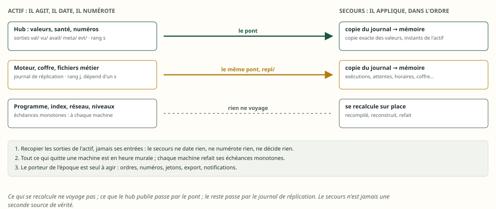

## 4. Le pont MQTT, et la copie de la mémoire

Les deux systèmes, en détail. Chaque machine a son binaire Sarah Home et son courtier MQTT embarqué,
où le hub, le moteur, la base, le module WebSocket et l'API sont des liens en mémoire. Les clients
extérieurs ne parlent qu'à l'actif : les écrans et les appareils MQTT du réseau par l'adresse
virtuelle, Zigbee2MQTT et les modules à part par l'écouteur local. Le secours a les mêmes
composants, en copie, ses modules et ses ponts radio arrêtés ; son courtier n'a qu'un éditeur, le
pont à reprise, client de l'écouteur réservé au secours sur l'actif.

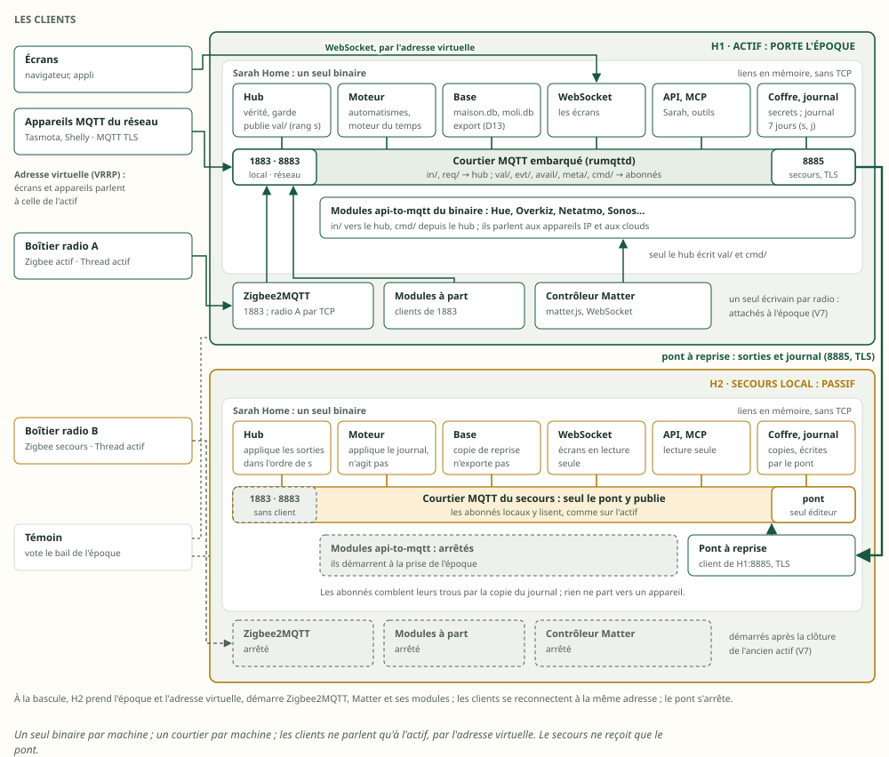

### 4.1 Copier par les entrées, ou par les sorties

Ta phrase, « comme il recevra les mêmes informations, il gardera les mêmes informations en
mémoire », a deux lectures. Le secours peut recevoir :

- **les entrées** : ce que les modules publient sur `in/`, qu'il traite lui-même, comme un second
  hub ;
- **les sorties** : ce que le hub de l'actif publie sur `val/`, avec ses instants et son rang `s`.

**Contre-épreuve**, sur une heure de la maison (la cadence de la v2 : 6 882 rapports, dont 3 115
identiques), un pont coupé 30 s à la 25e minute, et une horloge du secours à 23 ms de celle de
l'actif (NTP) :

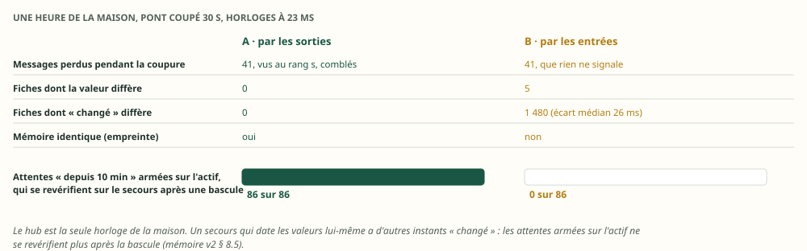

| Une heure de la maison | A : par les sorties | B : par les entrées |
|---|---|---|
| Messages perdus pendant la coupure | 41, vus au rang `s`, comblés par le journal | 41, que rien ne signale |
| Fiches dont la valeur diffère de l'actif | **0** | 5 |
| Fiches dont l'instant « changé » diffère | **0** | 1 480 (écart médian 26 ms ; 3 fausses de plusieurs minutes) |
| Mémoire identique à l'actif (empreinte) | **oui** | non |
| Attentes « depuis 10 min » armées sur l'actif, qui se revérifient sur le secours | **86 sur 86** | **0 sur 86** |

La dernière ligne est la raison de fond. Dans la v2, une attente « ouvert depuis 10 min » se
revérifie à l'échéance par `changé == depuis` (mémoire v2 § 8.5). L'attente est armée sur l'actif,
avec l'instant « changé » de l'actif. Si le secours date les valeurs lui-même, ses instants
diffèrent de quelques millisecondes : après une bascule, aucune attente ne se revérifie, et les
déclencheurs à durée en cours sont perdus sans un mot. Le hub est « une seule horloge de référence
pour toute la maison » (V7 § 10.1) ; le secours doit en hériter, pas en avoir une seconde.

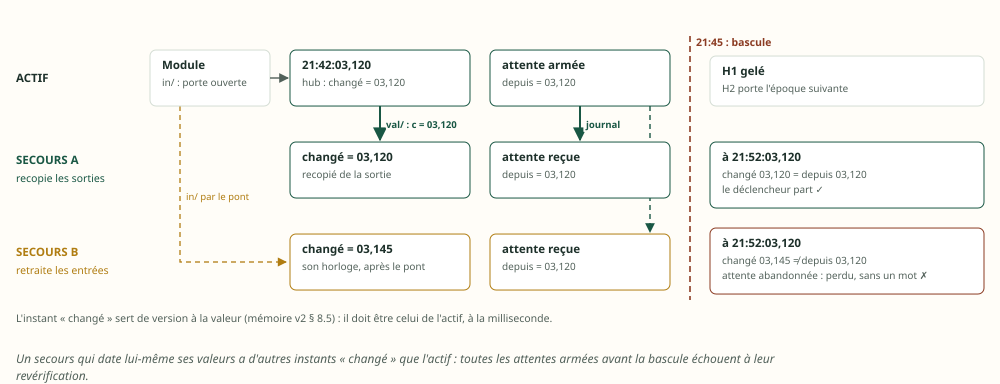

À ×10, même résultat : 839 attentes sur 839 tenues par les sorties, 0 par les entrées.

**Décision : le secours recopie les sorties.** C'est ce que fait PostgreSQL : le secours rejoue le
journal du principal, il ne rejoue pas les requêtes.

### 4.2 Ce que le secours fait d'une sortie

| Champ de la fiche `Vif` (mémoire v2 § 5.1) | Sur le secours |
|---|---|
| valeur, observé, changé, qualité | recopiés de la sortie |
| précédente | déduite : l'ancienne valeur. Aucune sortie n'a manqué, `s` le garantit |
| reçu | recopié (la sortie `vu/` le porte aussi, § 4.4) |
| contact de l'appareil | recopié depuis « reçu » |
| échéances de santé et de fraîcheur | refaites en horloge monotone **locale**, depuis l'instant « reçu » de l'actif |

Trois cas particuliers :

- **Un point nouveau** arrive par `meta/` avec son numéro `n` : le secours l'écrit dans son
  annuaire, avant usage, comme l'actif l'a fait. Il ne donne jamais de numéro lui-même.
- **Un `i` inconnu** : le secours redemande `meta/` ; il ne devine jamais (mémoire v2 § 4.4).
- **À la prise de l'époque**, chaque appareil reçoit la grâce du démarrage (mémoire v2 § 6.5) : le
  secours ne déclare personne muet parce qu'il vient d'arriver.

Appliquer une sortie coûte 39 ns ; écrire puis relire sa charge JSON, 101 ns.

### 4.3 Le pont de `rumqttd` ne suffit pas

Le courtier de la V7 a un pont (`link/bridge.rs`, lu dans la version 0.20.0). Il est minimal :

| Ce que fait le pont de `rumqttd` 0.20 | Ce qu'il faudrait |
|---|---|
| **un seul filtre** (`sub_path`) | six filtres (§ 4.4) ; `moli/v1/#` ramènerait aussi `in/`, `req/`, `cmd/` et `res/`, que le secours ne doit ni lire ni rejouer |
| **session propre codée en dur** (`clean_session: true`) : pendant une coupure, le courtier de l'actif ne garde rien | reprendre exactement là où l'on s'est arrêté |
| TCP ou TLS seulement, pas de WebSocket | sans objet avec NetBird (§ 10.2) |
| indicateur « retenu » jamais recopié (`RetainForwardRule::Never`) | sans objet : aucun retenu sur le chemin (§ 5) |
| aucun journal, aucun rang | combler un trou |

Sous deux coupures (5 s et 10 s) à 200 messages par seconde, il perd 3 009 messages sur 8 000 : tout
ce qui est passé pendant les coupures.

### 4.4 Le pont à reprise


Le pont est un module de Sarah Home sur le secours, un client MQTT vers le courtier de l'actif. Il
fait cinq choses :

1. **Il s'abonne aux sorties seulement** : `val/#`, `vu/#`, `avail/#`, `meta/#`, `evt/#`, `sys/#`,
   et aux tronçons du journal. Jamais `in/`, `req/`, `cmd/`, `res/` : l'ACL du compte « secours » le
   tient (V7 § 6.4), en lecture seule sauf sur `repl/demande` et `repl/accuse`.
2. **Il remet tout dans l'ordre de `s`.** `rumqttd` tient un journal par filtre : un abonné à deux
   filtres reçoit leurs messages entrelacés au hasard, même sans aucune perte (vu au banc). Un rang
   qui manque n'est donc demandé qu'après **200 ms de grâce** : l'autre filtre le livre peut-être.
3. **Il comble chaque trou par le journal de l'actif** : à chaque reconnexion (tout ce qui est passé
   pendant l'absence), et quand un rang manque au-delà de la grâce. Par fenêtres de 32 tronçons de
   64 sorties (≈ 94 Kio), une à la fois, sous le journal du filtre des tronçons (1 Mio × 4) : le
   courtier ne saute jamais une fenêtre. En binaire, 46 octets par sortie.
4. **Il écrit chaque sortie dans la copie du journal du secours, puis la publie** sur le courtier du
   secours. Les abonnés locaux (le hub de secours, la base, les écrans en lecture) lisent leur
   courtier comme sur l'actif, et comblent leurs propres trous par cette copie. À la prise de
   l'époque, la copie devient le journal du nouvel actif : `s` continue sans rupture.
5. **Il accuse son rang** toutes les 500 ms (`repl/accuse/<secours>`) : l'actif connaît le retard de
   chaque secours, et prévient au-delà d'un seuil.

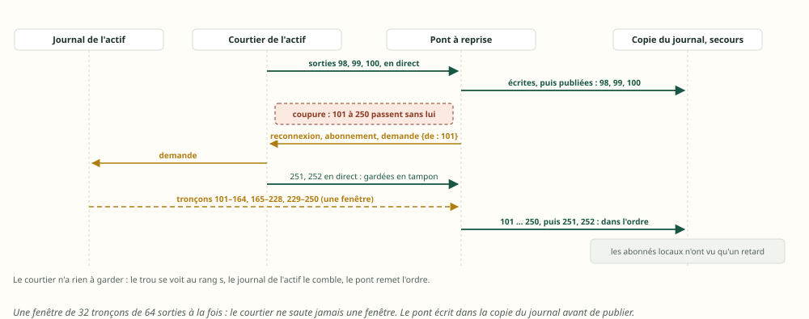

Bloc technique — les sujets de la réplication (proposé, dans l'arbre de la V7) :

```text
moli/v1/vu/<appareil>/<point>        hub → tous        QoS 0   le rapport identique : observé, reçu, s, i
moli/v1/repl/j                       hub → secours     QoS 1   le journal de réplication : j, s dont il dépend, enregistrement
moli/v1/repl/demande                 secours → hub     QoS 0   {"de": s} ou {"de_j": j} : un tronçon, à partir de ce rang
moli/v1/repl/troncon/<secours>       hub → secours     QoS 0   en-tête (bout du journal, fin de fenêtre) + 64 sorties de 46 o
moli/v1/repl/accuse/<secours>        secours → hub     QoS 0   {"s": …, "j": …} toutes les 500 ms
```

### 4.5 Ce que le banc mesure, sur le réseau local

Deux courtiers `rumqttd` 0.20 dans un même processus, un relais TCP entre les deux, le hub qui
publie à 200 messages par seconde (la pointe des deux maisons est de 239 par seconde, V7 § 6.2). Les
deux courtiers, le pont, le relais et la réplique partagent les 2 CPU du conteneur : le 99e centile
mesure surtout cette cohabitation, que deux machines n'auront pas.


| Réseau local | Pont de `rumqttd` | **Pont à reprise** |
|---|---|---|
| Régime, 6 000 messages : délai de la copie, médiane / 99e centile / pire | — | **1,9 / 35,4 / 58 ms** |
| Deux coupures, 5 s et 10 s : messages perdus | 3 009 sur 8 000 | **0** |
| Rattrapage après chaque coupure | jamais | **110 ms et 176 ms** |
| Messages venus du journal | 0 | 3 052 |
| Mémoire du secours identique à l'actif | non | **oui** |

### 4.6 Quatre leçons de `rumqttd` pour l'implémentation

Le banc les a rencontrées ; chacune devient une règle du pont ou des abonnés :

1. **L'ordre entre deux filtres n'est pas gardé** (un journal par filtre) : tout abonné qui lit
   plusieurs filtres remet l'ordre par `s` (schéma du § 5.2). D'où aussi la proposition de porter
   `s` sur toutes les sorties du hub, pas seulement `val/` (§ 13).
2. **Un abonné local qui a plus de ~1 400 messages de retard saute en avant, sans le savoir** (déjà
   mesuré par la V7, § 6.1). Au retour d'une coupure, le pont publie d'un coup des milliers de
   sorties rattrapées : la réplique du banc a sauté, puis comblé par la copie du journal. D'où la
   règle : **tout abonné local du secours comble par la copie du journal**, comme sur l'actif.
3. **Un lien local mis en pause doit répondre.** Quand la file d'un abonné déborde, le routeur lui
   envoie `Unschedule` et ne le reprend que sur `ready`. Un abonné qui l'ignore ne reçoit plus rien,
   jamais (la réplique du banc a été mise en pause 14 fois pendant les rattrapages ; le banc
   courtier de la V7 traitait déjà ce cas).
4. **La boucle d'un client MQTT ne s'interrompt jamais.** Sur le lien distant, le premier pont du
   banc abandonnait sa reconnexion à chaque tic de 100 ms : la poignée de main dure plus longtemps
   sur un lien de 40 ms. Les connexions à moitié ouvertes se sont accumulées chez le courtier de
   l'actif jusqu'à `max_connections`, après quoi il a refusé tout le monde. La boucle vit dans sa
   propre tâche. S'y ajoute la panique du chemin de connexion que la V7 corrige déjà (§ 6.1).

### 4.7 L'empreinte : vérifier que la copie est exacte

Un rang `s` égal ne prouve pas une mémoire égale : un défaut d'application passerait inaperçu.
L'actif publie donc, chaque minute, l'**empreinte** de sa mémoire répliquée au rang `s` (`sys/`) :
un CRC-32 par bloc de 256 points, plus un bloc pour la santé des appareils (10 blocs à ×1). Le
secours calcule la sienne au même rang ; un bloc qui diffère se recopie seul, par l'état du hub (V7
§ 10.4). Coût : 29 µs à ×1, 284 µs à ×10. Les échéances monotones n'y entrent pas : elles
appartiennent à chaque machine.

## 5. Ce qui ne passe pas par MQTT : le journal de réplication

### 5.1 Ce qu'il porte

| Enregistrement | Taille | Quand | Source |
|---|---|---|---|
| Une exécution qui change d'état (départ, pas, attente, issue, fin) | la fiche de 64 o | à chaque pas | mémoire v2 § 8.4 |
| Une attente de déclencheur à durée | 24 o | à l'armement, au départ | mémoire v2 § 8.5 |
| L'état d'une fiche horaire (prochaine, dernière partie, événements) | 25 o | à chaque occurrence | mémoire v2 § 10.4 |
| Une minuterie | 24 o | à l'armement, à l'arrêt | mémoire v2 § 10.8 |
| Un bail « pendant », une approbation en attente | quelques dizaines d'o | à l'ouverture, à la fin | V7 § 18.2.2 |
| La table d'un agenda | 24 o par événement, avec sa génération | à chaque lecture de l'agenda | mémoire v2 § 10.9 |
| Un point retiré (case condamnée) | 4 o | au retrait | mémoire v2 § 4.1 |
| Un secret du coffre, scellé pour chaque secours qui y a droit | ~2 Kio | à chaque écriture du coffre | § 8 |
| Un fichier métier (aides, définitions, personnes, réglages) | le fichier entier | à chaque écriture | § 5.4 |
| L'époque, le bail | 16 o | à chaque changement | V7 § 18.2.3 |

Ce qui n'y est pas : le programme, l'index, la vérité des conditions composées, les niveaux du hub
et toutes les échéances monotones (ils se refont, § 3), les valeurs (le pont), l'historique (§ 6).

Le moteur d'alarme n'est pas encore câblé : aujourd'hui, son état n'est rangé nulle part
(`moli-alarm`, `restore.rs` sans appelant). Quand il le sera, sa phase et ses minuteries à
génération entreront dans ce journal, comme les exécutions.

### 5.2 Un ordre, deux rangs

Les sorties du hub ont leur rang `s` ; le journal de réplication a le sien, `j`. Chaque
enregistrement `j` porte **le rang `s` dont il dépend** : celui de la valeur qui a déclenché
l'exécution, ou armé l'attente. Le secours n'applique un enregistrement `j` qu'une fois arrivé à ce
rang `s`.

**Inversion** : comment perdre un déclencheur à la bascule ? Les deux flux voyagent par deux
filtres, et le courtier les entrelace au hasard (§ 4.6). Sans cette dépendance, le secours peut
recevoir « attente armée, depuis 21:42:03,120 » avant la valeur qui l'a armée. Une bascule entre les
deux laisse une attente dont l'instant « changé » ne correspond à rien : elle ne se revérifie pas,
le déclencheur est perdu. Avec la dépendance, l'enregistrement attend sa valeur, quelques
millisecondes.

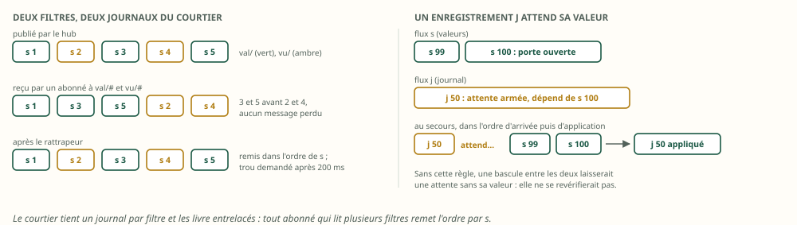

### 5.3 Ce que tout cela pèse

| Flux | Par jour (×1) | Source |
|---|---|---|
| Sorties `val/` et `vu/`, en MQTT | 19,7 Mo | banc, § 4.1 |
| Les mêmes, en binaire au journal (46 o) | 7,6 Mo | banc |
| Le journal de réplication | ~1,3 Mo | V7 § 18.2.2 (estimé) |
| Les opérations de l'historique, pour une copie de reprise (§ 6) | quelques Mo | estimé |

C'est peu : une journée entière tient dans un lien d'1 Mbit/s en une minute et demie (§ 10.3).

### 5.4 Les fichiers métier, ensemble

Ce qui se réplique ne doit pas reprendre la liste de la sauvegarde, qui en oublie (§ 2.4). La liste
juste : `moli.toml`, `labels.toml`, `trusted-profiles.toml`, `home.json`, `plan.json`,
`people.json`, `phones.json`, `settings.json`, `assistant.json`, `addresses.json`, `tuya.json`,
`alarm.json`, `alarm-profiles.json`, `automations.json`, `dependencies.json`, `durations.json`, les
`helper-*.json`, `button-occurrences.json`, `automation-occurrences.json`, et le coffre (§ 8).

**Trois d'entre eux vont ensemble** : `automations.json` (l'activation), `helper-timers.json` (les
échéances en attente) et `automation-occurrences.json` (les fenêtres déjà parties). En désaccord,
les échéances sont acquittées sans exécution (`moli-automation/src/engine.rs:143-262`). Ils partent
donc dans **un seul** enregistrement du journal, cohérent, jamais l'un sans les autres.

## 6. Plusieurs stockages

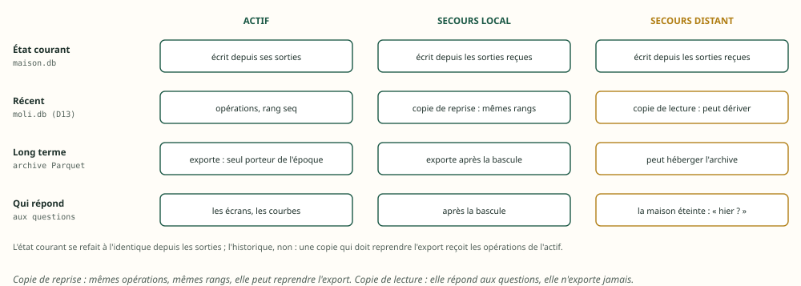

### 6.1 L'état courant : autant de copies qu'on veut

`maison.db` garde, par point, la dernière valeur et ses instants (stockage V3). C'est une fonction
des sorties : n'importe quelle machine qui reçoit `val/` dans l'ordre de `s` écrit la même table.
Chaque base range le rang `s` qu'elle a appliqué, dans la même transaction : appliquer deux fois une
sortie ne change rien, et un trou se voit.

### 6.2 L'historique : le piège du rang d'export

`moli.db` (D13) donne à chaque opération un rang `seq`, dans la transaction de son lot ; l'archive
reçoit des plages contiguës et refuse une plage déjà reçue avec un autre contenu (409). Or deux
bases qui dérivent chacune leur historique du même flux **ne numérotent pas pareil** :

- leurs lots de 2 s tombent à d'autres instants ;
- leurs heures d'énergie se closent à l'heure ronde de leur propre horloge ;
- un import ou une correction faits sur l'une n'existent pas sur l'autre ;
- `energy.db` additionne : rejouer une opération compte deux fois.

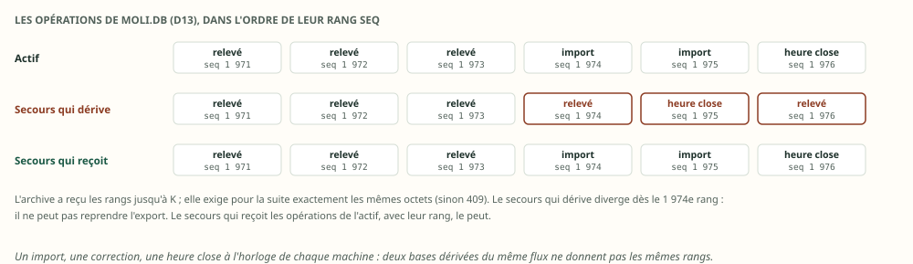

Le banc dérive les deux bases d'une même heure de la maison, avec un import à la 30e minute :
l'actif a 3 827 opérations, le secours 3 777, et leurs rangs divergent dès le 1 974e (1 854 rangs
différents). Après une bascule à la 40e minute, le secours **ne peut pas reprendre l'export**. C'est
la contradiction de fond avec la V7 (§ 18.2.2).

| Option | Ce qu'elle demande | Verdict |
|---|---|---|
| A. Le secours dérive sa base du flux (la V7) | rien de plus | **pour une copie de lecture** seulement : elle répond aux questions, elle n'exporte jamais |
| B. Le secours reçoit les opérations de l'actif, avec leur rang (le journal d'export de D13, déjà immuable et autonome) | un flux de plus dans le pont | **retenu pour une copie de reprise** : mêmes rangs, l'export continue |
| C. Une nouvelle « génération » d'export à chaque bascule | changer le contrat de l'archive (approuvé) et dédoublonner au contenu | écarté |

Le banc le vérifie : avec B, la reprise de l'export est possible (oui) ; avec A, non (non). Ne
jamais copier un fichier SQLite à chaud : `history.db` se croit alors « sale » et suspend ses purges
jusqu'à une validation humaine (`moli-history/src/store.rs:648-673`).

### 6.3 Qui répond aux questions

| Question | Qui répond |
|---|---|
| L'état courant, une courbe récente | la base de l'actif ; à défaut, celle du secours, qui devient l'actif |
| Le long terme (heures, jours, années) | l'archive (D13), où qu'elle soit |
| La maison est éteinte : « qu'est-ce qui s'est passé hier ? » | le secours distant, copie de lecture (§ 10) |

### 6.4 Un stockage déporté

Un stockage sur un NAS ou un VPS est un abonné de plus, par le même pont. Le protocole existe déjà :
celui de l'archive de D13 (lots rejouables, `durable_upto`, reprise exponentielle de 1 s à 5 min)
est fait pour un lien instable. **Le tampon, c'est le journal de l'actif**, pas une file en mémoire.

## 7. Les intégrations : qui peut tourner deux fois

### 7.1 Les radios

Thread n'a rien à basculer : plusieurs routeurs de bordure, un sur chaque boîtier radio, partagent
un même jeu de données opérationnel, et le maillage passe par celui qui reste (V7 § 18.1.6). **Ta
proposition « Thread actif sur le principal, passif sur le secours » serait en retrait de ce que
Thread fait seul.** Ce qui n'a qu'un écrivain, c'est le coordinateur Zigbee (un seul au monde pour
un réseau) et le contrôleur Matter (sa fabric) : actif/passif, attachés à l'époque, avec clôture de
l'ancien (V7 § 18.1.3).

### 7.2 Le tableau des intégrations

L'inventaire du code range les intégrations en sept familles. Pour une intégration donnée, l'arbre
dit ce que fait le secours :


Le détail, famille par famille :

| Famille | Intégrations | Ce que supporte une seconde instance | Le secours |
|---|---|---|---|
| **A. Un jeton qui tourne** | Netatmo | rien : deux renouvellements, et le fournisseur révoque (§ 8) | le jeton, copié à chaque rotation ; il ne renouvelle qu'après la bascule |
| **B. Une session par identifiant** | Ariston, Voltalis, Landroid, Overkiz (cloud), Reolink, Twinkly, routeurs Asus, Netgear, Huawei | des connexions répétées font bannir le compte (Somfy, Worx), ou chassent l'autre session (Twinkly : « duel ») | les identifiants, au coffre ; il se connecte **après** la prise de l'époque, jamais avant |
| **C. Une clé fixe, un appairage, une empreinte épinglée** | Hue, Samsung, Android TV, Cast, Philips, Nuki, Roborock, Tapo, Bambu, ESPHome, Tuya, Sonos ; Alexa (jeton fixe), l'assistant (clé d'API), iopool, les réservations (l'URL est le secret) ; les empreintes TLS de tous les pilotes | lire, oui ; mais sans le coffre, il faut appairer à nouveau (un bouton, un code sur la télé) et le secours **épingle sans le dire** le certificat qu'il voit | le coffre, copié une fois puis à chaque changement |
| **D. Un identifiant MQTT fixe** | Bambu, Frigate, Zigbee2MQTT | deux connexions du même identifiant se chassent du courtier | rien ne démarre en mode passif (§ 7.4) |
| **E. Des effets visibles** | Telegram, notifications des téléphones, récap de 21 h, accueil à la porte, `Toggle`, clavier Zigbee, boutons Hue | tout part deux fois | un seul actif |
| **F. Liée à la machine** | Sonos et ESPHome (`media_base`), Netatmo (`public_origin`), Cast (adresse locale), Host (nom de la machine), Philips (identifiant = adresse), présence (table ARP) | l'adresse change, l'identité change | une adresse virtuelle portée par l'actif (VRRP) ; une configuration par machine pour le reste |
| **G. Sans état ni session** | météo, Open-Meteo, Tempo, Wyoming, IGD, IPP, profils sans secret | sans conflit, mais sans utilité | rien |

### 7.3 Deux clients API qui tournent, ou un qui attend ?

**Un seul client actif par intégration, toujours ; le secours est prêt, pas branché.** Les raisons,
trouvées dans le code :

- le secours **a déjà les valeurs** : le pont les lui donne, avec les instants de l'actif ;
- un second client **use le compte** : rotation (A), bannissement (B), session chassée (B, D) ;
- il **double les effets** (E) ;
- il **double les quotas** : Netatmo est interrogé toutes les 300 s, Ariston toutes les 180 s, et
  les fournisseurs comptent par compte.

« Prêt » veut dire : la configuration, les secrets du coffre, le dernier matériel de session (un
jeton encore valable, une empreinte épinglée), et aucun appel. À la bascule, une intégration de la
famille A ou C repart **sans nouvelle connexion** ; une de la famille B se connecte, en quelques
secondes. Le pilote Zigbee2MQTT, lui, relit chaque appareil sur secteur à son démarrage, un toutes
les 500 ms : une minute pour cent appareils, pendant laquelle les valeurs copiées font foi.

Pour les mails et les API « à authentification forte », la même règle vaut, avec une variante
utile : quand le fournisseur accepte plusieurs autorisations pour un même compte (Google,
Microsoft), **donner au secours sa propre autorisation** supprime toute copie de jeton tournant. Le
banc le joue : deux autorisations, deux familles de jetons, 0 échec sur 1 000 (§ 8.2). Google borne
à 100 jetons par compte et par client, et Microsoft ne révoque pas l'ancien jeton à l'usage : le
choix se fait fournisseur par fournisseur.

### 7.4 Le mode passif, à créer

Le code n'en a pas (§ 2.4). Proposé (le schéma des deux systèmes, en tête du § 4, le montre en
place) :

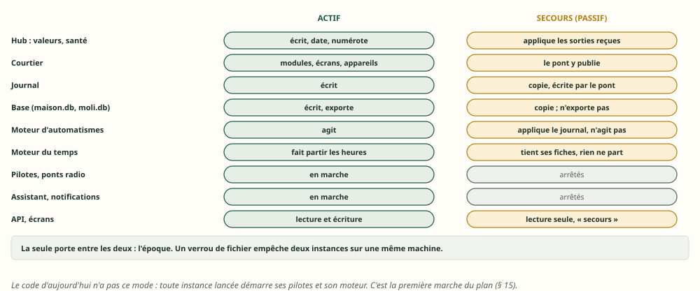

En détail :

| En mode passif | Démarré ? |
|---|---|
| Le hub, le courtier, le pont, la copie du journal, la base (copie) | oui |
| Le moteur d'automatismes : programme compilé, exécutions et attentes appliquées depuis le journal | oui, **sans aucun réveil qui agit** |
| Les pilotes, les ponts radio, l'assistant, les notifications | **non** |
| L'API et les écrans | en lecture seule, avec la mention « secours » |
| Le moteur du temps | il tient ses fiches, sans rien faire partir |

L'**époque** est la seule porte entre les deux modes, et un verrou de fichier (`flock`, comme
`moli-archive`) empêche deux instances sur une même machine.

## 8. Les sessions et les jetons

Décidé le 23 octobre : **au coffre, et en direct au secours** ; « mémoire seule » au cas par cas.

### 8.1 Le piège de la rotation

Un refresh token qui tourne change à chaque renouvellement : le fournisseur rend un nouveau jeton et
invalide l'ancien. La RFC 9700 (janvier 2025, § 4.14.2) va plus loin : si un jeton déjà utilisé
revient, le fournisseur ne sait pas qui l'a présenté, et **révoque le jeton encore valable**.
Netatmo fait tourner ses jetons ; le pilote le sait, et range le nouveau couple avant de s'en
servir.

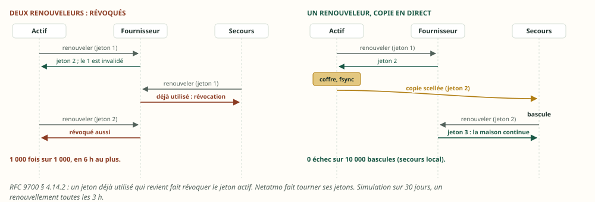

| Le banc, 30 jours, un renouvellement toutes les 3 h | Échecs |
|---|---|
| A. Les deux machines renouvellent chacune de leur côté | **1 000 sur 1 000** : révoquées en 6 h au plus |
| B. L'actif seul renouvelle, et copie au secours local en 5 ms | **0 sur 10 000 bascules** |
| C. Pareil, vers un secours distant hors ligne 1 h par jour | 429 sur 10 000 : la rotation tombée pendant son absence lui manque |
| D. Une autorisation par machine | 0 sur 1 000 |

### 8.2 Trois façons de tenir un compte à deux machines

| Façon | Pour qui | Risque |
|---|---|---|
| **Un renouveleur, copie en direct** (B) | tout jeton qui tourne (famille A) | une bascule dans les millisecondes entre la réponse du fournisseur et l'arrivée de la copie : une réautorisation humaine, que le pilote sait déjà demander |
| **Une autorisation par machine** (D) | les fournisseurs qui l'acceptent (Google, Microsoft) | aucun ; deux consentements à l'installation |
| **Une connexion après la bascule** | les sessions par identifiant (famille B) | quelques secondes de connexion ; jamais avant la bascule (bannissement) |

### 8.3 L'ordre des écritures

Bloc technique — un jeton renouvelé, sur l'actif (proposé) :

```text
1. le fournisseur répond : un nouveau couple (accès, refresh), version n+1
2. le coffre l'écrit (fichier, fsync, renommage, fsync du dossier) — c'est déjà la règle de Netatmo
3. le journal de réplication emporte la version n+1, scellée pour chaque secours qui y a droit
4. le pilote s'en sert
```

Le secours garde la plus grande version reçue. Il ne renouvelle jamais tant qu'il ne porte pas
l'époque du domaine (§ 11). Sceller un jeton de 2 Kio coûte 4,4 µs (ChaCha20-Poly1305, comme le
coffre), l'ouvrir 4,3 µs.

### 8.4 Le coffre répliqué

Aujourd'hui, le coffre est un fichier chiffré, lu une fois à son ouverture puis servi depuis la
mémoire ; un pilote y écrit par `ctx.store_secret`, qui réécrit tout le fichier. Proposé :

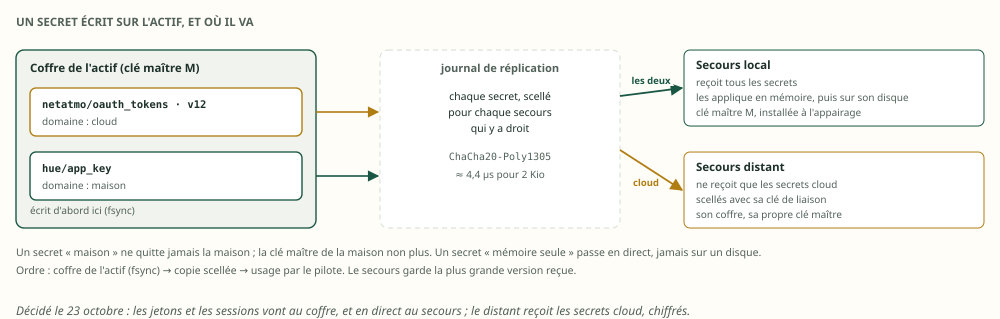


- **chaque écriture du coffre devient un enregistrement du journal**, scellé pour chaque secours qui
  y a droit. Le secours l'applique **dans son coffre en mémoire**, puis l'écrit sur son disque :
  copier le fichier seul ne suffirait pas ;
- **le secours local** reçoit tout. Il partage la clé maître de la maison, installée à l'appairage,
  comme le certificat d'écoute de la V7 (§ 18.2.2) ;
- **le secours distant** ne reçoit que les secrets du domaine cloud (décidé le 23 octobre), scellés
  avec **sa** clé de liaison. Il les range dans son propre coffre, sous sa propre clé maître : **la
  clé maître de la maison ne quitte jamais la maison** ;
- un secret dit son domaine dans la déclaration de son intégration (`cloud` ou `maison`) ; l'actif
  ne scelle pour le distant que ce qui est `cloud`.

### 8.5 « Mémoire seule », au cas par cas

Un secret marqué « mémoire seule » n'est jamais écrit sur disque, sur aucune machine, ni dans un
instantané. Il passe en direct au secours. Il survit à une bascule, pas à un arrêt des deux
machines : une coupure de courant de la maison demande alors une nouvelle autorisation humaine.
C'est pourquoi ce n'est pas le défaut.

### 8.6 Les sessions des personnes

Les sessions de l'interface (`core/ui_sessions`, `core/person_sessions`) sont déjà au coffre, sous
forme d'empreintes ; elles suivent donc le coffre répliqué, avec `people.json`. Deux limites :

- le cookie est lié au nom ou à l'adresse de la machine : le secours doit répondre **à la même
  adresse** (l'adresse virtuelle de l'actif), sinon chacun se reconnecte ;
- une session par PIN est liée à l'adresse du client sur le réseau local : par le secours distant,
  on arrive d'ailleurs, on se reconnecte. C'est acceptable.

### 8.7 Les secrets hors du coffre

La clé maître et le PIN de l'interface restent hors du coffre, par construction : ils s'installent à
l'appairage du secours. Les autres y entrent : le jeton Telegram (`token_file`), la clé Hue
(`app_key_env`), le mot de passe Zigbee2MQTT (`password_env`), les clés cloud Tuya, le jeton de
l'archive. Sinon, le secours démarre sans eux.

## 9. L'arrêt : figer la mémoire, et la ressortir

### 9.1 Ce que fait le code aujourd'hui

- SIGINT et SIGTERM suivent le même chemin : tout est annulé d'un coup, les tâches sont attendues
  sans délai borné, puis `state.json` est écrit (`moli-os/src/main.rs:483-507`).
- Les automatismes ont 2 s pour se noter « interrompus », puis ne reprennent jamais
  (`moli-automation/src/engine.rs:99-113`).
- Les pilotes sont abandonnés au prochain `await` : ni déconnexion, ni `DISCONNECT` MQTT.
- Les approbations, les ordres retenus et les exécutions de scènes vivent en mémoire seule.
- `docker stop` envoie SIGKILL après 10 s ; systemd, après 90 s par défaut. Le `compose.yaml` du
  dépôt ne règle pas `stop_grace_period`.

### 9.2 Quatre usages, un seul instantané

| Usage | Quand | Ce qu'il permet |
|---|---|---|
| **Arrêt propre** | SIGTERM, onduleur (NUT) | redémarrer exactement là où l'on s'est arrêté, sans rejouer le journal |
| **Relève** | une mise à jour, une maintenance de l'actif | passer la main au secours **sans rien perdre** (bascule planifiée) |
| **Point de restauration** | avant une mise à jour, sur demande | revenir en arrière ; le relire avec une version plus récente |
| **Hibernation, migration** | une machine qu'on remplace | ressortir la mémoire ailleurs, des jours plus tard |

### 9.3 La procédure, pas à pas

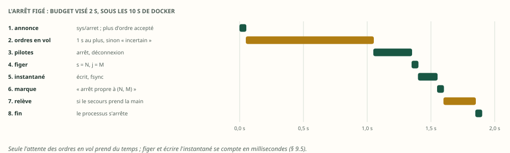

Bloc technique — l'arrêt figé (proposé ; budget visé : 2 s, sous les 10 s de Docker) :

```text
1. sys/arret publié : les écrans le montrent ; toute nouvelle demande d'ordre est refusée (« arrêt en cours »)
2. les ordres en vol ont 1 s pour aboutir ; au-delà, leur issue est « incertaine » (V7 § 20.7), au journal
3. les pilotes s'arrêtent, dans l'ordre inverse du démarrage, avec déconnexion quand le protocole en a une
4. le hub vide in/, puis se fige au rang s = N ; le moteur se fige au rang j = M
5. l'instantané est écrit : toute la mémoire au rang (N, M), échéances en heure murale, sans aucun secret
6. « arrêt propre à (N, M) » est ajouté au journal, fsync
7. relève seulement : le secours confirme (N, M) et la même empreinte ; le témoin lui donne l'époque E + 1
8. fin du processus
```

### 9.4 Le format

| Partie | Contenu |
|---|---|
| En-tête (64 o) | `SHI1`, version du format, raison (arrêt, périodique, point, relève), rang `s`, instant mural, époque, version du programme, empreinte de l'annuaire, CRC de l'en-tête |
| Sections | (genre, longueur, CRC-32, octets) : annuaire, valeurs, santé, échéances (en heure murale), exécutions, attentes, horaires, minuteries, agendas, aides |
| Absent | les secrets (au coffre ; « mémoire seule » ne touche jamais le disque), le programme (recompilé), tout ce qui se recalcule (§ 3) |

Écrit comme `StateFile` : un fichier voisin, `fsync`, renommage, `fsync` du dossier. **Une version
plus récente du logiciel lit les anciennes, jamais l'inverse** : une section inconnue et facultative
est ignorée ; obligatoire, l'instantané est refusé, et Sarah Home repart à froid (journal, état des
appareils). Un instantané abîmé (un CRC faux) ou tronqué est refusé ; le banc le vérifie.

### 9.5 Ce que le banc mesure

| Instantané d'arrêt | ×1 | ×10 |
|---|---|---|
| Taille | 233 Kio | 2,3 Mio |
| … dont l'annuaire / les valeurs | 90,6 / 84,0 Kio | 925 / 840 Kio |
| … dont les exécutions / les horaires | 25,0 / 9,8 Kio | 250 / 97,7 Kio |
| Compressé (LZ4) | 102 Kio | 1 002 Kio |
| Figer (construire les octets) | 129 µs | 1,2 ms |
| Écrire, avec `fsync` | 2,0 ms | 8,5 ms |
| Relire, vérifier, reprendre sur une horloge neuve | 260 µs | 2,7 ms |
| Mémoire reprise identique | oui | oui |
| Pour comparer : les seules valeurs, en JSON comme `state.json` aujourd'hui | 160 Kio | 1 612 Kio |

Toute la mémoire, figée, pèse à peine plus que les seules valeurs en JSON d'aujourd'hui. Le temps
d'écriture est celui du `fsync` du support : sur la carte SD d'un Pi, à mesurer.

### 9.6 Ressortir la mémoire

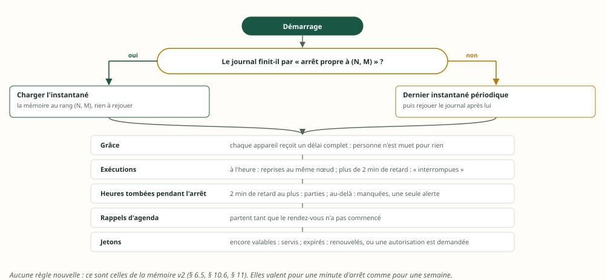

- **Après un arrêt propre**, le journal finit par « arrêt propre à (N, M) » : l'instantané suffit,
  rien n'est rejoué. Après un arrêt brutal : le dernier instantané périodique, puis le journal.
- **Des minutes ou des jours plus tard**, les règles de la v2 font le reste, sans une ligne de
  plus :
  - les valeurs gardent leurs instants ; une valeur trop vieille devient mauvaise à la lecture de sa
    fraîcheur, et chaque appareil reçoit la grâce du démarrage ;
  - une exécution en retard de plus de 2 min est arrêtée, notée « interrompue » ; à l'heure, elle
    reprend (mémoire v2 § 11) ;
  - les heures tombées pendant l'arrêt partent si elles ont 2 min de retard au plus ; au-delà, elles
    sont manquées, et une seule alerte le dit (mémoire v2 § 10.6) ;
  - un rappel d'agenda part tant que son rendez-vous n'a pas commencé ;
  - un jeton expiré se renouvelle, ou le pilote demande une autorisation.
- **Pour comprendre une panne**, un outil lit l'instantané hors ligne (proposé : `moli-os etat lire
  <fichier>`), secrets exclus par construction.

### 9.7 Écarté : figer le processus entier

CRIU sait figer un processus Linux et le relancer. Écarté : ses connexions TCP et TLS vers les
appareils et le cloud ne valent plus rien quelques minutes plus tard ; il exige les droits root ;
son image est liée au binaire exact et au noyau (aucune mise à jour possible) ; elle pèse la mémoire
résidente, des dizaines de Mio, contre 233 Kio.

## 10. Le secours distant

Décidé le 23 octobre : **copie, alerte et cloud**.

### 10.1 Ce qu'il fait, ce qu'il ne fait pas

| Le secours distant… | |
|---|---|
| tient la mémoire, le journal et l'historique à jour | oui, par le même pont |
| prévient si la maison se tait | oui, par son propre chemin d'envoi (Telegram n'a pas de consommateur exclusif, § 2.4) |
| reprend les intégrations cloud | **sur décision humaine**, avec l'époque cloud (§ 11.2) |
| reprend les radios, les appareils du réseau local | **non** : un coordinateur Zigbee ne se pilote pas à travers Internet |
| peut héberger l'archive (D13) | oui : le « passage sur un VPS » est déjà prévu |

Un secours distant sert surtout quand **la maison a du courant et Internet, mais plus de cerveau** :
les deux machines locales en panne, les radiateurs Voltalis et le chauffe-eau Ariston restent
pilotables par leur cloud. Pendant une coupure de courant de la maison, les appareils cloud de la
maison sont éteints eux aussi.

### 10.2 Le lien

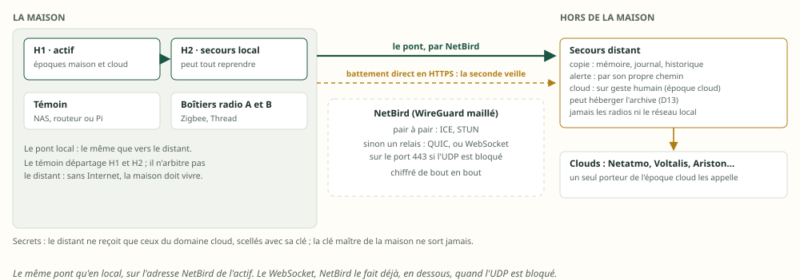

| Option | Comment | Verdict |
|---|---|---|
| MQTT sur TLS, port ouvert sur Internet | le courtier de l'actif exposé | non |
| MQTT sur WebSocket (wss, 443) | traverse les proxys ; `rumqttd` sert en WebSocket, `rumqttc` sait s'y connecter ; le pont de `rumqttd`, non | en dernier recours |
| WireGuard seul | un port UDP joignable d'un côté ; clés, itinérance | possible |
| **NetBird** (WireGuard maillé) | pair à pair par ICE et STUN ; sinon par un relais, en QUIC ou, si l'UDP est bloqué, en **WebSocket sur le port 443**, toujours chiffré de bout en bout ; règles d'accès par machine | **retenu** |

Avec NetBird, **le pont reste celui du réseau local**, vers l'adresse NetBird de l'actif, en TLS
avec certificat (défense en profondeur). Le WebSocket que tu évoquais, NetBird le fait déjà, en
dessous, quand il le faut.

Ce que coûte le chemin, par message de la maison (calculé, sauf la première ligne) :

| Couche | Octets |
|---|---|
| Une sortie `val/` en MQTT, mesurée sur le lien du banc | 123 |
| TLS : en-tête et étiquette d'un enregistrement | 22 à 29 |
| TCP et IP | 40 (IPv4) |
| WireGuard : en-tête et étiquette, UDP, IP | 60 (IPv4), 80 (IPv6) |
| WebSocket (relais NetBird seulement) : en-tête de trame | 2 à 6 |

Une journée de la maison fait 19,7 Mo de sorties en MQTT, et environ deux fois plus avec toutes les
couches. Un rattrapage passe en binaire, 46 octets par sortie, par tronçons de 2,9 Kio : le surcoût
des couches y est négligeable.

### 10.3 Le tampon

Le lien tombera. Trois façons de garder ce qui passe pendant ce temps :

| Où | Exemple | Limite | Verdict |
|---|---|---|---|
| Une file en mémoire du courtier | Mosquitto, session persistante, `max_queued_messages` | la mémoire de l'actif (128 Mio pour tout Sarah Home) ; perdue au redémarrage du courtier | non |
| Un cache sur disque dans le pont | NanoMQ, cache SQLite du pont | un second stockage à tenir | non : le journal existe déjà |
| **Le journal de l'actif, sur disque**, relu à partir du rang du secours | le journal de la V4, les accusés de D13 | sa rétention | **retenu** |

Rétention proposée : **7 jours**, comme le journal d'export de D13. Au-delà, le secours repart d'un
instantané (233 Kio), puis du journal à partir de son rang. Le retour après une absence, mesuré :

| Le secours revient après… | Lien | Rattrapage | Octets |
|---|---|---|---|
| une heure (6 882 sorties) | réseau local | 70 ms | 0,3 Mo |
| une journée (165 000 sorties) | réseau local | 1 054 ms | 7,7 Mo |
| une journée | 10 Mbit/s, 40 ms | 13,3 s | 7,7 Mo |
| une journée | 1 Mbit/s, 40 ms | 69 s | 7,7 Mo |

Dans les quatre cas, la mémoire du secours est identique à celle de l'actif à la fin.

### 10.4 Un lien qui bat

Le lien du banc : 40 ms de délai, 20 ms de gigue, 1 Mbit/s, coupé 3 s toutes les 15 s, pendant que
le hub publie 20 messages par seconde (dix fois la cadence moyenne de la maison) :

| Lien distant qui bat | Mesuré |
|---|---|
| Messages perdus | **0** sur 1 500 |
| Reconnexions | 5 |
| Rattrapage après chaque coupure | 281 à 331 ms |
| Délai de la copie, médiane / 99e centile | 53 / 66 ms |
| À la cadence de la maison, sans coupure : médiane / 99e centile | 57 / 67 ms |
| Mémoire identique à la fin | oui |

Pour un lien vraiment instable, deux réglages s'ajoutent : une reconnexion à attente croissante (1 s
à 5 min, avec gigue, comme le client de l'archive de D13), et l'alerte de retard (le rang accusé du
secours, § 4.4).

### 10.5 Le cloud repris par le distant

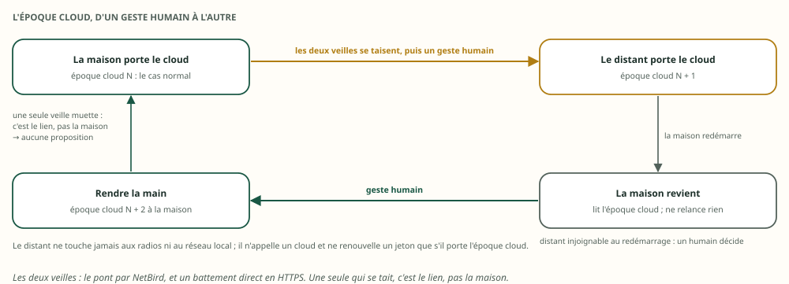

- **Sur un geste humain seulement.** Le distant propose la reprise quand **ses deux veilles** se
  taisent : le pont (par NetBird) et un battement direct en HTTPS vers son adresse publique. Si une
  seule se tait, c'est le lien, pas la maison.
- **L'époque cloud** passe au distant ; il démarre les intégrations cloud avec les jetons scellés
  reçus.
- **La maison qui revient ne relance pas le cloud** avant d'avoir lu l'époque cloud chez le
  distant ; si le distant ne répond pas, un humain décide. Rendre la main est un geste, lui aussi.
- **Le risque des jetons** : un distant hors ligne pendant une rotation n'a pas le dernier jeton. Le
  banc donne 4,3 % d'échecs pour un distant absent 1 h par jour. Trois parades : l'alerte de retard
  du secours ; une autorisation propre au distant quand le fournisseur l'accepte (§ 8.2) ; sinon, la
  réautorisation humaine, que le pilote Netatmo sait déjà demander.

### 10.6 La sécurité du distant

- Il ne reçoit que les secrets `cloud`, scellés avec sa clé ; la clé maître de la maison reste à la
  maison (§ 8.4).
- NetBird n'ouvre que l'écoute de réplication de l'actif, et rien d'autre ; le compte MQTT
  « secours » reste en lecture seule (sauf `repl/demande` et `repl/accuse`).
- Le distant n'a aucun chemin vers les appareils du réseau local.

## 11. La bascule : l'époque, le témoin, l'incertain

### 11.1 Ce que la V7 a posé

Une époque, un bail renouvelé chaque seconde auprès d'un témoin, la rétrogradation de l'actif à 2 s
sans réponse, l'époque suivante accordée au secours après les 3 s du bail, la clôture de l'ancien
(port PoE du boîtier radio), la promotion humaine par défaut et automatique après les tests sur le
matériel réel (V7 § 18.1.7). Tout cela reste.

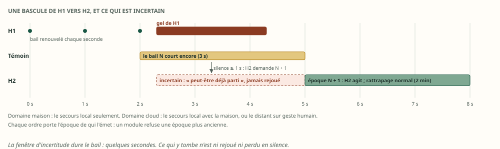

### 11.2 Deux domaines : maison et cloud

| Domaine | Ce qu'il couvre | Qui peut le porter |
|---|---|---|
| **maison** | les radios, les intégrations du réseau local, les ordres, les automatismes, la numérotation, l'export vers l'archive | l'actif ; le secours local par bascule |
| **cloud** | les intégrations cloud (famille A et B en cloud) | l'actif par défaut ; le secours local avec la maison ; le distant, sur geste humain |

Le secours local prend les deux ensemble. Le distant ne prend que le cloud. Une machine ne
renouvelle un jeton, n'appelle un cloud et n'envoie un ordre que si elle porte l'époque du domaine
concerné.

### 11.3 L'époque sur chaque ordre

Chaque `cmd/` porte l'époque de qui l'a émis. Un module garde la plus grande époque vue, et refuse
un ordre d'une époque plus ancienne : c'est le **jeton de clôture** des systèmes distribués. Un
actif gelé puis réveillé, qui enverrait un ordre avant de découvrir qu'il a perdu son bail, est
refusé par les modules eux-mêmes.

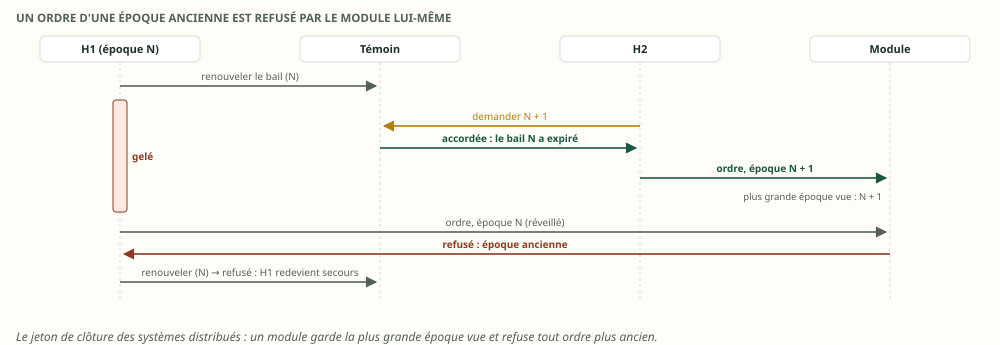

### 11.4 Ce qui est incertain à la bascule

**Inversion** : comment faire partir deux fois la même chose ? Ce que l'actif a fait sans que le
secours le sache encore.

| Ce qui était en cours | Après la bascule |
|---|---|
| Un ordre envoyé, sans issue | « incertain » (V7 § 20.7) ; l'exécution suit sa branche `Incertain` ; jamais renvoyé |
| Une heure ou un rappel dû entre le dernier enregistrement reçu et la fin du bail de l'ancien actif | **ni rejoué ni perdu en silence** : noté « peut-être déjà parti », une alerte |
| Une heure due après la fin du bail | rattrapée normalement (2 min ; mémoire v2 § 10.6) : l'ancien actif ne pouvait plus agir |
| Une exécution qui attendait une durée ou une condition | reprise au même nœud, avec la même échéance (test 19 de la V7) |

La fenêtre d'incertitude dure quelques secondes (le bail). Sur une maison à 400 déclencheurs
horaires par jour, une bascule en touche rarement un ; un ordre en vol, plus souvent, et la V7 a
déjà son issue.

### 11.5 Le retour de l'ancien actif

Il annonce son époque, apprend la suivante et redevient secours : il s'abonne au pont du nouvel
actif et comble par son journal. **Le pont va toujours du porteur de l'époque vers les autres**,
jamais dans les deux sens : aucune boucle possible.

## 12. Les tests

Les 19 tests de la V7 restent. Ceux-ci s'ajoutent ; ceux marqués « banc » passent déjà sur le banc,
les autres sont à écrire avec l'implémentation.

| # | Scénario | Réussi si | État |
|---|---|---|---|
| 20 | Le secours recopie une heure de la maison, pont coupé 30 s | empreinte identique ; toutes les attentes armées sur l'actif se revérifient | banc |
| 21 | Deux coupures du pont local, de 5 s et 10 s | aucun message perdu ; rattrapage sous la seconde ; empreinte identique | banc |
| 22 | Le pont de `rumqttd`, sous les mêmes coupures (contre-épreuve) | il perd tout ce qui passe pendant les coupures : le test sait échouer | banc |
| 23 | Lien distant de 40 ± 20 ms à 1 Mbit/s, coupé 3 s toutes les 15 s | aucune perte ; empreinte identique | banc |
| 24 | Le secours revient après une journée d'absence | rattrapage complet, en moins de 2 min à 1 Mbit/s | banc |
| 25 | Un abonné local du secours prend plus de 1 400 messages de retard | il comble par la copie du journal ; répond à `Unschedule` | banc |
| 26 | Deux filtres entrelacés par le courtier | aucun tronçon demandé pendant la grâce de 200 ms ; l'ordre de `s` rétabli | banc |
| 27 | Un enregistrement `j` arrive avant la valeur dont il dépend, et une bascule tombe entre les deux | il attend son rang `s` ; l'attente se revérifie après la bascule | à écrire |
| 28 | Deux machines renouvellent le même jeton qui tourne (contre-épreuve) | révocation ; avec un seul renouveleur, aucune | banc |
| 29 | Coupure de courant des deux machines | aucun compte à réautoriser, hors « mémoire seule » | à écrire |
| 30 | SIGTERM | instantané pris en moins de 2 s ; reprise sans rejouer le journal ; exécutions reprises à l'heure | à écrire (format : banc) |
| 31 | Instantané abîmé, tronqué ou d'une version future | refusé ; reprise à froid | banc |
| 32 | Relève planifiée | le secours prend l'époque avec la même empreinte ; aucune valeur perdue | à écrire |
| 33 | Bascule pendant un renouvellement Netatmo | le secours a le nouveau jeton, ou une réautorisation est demandée ; jamais une révocation | à écrire |
| 34 | Le distant est promu pour le cloud, puis la maison revient | elle ne relance pas le cloud avant d'avoir lu l'époque cloud | à écrire |
| 35 | Une seconde instance lancée par erreur | verrou : elle refuse de démarrer ; en passif, aucun pilote ni identifiant MQTT en double | à écrire |
| 36 | L'export vers l'archive reprend après une bascule | l'archive accepte la suite : mêmes rangs, mêmes octets | banc (modèle) |
| 37 | Le compte « secours » publie sur `cmd/` ou s'abonne à `in/` | refusé par l'ACL du courtier | à écrire |
| 38 | Une heure fixe tombe pendant la bascule | partie une fois, ou notée « peut-être déjà partie » ; jamais deux fois | à écrire |
| 39 | Un ordre d'une époque ancienne arrive à un module | refusé | à écrire |

## 13. Les choix

Décidé ici, parce que la mesure, le code ou une décision antérieure le tranche :

| Sujet | Décision | Pourquoi |
|---|---|---|
| Ce que le secours recopie | les sorties du hub, jamais les entrées | mesuré (§ 4.1) |
| Le pont | un pont à reprise, module de Sarah Home, pas celui de `rumqttd` | mesuré (§ 4.3, § 4.5) |
| Le tampon | le journal de l'actif sur disque, 7 jours ; au-delà, un instantané | mesuré (§ 10.3) |
| Les horloges | tout ce qui quitte une machine est en heure murale | mémoire v2 § 6.5, étendu |
| Le journal de réplication | un second rang `j`, chaque enregistrement dépend d'un rang `s` | inversion (§ 5.2) |
| L'historique du secours | une copie de reprise reçoit les opérations de l'actif ; une copie de lecture peut dériver | mesuré (§ 6.2) |
| Les intégrations | une seule instance active ; le secours prêt, sans aucun appel | inventaire (§ 7) |
| Les jetons qui tournent | l'actif seul renouvelle : coffre, puis copie scellée, puis usage | mesuré, RFC 9700 (§ 8) |
| Le coffre | répliqué par enregistrements, appliqué en mémoire ; la clé maître ne quitte pas la maison | § 8.4 |
| L'arrêt | un instantané versionné, en heure murale, sans secrets ; une version récente lit les anciennes | mesuré (§ 9) |
| Le lien distant | NetBird, et le même pont ; pas de MQTT sur WebSocket | § 10.2 |
| Les époques | deux domaines, maison et cloud ; l'époque sur chaque ordre | § 11 |
| Thread | actif sur les deux machines, comme la V7 | § 7.1 |

Décidé par toi le 23 octobre :

| Question | Ta réponse | Ce qui en découle |
|---|---|---|
| Un secours distant, que doit-il pouvoir faire ? | **Copie, alerte et cloud** | l'époque cloud ; les secrets `cloud` scellés pour lui ; reprise sur geste humain ; jamais les radios (§ 10, § 11.2) |
| Où ranger par défaut les jetons et les sessions des intégrations ? | **Au coffre, et en direct au secours** | coffre répliqué par enregistrements ; « mémoire seule » au cas par cas (§ 8) |

À trancher :

| Question | Recommandation |
|---|---|
| Porter `s` sur toutes les sorties du hub (`avail/`, `meta/`, `evt/`, et `vu/` à créer), pas seulement `val/` ? | oui : le courtier n'ordonne pas les filtres entre eux, et un trou de `meta/` doit se voir |
| Le hub republie-t-il les rapports identiques (`vu/`) pour que « reçu » soit exact sur le secours ? | oui, au plus un par appareil et par minute, comme les modules (V7 § 5.2) |
| Quel appareil sert de témoin ? | un appareil toujours allumé, hors des deux domaines de panne (NAS, routeur, Pi) |
| Pour quels fournisseurs donner au secours sa propre autorisation ? | ceux qui l'acceptent sans limite gênante : à vérifier compte par compte |
| La promotion du secours local devient-elle automatique ? | après les tests 2, 7, 8 et 9 de la V7 sur le matériel réel, comme la V7 le prévoit |

## 14. Ce que la proposition changerait dans la V7 et la mémoire v2

Si elle est retenue ; rien n'est modifié dans ces documents aujourd'hui.

| Document, section | Changement |
|---|---|
| V7 § 6.4 (configuration du courtier) | le compte « secours » écrit aussi `repl/demande` et `repl/accuse` ; un segment de journal propre aux tronçons (1 Mio × 4) |
| V7 § 7.1 et § 7.3 (sujets, charge) | `s` sur toutes les sorties ; `vu/` ; l'arbre `repl/` |
| V7 § 10.3 (les trous) | un abonné qui lit plusieurs filtres remet l'ordre par `s`, après une grâce ; un abonné local traite `Unschedule` |
| V7 § 12.3 (la base) | la copie de reprise reçoit les opérations de l'actif, avec leur rang |
| V7 § 18.2.2 (la secours) | le pont à reprise et la copie du journal ; le journal de réplication et sa dépendance à `s` |
| V7 § 20.6 (journal, instantané, époque) | la raison et la version dans l'instantané ; deux domaines d'époque ; l'époque dans `cmd/` |
| Mémoire v2 § 6.5 (deux horloges) | la règle s'étend : tout ce qui quitte une machine est en heure murale |
| Mémoire v2 § 11 (redémarrage) | l'arrêt propre : l'instantané suffit, rien n'est rejoué |

## 15. Le plan

Chaque marche est utile seule, dans l'ordre :

1. **Le mode passif et le verrou d'instance** (§ 7.4) : utile dès aujourd'hui, contre une seconde
   instance lancée par erreur.
2. **L'arrêt figé** (§ 9) : utile pour chaque mise à jour, avec ou sans secours.
3. **Les secrets au coffre, et le coffre complet dans la sauvegarde** (§ 8.7, § 5.4).
4. **Le journal, l'instantané et `s` sur toutes les sorties** (V7 § 20.6, § 5).
5. **Le pont à reprise et la copie du journal**, sur le réseau local, avec les quatre leçons de
   `rumqttd` (§ 4).
6. **L'époque, le témoin, l'époque dans `cmd/`** (V7 § 18, § 11), puis les radios (V7 § 18.1).
7. **Le coffre répliqué et les jetons** (§ 8).
8. **L'historique de reprise** (§ 6).
9. **Le secours distant** : NetBird, l'époque cloud, les deux veilles, l'alerte (§ 10).

## Annexe A — Le banc

### A.1 Comment il a été joué

- **Où** : `tools/haute-dispo-banc/`, crate hors workspace. Il reprend tels quels, par inclusion de
  fichiers, la maison, la mémoire des valeurs et les outils du banc mémoire
  (`tools/memoire-banc/`) : la réplique tient exactement la mémoire de la v2.
- **Le courtier** : `rumqttd` 0.20.0, sans TLS, réglé comme la V7 (64 Kio × 4 par filtre ; 1 Mio × 4
  pour les tronçons). Le pont à reprise est un client `rumqttc` 0.25.
- **Le lien** : un relais TCP qui coupe, retarde (sans réordonner), ajoute une gigue et limite le
  débit. Il ne perd pas de paquets : TCP les retransmettrait, et seul le délai changerait.
- **La série** : Linux musl (`rust:1-alpine`), chaque mesure dans trois conteneurs neufs de 2 CPU et
  128 Mio, sans échange ; la médiane des trois, et le pire des trois pour un pire cas. 13 tests
  passent dans le conteneur de compilation.
- **Rejouer** : `sh tools/haute-dispo-banc/scripts/linux.sh` (environ 25 min), ou une section :
  `cargo run --release --offline --manifest-path tools/haute-dispo-banc/Cargo.toml -- pont 1`.

### A.2 Les limites

- Les deux courtiers partagent un processus et une machine : le délai local mesure le chemin du
  logiciel, pas un vrai réseau.
- La machine de mesure est un Apple M4 partagé ; un Pi sera plusieurs fois plus lent. Les rapports
  tiennent ; les valeurs absolues sont à refaire sur la carte, comme pour l'étude mémoire.
- Le banc des jetons simule un fournisseur qui suit la RFC 9700 ; le comportement réel de chaque
  fournisseur est à vérifier sur un compte.
- Les bascules elles-mêmes (époque, témoin, radios) ont été jouées par la V4 et sont spécifiées par
  la V7 ; ce banc ne les rejoue pas.
- `fsync` : mesuré sur le disque du conteneur ; une carte SD est plus lente.

### A.3 Les résultats bruts

Sortie brute — `copie-x1.txt` :

```text
RESULTAT|copie|1|sorties_heure|6882.000|messages
RESULTAT|copie|1|vu_heure|3115.000|messages
RESULTAT|copie|1|octets_mqtt_heure|822083.000|o
RESULTAT|copie|1|octets_mqtt_jour|19729992.000|o
RESULTAT|copie|1|octets_journal_jour|7597728.000|o
RESULTAT|copie|1|a_perdues_au_pont|41.000|messages
RESULTAT|copie|1|a_trous_combles|1.000|trous
RESULTAT|copie|1|a_identique|1.000|booléen
RESULTAT|copie|1|a_fiches_differentes|0.000|fiches
RESULTAT|copie|1|b_perdues|41.000|messages
RESULTAT|copie|1|b_valeur_differente|5.000|fiches
RESULTAT|copie|1|b_change_different|1480.000|fiches
RESULTAT|copie|1|b_autre_different|150.000|fiches
RESULTAT|copie|1|b_ecart_change_ms_median|26.000|ms
RESULTAT|copie|1|b_faux_changements|3.000|fiches
RESULTAT|copie|1|attentes|86.000|attentes
RESULTAT|copie|1|a_attentes_tenues|86.000|attentes
RESULTAT|copie|1|b_attentes_tenues|0.000|attentes
RESULTAT|copie|1|appliquer_une_sortie|39.179|ns
RESULTAT|copie|1|ecrire_et_relire_une_charge|101.370|ns
RESULTAT|copie|1|empreinte|29.292|µs
RESULTAT|copie|1|empreinte_blocs|10.000|blocs
RESULTAT|copie|1|rss_fin|1548.000|Kio
CONTENEUR|false|0
CONTENEUR|false|0
CONTENEUR|false|0
```

Sortie brute — `copie-x10.txt` :

```text
RESULTAT|copie|10|sorties_heure|65246.000|messages
RESULTAT|copie|10|vu_heure|29372.000|messages
RESULTAT|copie|10|octets_mqtt_heure|8004681.000|o
RESULTAT|copie|10|octets_mqtt_jour|192112344.000|o
RESULTAT|copie|10|octets_journal_jour|72031584.000|o
RESULTAT|copie|10|a_perdues_au_pont|535.000|messages
RESULTAT|copie|10|a_trous_combles|1.000|trous
RESULTAT|copie|10|a_identique|1.000|booléen
RESULTAT|copie|10|a_fiches_differentes|0.000|fiches
RESULTAT|copie|10|b_perdues|535.000|messages
RESULTAT|copie|10|b_valeur_differente|74.000|fiches
RESULTAT|copie|10|b_change_different|14332.000|fiches
RESULTAT|copie|10|b_autre_different|1596.000|fiches
RESULTAT|copie|10|b_ecart_change_ms_median|27.000|ms
RESULTAT|copie|10|b_faux_changements|45.000|fiches
RESULTAT|copie|10|attentes|839.000|attentes
RESULTAT|copie|10|a_attentes_tenues|839.000|attentes
RESULTAT|copie|10|b_attentes_tenues|0.000|attentes
RESULTAT|copie|10|appliquer_une_sortie|39.106|ns
RESULTAT|copie|10|ecrire_et_relire_une_charge|100.932|ns
RESULTAT|copie|10|empreinte|284.252|µs
RESULTAT|copie|10|empreinte_blocs|90.000|blocs
RESULTAT|copie|10|rss_fin|1604.000|Kio
CONTENEUR|false|0
CONTENEUR|false|0
CONTENEUR|false|0
```

Sortie brute — `distant-x1.txt` :

```text
RESULTAT|distant|1|flappant_messages|1500.000|messages
RESULTAT|distant|1|flappant_appliques|1500.000|messages
RESULTAT|distant|1|flappant_perdus|0.000|messages
RESULTAT|distant|1|flappant_identique|1.000|booléen
RESULTAT|distant|1|flappant_lat_p50|53.383|ms
RESULTAT|distant|1|flappant_lat_p99|66.439|ms
RESULTAT|distant|1|flappant_lat_max|3228.662|ms
RESULTAT|distant|1|flappant_via_journal|262.000|messages
RESULTAT|distant|1|flappant_demandes_pont|5.000|demandes
RESULTAT|distant|1|flappant_demandes_locales|0.000|demandes
RESULTAT|distant|1|flappant_connexions|5.000|connexions
RESULTAT|distant|1|flappant_rattrapage_1|280.858|ms
RESULTAT|distant|1|flappant_rattrapage_2|312.413|ms
RESULTAT|distant|1|flappant_rattrapage_3|317.523|ms
RESULTAT|distant|1|flappant_rattrapage_4|278.925|ms
RESULTAT|distant|1|flappant_rattrapage_max|330.809|ms
RESULTAT|distant|1|flappant_duree|77.004|s
RESULTAT|distant|1|flappant_octets_retour|163110.000|o
RESULTAT|distant|1|flappant_octets_aller|6129.000|o
RESULTAT|distant|1|flappant_octets_par_message|108.740|o
RESULTAT|distant|1|flappant_ecritures_retour|1264.000|écritures
RESULTAT|distant|1|flappant_tampon_max|0.000|messages
RESULTAT|distant|1|flappant_pauses_routeur|0.000|pauses
RESULTAT|distant|1|cadence_maison_messages|120.000|messages
RESULTAT|distant|1|cadence_maison_appliques|120.000|messages
RESULTAT|distant|1|cadence_maison_perdus|0.000|messages
RESULTAT|distant|1|cadence_maison_identique|1.000|booléen
RESULTAT|distant|1|cadence_maison_lat_p50|56.807|ms
RESULTAT|distant|1|cadence_maison_lat_p99|67.392|ms
RESULTAT|distant|1|cadence_maison_lat_max|265.988|ms
RESULTAT|distant|1|cadence_maison_via_journal|0.000|messages
RESULTAT|distant|1|cadence_maison_demandes_pont|1.000|demandes
RESULTAT|distant|1|cadence_maison_demandes_locales|0.000|demandes
RESULTAT|distant|1|cadence_maison_connexions|1.000|connexions
RESULTAT|distant|1|cadence_maison_rattrapage_max|0.000|ms
RESULTAT|distant|1|cadence_maison_duree|61.569|s
RESULTAT|distant|1|cadence_maison_octets_retour|14795.000|o
RESULTAT|distant|1|cadence_maison_octets_aller|4447.000|o
RESULTAT|distant|1|cadence_maison_octets_par_message|123.292|o
RESULTAT|distant|1|cadence_maison_ecritures_retour|135.000|écritures
RESULTAT|distant|1|cadence_maison_tampon_max|0.000|messages
RESULTAT|distant|1|cadence_maison_pauses_routeur|0.000|pauses
RESULTAT|distant|1|rss_fin|6512.000|Kio
CONTENEUR|false|0
CONTENEUR|false|0
CONTENEUR|false|0
```

Sortie brute — `instantane-x1.txt` :

```text
RESULTAT|instantane|1|octets|238562.000|o
RESULTAT|instantane|1|octets_annuaire|92808.000|o
RESULTAT|instantane|1|octets_valeurs|86032.000|o
RESULTAT|instantane|1|octets_executions|25600.000|o
RESULTAT|instantane|1|octets_horaires|10000.000|o
RESULTAT|instantane|1|figer|128.960|µs
RESULTAT|instantane|1|ecrire_fsync|1.958|ms
RESULTAT|instantane|1|relire_et_reprendre|260.418|µs
RESULTAT|instantane|1|repris_identique|1.000|booléen
RESULTAT|instantane|1|octets_lz4|104336.000|o
RESULTAT|instantane|1|octets_json_valeurs_aujourdhui|163597.000|o
RESULTAT|instantane|1|json_valeurs_ecrire_fsync|1.786|ms
RESULTAT|instantane|1|rss_fin|1676.000|Kio
CONTENEUR|false|0
CONTENEUR|false|0
CONTENEUR|false|0
```

Sortie brute — `instantane-x10.txt` :

```text
RESULTAT|instantane|10|octets|2403042.000|o
RESULTAT|instantane|10|octets_annuaire|946888.000|o
RESULTAT|instantane|10|octets_valeurs|860320.000|o
RESULTAT|instantane|10|octets_executions|256000.000|o
RESULTAT|instantane|10|octets_horaires|100000.000|o
RESULTAT|instantane|10|figer|1244.010|µs
RESULTAT|instantane|10|ecrire_fsync|8.452|ms
RESULTAT|instantane|10|relire_et_reprendre|2652.895|µs
RESULTAT|instantane|10|repris_identique|1.000|booléen
RESULTAT|instantane|10|octets_lz4|1026233.000|o
RESULTAT|instantane|10|octets_json_valeurs_aujourdhui|1650361.000|o
RESULTAT|instantane|10|json_valeurs_ecrire_fsync|6.515|ms
RESULTAT|instantane|10|rss_fin|1748.000|Kio
CONTENEUR|false|0
CONTENEUR|false|0
CONTENEUR|false|0
```

Sortie brute — `jetons-x1.txt` :

```text
RESULTAT|jetons|1|a_deux_renouveleurs_revoques|1000.000|sur 1 000
RESULTAT|jetons|1|a_jours_avant_revocation_max|0.250|jours
RESULTAT|jetons|1|b_local_echecs|0.000|sur 10 000 bascules
RESULTAT|jetons|1|c_distant_hors_ligne_1h_jour_echecs|429.000|sur 10 000 bascules
RESULTAT|jetons|1|d_par_machine_echecs|0.000|sur 1 000
RESULTAT|jetons|1|sceller_2kio|4.370|µs
RESULTAT|jetons|1|ouvrir_2kio|4.254|µs
RESULTAT|jetons|1|octets_scelles_2kio|2064.000|o
RESULTAT|jetons|1|rss_fin|1296.000|Kio
CONTENEUR|false|0
CONTENEUR|false|0
CONTENEUR|false|0
```

Sortie brute — `machine.txt` :

```text
machine : Apple M4
docker : 29.2.1 · 4 CPU · 8309014528 o
conteneurs : 2 CPU, 128 Mio sans échange, trois essais par mesure (médiane ; le pire pour _max)
charge à la fin de la série : 5.37 5.84 5.89
```

Sortie brute — `pont-x1.txt` :

```text
RESULTAT|pont|1|regime_messages|6000.000|messages
RESULTAT|pont|1|regime_appliques|6000.000|messages
RESULTAT|pont|1|regime_perdus|0.000|messages
RESULTAT|pont|1|regime_identique|1.000|booléen
RESULTAT|pont|1|regime_lat_p50|1.907|ms
RESULTAT|pont|1|regime_lat_p99|35.427|ms
RESULTAT|pont|1|regime_lat_max|58.197|ms
RESULTAT|pont|1|regime_via_journal|0.000|messages
RESULTAT|pont|1|regime_demandes_pont|1.000|demandes
RESULTAT|pont|1|regime_demandes_locales|0.000|demandes
RESULTAT|pont|1|regime_connexions|1.000|connexions
RESULTAT|pont|1|regime_rattrapage_max|0.000|ms
RESULTAT|pont|1|regime_duree|31.998|s
RESULTAT|pont|1|regime_octets_retour|717158.000|o
RESULTAT|pont|1|regime_octets_aller|2456.000|o
RESULTAT|pont|1|regime_octets_par_message|119.526|o
RESULTAT|pont|1|regime_ecritures_retour|5577.000|écritures
RESULTAT|pont|1|regime_tampon_max|5.000|messages
RESULTAT|pont|1|regime_pauses_routeur|0.000|pauses
RESULTAT|pont|1|coupures_messages|8000.000|messages
RESULTAT|pont|1|coupures_appliques|8000.000|messages
RESULTAT|pont|1|coupures_perdus|0.000|messages
RESULTAT|pont|1|coupures_identique|1.000|booléen
RESULTAT|pont|1|coupures_lat_p50|1.913|ms
RESULTAT|pont|1|coupures_lat_p99|35.380|ms
RESULTAT|pont|1|coupures_lat_max|55.176|ms
RESULTAT|pont|1|coupures_via_journal|3052.000|messages
RESULTAT|pont|1|coupures_demandes_pont|3.000|demandes
RESULTAT|pont|1|coupures_demandes_locales|0.000|demandes
RESULTAT|pont|1|coupures_connexions|3.000|connexions
RESULTAT|pont|1|coupures_rattrapage_1|110.138|ms
RESULTAT|pont|1|coupures_rattrapage_2|175.867|ms
RESULTAT|pont|1|coupures_rattrapage_max|190.518|ms
RESULTAT|pont|1|coupures_duree|41.999|s
RESULTAT|pont|1|coupures_octets_retour|735161.000|o
RESULTAT|pont|1|coupures_octets_aller|3447.000|o
RESULTAT|pont|1|coupures_octets_par_message|91.895|o
RESULTAT|pont|1|coupures_ecritures_retour|4625.000|écritures
RESULTAT|pont|1|coupures_tampon_max|3.000|messages
RESULTAT|pont|1|coupures_pauses_routeur|14.000|pauses
RESULTAT|pont|1|rumqttd_messages|8000.000|messages
RESULTAT|pont|1|rumqttd_appliques|2000.000|messages
RESULTAT|pont|1|rumqttd_perdus|3009.000|messages
RESULTAT|pont|1|rumqttd_identique|0.000|booléen
RESULTAT|pont|1|rumqttd_lat_p50|0.000|ms
RESULTAT|pont|1|rumqttd_lat_p99|0.000|ms
RESULTAT|pont|1|rumqttd_lat_max|0.000|ms
RESULTAT|pont|1|rumqttd_via_journal|0.000|messages
RESULTAT|pont|1|rumqttd_demandes_pont|0.000|demandes
RESULTAT|pont|1|rumqttd_demandes_locales|27.000|demandes
RESULTAT|pont|1|rumqttd_connexions|0.000|connexions
RESULTAT|pont|1|rumqttd_rattrapage_max|0.000|ms
RESULTAT|pont|1|rumqttd_duree|72.002|s
RESULTAT|pont|1|rumqttd_octets_retour|597379.000|o
RESULTAT|pont|1|rumqttd_octets_aller|144.000|o
RESULTAT|pont|1|rumqttd_octets_par_message|74.672|o
RESULTAT|pont|1|rumqttd_ecritures_retour|4957.000|écritures
RESULTAT|pont|1|rumqttd_tampon_max|0.000|messages
RESULTAT|pont|1|rumqttd_pauses_routeur|0.000|pauses
RESULTAT|pont|1|rss_fin|21088.000|Kio
CONTENEUR|false|0
CONTENEUR|false|0
CONTENEUR|false|0
```

Sortie brute — `rattrapage-x1.txt` :

```text
RESULTAT|rattrapage|1|heure_local_messages|6882.000|messages
RESULTAT|rattrapage|1|heure_local_appliques|6882.000|messages
RESULTAT|rattrapage|1|heure_local_perdus|0.000|messages
RESULTAT|rattrapage|1|heure_local_identique|1.000|booléen
RESULTAT|rattrapage|1|heure_local_lat_p50|0.000|ms
RESULTAT|rattrapage|1|heure_local_lat_p99|0.000|ms
RESULTAT|rattrapage|1|heure_local_lat_max|0.000|ms
RESULTAT|rattrapage|1|heure_local_via_journal|6882.000|messages
RESULTAT|rattrapage|1|heure_local_demandes_pont|4.000|demandes
RESULTAT|rattrapage|1|heure_local_demandes_locales|0.000|demandes
RESULTAT|rattrapage|1|heure_local_connexions|1.000|connexions
RESULTAT|rattrapage|1|heure_local_rattrapage_1|70.236|ms
RESULTAT|rattrapage|1|heure_local_rattrapage_max|125.047|ms
RESULTAT|rattrapage|1|heure_local_duree|0.372|s
RESULTAT|rattrapage|1|heure_local_octets_retour|321883.000|o
RESULTAT|rattrapage|1|heure_local_octets_aller|231.000|o
RESULTAT|rattrapage|1|heure_local_octets_par_message|46.772|o
RESULTAT|rattrapage|1|heure_local_ecritures_retour|26.000|écritures
RESULTAT|rattrapage|1|heure_local_tampon_max|0.000|messages
RESULTAT|rattrapage|1|heure_local_pauses_routeur|31.000|pauses
RESULTAT|rattrapage|1|jour_local_messages|165000.000|messages
RESULTAT|rattrapage|1|jour_local_appliques|165000.000|messages
RESULTAT|rattrapage|1|jour_local_perdus|0.000|messages
RESULTAT|rattrapage|1|jour_local_identique|1.000|booléen
RESULTAT|rattrapage|1|jour_local_lat_p50|0.000|ms
RESULTAT|rattrapage|1|jour_local_lat_p99|0.000|ms
RESULTAT|rattrapage|1|jour_local_lat_max|0.000|ms
RESULTAT|rattrapage|1|jour_local_via_journal|165000.000|messages
RESULTAT|rattrapage|1|jour_local_demandes_pont|81.000|demandes
RESULTAT|rattrapage|1|jour_local_demandes_locales|0.000|demandes
RESULTAT|rattrapage|1|jour_local_connexions|1.000|connexions
RESULTAT|rattrapage|1|jour_local_rattrapage_1|1054.355|ms
RESULTAT|rattrapage|1|jour_local_rattrapage_max|2023.931|ms
RESULTAT|rattrapage|1|jour_local_duree|1.364|s
RESULTAT|rattrapage|1|jour_local_octets_retour|7716390.000|o
RESULTAT|rattrapage|1|jour_local_octets_aller|3077.000|o
RESULTAT|rattrapage|1|jour_local_octets_par_message|46.766|o
RESULTAT|rattrapage|1|jour_local_ecritures_retour|538.000|écritures
RESULTAT|rattrapage|1|jour_local_tampon_max|0.000|messages
RESULTAT|rattrapage|1|jour_local_pauses_routeur|773.000|pauses
RESULTAT|rattrapage|1|jour_10mbit_messages|165000.000|messages
RESULTAT|rattrapage|1|jour_10mbit_appliques|165000.000|messages
RESULTAT|rattrapage|1|jour_10mbit_perdus|0.000|messages
RESULTAT|rattrapage|1|jour_10mbit_identique|1.000|booléen
RESULTAT|rattrapage|1|jour_10mbit_lat_p50|0.000|ms
RESULTAT|rattrapage|1|jour_10mbit_lat_p99|0.000|ms
RESULTAT|rattrapage|1|jour_10mbit_lat_max|0.000|ms
RESULTAT|rattrapage|1|jour_10mbit_via_journal|165000.000|messages
RESULTAT|rattrapage|1|jour_10mbit_demandes_pont|81.000|demandes
RESULTAT|rattrapage|1|jour_10mbit_demandes_locales|0.000|demandes
RESULTAT|rattrapage|1|jour_10mbit_connexions|1.000|connexions
RESULTAT|rattrapage|1|jour_10mbit_rattrapage_1|13262.791|ms
RESULTAT|rattrapage|1|jour_10mbit_rattrapage_max|13293.092|ms
RESULTAT|rattrapage|1|jour_10mbit_duree|13.566|s
RESULTAT|rattrapage|1|jour_10mbit_octets_retour|7716394.000|o
RESULTAT|rattrapage|1|jour_10mbit_octets_aller|4054.000|o
RESULTAT|rattrapage|1|jour_10mbit_octets_par_message|46.766|o
RESULTAT|rattrapage|1|jour_10mbit_ecritures_retour|567.000|écritures
RESULTAT|rattrapage|1|jour_10mbit_tampon_max|0.000|messages
RESULTAT|rattrapage|1|jour_10mbit_pauses_routeur|162.000|pauses
RESULTAT|rattrapage|1|jour_1mbit_messages|165000.000|messages
RESULTAT|rattrapage|1|jour_1mbit_appliques|165000.000|messages
RESULTAT|rattrapage|1|jour_1mbit_perdus|0.000|messages
RESULTAT|rattrapage|1|jour_1mbit_identique|1.000|booléen
RESULTAT|rattrapage|1|jour_1mbit_lat_p50|0.000|ms
RESULTAT|rattrapage|1|jour_1mbit_lat_p99|0.000|ms
RESULTAT|rattrapage|1|jour_1mbit_lat_max|0.000|ms
RESULTAT|rattrapage|1|jour_1mbit_via_journal|165000.000|messages
RESULTAT|rattrapage|1|jour_1mbit_demandes_pont|81.000|demandes
RESULTAT|rattrapage|1|jour_1mbit_demandes_locales|0.000|demandes
RESULTAT|rattrapage|1|jour_1mbit_connexions|1.000|connexions
RESULTAT|rattrapage|1|jour_1mbit_rattrapage_1|69013.473|ms
RESULTAT|rattrapage|1|jour_1mbit_rattrapage_max|69041.107|ms
RESULTAT|rattrapage|1|jour_1mbit_duree|69.324|s
RESULTAT|rattrapage|1|jour_1mbit_octets_retour|7716416.000|o
RESULTAT|rattrapage|1|jour_1mbit_octets_aller|8350.000|o
RESULTAT|rattrapage|1|jour_1mbit_octets_par_message|46.766|o
RESULTAT|rattrapage|1|jour_1mbit_ecritures_retour|596.000|écritures
RESULTAT|rattrapage|1|jour_1mbit_tampon_max|0.000|messages
RESULTAT|rattrapage|1|jour_1mbit_pauses_routeur|117.000|pauses
RESULTAT|rattrapage|1|rss_fin|35812.000|Kio
CONTENEUR|false|0
CONTENEUR|false|0
CONTENEUR|false|0
```

Sortie brute — `stockage-x1.txt` :

```text
RESULTAT|stockage|1|ops_actif|3827.000|opérations
RESULTAT|stockage|1|ops_secours_derivees|3777.000|opérations
RESULTAT|stockage|1|premier_rang_different|1974.000|rang
RESULTAT|stockage|1|rangs_differents|1854.000|rangs
RESULTAT|stockage|1|reprise_export_si_derivee|0.000|booléen
RESULTAT|stockage|1|reprise_export_si_expediee|1.000|booléen
RESULTAT|stockage|1|rss_fin|1544.000|Kio
CONTENEUR|false|0
CONTENEUR|false|0
CONTENEUR|false|0
```

Sortie brute — `tests.txt` :

```text
test flux::tests::une_charge_se_relit_a_l_identique ... ok
test flux::tests::la_replique_comble_un_trou_et_ecarte_les_doublons ... ok
test instantane::tests::un_instantane_abime_ou_d_une_version_inconnue_est_refuse ... ok
test jetons::tests::deux_renouveleurs_se_font_toujours_revoquer ... ok
test jetons::tests::le_fournisseur_revoque_quand_un_vieux_jeton_revient ... ok
test copie::tests::sans_coupure_ni_decalage_b_garde_quand_meme_le_delai_du_pont ... ok
test instantane::tests::un_instantane_se_reprend_a_l_identique_sur_une_horloge_neuve ... ok
test pont::tests::une_fenetre_finie_en_retard_demande_la_suivante ... ok
test copie::tests::la_copie_par_les_sorties_est_exacte_celle_par_les_entrees_ne_l_est_pas ... ok
test stockage::tests::sans_import_ni_ecart_d_horloge_les_releves_seuls_se_suivent ... ok
test jetons::tests::un_seul_renouveleur_tient_si_la_copie_arrive ... ok
test pont::tests::le_rattrapeur_remet_dans_l_ordre_et_attend_la_grace ... ok
test stockage::tests::une_base_derivee_ne_peut_pas_reprendre_l_export_une_base_expediee_si ... ok
test result: ok. 13 passed; 0 failed; 0 ignored; 0 measured; 0 filtered out; finished in 1.84s
rustc 1.99.1 (58cf8f9c3 2026-10-13)
```

