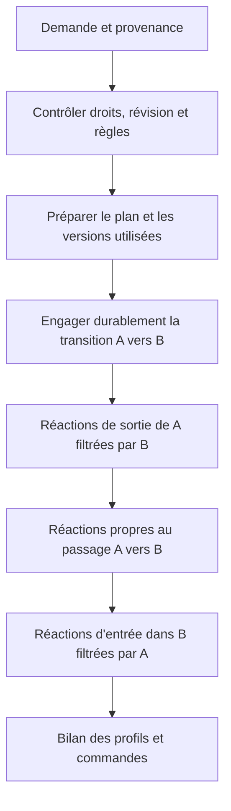

# Proposition — Modes, transitions et profils d’équipements

Date : 21 octobre 2026. Statut : proposition fonctionnelle et technique à relire.
Ce document décrit une évolution ; il ne déclare pas ces fonctions livrées et ne
modifie pas les décisions de [l’architecture](../ARCHITECTURE.md).
Les exemples sont génériques et ne décrivent aucune installation réelle.

## 1. Intention

Permettre à la maison de connaître plusieurs contextes durables et d’adapter ses
automatismes à leur combinaison : fonctionnement général, séjour des enfants,
occupation d’une chambre, activité d’une pièce, vigilance ou télétravail.

Le mode principal reste directement accessible sur l’accueil. Une page « Modes »
affiche automatiquement tous les groupes configurés. Chaque changement indique
l’état quitté, l’état rejoint, sa source, sa cause et les réactions exécutées.

La fonction comprend trois objets liés :

| Objet | Question à laquelle il répond | Exemple |
|---|---|---|
| Mode | Dans quel contexte sommes-nous ? | L’activité de la pièce est « Cinéma » |
| Transition | D’où vient-on, où va-t-on et pourquoi ? | « Cinéma → Nuit », à la demande d’une personne |
| Profil d’équipements | Quels réglages faut-il appliquer ? | Éclairage à 15 %, volets à une position donnée |

Le besoin central dépasse « faire quelque chose quand un état change » : une sortie
de Cinéma vers Nuit doit pouvoir différer d’une sortie de Cinéma vers Normal ; une
entrée en Nuit depuis Cinéma peut aussi différer d’une entrée depuis Lecture.

## 2. Principes retenus pour la proposition

1. Un seul mode principal est présenté sur l’accueil ; les autres restent disponibles
   dans une page dédiée, sans multiplier les boutons sur la page principale.
2. Plusieurs groupes sont actifs simultanément, avec un seul état courant par groupe.
3. Les identités des groupes, états et profils sont stables ; leurs libellés peuvent
   changer et être traduits sans casser les références.
4. Un mode décrit un contexte. Ses effets sont des réactions explicites, configurées
   et validées, pas des comportements cachés dans son nom.
5. Une transition conserve un contexte immuable, notamment `from` et `to`, disponible
   pour les règles de sortie, de passage et d’entrée.
6. Un profil décrit des valeurs cibles réutilisables. Il peut être appliqué depuis
   plusieurs transitions ou directement, sans imposer un changement de mode.
7. La famille conserve les commandes ordinaires selon les droits actuels. Les règles
   automatiques, leurs dépendances et leurs remplacements suivent la validation humaine.
8. L’IA prépare, configure et explique. L’exécution autonome des transitions et des
   commandes reste déterministe, conformément à l’architecture actuelle.
9. Mode demandé, mode courant et réussite des effets sont distingués. Une transition
   logique réussie ne prouve pas que tous les appareils ont atteint leur consigne.

## 3. Vocabulaire et organisation des modes

Un **groupe de modes** est un ensemble nommé d’états exclusifs : « Maison », « Séjour
des enfants », « Activité de la pièce ». Dans l’interface, on peut naturellement
parler de « mode Cinéma » ; dans le modèle, Cinéma est un état d’un groupe identifié.

| Groupe possible | États possibles | Portée et intérêt |
|---|---|---|
| Maison, principal | Normal, Absent, Nuit, Vacances | Fonctionnement général |
| Séjour des enfants | Chez nous, Hors séjour | Horaires et confort pendant une période de séjour |
| Chambre d’amis | Libre, Occupée | Volets et confort de cette pièce |
| Activité d’une pièce | Normal, Lecture, Cinéma, Nuit | Réglages locaux adaptés à l’activité |
| Vigilance | Vert, Orange, Rouge | Réactions graduées aux incidents |
| Armement de l’alarme | Désarmée, Partielle, Totale | Surveillance effectivement armée |
| Travail | Habituel, Télétravail | Bureau et interruptions |
| Repos | Habituel, Sieste | Annonces et actions gênantes |
| Entretien | Habituel, Ménage, Travaux | Suspensions temporaires de règles concernées |

Ces groupes constituent un catalogue d’idées, pas une configuration obligatoire.
Une maison peut se limiter aux groupes qui lui servent. La portée peut être la
maison, une pièce ou un ensemble explicite de pièces ; elle est montrée à la validation.

La combinaison « Maison = Nuit », « Séjour des enfants = Chez nous » et « Chambre
d’amis = Occupée » n’exige pas de créer un état distinct pour chaque combinaison.
Une règle peut utiliser plusieurs groupes comme conditions.

Le séjour planifié et la présence physique restent deux informations différentes :
une absence pendant la journée ne termine pas automatiquement un séjour. De même,
une réservation ne prouve pas une arrivée réelle. Armement et vigilance sont séparés :
être en Rouge ne signifie pas qu’un ordre d’armement vient d’être exécuté.

Une indisponibilité est une qualité de l’information, distincte d’un état métier.
« Inconnu » ne signifie ni Libre, ni Absent, ni Vert. Un nouvel état métier de ce nom
n’est créé que si sa signification et ses réactions sont explicitement définies.

## 4. Sources des changements et arbitrage

« D’où vient le changement » recouvre deux dimensions : l’état précédent et la source
de la demande. Elles doivent être conservées séparément.

| Source | Exemple | Contrat proposé |
|---|---|---|
| Personne | Choisir Cinéma dans la page Modes | Droits du foyer et garde habituelle |
| Consigne à l’assistant | « Prépare une période invités pour ce week-end » | Interprétation et aperçu ; commande ou règle selon les droits existants |
| Planning | Semaine de séjour récurrente | Définition validée, fuseau et prochaine échéance visibles |
| Agenda | Fenêtre de réservation active | Source choisie par un humain et correspondance déterministe validée |
| Équipement ou capteur | État d’une centrale d’alarme | Source et fraîcheur vérifiées, transitions autorisées explicites |
| Automatisme | Passage en Nuit à une heure choisie | Graphe validé et corrélation du lancement conservée |
| Système externe | Événement d’un connecteur autorisé | Adaptateur identifié, entrées bornées, aucune autorité implicite |

Un libellé fourni par un client, un texte d’agenda ou un champ `source` ne prouve pas
une autorisation. L’origine et les droits sont établis côté serveur ; les métadonnées
de provenance expliquent la demande sans lui accorder de pouvoir supplémentaire.

### 4.1 Correction manuelle et retour au planning

Pour les modes ordinaires, proposer un fonctionnement automatique avec dérogation
manuelle : jusqu’à une échéance choisie, jusqu’à la prochaine frontière du planning,
ou jusqu’à « Reprendre le planning ». Montrer la durée et l’état qui prendrait le relais.
Une dérogation expirée fait recalculer la situation présente ; elle ne rejoue pas les
transitions horaires manquées. Le traitement des effets suit la politique de reprise.

La définition du groupe choisit ses sources et leur ordre de priorité. À priorité
égale, un ordre stable par identité départage les sources ; une configuration
contradictoire doit être signalée dans l’aperçu. Le dernier message réseau reçu ne
constitue pas une règle de priorité. Toutes les décisions restent explicables.

### 4.2 Sources périmées

Chaque liaison automatique définit sa fraîcheur et le comportement en cas de panne :
conserver une valeur en la marquant périmée, déclarer l’état indisponible, ou employer
un repli explicitement validé. Aucune panne d’agenda ne devient silencieusement
« chambre libre ». Aucun équipement d’alarme injoignable ne prouve le retour au Vert.

## 5. Transitions : état précédent, état suivant et cause

Une transition est un passage accepté `A → B` dans un groupe. Elle porte :

| Donnée | Usage |
|---|---|
| Identité de transition et révision du groupe | Déduplication, concurrence, corrélation |
| Groupe et version de définition utilisée | Expliquer et reproduire la décision logique |
| `from` et `to` | Filtrer le passage et les réactions de sortie/entrée |
| Source, origine, acteur et cause | Comprendre pourquoi le changement a été demandé |
| Instant de demande et instant d’engagement | Distinguer réception et changement effectif |
| Chaîne causale | Relier agenda, automatisme, transition, profil et commandes |
| Dérogation et échéance éventuelles | Expliquer la durée et le retour au fonctionnement automatique |
| Résultat des réactions | Montrer succès, attente, échec partiel ou interruption |

Les références de cause sont minimales et opaques lorsque nécessaire. Ne pas copier
de titre privé, de participant, d’URL secrète ou de contenu d’agenda dans un événement
générique, une projection de point ou un message public.

### 5.1 Trois points d’accroche

| Réaction | Déclenchement | Filtres utiles |
|---|---|---|
| Sortie de A | On quitte A | Destination B, source, autres contextes |
| Passage A → B | Cette paire exacte est parcourue | Cause, source, autres contextes |
| Entrée dans B | On rejoint B | Provenance A, source, autres contextes |

Exemples de règles exprimables :

- Sortir de Cinéma **vers Normal** : restaurer certains réglages antérieurs.
- Sortir de Cinéma **vers Nuit** : abandonner la restauration et appliquer le profil Nuit.
- Entrer dans Cinéma **depuis Lecture** : appliquer le même profil Cinéma, avec une
  étape de préparation propre à cette provenance si elle a été configurée.
- Entrer dans Nuit **depuis Absent** : appliquer un parcours différent de Normal → Nuit.
- Passer de Vigilance Orange à Rouge : exécuter l’escalade prévue, sans répéter toutes
  les réactions déjà faites en Orange.
- Quitter Rouge vers Orange : conserver les mesures prévues pour un incident encore actif.

Un filtre absent signifie « toute provenance » ou « toute destination ». Les conditions
peuvent combiner la paire, la source et d’autres groupes, sans formule libre exécutée
par un LLM. `from` et `to` restent ceux de la transition, même après une attente.
Une condition sur l’état courant est une autre lecture, explicitement identifiable.

### 5.2 Ordre proposé

Les trois phases s’exécutent dans cet ordre ; dans une phase, l’ordre explicite des
étapes fait foi. Les règles génériques et spécifiques qui correspondent s’ajoutent :
une règle spécifique ne remplace pas silencieusement une règle générale. L’aperçu
montre l’ensemble et signale les effets contradictoires ou répétés.

La sortie est ici une **phase de réaction** : l’état courant B a déjà été engagé.
Les actions de sortie utilisent le contexte `from = A`, `to = B` ; elles ne relisent
pas le point courant en espérant y retrouver A. Les préconditions capables de refuser
le changement sont évaluées avant engagement, pas dans une action de sortie.

Une même valeur demandée de nouveau produit un reçu « déjà dans cet état » sans
rejouer les sorties et entrées. « Réappliquer le profil » est une opération distincte.
Un changement de source à état identique actualise sa provenance sans simuler A → A.

### 5.3 Concurrence, attentes et annulation

Les changements d’un groupe sont sérialisés et contrôlés par révision attendue.
Deux clients ne peuvent pas engager une transition depuis la même ancienne révision.
Un conflit exige de relire l’état, sans remplacer aveuglément la demande par une autre.

Une nouvelle transition acceptée invalide les effets encore en attente de l’ancienne.
Les étapes différées revérifient la génération, les conditions courantes nécessaires,
les droits et le permis vivant avant émission. Une commande déjà envoyée n’est pas
défaite ; son résultat reste suivi et journalisé. Une escalade urgente ne reste pas
bloquée derrière une attente de confort.

Chaque chaîne de transitions conserve sa cause initiale. Les dépendances de réactions
qui se déclencheraient en boucle, dans un groupe ou entre groupes, sont refusées ;
les allers-retours entre états sur des demandes distinctes restent normaux. Les chaînes
provoquées par des événements externes sont bornées et protégées contre les oscillations.
Une mise à jour d’un autre groupe reste une transition distincte : pas de transaction atomique entre tous les
contextes ni entre leurs appareils.

### 5.4 Changement logique et échec d’un effet

Une définition invalide, une source non autorisée ou une précondition non satisfaite
refuse la transition avant engagement. Un appareil hors ligne pendant une réaction
laisse la transition engagée, avec un résultat partiel. L’interface peut donc afficher
« Cinéma — éclairage appliqué, volet indisponible ».

Le plan définit les étapes indispensables et facultatives : l’échec d’une étape
indispensable arrête la suite dépendante ; les branches indépendantes autorisées
peuvent continuer. Il n’y a pas de retour automatique au mode précédent pour masquer
un échec physique, ni de promesse de transaction entre appareils.

## 6. Profils d’équipements réutilisables

Un profil d’équipements est un ensemble nommé de **valeurs cibles typées** : lumière
allumée ou éteinte, luminosité, couleur, température de blanc, position de volet,
consigne de chauffage ou volume lorsque les appareils exposent ces capacités.
Il peut concerner plusieurs appareils et plusieurs familles d’équipements.

Ces profils sont la présentation fonctionnelle des **scènes** proposées par
[AUTO-S1](../components/automatismes-primitives.md#auto-s1--scène). Il faut un seul
moteur de scènes, pas deux implémentations concurrentes. Ils sont distincts des
[profils déclaratifs d’intégration](../components/profils.md), qui décrivent comment
communiquer avec un appareil. Une ambiance lumineuse existante peut être réutilisée
comme étape explicite, mais ne couvre pas à elle seule les volets et le reste.

### 6.1 Exemple : profil Cinéma

| Équipement fictif | Valeurs cibles |
|---|---|
| Lampe principale de la pièce | Éteinte |
| Éclairage indirect | Allumé, luminosité 15 %, blanc chaud si disponible |
| Volet de la pièce | Position fermée selon la sémantique réelle du point |
| Téléviseur | Allumé si le point sait représenter et appliquer cet état |
| Enceinte | Volume à une valeur choisie, si ce point est exposé |

Ne pas supposer qu’un pourcentage de volet a le même sens pour tous les pilotes.
L’éditeur utilise le sens, l’unité et les bornes du point réellement choisi.
Une action événementielle comme « lancer un film », « annoncer un message » ou
« ouvrir une gâche » reste une étape de réaction distincte d’un profil d’état voulu.

Le même profil peut être associé à l’entrée dans Cinéma depuis plusieurs états.
Un bouton « Appliquer » permet aussi de l’utiliser sans modifier le groupe de modes.
Appliquer un profil n’active aucun contexte implicitement ; entrer dans un contexte
n’applique que les profils explicitement liés à ses réactions.

### 6.2 Création et édition

Deux chemins sont proposés : sélectionner les appareils et leurs valeurs, ou capturer
un sous-ensemble choisi de réglages actuels. La capture montre les points retenus et
exclut les valeurs inconnues, les secrets et les commandes événementielles.
Elle ne fait pas de copie intégrale opaque de la maison.

Avant publication : valider les types, unités, plages et références ; refuser les
valeurs contradictoires pour un même point ; montrer les pièces, groupes et membres
réellement touchés, avec les protections existantes.

Les profils ont un brouillon et une version courante validée. Modifier un profil
réutilisé montre tous ses consommateurs, y compris les réactions de modes et leurs
graphes. Une édition d’agent ne remplace jamais un profil déjà approuvé.

### 6.3 Application et résultat

L’application produit un plan prévalidé et un bilan par cible : déjà conforme,
retenue pour autorisation, envoyée, confirmée, échouée, remplacée ou résultat inconnu.
La confirmation doit venir d’une observation appropriée ; l’acceptation par un pilote
ne prouve pas toujours que la consigne physique a été atteinte.

Le moteur conserve les dépendances d’ordre sur un appareil et limite la concurrence
entre appareils. Il peut éviter une écriture déjà conforme. Une répétition de demande
avec la même identité retrouve son reçu ; elle ne crée pas une seconde application.
Un résultat ambigu ne provoque pas un réessai physique automatique.

Deux usages sont proposés : appliquer simplement les réglages, ou démarrer un
**profil temporaire avec mémorisation de l’existant**. Dans le second cas, une session
relie la capture avant application, les réglages appliqués et leur restauration à la
fin de cette utilisation. La confirmation des réglages ne termine pas cette session.

Un profil ponctuel ne réserve pas les équipements et ne maintient pas continuellement
leurs consignes. Si une personne règle une lampe ensuite, le profil ne lutte pas contre
elle. Un éventuel profil maintenu serait une extension distincte, avec ses règles de
dérogation et son coût d’exécution.

## 7. Sortir d’un mode : profil suivant, conservation ou restauration

La politique de sortie est explicite et peut dépendre de la destination.

| Politique | Exemple | Effet |
|---|---|---|
| Appliquer un profil de destination | Cinéma → Nuit | Appliquer Nuit, sans retour intermédiaire à l’éclairage précédent |
| Restaurer certains réglages antérieurs | Cinéma → Normal | Restaurer seulement les points admissibles et encore attribuables à cette application |
| Conserver les réglages | Cinéma → Lecture | Garder les points non repris par un profil Lecture |
| Réaction spécifique | Orange → Rouge | Exécuter une séquence dédiée au passage |

### 7.1 Exemple complet : mémoriser, appliquer, puis revenir à l’existant

Le parcours attendu pour un profil temporaire est :

1. Une transition vers Cinéma demande l’application du profil correspondant.
2. **Avant la première commande du profil**, lire et enregistrer les valeurs existantes
   des points qui devront être restaurés : éclairages, positions des volets et autres
   réglages sélectionnés. La capture est rendue durable avant ces commandes.
3. Appliquer les valeurs prédéfinies du profil Cinéma et conserver la capture initiale
   pendant toute cette utilisation, même lorsque l’application est terminée.
4. À la fin de cette utilisation, restaurer les valeurs capturées selon la politique
   de sortie et les contrôles de provenance décrits ci-dessous.

| Réglage fictif | Juste avant Cinéma, mémorisé | Pendant le profil | Après « Terminer et restaurer » |
|---|---|---|---|
| Lampe principale | Allumée | Éteinte | Allumée |
| Luminosité indirecte | 65 % | 15 % | 65 % |
| Volet | À mi-course | Fermé | À mi-course |

La restauration revient à **ce qui existait réellement au début de cette utilisation**.
Elle n’applique pas un profil Normal fixe et ne dépend pas des valeurs présentes lors
de la création du profil. Une séance suivante mémorise son propre état de départ.

Lorsque la session est liée à un mode, sa fin est déclenchée par la sortie de ce mode,
avec la destination connue. Pour un profil appliqué seul, une action explicite
« Terminer et restaurer » termine la session sans changer implicitement un mode.
Un délai de fin éventuel doit être configuré explicitement. Cinéma → Nuit peut choisir
le profil Nuit au lieu de revenir à l’existant, conformément à la table précédente.

### 7.2 Captures par utilisation et limites

La restauration est une option de la liaison ou de l’application ; lorsqu’elle est
choisie, la capture avant application est obligatoire. Elle est bornée aux points
sélectionnés et porte l’identité de session, l’identité d’application et la version du
profil. Elle reste disponible jusqu’au bilan de fin, puis suit une rétention bornée.

Un réessai de la même demande ou une réapplication dans la même session ne remplace
jamais la capture initiale par les réglages Cinéma déjà appliqués. Une nouvelle session
capture un nouvel existant ; la première version ne crée pas de sessions temporaires
imbriquées sur les mêmes points.

Les valeurs inconnues ne sont pas inventées. Si une capture requise ne peut pas être
lue ou enregistrée, l’application est arrêtée avant toute commande du profil, avec
une explication. Retirer des points à restaurer demande un choix explicite ; ce n’est
pas un succès silencieux de la capture incomplète.

### 7.3 Préserver les changements effectués depuis la capture

Avant toute restauration, vérifier que le point est toujours contrôlé par cette
application : aucune commande manuelle, autre règle ou profil plus récent ne l’a repris.
Une simple égalité de valeur est insuffisante : une personne peut avoir choisi la même
valeur. Cela nécessite un suivi de révision et de provenance des écritures, à ajouter
explicitement ; le cache d’état actuel ne fournit pas seul cette garantie.

Le contrôle doit tenir jusqu’à l’admission et l’émission de la commande de restauration,
pas seulement lors de l’aperçu. Un point repris par quelqu’un d’autre est ignoré avec
une explication. Les points repris par le profil de destination sont aussi exclus de
la restauration : éviter « rallumer tout, puis tout éteindre » lors de Cinéma → Nuit.

Pas de restauration automatique globale, de pile illimitée de profils ni de rollback
physique sur échec. Après redémarrage, une ancienne capture ne déclenche aucune
restauration spontanée ; elle peut être présentée pour une nouvelle action explicite.

## 8. Vigilance et réactions graduées

La vigilance est un usage particulier des modes, avec une politique d’escalade adaptée.

| Niveau | Sens possible | Réactions configurables |
|---|---|---|
| Vert | Aucun incident actif connu selon les sources utilisables | Fonctionnement ordinaire |
| Orange | Incident mineur, doute ou signal nécessitant vérification | Information du foyer et vérifications définies |
| Rouge | Intrusion confirmée selon une règle ou une source de référence | Réactions d’alarme explicitement validées |

La confirmation est définie par le propriétaire : état d’une centrale, combinaison
déterministe de signaux ou décision humaine. Un LLM ne transforme pas librement un
texte suspect en preuve d’intrusion.

Si plusieurs incidents sont actifs, le niveau retenu est le plus élevé encore requis.
Un événement Vert d’une source ne supprime pas un incident Rouge d’une autre.
Un acquittement indique qu’une personne a vu l’alerte ; il ne résout pas l’incident.

Les transitions descendantes, notamment Rouge → Orange et Rouge → Vert, ont leurs
conditions propres : résolution des incidents concernés et remise à zéro autorisée
si elle a été prévue. L’absence de nouveau signal ou la panne d’une source ne vaut
pas une résolution. Une indisponibilité est signalée séparément du dernier niveau.

Les temporisations d’anti-rebond et de retour au calme sont explicites et bornées.
La page montre les incidents qui expliquent le niveau et les réactions déjà effectuées,
afin d’éviter les notifications et actions répétées à chaque observation identique.
Les protections des chambres restent indépendantes du niveau de vigilance.

## 9. Plannings, agendas et rôle de l’assistant

### 9.1 Séjours et récurrences

Pour une alternance sur deux semaines : date d’ancrage, fuseau, récurrence, début et
fin de période, puis exceptions explicites. Une simple bascule hebdomadaire ne suffit
pas : une coupure du service pourrait inverser le calendrier réel.

Le dépôt comporte maintenant des [plannings hebdomadaires](../components/plannings.md)
et un [lecteur de réservations ICS](../components/reservations.md). Le premier fournit
un booléen hebdomadaire ; il ne représente pas seul une alternance sur deux semaines.
Le second prend déjà en charge un sous-ensemble de récurrences hebdomadaires avec
intervalle et exceptions, mais garde un contrat de réservation spécifique et une
qualification de fournisseur distincte. Ne pas l’annoncer comme agenda universel.

Réutiliser leurs mécanismes temporels et de fraîcheur ; ajouter une liaison explicite
vers les modes. Le lecteur ICS ne change aujourd’hui ni présence ni mode à lui seul.
Un état de séjour prévu peut alimenter « Occupation planifiée » ; le choix de le relier
à « Chambre occupée » reste une règle visible, avec correction manuelle possible.

### 9.2 Assistant et agents externes

L’assistant peut aider à nommer les groupes, préparer leurs états, construire un profil,
traduire une consigne en période ou en règle, proposer des transitions, expliquer les
effets et repérer les incohérences. Les créations et modifications exécutables restent
des brouillons jusqu’à leur publication humaine selon les mécanismes existants.

Une consigne directe de la famille peut employer les outils de commande disponibles,
avec les droits réels de l’assistant et la garde. Elle ne devient pas automatiquement
un automatisme de confiance. Changer un mode doit tenir compte de ses effets indirects.

L’exécution autonome lit les événements et définitions validés sans dépendre d’un
appel LLM. Une interprétation libre et continue d’agendas par LLM pour décider des
actions serait une autre décision d’architecture ; elle n’est pas introduite par
cette proposition. Les textes externes restent des données, jamais des instructions
capables de modifier les droits, les profils ou les transitions.

## 10. Expérience dans le dashboard

### 10.1 Accueil

Conserver le sélecteur du mode principal et ajouter un accès à la page Modes.
Le rôle principal est une métadonnée explicite, avec une seule référence principale
configurée ; il ne dépend pas du nom d’un groupe ou d’une recherche par suffixe.
La migration conserve la référence du mode principal existant.

Une alerte importante peut apparaître parmi les alertes de l’accueil sans remplacer
le sélecteur principal. L’accueil peut ainsi présenter « Nuit » et une alerte Rouge.

### 10.2 Page Modes

La page se construit depuis les définitions visibles pour l’appelant : aucune liste
de groupes codée en dur dans l’interface. Une carte par groupe montre :

- nom, portée, états disponibles et état courant ;
- provenance du dernier changement, paire précédente → suivante et cause ;
- mode automatique ou dérogation, échéance et prochaine transition prévue ;
- qualité de l’information et sources indisponibles ;
- profils liés et bilan des dernières réactions ;
- actions autorisées : changer d’état, reprendre le planning, voir les règles et le journal.

Un groupe en brouillon est distinct d’un groupe publié utilisable. L’ajout d’un groupe
publié le rend visible sans modification du code de la page. Son retrait conserve les
preuves et les dépendances ; une référence utilisée n’est pas supprimée silencieusement.

### 10.3 Éditeur de transitions et de profils

L’éditeur propose des formulations lisibles : « En quittant Cinéma vers Nuit »,
« En entrant dans Cinéma depuis Lecture » et « Pendant que Chambre d’amis est Occupée ».
Il montre les réactions générales et spécifiques ensemble, dans leur ordre réel.

Pour un profil temporaire, afficher « Mémoriser l’état avant application », les points
capturés et la politique de fin. La session active propose « Terminer et restaurer »
avec l’aperçu des valeurs qui seraient rétablies et des points qui seraient ignorés.

Avant validation ou commande sensible, l’aperçu décrit les équipements touchés,
les réglages prévus, les restaurations ignorées et les conflits connus. Un essai à
blanc détaille le parcours sans changer un mode, attendre réellement, envoyer une
commande, contacter un tiers ou appeler un LLM.

Tous les libellés d’interface et messages exécutables seront traduits en français
et en anglais dès leur écriture. Les noms personnalisés restent des données de la maison.

## 11. Combinaisons et conflits entre usages

Chaque groupe reste indépendant ; une priorité des sources **dans un groupe** ne
résout pas à elle seule les commandes de deux profils sur une même lampe.

Pour la première version, les usages combinés sont exprimés par des conditions et
des réactions explicites : par exemple, le passage général en Nuit peut demander
une transition locale Cinéma → Nuit si cette liaison a été configurée et validée.
Tous les automatismes d’ouverture concernés doivent consulter l’occupation d’une
chambre ; ajouter une règle d’exception à côté d’une ouverture générale qui l’ignore
ne suffit pas.

Prévalider les conflits au sein d’une application et montrer les recouvrements connus
entre profils et règles. Une commande concurrente peut remplacer une consigne ; le
bilan l’indique au lieu de prétendre que le profil est entièrement atteint.
Les conditions et permis sont revérifiés avant les effets différés.

Un moteur général de profils superposés avec arbitrage permanent par point reste une
extension ambitieuse. Il ne doit pas être introduit implicitement en prétendant que
tous les profils ponctuels possèdent les appareils jusqu’à la sortie d’un mode.

## 12. Autorisations et versions exécutables

Un changement de mode peut lancer des actions dans des pièces protégées. Une projection
virtuelle située hors de ces pièces ne doit pas devenir un détour autour de la garde.

Toutes les entrées — page Modes, REST, MCP, CLI, assistant et écriture compatible d’un
point — passent par la même admission métier. Pour une commande directe, considérer
le périmètre des effets dérivés et conserver l’origine, l’acteur et la corrélation.
L’autorisation doit rester valable jusqu’à l’émission, notamment pour une commande
retenue ou une session invitée expirée.

Une réaction automatique agit sous l’autorité de sa définition humaine validée et de
ses sources autorisées. Le fait qu’elle existe ne rend pas tout appelant autorisé à
la déclencher : un agent ne peut pas contourner ses droits en changeant une aide, puis
faire exécuter indirectement le même ordre avec une origine plus forte. Un champ JSON
ne permet jamais de choisir `automation` ou `system`.

Réutiliser le contrat [des dépendances exécutables](../components/plannings.md) pour
les définitions de modes, réactions et scènes : brouillon, courant validé, aperçu des
consommateurs, confirmation PIN et contrôle de versions. L’aperçu inclut les dépendances
transitives et les effets des profils. Les graphes existants n’exécutent jamais un
brouillon modifié par un agent.

L’empreinte couvre les comportements, les liaisons et les identités référencées.
La publication d’une nouvelle version montre les consommateurs affectés. Une transition
admise conserve les versions exécutables résolues dans son plan ; une publication
ultérieure ne réécrit pas ce plan déjà admis. Les transitions suivantes emploient le
nouveau courant. Ce gel concerne le plan de transition ; il ne change pas les lectures
ordinaires des graphes existants, qui suivent leur propre contrat de dépendances.
Coupure, retrait d’autorisation et transition plus récente restent capables d’annuler
des effets non envoyés. Ne pas confondre version de définition,
révision d’état et identité de transition.

Les invités ne reçoivent aucun accès global aux modes, agendas, profils ou incidents.
Une éventuelle commande locale autorisée respecte leurs pièces et fenêtres existantes.
Une permission d’occupation ne crée aucun compte, droit d’accès ou autorisation de serrure.
Aucun canal d’envoi à un tiers n’est activé implicitement par un niveau d’alerte.

## 13. État du dépôt et architecture d’intégration proposée

État examiné le 21 octobre 2026, référence `7cee583`.

| Brique | Présent | Évolution proposée |
|---|---|---|
| Aides `select` et `switch` | Valeurs virtuelles utilisables dans les graphes | Définition métier des groupes, sources et transitions |
| Mode principal de l’accueil | Recherche explicite de `:mode_maison` | Référence principale configurée et page Modes générique |
| Automatismes | Filtres d’état `from` / `to`, conditions, commandes et occurrences | Contexte complet de transition, phases et actions de mode/profil |
| Dépendances exécutables | Types planning et calcul, versions et publication validée | Étendre avec des types modes/scènes, pas du JSON exécutable libre |
| Plannings et ICS | Évaluations déterministes et contrats de reprise | Liaisons explicites vers les groupes et leurs dérogations |
| Scènes d’équipements | Contrat AUTO-S1 proposé | Moteur partagé des profils d’équipements |
| Ambiances | Actions lumineuses existantes | Réutilisation choisie dans une réaction, sans confusion avec un profil complet |
| Hub, garde, permis et journal | Chemin commun des commandes | Admission des effets indirects et corrélation des transitions |

Répartition proposée, à préciser à l’étape d’implémentation :

- Domaine pur : groupes, états, transitions, filtres, définitions typées de scènes
  et validation de leurs références.
- Propriétaire métier : état courant, provenance, dérogations, admission sérialisée,
  révisions et reçus durables. Les projections du hub restent des vues de cet état.
- Moteur d’automatismes : réactions validées, ordre des étapes, attentes, annulations,
  consommation des événements et suivi des lancements.
- Exécuteur de scènes : prévalidation des points, application bornée, confirmations
  et éventuelle capture/restauration contrôlée.
- Connecteurs : publication de données et événements identifiés ; aucune logique
  de commande cachée dans le lecteur d’agenda ou dans un pilote de capteur.
- REST, MCP, CLI et dashboard : mêmes services métier, mêmes droits et mêmes résultats.

Les points des modes peuvent rester lisibles dans les outils et graphes génériques.
Toute écriture d’une ancienne aide adoptée comme mode doit être routée vers le service
de transition ; garder une deuxième voie qui modifie directement son cache créerait
des changements sans contexte ni autorisation cohérente.

## 14. Persistance, reprise et limites

### 14.1 État durable

Les nouvelles définitions suivent le propriétaire de dépendances existant, étendu
avec des types explicites. L’état d’exécution des modes utilise un propriétaire métier
unique et un fichier versionné, par exemple `modes.json`, selon les conventions des
primitives : écriture temporaire, fsync, renommage et synchronisation du dossier avant
acquittement. Le cache périodique `state.json` ne constitue pas cette durabilité.
Cette proposition ne choisit pas une nouvelle base et ne redéfinit pas D13.

Persister ensemble état, révision, provenance, dérogation et reçu de transition, ainsi
que les références nécessaires à son suivi. Les fichiers métier sont inclus dans les
sauvegardes. Une erreur ou une version inconnue bloque le chemin concerné avec un
diagnostic ; aucune réinitialisation silencieuse.

Les captures des sessions de profils temporaires sont des données d’exécution de la
maison, distinctes de la définition du profil. Leur stockage est borné, inclus dans les
sauvegardes et confirmé avant les premières commandes correspondantes.

Les effets physiques commencent seulement après l’engagement durable de leur intention.
Une identité de requête permet de retrouver le résultat d’une réponse perdue sans
recommencer le passage. Les reçus sont bornés ; une identité trop ancienne pour être
prouvée est refusée plutôt qu’interprétée comme une nouvelle intention.

### 14.2 Redémarrage et perte d’événements

Au démarrage, restaurer les états durables, réévaluer les sources encore valides et
réconcilier les contextes présents. Ne pas rejouer les sorties/entrées manquées, les
notifications, les ouvertures ou les applications physiques d’un ancien plan.
Une interruption entre émission et confirmation reste « résultat inconnu ».

Une réconciliation est identifiée comme telle, distincte d’une transition observée
en direct. En première version, elle actualise le contexte sans ses réactions normales ;
un éventuel comportement de reprise nécessite une règle séparée, explicite et validée.
La reprise d’un état n’est jamais interprétée comme une arrivée physique.

Une perte du bus permet de relire l’état courant, pas de recréer toutes les transitions
qui ont eu lieu. Les consommations d’événements portent une identité et une politique
documentées, en cohérence avec les [occurrences](../components/automatismes.md).

### 14.3 Bornes et performance

Le contrat final fixe et teste les plafonds de groupes, états par groupe, réactions,
cibles par profil, captures, reçus, événements, chaînes causales et délais. Une borne
atteinte produit un refus visible ; aucune file, pile de profils ou rétention illimitée.
Les définitions partagées restent dans les plafonds existants tant qu’aucune hausse
n’a été justifiée et mesurée ; les profils ne créent pas un registre parallèle illimité.

Indexer les transitions par groupe et filtres. Réagir aux changements et échéances,
réutiliser les ordonnanceurs, ne pas parcourir tous les profils à chaque seconde.
Sans groupes configurés, aucune tâche périodique dédiée. Les mesures doivent tenir
le [budget de performance](../PERFORMANCE.md), y compris avec le dashboard et les
sources déconnectées. Aucun gain ni coût chiffré n’est revendiqué avant mesure.

## 15. Surfaces proposées et compatibilité

Les noms ci-dessous expriment des capacités à concevoir ; ils ne décrivent pas des
routes ou outils déjà disponibles.

| Capacité | Contenu attendu |
|---|---|
| Lister les modes | Définitions visibles, courant, provenance, qualité et prochaine échéance |
| Préparer un brouillon | États, sources autorisées, réactions et profils référencés |
| Prévisualiser et publier | Différence de version, effets et consommateurs, confirmation humaine |
| Demander une transition | Groupe, destination, révision attendue et identité de requête |
| Simuler une transition | Paire précédente → suivante, règles retenues et commandes prévues |
| Gérer une dérogation | Échéance, retour au planning et nouvelle révision |
| Lister/appliquer les profils | Définition validée et résultat par cible |
| Lire le journal | Corrélation source → transition → réactions → commandes |

Le client ne choisit ni l’état précédent, ni une origine de confiance, ni la version
exécutable réellement autorisée. Un événement interne contient ces informations
établies côté serveur. Les erreurs distinguent conflit, refus, attente humaine,
indisponibilité et application partielle ; une simulation ne crée pas de transition.

Conserver l’identité du mode principal existant et ses références dans les graphes.
L’adoption comme groupe de modes demande un aperçu et une validation explicites :
aucune aide ni automatisation existante n’est réinterprétée au seul motif de son nom.
Les modes d’exécution `restart`, `single` et `queued` des automatismes restent une
notion distincte des modes de la maison.

## 16. Choix d’approche et périmètre progressif

Le regroupement des idées fait apparaître trois ensembles : les **contextes** (modes
et sources), les **passages** (transitions et réactions) et les **réglages** (profils).
Le tri ci-dessous utilise trois critères : couverture du besoin, simplicité pour
la famille et effort d’intégration.

| Approche | Couverture et intérêt | Limite | Avis |
|---|---|---|---|
| Aides seules et graphes écrits à la main | Vérifier rapidement quelques usages | Provenance, révisions et sorties restent dispersées | Utile pour une exploration limitée |
| Modes métier + réactions dans le moteur + scènes partagées | Couvre les transitions conditionnelles et profils réutilisables avec une page commune | Ajoute admission métier et contexte de transition | Approche recommandée |
| Profils maintenus et superposés avec arbitrage permanent | Pour des configurations très nombreuses et fortement combinées | Priorités, propriété des points et dérogations nettement plus complexes | Extension ultérieure |

Découpage proposé, sans estimation ni engagement d’implémentation :

1. **Modes et visibilité** : groupes, principal conservé, page générique, provenance,
   révisions, validation et admission commune. Vérifier deux groupes simultanés.
2. **Transitions complètes** : `from` / `to`, phases ordonnées, filtres, journal, essais
   à blanc, concurrence et reprise. Vérifier deux sorties d’un même état.
3. **Profils via AUTO-S1** : définitions réutilisables, publication des dépendances,
   application et confirmations, sessions temporaires avec capture préalable et
   restauration contrôlée ; priorité au profil de destination lorsqu’il est choisi.
4. **Liaisons automatiques** : planning, ICS, exceptions et dérogations ; garder les
   distinctions entre prévision, présence et événement observé.
5. **Vigilance** : incidents multiples, escalade, acquittement distinct de résolution,
   retours autorisés et réactions graduées.
6. **Extensions facultatives** : modèles prêts à configurer, éditeur enrichi et étude
   des profils maintenus.

Les droits indirects, la durabilité, les états inconnus et les résultats partiels sont
des propriétés de chaque lot concerné ; ils ne sont pas reportés à un lot final.

## 17. Cas d’acceptation pour la future implémentation

1. Ajouter un groupe publié le fait apparaître dans Modes sans changement du frontend ;
   le mode principal reste disponible sur l’accueil.
2. Changer le séjour des enfants ne remplace ni le mode Maison ni l’occupation de la
   chambre d’amis. Une observation d’absence ne termine pas le séjour sans règle prévue.
3. Normal → Cinéma avec restauration mémorise durablement l’existant avant la première
   commande du profil, l’applique une seule fois et conserve sa provenance. Une capture
   obligatoire impossible empêche cette application ; un réessai ne remplace pas la capture.
4. Cinéma → Normal et Cinéma → Nuit sélectionnent des réactions de sortie différentes.
   Une entrée dans Nuit peut aussi filtrer son état précédent.
5. Sortie générale, paire spécifique et entrée générale sont toutes visibles et suivent
   l’ordre annoncé. Les doublons contradictoires sont signalés avant publication.
6. Demander à nouveau Cinéma, ou réessayer la même requête, ne rejoue pas ses réactions.
   Une réapplication explicite de profil reste possible selon les droits.
7. Une attente suivie d’un changement de mode ne laisse partir aucun effet devenu caduc
   encore annulable. Les commandes déjà émises gardent une trace de résultat.
8. Un volet hors ligne produit une application partielle ; la transition logique et la
   réussite de chaque cible restent distinctes. Une reconnexion ne rejoue rien seule.
9. Terminer un profil temporaire restaure l’état de départ propre à cette session,
   y compris hors d’un mode. Modifier manuellement une lampe, même vers la même valeur,
   empêche la restauration de reprendre ce point. Le profil de destination exclut une
   restauration intermédiaire ; une nouvelle session capture un nouvel état de départ.
10. Une publication de profil montre tous ses consommateurs transitifs ; un brouillon
    d’agent n’a aucun effet sur les modes et graphes validés.
11. REST, MCP, CLI, assistant et ancienne écriture de point traversent la même admission.
    Un agent ou invité ne gagne aucun droit en passant par un mode ou un profil.
12. Deux demandes concurrentes depuis une même révision ne peuvent pas toutes deux
    réussir. Une réponse perdue se résout sans double transition.
13. Planning, exceptions, alternance sur deux semaines, fuseau, heures sautées/répétées,
    dérogation et retour au planning produisent des états cohérents après interruption.
14. Une source périmée n’est pas traitée comme Libre ou Vert ; la cause est visible sans
    exposer le contenu privé d’un agenda.
15. Plusieurs incidents actifs maintiennent le niveau maximal requis. Acquitter ne
    résout pas ; l’escalade et les retours ont des règles distinctes.
16. Les coupures avant/après engagement durable et l’incertitude de confirmation ne
    provoquent ni faux succès ni réinitialisation ni rejeu physique aveugle.
17. Un essai à blanc explique le parcours sans effet réel, notification externe, attente
    effective ou appel LLM. Les tests utilisent des appareils simulés et des données fictives.
18. Les plafonds, l’absence de cycles, la sauvegarde/restauration, les traductions fr/en
    et les budgets de performance sont vérifiés sur les chemins réellement livrés.

## 18. Références du dépôt

- [Architecture et règles de commande](../ARCHITECTURE.md).
- [Cœur, garde, origines et journal](../components/coeur.md).
- [Aides et pilotes](../components/pilotes.md).
- [Automatismes et occurrences](../components/automatismes.md).
- [Primitives proposées, dont les scènes AUTO-S1](../components/automatismes-primitives.md).
- [Plannings et versions des dépendances exécutables](../components/plannings.md).
- [Réservations ICS et accès invités](../components/reservations.md).
- [Contrat et limites du lecteur ICS](../../integrations/reservations/README.md).
- [Assistant](../components/moli.md), [dashboard](../components/dashboard.md)
  et [surfaces d’API](../components/api.md).
- [Profils déclaratifs d’intégration, notion distincte](../components/profils.md).
- [Budget de performance](../PERFORMANCE.md).
