# Nettoyage des équipements — Sarah Home : sortir un appareil, et réutiliser sa place

Date : 23 octobre 2026. Statut : **proposition, aucune modification du code**. Base analysée :
`main` au commit `a835893`. Complète l'[étude mémoire v2](memoire-v2.md) (§ 4, les numéros) et la
[haute disponibilité v2](haute-disponibilite-v2.md) (§ 6, la copie ; § 16, l'instantané).

Ta remarque : la mémoire rangée par numéros, où le numéro d'un point est l'adresse de sa fiche, est
efficace. Mais la mémoire v2 dit aussi : « un point retiré garde sa case, condamnée ; son numéro
n'est jamais redonné ». Après une grosse refonte (changer de passerelle, remplacer les capteurs d'un
étage, abandonner une intégration), ces cases s'accumulent : des blocs de mémoire perdus pour
toujours.

Tu demandes une proposition pour gérer la sortie des équipements, et le nettoyage de ces blocs pour
les réutiliser. Pas forcément tout de suite : peut-être par lots. Avec deux mises en garde :

- les workflows et la haute disponibilité tiennent des informations importantes ;
- l'opération sera rare, et son passage doit être optimisé.

Méthode, et techniques employées, nommées au fil du texte :

- **« Comment pourrait-on… »** : la demande reformulée en cinq questions, et ce qui prouvera la
  réponse (§ 2) ;
- **premiers principes** : ce que coûte vraiment une case condamnée, mesuré sur vingt ans de la vie
  d'une maison (§ 3) ;
- **inventaire** : tout ce qui garde un numéro dans la conception (mémoire v2, haute disponibilité
  v2), et tout ce qui garde le nom d'un appareil dans le code d'aujourd'hui (§ 4) ;
- **analogies** : les moteurs de jeu, Home Assistant, Cassandra, les allocateurs de mémoire, les
  ramasse-miettes, les numéros de processus d'Unix, l'hôtel et sa « chambre à faire » (§ 5) ;
- **SCAMPER** et le **brainstorming inversé** (« comment rater ce nettoyage ? ») pour produire les
  options et les garde-fous (§ 5) ;
- **analyse morphologique**, puis **sélection à critères visibles** (§ 6) ;
- **un banc** : le registre proposé, la mémoire de la v2, un moteur de workflows réduit, deux copies
  de secours et un client. Une refonte y est rejouée minute par minute, et vingt ans de la vie de la
  maison simulés. 18 tests ; 11 fautes injectées, toutes détectées. Linux musl, 2 CPU et 128 Mio,
  trois essais par mesure. Rangé dans `tools/nettoyage-banc/` (annexe A).

Vocabulaire :

- une **place** : la case d'une fiche dans les colonnes de la mémoire v2 (la valeur vive d'un point,
  la santé d'un appareil) ;
- la **génération** d'une place : combien de fois elle a déjà servi ;
- le **numéro** : la place et sa génération, dans les mêmes 4 octets ;
- **absent** : l'intégration ne donne plus l'appareil (catalogue relu, pont redémarré, instance
  arrêtée). Tout est gardé, il peut revenir ;
- **retiré** : un humain a décidé qu'il ne revient pas. Il n'est plus lu ni commandé, et sa place
  attend ;
- le **délai de grâce** : le temps pendant lequel un retrait peut encore être annulé ;
- le **lot** : l'opération qui libère d'un coup les places retirées depuis plus longtemps que le
  délai de grâce ;
- la **succession** : un appareil neuf prend la suite d'un ancien (mêmes rôles dans les workflows,
  même pièce, même compteur d'énergie) ;
- le **déménagement** : l'opération rare qui resserre les colonnes, en déplaçant les fiches vers les
  places libres du bas.

## 1. Le verdict en bref

- **Oui, les blocs se récupèrent sans risque, à une condition : le numéro garde sa place et y ajoute
  une génération.** La génération prend 7 bits sur les 32 du numéro ; la place en garde 24, soit
  16,7 millions de places, et le bit réservé de la v2 reste. Une place libérée sert de nouveau, à la
  génération suivante. **Le numéro entier, lui, n'est toujours jamais redonné** : la règle de la
  mémoire v2, dont la haute disponibilité a besoin, tient. Seule la case se réutilise (§ 7).
- **Trois rythmes**, comme tu le proposais (§ 8 à 12) :
  - au fil de l'eau, on **retire** : un geste, aussitôt fait, et rien n'est libéré ;
  - **par lots**, on **libère** : la nuit, au plus tôt 30 jours après le retrait ;
  - **rarement**, à la fin d'une refonte, on **déménage** pour rendre la mémoire.
- **Mesuré sur vingt ans de la maison ×1** : 2 264 points, des remplacements chaque mois, une grande
  refonte tous les cinq ans (§ 3).

  | Au bout de vingt ans, ×1 | Places | Noms gardés | Mémoire |
  |---|---|---|---|
  | Sans jamais libérer | 11 063 | 11 063 | 2,2 Mo |
  | Avec les lots | 3 611 | 2 300 | 0,5 Mo |
  | Avec un déménagement à chaque fin de refonte | 2 390 | 2 295 | 0,4 Mo |

  Avec les lots, la mémoire ne dépend plus de l'histoire de la maison, seulement de sa taille.
- **Le passage ne coûte presque rien** (§ 11 et § 12) :
  - un lot qui libère 648 points à ×1 prend 29 µs, en un seul message de 1,6 Ko ;
  - à ×100 (67 996 points), il prend 3,4 ms ;
  - le déménagement de toute la maison ×1 prend 113 µs et 15,8 Ko de message ; à ×100, 9,0 ms.

  Le coût n'est pas dans le processeur. Il est dans la discipline : des règles, et des tests qui
  savent échouer.
- **Les workflows** (§ 13) :
  - aucun ordre ne part vers un appareil retiré ;
  - un automatisme qui en cite un passe « à revoir » ;
  - la **succession** récrit les définitions par les noms, en une seule validation, et l'automatisme
    continue avec l'appareil neuf ;
  - une attente « depuis 10 min » sur un appareil absent ou retiré ne part pas ;
  - la cause d'une ancienne exécution ne prend jamais le nom du nouvel occupant.
- **La haute disponibilité** (§ 14) :
  - retrait, lot et déménagement sont des sorties critiques, au rang `s`, décidées par l'actif
    seul ; les copies les rejouent ;
  - au banc, la copie qui applique tout, et celle qui a manqué le lot puis repris par l'état
    complet, finissent identiques à l'actif ;
  - un client qui revient avec un vieux cache ne confond jamais deux appareils. Un numéro réutilisé
    lui est inconnu : il redemande `meta/`, la règle qui existe déjà en v2.
- **Le prix de la génération** est nul sur le chemin chaud : le programme est recompilé à chaque lot
  et ne garde jamais un numéro périmé. Vérifier la génération ajoute 0,16 ns à une lecture à ×1 ; on
  ne le fait qu'aux endroits qui gardent un numéro longtemps : exécutions, attentes, minuteries,
  baux, caches.
- **Trouvé dans le code d'aujourd'hui : rien ne sort proprement** (§ 4.3) :
  - un automatisme qui cite un appareil disparu reste approuvé, et ne part plus, sans aucune trace ;
  - un compteur d'énergie continue de compter la dernière puissance d'un appareil retiré : des kWh
    fantômes ;
  - les étiquettes et l'état restauré d'un appareil parti restent pour toujours, et empêchent même
    certains remplaçants d'être admis ;
  - rien ne permet de remplacer un appareil par un autre.
- **Trouvé par le banc** (§ 17) :
  - une place réutilisée doit être remise à zéro, sinon l'appareil neuf lit la dernière valeur de
    l'ancien. Une faute injectée l'a montré, et un test le garde maintenant ;
  - le tiroir des noms, récrit après un lot, ne doit garder aucun ancien décalage. C'était un défaut
    réel du premier jet, trouvé par la simulation de vingt ans.

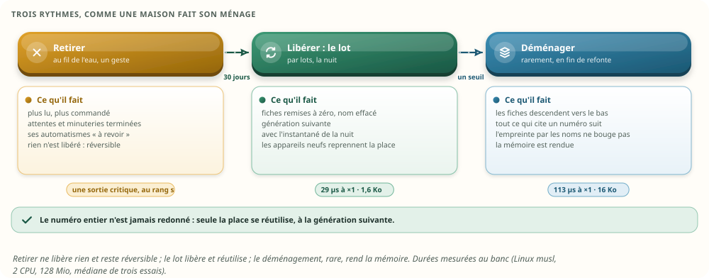

## 2. La question, reformulée

Technique **« Comment pourrait-on… »** (*How Might We*) : la demande, posée en questions ouvertes.

1. Comment pourrait-on laisser partir un équipement sans laisser de poids mort, ni dans la mémoire,
   ni dans les copies ?
2. Comment pourrait-on réutiliser une place sans qu'aucun lecteur, workflow, copie ou écran, ne
   confonde l'ancien occupant et le nouveau ?
3. Comment pourrait-on faire du nettoyage une opération rare, par lots, presque gratuite, invisible
   pour la maison ?
4. Comment pourrait-on éviter le trou quand un équipement en remplace simplement un autre ?
5. Comment pourrait-on garder les workflows et la haute disponibilité exacts pendant tout cela ?

Ce qui prouvera la réponse, fixé avant de chercher :

| Critère | La preuve |
|---|---|
| Aucun ordre ne part vers un appareil retiré, ni vers le mauvais | un test, et des fautes injectées qui le font échouer |
| Aucun nom n'est pris pour un autre : exécutions, caches, copies | trois tests |
| Les copies restent identiques, même après un trou | l'empreinte de la mémoire, comparée |
| La mémoire ne grandit pas avec l'histoire de la maison | vingt ans simulés |
| Le passage tient en millisecondes, et en un message | mesuré à ×1, ×10 et ×100 |
| Rien ne disparaît sans un humain | un délai de grâce, et le retrait réversible |

## 3. Ce que coûte une case condamnée

### 3.1 En mémoire, sur vingt ans

**Premiers principes** : une case condamnée coûte sa fiche et son nom. La mémoire v2 l'a mesuré :
124 octets par point, tout compris, soit 0,1 Mio pour mille points retirés. C'est peu une fois. Mais
cela s'ajoute à chaque remplacement, pour toute la vie de la maison.

Le banc simule vingt ans. Chaque mois, 0,5 % des appareils sont remplacés, 0,3 % retirés et 0,3 %
ajoutés ; tous les cinq ans, une grande refonte remplace la moitié des appareils. Trois règles :

- jamais libérer (la v2 telle quelle) ;
- libérer par lots, chaque mois, 30 jours après le retrait ;
- les lots, plus un déménagement le mois qui suit chaque grande refonte.

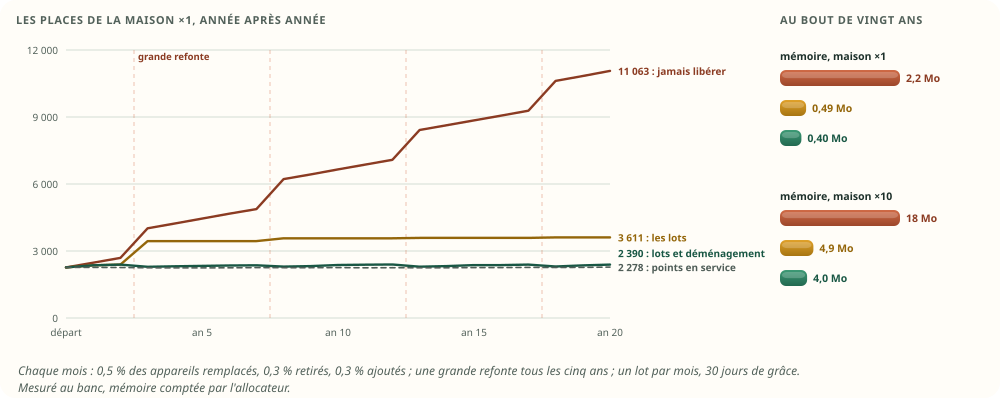

| Au bout de vingt ans | ×1 | ×10 |
|---|---|---|
| Points déclarés en vingt ans | 11 063 | 110 782 |
| Points en service | 2 278 | 22 616 |
| **Jamais libérer** : places, mémoire | 11 063 ; 2,2 Mo | 110 782 ; 17,7 Mo |
| **Les lots** : places, mémoire | 3 611 ; 0,5 Mo | 36 115 ; 4,9 Mo |
| **Les lots et le déménagement** : fiches, mémoire | 2 390 ; 0,4 Mo | 23 170 ; 4,0 Mo |
| Noms gardés : jamais / lots | 11 063 / 2 300 | 110 782 / 22 800 |
| État complet : jamais / lots / déménagement | 1 297 / 241 / 238 Ko | 13,0 / 2,4 / 2,4 Mo |

Sans libérer, la maison ×1 tient 4,9 fois plus de places qu'elle n'a de points en service, et chaque
grande refonte ajoute une marche. Avec les lots, les places suivent le **pic** : la maison d'avant
et la maison d'après, le temps du délai de grâce. La refonte suivante réutilise ces places. Le
déménagement ramène les fiches au nombre de points vivants.

### 3.2 Ce qui n'est pas de la mémoire

Trois coûts pèsent plus que les octets :

- **Les noms restent.** Un appareil retiré garde son nom dans l'annuaire, et donc dans chaque
  instantané, chez le secours local et chez le distant. C'est parfois l'adresse MAC d'un téléphone,
  ou le prénom de quelqu'un : la confidentialité demande qu'ils partent (§ 15).
- **L'état complet suit.** C'est ce que la haute disponibilité envoie à un secours en retard. Sans
  lot, il porte tous les noms jamais donnés : 1,3 Mo au bout de vingt ans à ×1, contre 241 Ko avec
  les lots.
- **La base a ses propres numéros, bornés.** Le catalogue de D13 tient 524 288 points (`samples.id =
  point_id · 2^44 + ts`), et les compteurs d'énergie 1 024 (`meter_state.id ≤ 1023`). Aucun n'est
  réutilisé aujourd'hui (§ 16).

### 3.3 Ce que cela veut dire

À ×1, 2 Mo en vingt ans ne gênent pas un Pi. Mais la croissance n'a pas de fin, les noms ne partent
jamais, et le vrai risque est ailleurs. **Aujourd'hui, la sortie d'un appareil n'existe pas** : ce
qui le cite reste, en silence (§ 4.3). La proposition traite donc d'abord la sortie, puis la
réutilisation, et la mémoire en dernier.

## 4. Qui garde un numéro, ou le nom d'un appareil

### 4.1 Dans la conception : mémoire v2 et haute disponibilité v2

**Inventaire** des endroits qui gardent un numéro de point ou d'appareil, et ce que la proposition
en fait :


| Qui le garde | Combien de temps | Ce que la proposition en fait |
|---|---|---|
| Les colonnes du hub : définition, valeur vive, péremption, fraîcheur ; santé et échéance par appareil | tant que la place est occupée | le lot remet les fiches à zéro |
| L'annuaire : le nom de chaque place | tant que la place porte un nom | le lot efface le nom |
| Le programme : règles, nœuds, index par point, feuilles des conditions composées, fiches horaires portées par une valeur | jusqu'à la recompilation suivante | recompilé à chaque retrait, lot et déménagement : il ne garde jamais un numéro périmé |
| Les exécutions (64 o : la cause, et la cible par le nœud) | de quelques secondes à 24 h | la génération rend une référence périmée inerte ; elles suivent un déménagement |
| Les attentes des déclencheurs à durée (24 o) | la durée attendue | retirées au retrait ; revérifiées à l'échéance ; elles suivent un déménagement |
| Les minuteries, les baux « pendant », les approbations | de minutes à heures | terminés au retrait : il n'y a plus rien à éteindre ni à rétablir |
| La file des exécutions finies, montrée par l'écran | les 500 dernières | la génération : « appareil retiré » une fois la place libérée |
| La file des 10 000 sorties de l'actif, l'état complet, l'instantané, la mémoire des secours | selon le rang | chaque sortie parle la numérotation de son rang ; tout s'applique dans l'ordre de `s` |
| Les abonnés internes : le moteur du secours, les écrans, la base | le temps d'une connexion, ou plus en cache | un numéro inconnu → `meta/` (la règle de la v2) ; un numéro réutilisé leur est inconnu |
| Les clients extérieurs | — | les noms seulement (la règle de la v2) |
| Tout ce qui dure : la base, l'archive, le journal d'exécution (`run/`, `hist/ops`), l'audit | des mois, des années | **les noms**, jamais un numéro : la règle des deux bases, étendue au journal d'exécution |

### 4.2 Pourquoi la règle « jamais redonné » tient encore

La v2 a fixé cette règle parce qu'un numéro voyage : dans le flux du hub, dans l'instantané, chez
les secours, sur MQTT. Avec la génération dans le numéro, **le numéro entier n'est jamais
redonné** : la place 1 234 de génération 0 et la place 1 234 de génération 1 sont deux numéros
différents. Tout ce qui garde l'ancien sait qu'il est périmé, soit en comparant la génération, soit
parce que le numéro lui est inconnu. Seul ce qui se recompile de toute façon (le programme) n'a rien
à vérifier.

### 4.3 Dans le code d'aujourd'hui : quand un appareil sort

Aujourd'hui, les références sont des noms (`DeviceId`, `PointId`), pas des numéros. Un appareil sort
quand son pilote appelle `remove_device`, parce que l'intégration ne le donne plus. Le Zigbee le
fait au catalogue relu (`moli-z2m/src/lib.rs:226-230`) ; Hue, Overkiz, Voltalis, Ariston, Netgear et
le Cast aussi. Le hub retire alors les valeurs, la disponibilité et la définition, et publie
`DeviceRemoved` (`moli-runtime/src/hub.rs:2201-2223`). Le reste, relevé fichier par fichier :

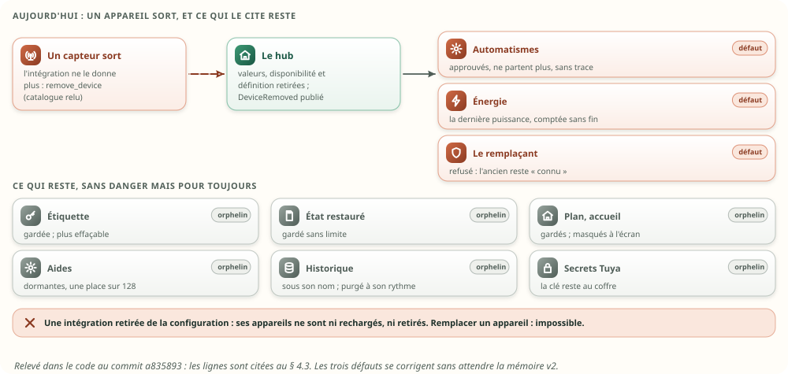

| Ce qui cite l'appareil | Ce qui lui arrive | Où |
|---|---|---|
| Les automatismes qui le citent | **gelés, en silence** : toujours approuvés et actifs ; un seul point manquant suffit à ce qu'aucun départ n'aboutisse, sans exécution enregistrée ni journal ; seul l'écran le montre (`live: false`) | `moli-automation/src/dependencies.rs:84-101`, `engine.rs:650-657`, `engine.rs:558`, `moli-api/src/automations.rs:82` |
| Un compteur d'énergie qui intègre une puissance | **des kWh fantômes** : `DeviceRemoved` est ignoré, et toutes les 5 min la dernière puissance tenue est comptée de nouveau, sans fin | `moli-energy/src/lib.rs:580-612`, `lib.rs:742-767`, `meter.rs:196-203` |
| Son étiquette (nom, pièce) | gardée pour toujours ; l'API refuse de la modifier ou de l'effacer, l'appareil étant inconnu | `moli-runtime/src/labels.rs:11`, `hub.rs:1704`, `moli-api/src/rest.rs:364` |
| Son état restauré (`state.json`) | gardé sans limite s'il n'est jamais redéclaré | `moli-runtime/src/hub.rs:593-597`, `hub.rs:2150-2156` |
| La liste des appareils « connus » d'une intégration | étiquettes et état restauré en font encore partie : un profil à cible unique, ou le routeur Netgear, **refusent alors le remplaçant** (identité différente) | `moli-runtime/src/hub.rs:2339-2350`, `moli-profile/src/policies.rs:89-95`, `moli-netgear/src/publication.rs:163` |
| Le plan, l'accueil (favoris, portes, prises) | gardés ; l'écran masque ce qu'il ne connaît plus | `moli-api/src/plan.rs:371`, `home.json` |
| Les aides (agrégats, durées, scènes), compteurs, minuteurs, dates | gardés, dormants, chacun dans une des 128 places de sa sorte ; une source disparue est exclue de la moyenne | `moli-runtime/src/dependencies/store.rs:75`, `computed_hub.rs:281` |
| L'historique | gardé sous son nom, et purgé à son rythme ; `DeviceRemoved` est ignoré | `moli-history/src/lib.rs:342` |
| Une intégration retirée de la configuration | ses appareils ne sont **ni rechargés, ni retirés** : ils ne passent jamais par `remove_device` | `moli-os/src/main.rs:1124`, `moli-runtime/src/hub.rs:593-597` |
| Renommer une intégration | change l'identité de tous ses appareils (`{instance}:{natif}`) | `moli-core/src/id.rs:68`, `moli-os/src/config.rs:186` |
| Remplacer un appareil par un autre | **impossible** : aucune fonction ; seule voie, l'arrêt et l'édition des fichiers à la main | — |

Le relevé complet compte une vingtaine d'emplacements. La plupart gardent un orphelin sans danger.
Trois défauts comptent : l'automatisme gelé sans trace, les kWh fantômes, et les fantômes qui
bloquent un remplaçant. Ils se corrigent sans attendre la mémoire v2 (§ 20, marche 1).

## 5. Les idées

### 5.1 Ailleurs, comment fait-on ?

Technique des **analogies** : d'autres domaines réutilisent des places numérotées.

| Où | Ce qu'ils font | Pourquoi ça peut marcher ici |
|---|---|---|
| **Moteurs de jeu** (EnTT, Bevy) | une entité est un entier : 20 bits d'entité et 12 de version dans EnTT ; une place recyclée change de version | une référence périmée se voit en une comparaison, sans rien chercher |
| **Home Assistant** | un appareil supprimé est gardé 30 jours (`ORPHANED_DEVICE_KEEP_SECONDS`) ; s'il revient, il retrouve son identifiant, sa pièce, ses étiquettes | un délai de grâce, et un retour sans perte |
| **Cassandra** | une suppression est une pierre tombale, gardée `gc_grace_seconds` (10 jours par défaut) pour que chaque réplique l'apprenne avant le compactage ; sinon, la donnée revient d'entre les morts | le retrait est une sortie critique, propagée avant d'être nettoyée |
| **Allocateurs de mémoire** | une liste des cases libres, en plages ; on sert la plus basse d'abord | la mémoire suit le pic, plus l'histoire ; la queue se vide |
| **Ramasse-miettes compacteurs** | déplacer les vivants, mettre à jour chaque référence | le déménagement, et son risque : une référence oubliée |
| **Numéros de processus d'Unix** | un numéro réutilisé trop tôt fait viser le mauvais processus ; d'où les `pidfd` | jamais réutiliser sans un moyen de reconnaître l'ancien |
| **L'hôtel** | entre deux clients, la chambre est « à faire » ; le ménage passe par étage, à heure fixe | libérer par lots, et remettre à zéro avant de redonner |
| **Les numéros de téléphone** | un numéro résilié attend avant d'être réattribué | une quarantaine ; ici, la génération fait le travail, sans attendre des mois |

### 5.2 SCAMPER sur la case condamnée

| Lentille | L'idée | Ce qu'elle apporte |
|---|---|---|
| **S**ubstituer | le numéro devient place + génération | la réutilisation sans ambiguïté |
| **C**ombiner | le lot de nuit avec l'instantané de nuit | une seule écriture sur disque |
| **A**dapter | le délai de 30 jours de Home Assistant | un retrait annulable, sans perte |
| **M**odifier | libérer par appareil, en plages | les points d'un appareil se suivent toujours |
| **P**roposer un autre usage | pendant la grâce, la place retirée dit « remplacé par … » | l'écran explique, sans rien stocker de plus |
| **É**liminer | le trou à la source : la succession | une refonte remplace plus qu'elle ne retire |
| **R**enverser | toujours servir la place libre la plus basse | la queue se vide, et se rogne sans rien déplacer |

### 5.3 Brainstorming inversé : comment rater ce nettoyage ?

Technique du **brainstorming inversé** : chercher les pires façons de faire, puis en tirer les
garde-fous.

| La pire idée | Ce qu'elle casserait | Le garde-fou |
|---|---|---|
| Réutiliser une place qu'une exécution cite encore | l'ordre part vers le nouvel appareil | la génération : la référence devient inerte |
| Laisser armée une attente sur un appareil retiré | « porte ouverte depuis 10 min » part sur un capteur parti | retirée au retrait, et revérifiée à l'échéance |
| Donner une place sans la remettre à zéro | l'appareil neuf lit la dernière valeur de l'ancien | fiches remises à zéro, par le lot et par la déclaration |
| Libérer sur une copie avant de l'avoir retiré | deux mémoires différentes | tout passe au rang `s`, et la copie ne décide rien |
| Un client range son cache par place | le salon prend le nom de la cave | le cache est rangé par numéro entier |
| Retirer dès qu'un pont redémarre | des automatismes cassés pour un hoquet | absent n'est pas retiré ; retirer est un geste |
| Garder les noms pour toujours | la MAC d'un téléphone revendu, chez le distant | le lot efface le nom |
| Renuméroter toute la maison chaque nuit | chaque nuit, toutes les références à suivre | le déménagement est rare, et seulement au-delà d'un seuil |
| Écrire un numéro dans un fichier qui dure | dans un an, il désigne un autre appareil | ce qui dure porte des noms |

### 5.4 Les options, côte à côte

**Analyse morphologique** : les façons de traiter la case d'un appareil parti.

| # | Option | Ce qu'elle fait |
|---|---|---|
| O1 | **Jamais redonné** (la v2 telle quelle) | la case reste condamnée, avec son nom |
| O2 | **Place et génération, libérées par lots** | la case se libère au lot, et sert de nouveau à la génération suivante |
| O3 | **Tout renuméroter** | de temps en temps, des numéros neufs et serrés pour tous |
| O4 | **Numéro fixe, et une table des places** | le numéro ne revient jamais ; chaque machine range ses fiches où elle veut, par une table |
| O5 | **Numéros propres à chaque machine** | entre machines, seulement les noms |
| O6 | **Des rôles plutôt que des appareils** | le numéro suit le rôle (« température du salon »), le matériel se rebranche dessous |
| O7 | **Rogner la queue seulement** | ne rendre que les places libres de la fin |

## 6. Le choix, à critères visibles

Les critères, notés de 0 à 3 :

- **workflows sûrs** : 3 si agir sur le mauvais appareil est impossible par construction ;
- **copies sûres** : 3 si rien de neuf n'est à recopier ;
- **mémoire rendue** : 3 si elle suit ce qui vit, 2 si elle suit le pic, 0 si elle suit l'histoire ;
- **simplicité** ; **chemin chaud** : le coût d'une lecture ; **passage** : le coût de l'opération
  rare ;
- **confidentialité** : 3 si les noms partent.

| Critère | O1 | **O2** | O3 | O4 | O5 | O6 | O7 |
|---|---|---|---|---|---|---|---|
| Workflows sûrs | 3 | **3** : une référence périmée est inerte | 1 : chaque référence à suivre | 3 | 3 | 2 | 3 |
| Copies sûres | 3 | **2** : une sortie de plus, rejouée telle quelle | 1 | 3 | 1 : les noms dans chaque message | 3 | 3 |
| Mémoire rendue | 0 | **2** : le pic | 3 | 2 : la table grandit avec l'histoire | 3 | 2 | 1 |
| Simplicité | 3 | **2** : un registre et un lot | 1 | 2 | 1 | 1 : un modèle à refaire | 3 |
| Chemin chaud | 3 | **3** : la place reste l'adresse | 3 | 2 : une lecture de plus | 3 | 3 | 3 |
| Passage | 3 | **3** : les places libérées, un message court | 1 | 3 : local | 3 | 3 | 3 |
| Confidentialité | 0 | **3** | 3 | 3 | 3 | 3 | 0 |
| **Total (sur 21)** | 15 | **18** | 13 | 18 | 17 | 17 | 16 |

O2 et O4 font jeu égal. Trois raisons départagent :

- O2 garde ton principe, **le numéro est l'adresse**, chez le hub comme chez les abonnés qui rangent
  par `i` ;
- O4 fait grandir sa table avec l'histoire (4 octets par numéro jamais donné), O2 seulement avec le
  pic ;
- **O2 est déjà la règle des exécutions en v2** : « la case est réutilisée ; la génération remplace
  la règle jamais redonné » (mémoire v2 § 8.4). Une seule règle pour tout ce qui se numérote.

**Retenu : O2.** S'y ajoutent deux compléments : la **succession**, qui évite le trou à la source
(le E de SCAMPER, § 10), et le **déménagement**, pris à O3 mais fait autrement, rare et au-delà d'un
seuil (§ 12). O6, les rôles, change le modèle des appareils : c'est une piste à part, hors de ce
nettoyage.

## 7. Le numéro : une place et sa génération

Bloc technique — le numéro (proposé) :

```text
bit 31      bits 24 à 30            bits 0 à 23
réservé     génération (0 à 127)    place (0 à 16 777 215)
(marques de cause : HORLOGE, AGENDA, mémoire v2 § 8.4)

adresse de la fiche   = début de la colonne + (numéro & 0x00FF_FFFF) × taille de la fiche
référence encore bonne ⇔ génération[place] == (numéro >> 24) & 0x7F
```

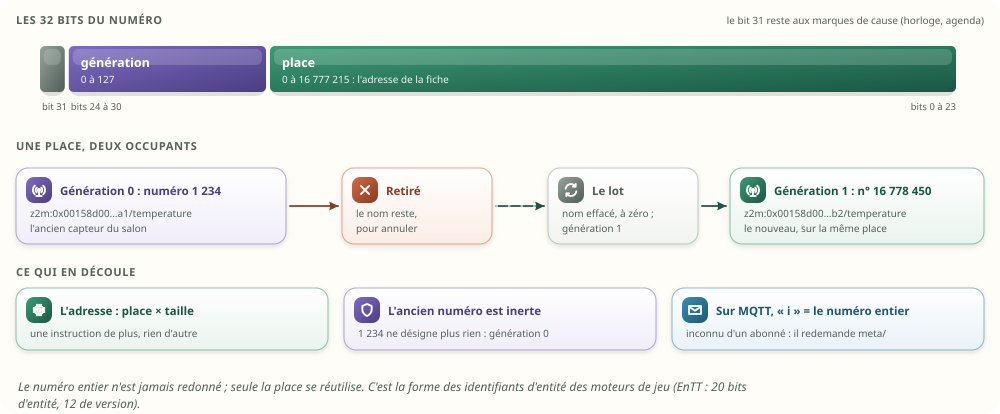

Les règles :

- **La place donne l'adresse**, comme en v2 : une instruction de plus (un masque).
- **Une référence est bonne si sa génération est celle de la place.** Sinon, elle est inerte : on ne
  la lit plus, on ne commande plus rien avec.
- **Un lot fait passer la place à la génération suivante.** Après la 127e, la place est condamnée et
  ne sert plus. Une place réutilisée 127 fois, c'est 127 refontes au même endroit : en pratique,
  jamais.
- **Le numéro entier n'est jamais redonné.**
- **Sur MQTT, `i` porte le numéro entier**, et le contrat ne change pas : « un abonné qui reçoit un
  `i` qu'il ne connaît pas redemande `meta/` ». Un numéro de génération 0 s'écrit comme aujourd'hui
  (`"i":1234`) ; réutilisé, il grandit (`"i":16778450`), 4 octets de plus dans un message de 124.

Ce que coûte la génération, mesuré (une lecture au hasard, ns) :

| Lire une valeur | ×1 | ×10 | ×100 |
|---|---|---|---|
| Le numéro est l'adresse (v2) | 0,36 | 0,54 | 0,59 |
| La place, tirée du numéro | 0,40 | 0,54 | 0,61 |
| La place, génération vérifiée | 0,52 | 0,66 | 0,92 |
| Pour comparer, O4 : un numéro fixe, par une table | 0,44 | 0,81 | 0,97 |

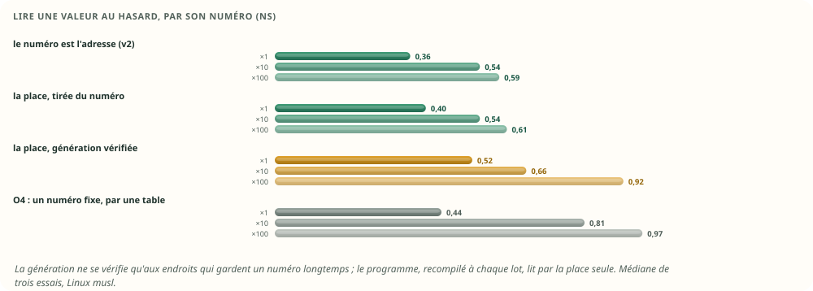

Où vérifier la génération, et où ce n'est pas utile :

| Endroit | Vérifier ? | Pourquoi |
|---|---|---|
| Le programme : règles, index, conditions composées | non | recompilé à chaque retrait, lot et déménagement : ses numéros sont toujours bons |
| Une exécution qui se réveille (sa cible, sa cause) | oui | elle peut durer jusqu'à 24 h |
| Une attente à son échéance | oui | revérifiée de toute façon (mémoire v2 § 8.5) |
| Une minuterie, un bail, une approbation | oui | ils durent |
| L'écran qui montre les exécutions finies | oui | elles restent dans sa file |
| Un abonné, un client avec un cache | il compare le numéro entier | un numéro réutilisé lui est inconnu |

## 8. Le cycle d'un équipement

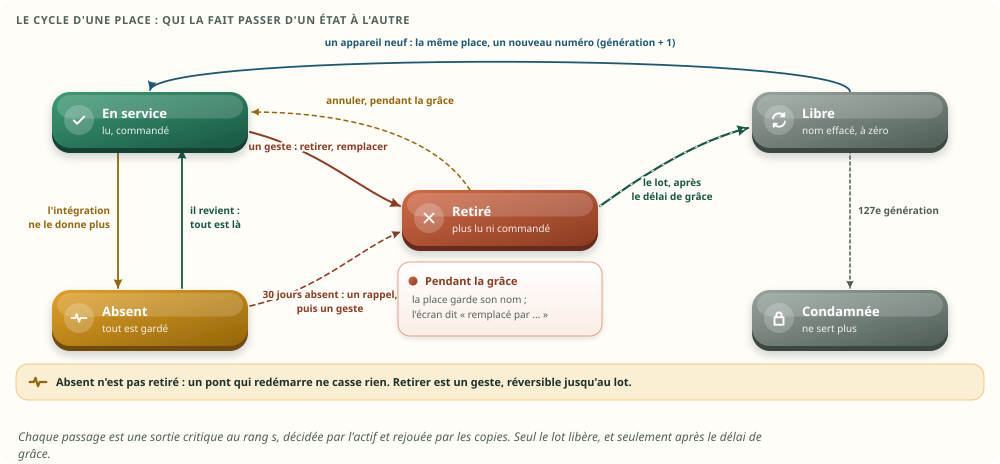

| État | Quand | Ce qui se passe | Réversible | Sortie critique |
|---|---|---|---|---|
| **En service** | déclaré par son intégration | lu, commandé | — | `meta/` (la déclaration, avec les numéros) |
| **Absent** | l'intégration ne le donne plus : catalogue relu, pont redémarré, instance arrêtée | ses valeurs se lisent « mauvaises », et rien ne part dessus ; il garde tout : place, nom, étiquette, workflows | oui, tout seul, s'il revient | `meta/` (statut) |
| **Retiré** | un geste : retirer, remplacer, ou supprimer l'intégration | plus lu, plus commandé ; attentes, minuteries, baux et approbations terminés ; ses automatismes passent « à revoir » ; ses sujets gardés sur MQTT sont effacés | oui, pendant le délai de grâce | `meta/` (statut) |
| **Libre** | le lot, le délai de grâce passé | nom effacé, fiches à zéro, génération suivante | non | `meta/lot` |
| **De nouveau en service** | un appareil neuf | un nouveau nom, un nouveau numéro, sur la même place | — | `meta/` (la déclaration) |
| **Condamnée** | la 127e génération | la place ne sert plus | non | `meta/lot` |

Deux règles tiennent ce cycle :

- **Absent n'est pas retiré.** Un catalogue relu, un pont qui redémarre, une intégration arrêtée ne
  doivent rien casser. Aujourd'hui, `remove_device` mélange les deux ; il devient « absent ».
- **Retirer est un geste.** Après 30 jours d'absence, un rappel le propose (« trois appareils
  absents depuis plus de 30 jours : les retirer ? »), comme Home Assistant purge ses appareils
  orphelins à 30 jours. Rien ne se retire tout seul, sauf les points internes du hub (une plage
  horaire qu'aucun automatisme ne lit plus), qui n'ont pas besoin de grâce.

## 9. Sortir un équipement, au fil de l'eau

### 9.1 Avant le geste : ce que l'appareil touche

Le retrait commence par un **rapport d'impact** : tout ce qui cite l'appareil, par son nom.

- Les automatismes : ses déclencheurs, ses conditions, ses ordres.
- Les aides : agrégats, durées, scènes, compteurs.
- Le plan, l'accueil, les favoris, l'étiquette.
- Les compteurs d'énergie.
- L'alarme, une fois câblée : les zones et leurs capteurs.
- L'historique : combien de temps il restera, selon sa rétention.
- Les copies : rien à faire, elles suivent.

Pour chaque appareil, trois réponses : **remplacer** par un autre (la succession, § 10),
**retirer**, ou **le laisser absent**.

### 9.2 Le retrait, pas à pas

Bloc technique — retirer un appareil (proposé) :

```text
1. meta/ : statut « retiré », au rang s                     → chaque copie l'applique au même rang
2. moteur : attentes, minuteries, baux, approbations de ses points terminés
            exécutions en cours : elles continuent ; arrivées au bout, aucun ordre vers lui
            programme recompilé (0,45 ms à ×1) : ce qui le cite passe « à revoir », une notification
3. hub : plus d'échéance (aucune alerte « muet »), sujets gardés effacés (meta/, val/ : message vide)
4. énergie : ses compteurs s'arrêtent, comme pour un appareil hors ligne
5. étiquette, plan, accueil : gardés pendant le délai de grâce (pour annuler), archivés au lot
6. historique : rien à faire ; il porte les noms et suit sa rétention
```

Ce que la refonte du banc a vérifié, au moment du retrait de 150 appareils :

| Contrôle | Résultat |
|---|---|
| Exécutions arrivées au bout après le retrait de leur cible | 30, aucun ordre parti |
| Ordres partis vers un numéro inerte, sur 466 ordres | 0 |
| Attentes « pendant 10 min » armées sur des appareils retirés ou absents, parties | 0 |
| Automatismes « à revoir » | 16 : exactement ceux qui citent un appareil retiré sans successeur |

### 9.3 Annuler un retrait

Pendant le délai de grâce, rien n'a été libéré. L'appareil revient avec la même place, le même
numéro, la même étiquette ; ses automatismes se recompilent. Au banc, cinq appareils absents vingt
minutes reviennent avec leurs numéros, de nouveau lus et commandés.

## 10. La succession : remplacer sans laisser de trou

C'est le cas le plus courant d'une refonte : un capteur en remplace un autre, une passerelle en
remplace une autre. Aujourd'hui, c'est impossible sans éditer les fichiers à la main (§ 4.3).

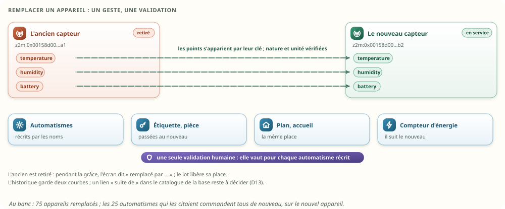

Bloc technique — remplacer un appareil (proposé) :

```text
1. « Remplacer cet appareil par… » : le nouveau est déjà appairé, en service
2. les points s'apparient par leur clé (temperature → temperature, contact → contact),
   proposés, modifiables ; la nature et l'unité sont vérifiées
3. le rapport d'impact : automatismes, aides, plan, accueil, compteurs, étiquette
4. une seule validation humaine : elle vaut celle de chaque automatisme récrit
   (la règle « modifier la logique attend un humain » tient, en un geste)
5. appliqué d'un bloc : définitions récrites par les noms ; étiquette, pièce, plan, accueil et
   compteur passés au nouveau ; l'ancien retiré, avec « remplacé par … » pendant la grâce
6. historique : deux courbes par défaut ; un lien « suite de » dans le catalogue, à décider (D13)
```

Au banc, 75 appareils remplacés : les 25 automatismes suivis pour cela (15 sur un déclencheur
remplacé, 10 sur une cible remplacée) commandent tous de nouveau, 25 sur 25.

**Le mode refonte**, pour une grande refonte : on appaire pièce par pièce ; le système propose les
correspondances (même pièce, même type, mêmes clés), et l'on valide par pièce ou d'un seul geste.

Option écartée pour l'instant : que le successeur prenne tout de suite les places de l'ancien. Il
n'y aurait pas de pic pendant la grâce, mais annuler devient compliqué. Le pic coûte une refonte, le
temps du délai : à ×1, la première grande refonte porte les places de 2 391 à 3 442, puis la
suivante les réutilise.

## 11. Le lot : libérer par lots

### 11.1 Quand

- **La nuit, avec l'instantané de la nuit** : une seule écriture sur disque couvre les deux.
- **Au geste « Terminer la refonte »**, pour les appareils confirmés.
- **Seulement s'il y a quelque chose à libérer.**

### 11.2 Les conditions

- **Retiré depuis le délai de grâce** : 30 jours recommandés, jamais moins de 24 h. C'est la plus
  longue attente d'un workflow (`MAX_WAIT_S`, `moli-automation/src/check.rs:18`) : au-delà, plus
  aucune exécution ne peut citer la place. La génération rend le reste inerte de toute façon.
- **L'actif décide**, le porteur de l'époque, comme pour tout numéro donné (haute disponibilité v1).
- **Un appareil part avec tous ses points.**

### 11.3 Ce qu'il fait

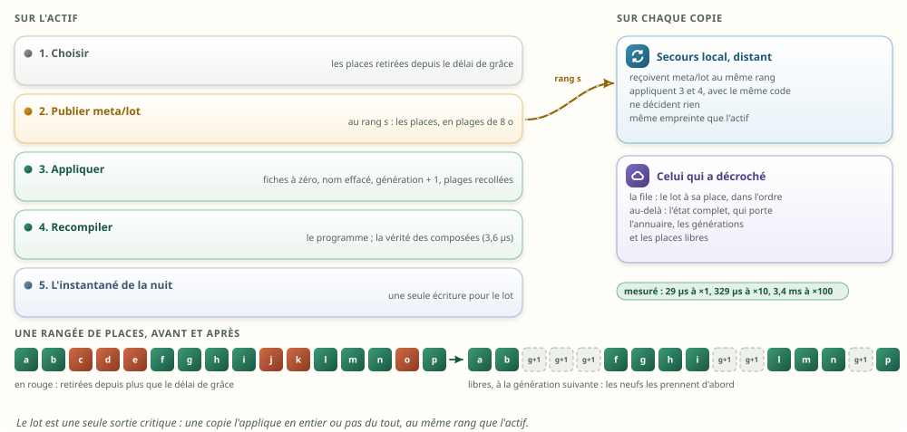

Bloc technique — le lot (proposé) :

```text
sur l'actif :
1. choisir : les places retirées depuis le délai de grâce            O(retraits)
2. publier meta/lot, au rang s : les places, en plages (8 o chacune)  un message
3. appliquer, comme une copie :
   - fiches remises à zéro (valeur, précédente, instants, qualité, échéances)
   - nom effacé de l'annuaire ; le tiroir des noms récrit s'il est à moitié vide
   - génération + 1 (ou place condamnée) ; plages libres recollées ; la queue rognée
4. recompiler le programme ; reconstruire la vérité des conditions composées (3,6 µs à ×1)
5. l'instantané de la nuit enregistre le tout

sur chaque copie : 3 et 4, au même rang, avec le même code ; rien à décider
```

### 11.4 Mesures

| Le lot, 30 % des appareils retirés | ×1 | ×10 | ×100 |
|---|---|---|---|
| Points libérés | 648 | 6 868 | 67 996 |
| Durée (choisir et appliquer) | 29 µs | 329 µs | 3,4 ms |
| Message `meta/lot` | 1,6 Ko | 16,7 Ko | 167 Ko |
| État complet, avant → après | 291 → 207 Ko | 2,94 → 2,03 Mo | 29,3 → 20,3 Mo |
| Noms gardés, avant → après | 88 → 64 Ko | 902 → 628 Ko | 8,9 → 6,3 Mo |
| Déclarer un appareil neuf dans une place libre | 0,7 µs | 1,1 µs | 3,5 µs |
| Places ajoutées au bout pour les neufs | 0 | 0 | 0 |

Deux choses à retenir :

- **L'état complet rétrécit dès le lot.** Il ne porte que les places qui ont un nom ; une place
  libre n'y coûte que ses octets d'annuaire. Le secours en retard reçoit moins, sans attendre de
  déménagement.
- **La mémoire, elle, ne rétrécit pas au lot** : les places libres restent dans les colonnes, prêtes
  pour les appareils suivants. Les neufs les reprennent toutes (aucune place ajoutée au bout).

Les durées sont celles d'une machine de mesure chargée ; la refonte du banc, plus agitée, a mesuré
201 µs pour 694 points.

## 12. Le déménagement : rendre la mémoire, rarement

### 12.1 Quand

Seulement au geste « Terminer la refonte », et seulement si les places libres dépassent un seuil :
un quart des colonnes, et 64 Kio. Jamais dans la vie ordinaire. À ×1, ce qu'il rend est petit (54 Ko
quand 30 % des appareils sont partis) : c'est un outil pour les grosses maisons, ou les maisons qui
rétrécissent.

### 12.2 Comment

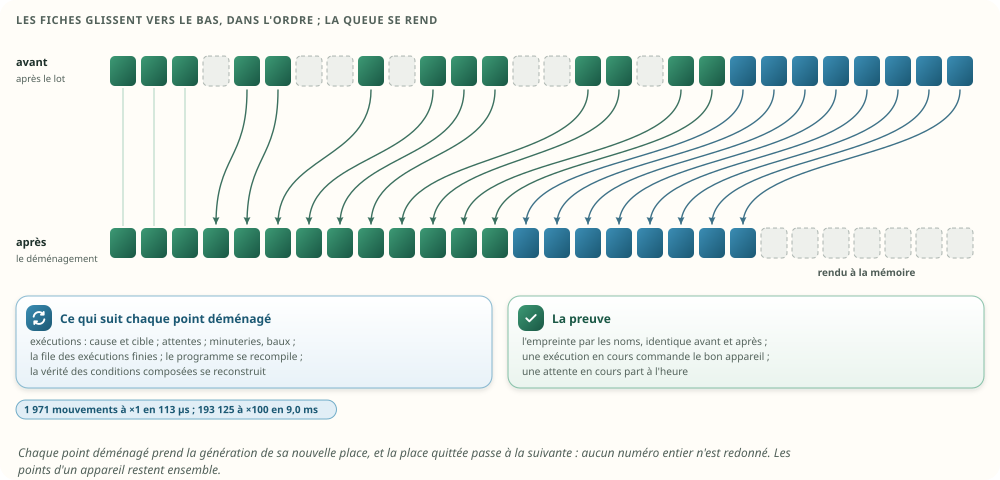

- **Dans l'ordre** : appareils et blocs de points descendent vers les places libres les plus
  basses ; les points d'un appareil restent ensemble.
- **Chaque point déménagé prend la génération de sa nouvelle place** : son nouveau numéro n'a jamais
  été donné.
- **La place quittée passe à la génération suivante**, comme au lot.
- **Tout ce qui garde un numéro suit** : exécutions (cause et cible), attentes, minuteries, baux,
  file des exécutions finies. Le programme se recompile, la vérité des conditions composées se
  reconstruit.
- **Un message** `meta/demenagement` : l'ancien et le nouveau numéro, 8 octets par mouvement, en
  morceaux de 4 Kio comme un fichier métier (`conf/`).

### 12.3 La preuve : l'empreinte par les noms

L'empreinte d'une mémoire calculée **par les noms** (chaque point, sa valeur, ses instants, son
appareil) ne dépend pas des numéros. Le déménagement ne doit pas la changer : au banc, elle est
identique avant et après. Une exécution partie à 00:30 pour 3 h commande le bon appareil à 03:30,
après le déménagement de 01:00 ; une attente armée à 00:55 part à 01:05.

### 12.4 Mesures

| Le déménagement, 30 % de places libres | ×1 | ×10 | ×100 |
|---|---|---|---|
| Mouvements | 1 971 | 19 228 | 193 125 |
| Durée | 113 µs | 816 µs | 9,0 ms |
| Message | 15,8 Ko | 154 Ko | 1,55 Mo |
| Fiches, avant → après | 2 264 → 1 616 | 22 640 → 15 772 | 226 396 → 158 404 |
| Mémoire, après le lot → après le déménagement | 323 → 269 Ko | 3,20 → 2,57 Mo | 31,4 → 25,2 Mo |

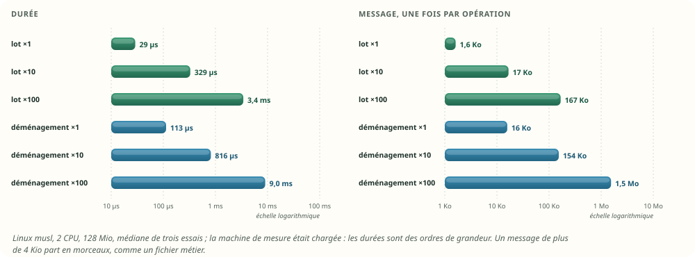

### 12.5 Le risque, et sa forme

Le déménagement est la seule opération où des références **vivantes** doivent suivre. S'il en oublie
une, la génération change la nature de la faute : la référence oubliée devient inerte, et une action
manque (l'attente ne part pas, l'ordre ne part pas). Il n'y a pas de mauvaise action, seulement une
action manquée. Trois fautes injectées le montrent, toutes détectées par le banc : attentes,
exécutions, et appareil d'un point qui ne suivent pas.

## 13. Les workflows

| Mémoire des workflows | Au retrait | Au lot | Au déménagement |
|---|---|---|---|
| Le programme (nœuds, règles, index, fiches horaires) | recompilé : le retiré n'y est plus, ses automatismes « à revoir » | recompilé | recompilé |
| Les définitions (`automations.json`, par les noms) | inchangées ; ou récrites par la succession, avec une validation | inchangées | inchangées |
| Les exécutions en cours | continuent ; à leur réveil, aucun ordre vers un retiré | une référence à une place libérée est inerte | cause et cible suivent |
| Les attentes des déclencheurs à durée | retirées | — | suivent |
| La vérité des conditions composées | une feuille sur un point qui ne se lit plus est fausse (règle de la v2) | reconstruite (3,6 µs à ×1) | reconstruite |
| Les fiches horaires « à l'heure portée par une valeur » | recompilées sans le point | — | recompilées |
| Minuteries, baux « pendant », approbations | terminés | — | suivent |
| La file des exécutions finies (l'écran) | la cause garde son nom pendant la grâce | « un appareil retiré » | suivent |
| Le journal d'exécution (`run/`, `hist/`) | **les noms**, pas les numéros | — | — |

Une précision à la règle des attentes de la mémoire v2 (§ 8.5). Elle revérifie seulement que
l'instant « changé » n'a pas bougé. Pour un appareil absent ou retiré, cet instant ne bouge plus :
la revérification réussirait, et « porte ouverte depuis 10 min » partirait sur un capteur parti. La
proposition ajoute : **et la valeur se lit encore** (bonne génération, appareil ni absent ni muet).
C'est l'esprit de la v2, « rien ne part sur une valeur qu'on ne connaît plus ». Une faute injectée
qui retire cette condition fait partir les attentes des absents, et le banc la détecte.

## 14. La haute disponibilité


- **Une seule machine décide** : l'actif, porteur de l'époque. Le retrait vient d'un geste sur l'API
  de l'actif. Le lot et le déménagement sont choisis par l'actif ; les copies ne décident rien.
- **Tout passe au rang `s`.** Statut, lot, déclaration d'un appareil neuf, déménagement : quatre
  sorties critiques, chacune appliquée par chaque copie au même rang, avec le même code. Une copie
  qui reçoit une déclaration sur une place qui n'est pas libre à cette génération la refuse : deux
  mémoires ont divergé, elle redemande l'état complet.
- **La file des 10 000 sorties ne change pas.** Les sorties d'avant le lot parlent les anciens
  numéros, celles d'après les nouveaux ; le lot est entre les deux. Un secours qui comble un trou
  les rejoue dans l'ordre, et tout tombe juste.
- **L'état complet porte l'annuaire entier** : noms, générations, places libres, retraits en cours.
  Les fiches, seulement pour les places nommées. Un secours très en retard, ou le distant qui
  revient après une semaine, le prend et n'a rien à rejouer. Le piège de Cassandra (une suppression
  oubliée par une réplique, puis la donnée qui revient) n'existe pas : l'état complet remplace, il
  ne fusionne pas.
- **L'instantané** a le même format ; celui de la nuit suit le lot.
- **Une bascule pendant un lot** ne coupe rien en deux : le lot est une seule sortie, appliquée ou
  pas. Le nouvel actif continue avec le même registre, les mêmes places libres.
- **Redémarrer sur un vieil instantané**, sans pair vivant : il est cohérent avec lui-même. Un
  numéro donné après lui, puis perdu dans la panne, n'avait rien laissé de durable, puisque tout ce
  qui dure porte des noms. Et si un pair vit, il est plus avancé et l'emporte (haute disponibilité
  v2 § 11).

Au banc :

| Contrôle | Résultat |
|---|---|
| Sorties critiques publiées en trois jours | 92 106 |
| La copie qui applique tout, dans l'ordre | identique à l'actif |
| La copie qui a manqué le lot et les déclarations (J2 11:00 à 14:00), reprise par l'état complet | identique à l'actif |
| Le client revenu avec son cache de la veille : noms confondus | 0 ; 4 510 demandes de `meta/` en trois jours |
| Numéros entiers donnés deux fois | 0 |

## 15. Les noms, et ce qui doit être oublié

- **Le lot efface le nom** de l'annuaire. L'instantané suivant ne l'a plus ; les copies le perdent
  au même rang ; le distant aussi.
- **L'historique garde le nom selon sa rétention** (D13). L'expurgation existe déjà pour la
  confidentialité (`moli-history/src/privacy.rs:31-32`) : un retrait « avec oubli » peut s'en
  servir.
- **L'étiquette, le plan, l'accueil** : gardés pendant la grâce, puis archivés au lot. La sauvegarde
  de la veille les a encore.
- **Le coffre** : les secrets d'une intégration supprimée partent avec elle. Aujourd'hui, l'import
  des clés locales Tuya ne fait qu'ajouter au coffre (`moli-os/src/main.rs:642`), et aucun chemin ne
  retire celle d'un appareil disparu.

## 16. Les numéros de la base (D13) : plus tard

La base a ses propres numéros, indépendants de la mémoire, et elle les borne :

| Espace | Borne | Réutilisé ? | Vingt ans à ×1 | Vingt ans à ×10 |
|---|---|---|---|---|
| Catalogue des points (`samples.id = point_id · 2^44 + ts`) | 524 288 | non : une ligne n'est supprimée que par l'expurgation | 11 063 points, 2,1 % | 110 782 points, 21 % |
| Compteurs d'énergie (`meter_state.id ≤ 1023`) | 1 024 | non | quelques dizaines | quelques centaines |

Rien ne presse à ×1. Proposé pour plus tard :

- une alerte quand un espace dépasse la moitié ;
- **réutiliser un identifiant de la base** quand tous ses relevés sont purgés, et que sa dernière
  opération exportée est sous le plancher de rejeu de l'archive (`replay_floor`). L'archive ne
  connaît que des noms : la réutilisation ne la trouble pas.
- un compteur d'énergie reste vivant tant que ses totaux de mois existent, soit 13 mois après sa
  dernière heure.

## 17. Ce que la vérification a trouvé

### 17.1 La refonte rejouée

Une maison ×1 (496 appareils, 2 264 points) vit trois jours, minute par minute, à 20 nouvelles par
minute, avec 56 automatismes :

| Quand | Ce qui arrive |
|---|---|
| J1 09:30 | des exécutions partent pour 20 h vers des appareils qui seront retirés |
| J1 09:55 | des attentes « pendant 10 min » s'arment sur des appareils qui seront retirés ou absents |
| J1 10:00 | 5 appareils deviennent absents ; la refonte retire 150 appareils, dont 75 remplacés |
| J1 10:20 | les absents reviennent |
| J1 11:00 | les successeurs déclenchent ; les automatismes qui les visent commandent |
| J1 23:00 | un client se déconnecte, en gardant son cache de noms |
| J2 11:00 | un appareil est retiré, une heure avant le lot ; la seconde copie décroche |
| J2 12:00 | le lot, avec un délai de grâce de 24 h |
| J2 13:00 | 80 appareils neufs reprennent les places libérées |
| J2 13:30 et 14:00 | le client revient ; la seconde copie reprend par l'état complet |
| J3 00:30 et 00:55 | une exécution de 3 h et une attente de 10 min, sur des appareils qui vont déménager |
| J3 01:00 | fin de refonte : le déménagement |

| Contrôle | Résultat |
|---|---|
| Points libérés par le lot, appareils | 694, 150 |
| Points neufs, dont dans des places libérées | 373, 373 |
| Points neufs qui lisaient la valeur de l'ancien occupant | 0 |
| Causes d'exécutions finies montrées au nom d'un autre | 0 ; 96 montrées « appareil retiré » |
| Déménagement : mouvements, fiches avant → après | 2 210 ; 2 609 → 2 288 |
| Copies conformes | oui |

### 17.2 Les tests, et la preuve qu'ils savent échouer

| Test | Ce qu'il exige |
|---|---|
| `une_place_liberee_sert_a_la_generation_suivante` | le délai de grâce ; l'ancien numéro ne désigne plus rien ; la place libre sert d'abord, à la génération 1 |
| `une_generation_epuisee_condamne_la_place` | après la 127e génération, la place ne sert plus ; aucun numéro donné deux fois sur 200 |
| `une_copie_refuse_une_place_qui_n_est_pas_libre` | une place occupée, ou d'une autre génération, est refusée |
| `les_plages_se_recollent_et_le_bout_se_rogne` | plages libres fusionnées, queue rognée, plage du bout prolongée |
| `le_tiroir_des_noms_se_tasse_sans_rien_perdre` | les noms restants se relisent, l'annuaire relu est identique |
| `l_annuaire_relu_est_identique` | l'état complet de l'annuaire, relu |
| `les_copies_restent_conformes` | les deux copies identiques à l'actif |
| `aucun_ordre_ne_part_vers_un_appareil_retire` | aucun ordre vers un numéro inerte ni au mauvais nom ; des exécutions sont bien arrivées sans cible |
| `une_attente_ne_part_pas_sur_un_appareil_absent_ou_retire` | aucune |
| `les_automatismes_d_un_appareil_retire_sont_a_revoir` | exactement ceux-là |
| `la_succession_reprend_les_automatismes` | tous commandent de nouveau |
| `un_appareil_absent_revient_avec_ses_numeros` | mêmes numéros, de nouveau vivants |
| `le_lot_respecte_le_delai_de_grace_et_oublie_les_noms` | 150 appareils libérés, leurs noms oubliés ; le retrait tardif gardé |
| `les_places_liberees_servent_a_la_generation_suivante` | tous les neufs dans les places libérées, à la génération 1 ; aucun numéro redonné |
| `un_appareil_neuf_ne_lit_jamais_la_valeur_de_l_ancien_occupant` | avant sa première nouvelle, rien : ni valeur, ni instant, qualité « incertaine » |
| `le_client_en_cache_ne_confond_jamais_deux_appareils` | aucune confusion |
| `la_cause_d_une_execution_ne_prend_jamais_un_autre_nom` | jamais ; « appareil retiré » après le lot |
| `le_demenagement_garde_tout_par_les_noms` | empreinte par les noms identique ; plus aucun trou ; l'exécution et l'attente en cours suivent |

Les fautes injectées (`scripts/mutations.py`) :

| Faute | Tests en échec |
|---|---|
| Le lot ne fait pas passer la place à la génération suivante | 6, dont le client et les causes |
| Le lot ignore le délai de grâce | 2 |
| L'état complet ne porte pas les générations | 2, dont la copie reprise |
| Le compilateur accepte un point retiré | 1 (« à revoir ») |
| Une attente part sans vérifier que la valeur se lit encore | 1 |
| Une exécution commande une cible retirée qui a encore son nom | 1 |
| Le client range son cache par place, sans la génération | 1 |
| Au déménagement, les attentes ne suivent pas | 1 |
| Au déménagement, les exécutions ne suivent pas leur cible | 1 |
| Au déménagement, un point ne suit pas son appareil | 11 |
| Une place libérée garde la valeur de son ancien occupant | 1 |

### 17.3 Ce que le banc a appris

- **Une faute passait d'abord** : une place libérée qui garde la valeur de son ancien occupant.
  Aucun test ne regardait un appareil neuf avant sa première nouvelle, et les deux copies, faisant
  la même erreur, restaient identiques. Le test qui la détecte a été ajouté. La leçon de l'étude
  mémoire se confirme : un test vert ne prouve rien s'il ne sait pas échouer.
- **Un défaut réel du premier jet** : après le tassement du tiroir des noms, une place libérée
  gardait l'ancien décalage de son nom. Lire l'annuaire tombait hors du tiroir. Seule la simulation
  de vingt ans, qui tasse le tiroir, l'a trouvé ; un test unitaire le garde.
- **L'état complet ne doit porter que les places nommées.** Le premier jet y mettait aussi les
  places libres : il ne rétrécissait qu'au déménagement.

## 18. Ce que la proposition change

Si elle est retenue ; rien n'est modifié dans ces documents aujourd'hui.

| Document, section | Changement |
|---|---|
| Mémoire v2 § 4.1, point 4 | « un point retiré garde sa case, condamnée » devient : sa case attend le lot, qui la libère à la génération suivante ; **le numéro entier n'est jamais redonné** |
| Mémoire v2 § 4.3 | le numéro typé porte sa génération : `Point(u32)` avec `place()` et `generation()` |
| Mémoire v2 § 4.4 | `i` porte le numéro entier ; la règle « numéro inconnu → `meta/` » suffit |
| Mémoire v2 § 8.5 | une attente revérifiée exige aussi que la valeur se lise encore |
| Mémoire v2 § 11 | l'instantané porte générations, places libres et retraits |
| Haute disponibilité v2 § 6.3 | trois sorties critiques de plus : statut, `meta/lot`, `meta/demenagement` |
| Haute disponibilité v2 § 16.2 | l'annuaire avec ses générations ; les fiches des seules places nommées |
| Code d'aujourd'hui | `remove_device` veut dire « absent » ; un geste « retirer » ; l'énergie s'arrête au retrait ; plus de fantômes dans les appareils connus |

## 19. Les choix

Décidé ici, parce que la mesure, le code ou une décision antérieure le tranche :

| Sujet | Décision | Pourquoi |
|---|---|---|
| Le numéro | une place (24 bits) et sa génération (7 bits) ; le numéro entier jamais redonné | § 6, § 7 ; la règle des exécutions de la v2 |
| Absent ou retiré | deux états ; retirer est un geste | § 8 ; aujourd'hui, un pont qui redémarre ne doit rien casser |
| Les trois rythmes | retirer au fil de l'eau, libérer par lots, déménager rarement | ta demande ; mesuré (§ 11, § 12) |
| Le lot | la nuit, avec l'instantané, décidé par l'actif, une sortie critique | § 11, § 14 |
| Les fiches | remises à zéro au lot et à la déclaration | une faute injectée (§ 17.3) |
| Les attentes | revérifiées, et la valeur doit se lire encore | § 13 |
| Ce qui dure | des noms, jamais des numéros | § 4.1 |
| L'état complet | les fiches des seules places nommées | § 11.4 |

Décidé par toi le 23 octobre :

| Question | Ta réponse | Ce qui en découle |
|---|---|---|
| Le délai de grâce avant le lot | **30 jours** | un retrait s'annule pendant un mois ; le lot de nuit libère ensuite (§ 11) |
| Le déménagement | **en fin de refonte, avec un seuil** | au geste « Terminer la refonte », au-delà d'un quart de places libres et de 64 Kio ; jamais dans la vie ordinaire (§ 12) |
| Retirer tout seul après une longue absence ? | **non, un rappel** | après 30 jours d'absence, un rappel propose le retrait ; retirer reste un geste (§ 8) |
| Des tickets pour les défauts d'aujourd'hui ? | **oui** | quatre tickets ouverts (§ 20, marche 1) |

Reste à trancher :

| Question | Recommandation |
|---|---|
| La succession garde-t-elle une seule courbe d'historique ? | un lien « suite de » dans le catalogue de la base, à décider avec D13 |
| Les numéros de la base | les surveiller (alerte à la moitié) ; les réutiliser plus tard (§ 16) |

## 20. Le plan

Chaque marche est utile seule, dans l'ordre :

1. **Aujourd'hui, sans attendre la mémoire v2** (quatre tickets, ouverts le 23 octobre) :
   - absent et retiré deviennent deux états, avec un geste « retirer » et son rapport d'impact
     (ticket « absent et retiré ») ;
   - un appareil retiré sort aussitôt des appareils connus, et son remplaçant est admis ; son
     étiquette et son état restauré partent après le délai de grâce (ticket « appareil connu ») ;
   - l'énergie cesse de compter un appareil absent ou retiré (ticket « kWh fantômes ») ;
   - un automatisme qui cite un appareil disparu le dit : une notification, une liste « à revoir »
     (ticket « automatisme gelé »).
2. **La succession**, par les noms, dès aujourd'hui : remplacer un appareil, récrire ses
   automatismes, passer étiquette, pièce, plan et compteur, en une validation.
3. **Avec la mémoire v2** : le numéro à génération, le registre et ses plages libres, les fiches
   remises à zéro, l'attente qui exige une valeur lisible.
4. **Le lot de nuit**, avec l'instantané.
5. **Avec la haute disponibilité v2** : statut, lot et déménagement au rang `s` ; l'état complet par
   places nommées.
6. **Le déménagement**, seulement si une maison en a besoin.
7. **La base** : surveiller ses espaces de numéros.

## Annexe A — Le banc

### A.1 Comment il a été joué

- **Où** : `tools/nettoyage-banc/`, crate hors workspace. Il reprend tels quels, par inclusion de
  fichiers, la maison, les fiches de la mémoire v2 (`Vif` 40 o, `Def` 16 o, `Sante` 20 o) et les
  outils du banc mémoire.
- **Le registre** (`src/numeros.rs`) : le numéro à génération, les statuts, les plages libres, le
  tiroir des noms, le lot, le déménagement, l'annuaire de l'état complet.
- **La mémoire** (`src/memoire.rs`) : les colonnes de la v2 rangées par place ; les sorties
  critiques (déclaration, valeur, statut, lot, déménagement) ; l'état complet ; deux empreintes, la
  brute et celle par les noms.
- **Le moteur réduit** (`src/moteur.rs`) : programme compilé depuis les noms, exécutions, attentes
  revérifiées, file des exécutions finies, client à cache.
- **La refonte** (`src/refonte.rs`) et **les mesures** (`src/banc.rs`).
- **La série** : Linux musl (`rust:1-alpine`), chaque mesure dans trois conteneurs neufs de 2 CPU et
  128 Mio, sans échange ; la médiane des trois. 18 tests passent dans le conteneur de compilation.
  La lecture a été rejouée seule, une première série ayant subi la charge de la machine. Rejouer :
  `sh tools/nettoyage-banc/scripts/linux.sh` (quelques minutes) ; les fautes : `python3 -I
  tools/nettoyage-banc/scripts/mutations.py`.

### A.2 Les limites

- La machine de mesure est un Apple M4 partagé, chargé pendant la série : les durées varient du
  simple au double d'un essai à l'autre. Les rapports tiennent ; les valeurs absolues sont à refaire
  sur un Pi.
- Le moteur est réduit : un déclencheur, une attente, un ordre par automatisme. Il porte ce qu'un
  retrait peut casser, pas tout le moteur de la v2.
- La recompilation du programme n'est pas remesurée : la mémoire v2 l'a mesurée (0,45 ms à ×1,
  7,4 ms à ×10).
- Les copies reçoivent les sorties en mémoire, sans courtier : le transport, les trous et la file
  ont été joués par le banc de la haute disponibilité v2.
- La vie de vingt ans est une simulation régulière ; une vraie maison change par à-coups, ce qui ne
  change pas les conclusions : les lots suivent le pic, quel qu'il soit.

### A.3 Les résultats bruts

Sortie brute — `lecture-x1.txt` :

```text
RESULTAT|lecture|1|numero_adresse_v2|0.356|ns
RESULTAT|lecture|1|place_et_generation|0.397|ns
RESULTAT|lecture|1|place_et_generation_verifiee|0.519|ns
RESULTAT|lecture|1|numero_fixe_par_une_table|0.438|ns
RESULTAT|lecture|1|rss_fin|504.000|Kio
CONTENEUR|false|0
CONTENEUR|false|0
CONTENEUR|false|0
```

Sortie brute — `lecture-x10.txt` :

```text
RESULTAT|lecture|10|numero_adresse_v2|0.539|ns
RESULTAT|lecture|10|place_et_generation|0.539|ns
RESULTAT|lecture|10|place_et_generation_verifiee|0.661|ns
RESULTAT|lecture|10|numero_fixe_par_une_table|0.814|ns
RESULTAT|lecture|10|rss_fin|504.000|Kio
CONTENEUR|false|0
CONTENEUR|false|0
CONTENEUR|false|0
```

Sortie brute — `lecture-x100.txt` :

```text
RESULTAT|lecture|100|numero_adresse_v2|0.590|ns
RESULTAT|lecture|100|place_et_generation|0.610|ns
RESULTAT|lecture|100|place_et_generation_verifiee|0.916|ns
RESULTAT|lecture|100|numero_fixe_par_une_table|0.966|ns
RESULTAT|lecture|100|rss_fin|504.000|Kio
CONTENEUR|false|0
CONTENEUR|false|0
CONTENEUR|false|0
```

Sortie brute — `lot-x1.txt` :

```text
RESULTAT|lot|1|points|2264.000|
RESULTAT|lot|1|appareils_retires|141.000|
RESULTAT|lot|1|memoire_avant_lot|322225.000|o
RESULTAT|lot|1|noms_avant_lot|88280.000|o
RESULTAT|lot|1|etat_complet_avant_lot|291189.000|o
RESULTAT|lot|1|lot_duree|28.959|µs
RESULTAT|lot|1|lot_points|648.000|
RESULTAT|lot|1|lot_message|1616.000|o
RESULTAT|lot|1|memoire_apres_lot|322710.000|o
RESULTAT|lot|1|noms_apres_lot|63665.000|o
RESULTAT|lot|1|etat_complet_apres_lot|206673.000|o
RESULTAT|lot|1|plages_libres|100.000|
RESULTAT|lot|1|demenagement_duree|113.041|µs
RESULTAT|lot|1|demenagement_mouvements|1971.000|
RESULTAT|lot|1|demenagement_message|15784.000|o
RESULTAT|lot|1|colonnes_avant_demenagement|2264.000|places
RESULTAT|lot|1|colonnes_apres_demenagement|1616.000|places
RESULTAT|lot|1|memoire_apres_demenagement|268614.000|o
RESULTAT|lot|1|etat_complet_apres_demenagement|205089.000|o
RESULTAT|lot|1|declaration_dans_une_place_libre|0.709|µs
RESULTAT|lot|1|places_ajoutees_au_bout|0.000|
RESULTAT|lot|1|rss_fin|516.000|Kio
CONTENEUR|false|0
CONTENEUR|false|0
CONTENEUR|false|0
```

Sortie brute — `lot-x10.txt` :

```text
RESULTAT|lot|10|points|22640.000|
RESULTAT|lot|10|appareils_retires|1504.000|
RESULTAT|lot|10|memoire_avant_lot|3207436.000|o
RESULTAT|lot|10|noms_avant_lot|901608.000|o
RESULTAT|lot|10|etat_complet_avant_lot|2939588.000|o
RESULTAT|lot|10|lot_duree|328.834|µs
RESULTAT|lot|10|lot_points|6868.000|
RESULTAT|lot|10|lot_message|16720.000|o
RESULTAT|lot|10|memoire_apres_lot|3202365.000|o
RESULTAT|lot|10|noms_apres_lot|627513.000|o
RESULTAT|lot|10|etat_complet_apres_lot|2027370.000|o
RESULTAT|lot|10|plages_libres|1044.000|
RESULTAT|lot|10|demenagement_duree|816.042|µs
RESULTAT|lot|10|demenagement_mouvements|19228.000|
RESULTAT|lot|10|demenagement_message|153840.000|o
RESULTAT|lot|10|colonnes_avant_demenagement|22640.000|places
RESULTAT|lot|10|colonnes_apres_demenagement|15772.000|places
RESULTAT|lot|10|memoire_apres_demenagement|2574717.000|o
RESULTAT|lot|10|etat_complet_apres_demenagement|2010682.000|o
RESULTAT|lot|10|declaration_dans_une_place_libre|1.083|µs
RESULTAT|lot|10|places_ajoutees_au_bout|0.000|
RESULTAT|lot|10|rss_fin|572.000|Kio
CONTENEUR|false|0
CONTENEUR|false|0
CONTENEUR|false|0
```

Sortie brute — `lot-x100.txt` :

```text
RESULTAT|lot|100|points|226400.000|
RESULTAT|lot|100|appareils_retires|14879.000|
RESULTAT|lot|100|memoire_avant_lot|31612578.000|o
RESULTAT|lot|100|noms_avant_lot|8941120.000|o
RESULTAT|lot|100|etat_complet_avant_lot|29295518.000|o
RESULTAT|lot|100|lot_duree|3429.832|µs
RESULTAT|lot|100|lot_points|67996.000|
RESULTAT|lot|100|lot_message|167136.000|o
RESULTAT|lot|100|memoire_apres_lot|31445713.000|o
RESULTAT|lot|100|noms_apres_lot|6258166.000|o
RESULTAT|lot|100|etat_complet_apres_lot|20304316.000|o
RESULTAT|lot|100|plages_libres|10445.000|
RESULTAT|lot|100|demenagement_duree|9016.205|µs
RESULTAT|lot|100|demenagement_mouvements|193125.000|
RESULTAT|lot|100|demenagement_message|1545016.000|o
RESULTAT|lot|100|colonnes_avant_demenagement|226396.000|places
RESULTAT|lot|100|colonnes_apres_demenagement|158404.000|places
RESULTAT|lot|100|memoire_apres_demenagement|25232325.000|o
RESULTAT|lot|100|etat_complet_apres_demenagement|20137212.000|o
RESULTAT|lot|100|declaration_dans_une_place_libre|3.500|µs
RESULTAT|lot|100|places_ajoutees_au_bout|0.000|
RESULTAT|lot|100|rss_fin|1104.000|Kio
CONTENEUR|false|0
CONTENEUR|false|0
CONTENEUR|false|0
```

Sortie brute — `machine.txt` :

```text
machine : Apple M4
docker : 29.2.1 · 4 CPU · 8309014528 o
conteneurs : 2 CPU, 128 Mio sans échange, trois essais par mesure (médiane ; le pire pour _max)
charge à la fin de la série : 7.24 8.34 7.50
```

Sortie brute — `refonte-x1.txt` :

```text
RESULTAT|refonte|1|sorties|92106.000|
RESULTAT|refonte|1|ordres|466.000|
RESULTAT|refonte|1|ordres_vers_un_numero_inerte|0.000|
RESULTAT|refonte|1|executions_arrivees_sans_cible|30.000|
RESULTAT|refonte|1|attentes_parties_sur_absent_ou_retire|0.000|
RESULTAT|refonte|1|automatismes_a_revoir|16.000|
RESULTAT|refonte|1|succession_automatismes_qui_commandent|25.000|
RESULTAT|refonte|1|succession_automatismes|25.000|
RESULTAT|refonte|1|lot_points|694.000|
RESULTAT|refonte|1|lot_appareils|150.000|
RESULTAT|refonte|1|lot_message|1712.000|o
RESULTAT|refonte|1|lot_duree|200.875|µs
RESULTAT|refonte|1|neufs_points|373.000|
RESULTAT|refonte|1|neufs_dans_les_places_liberees|373.000|
RESULTAT|refonte|1|neufs_avec_la_valeur_de_l_ancien|0.000|
RESULTAT|refonte|1|numeros_redonnes|0.000|
RESULTAT|refonte|1|client_erreurs|0.000|
RESULTAT|refonte|1|client_demandes_meta|4510.000|
RESULTAT|refonte|1|causes_au_nom_d_un_autre|0.000|
RESULTAT|refonte|1|causes_d_un_appareil_libere|96.000|
RESULTAT|refonte|1|demenagement_mouvements|2210.000|
RESULTAT|refonte|1|demenagement_message|17696.000|o
RESULTAT|refonte|1|demenagement_duree|131.333|µs
RESULTAT|refonte|1|colonnes_avant_demenagement|2609.000|places
RESULTAT|refonte|1|colonnes_apres_demenagement|2288.000|places
RESULTAT|refonte|1|copies_conformes|1.000|
RESULTAT|refonte|1|rss_fin|536.000|Kio
CONTENEUR|false|0
CONTENEUR|false|0
CONTENEUR|false|0
```

Sortie brute — `tests.txt` :

```text
test numeros::tests::l_annuaire_relu_est_identique ... ok
test numeros::tests::une_copie_refuse_une_place_qui_n_est_pas_libre ... ok
test numeros::tests::les_plages_se_recollent_et_le_bout_se_rogne ... ok
test numeros::tests::une_place_liberee_sert_a_la_generation_suivante ... ok
test numeros::tests::une_generation_epuisee_condamne_la_place ... ok
test numeros::tests::le_tiroir_des_noms_se_tasse_sans_rien_perdre ... ok
test refonte::tests::la_cause_d_une_execution_ne_prend_jamais_un_autre_nom ... ok
test refonte::tests::la_succession_reprend_les_automatismes ... ok
test refonte::tests::aucun_ordre_ne_part_vers_un_appareil_retire ... ok
test refonte::tests::le_client_en_cache_ne_confond_jamais_deux_appareils ... ok
test refonte::tests::le_demenagement_garde_tout_par_les_noms ... ok
test refonte::tests::le_lot_respecte_le_delai_de_grace_et_oublie_les_noms ... ok
test refonte::tests::les_automatismes_d_un_appareil_retire_sont_a_revoir ... ok
test refonte::tests::les_copies_restent_conformes ... ok
test refonte::tests::les_places_liberees_servent_a_la_generation_suivante ... ok
test refonte::tests::un_appareil_absent_revient_avec_ses_numeros ... ok
test refonte::tests::un_appareil_neuf_ne_lit_jamais_la_valeur_de_l_ancien_occupant ... ok
test refonte::tests::une_attente_ne_part_pas_sur_un_appareil_absent_ou_retire ... ok
test result: ok. 18 passed; 0 failed; 0 ignored; 0 measured; 0 filtered out; finished in 0.03s
rustc 1.99.1 (58cf8f9c3 2026-10-13)
```

Sortie brute — `vie-x1.txt` :

```text
RESULTAT|vie_jamais|1|an01_places|2474.000|
RESULTAT|vie_jamais|1|an01_colonnes|2474.000|
RESULTAT|vie_jamais|1|an01_en_service|2265.000|
RESULTAT|vie_jamais|1|an02_places|2691.000|
RESULTAT|vie_jamais|1|an02_colonnes|2691.000|
RESULTAT|vie_jamais|1|an02_en_service|2261.000|
RESULTAT|vie_jamais|1|an03_places|4017.000|
RESULTAT|vie_jamais|1|an03_colonnes|4017.000|
RESULTAT|vie_jamais|1|an03_en_service|2246.000|
RESULTAT|vie_jamais|1|an04_places|4231.000|
RESULTAT|vie_jamais|1|an04_colonnes|4231.000|
RESULTAT|vie_jamais|1|an04_en_service|2245.000|
RESULTAT|vie_jamais|1|an05_places|4449.000|
RESULTAT|vie_jamais|1|an05_colonnes|4449.000|
RESULTAT|vie_jamais|1|an05_en_service|2242.000|
RESULTAT|vie_jamais|1|an06_places|4670.000|
RESULTAT|vie_jamais|1|an06_colonnes|4670.000|
RESULTAT|vie_jamais|1|an06_en_service|2248.000|
RESULTAT|vie_jamais|1|an07_places|4877.000|
RESULTAT|vie_jamais|1|an07_colonnes|4877.000|
RESULTAT|vie_jamais|1|an07_en_service|2255.000|
RESULTAT|vie_jamais|1|an08_places|6218.000|
RESULTAT|vie_jamais|1|an08_colonnes|6218.000|
RESULTAT|vie_jamais|1|an08_en_service|2252.000|
RESULTAT|vie_jamais|1|an09_places|6431.000|
RESULTAT|vie_jamais|1|an09_colonnes|6431.000|
RESULTAT|vie_jamais|1|an09_en_service|2253.000|
RESULTAT|vie_jamais|1|an10_places|6653.000|
RESULTAT|vie_jamais|1|an10_colonnes|6653.000|
RESULTAT|vie_jamais|1|an10_en_service|2255.000|
RESULTAT|vie_jamais|1|an11_places|6867.000|
RESULTAT|vie_jamais|1|an11_colonnes|6867.000|
RESULTAT|vie_jamais|1|an11_en_service|2249.000|
RESULTAT|vie_jamais|1|an12_places|7084.000|
RESULTAT|vie_jamais|1|an12_colonnes|7084.000|
RESULTAT|vie_jamais|1|an12_en_service|2251.000|
RESULTAT|vie_jamais|1|an13_places|8420.000|
RESULTAT|vie_jamais|1|an13_colonnes|8420.000|
RESULTAT|vie_jamais|1|an13_en_service|2248.000|
RESULTAT|vie_jamais|1|an14_places|8634.000|
RESULTAT|vie_jamais|1|an14_colonnes|8634.000|
RESULTAT|vie_jamais|1|an14_en_service|2250.000|
RESULTAT|vie_jamais|1|an15_places|8849.000|
RESULTAT|vie_jamais|1|an15_colonnes|8849.000|
RESULTAT|vie_jamais|1|an15_en_service|2255.000|
RESULTAT|vie_jamais|1|an16_places|9062.000|
RESULTAT|vie_jamais|1|an16_colonnes|9062.000|
RESULTAT|vie_jamais|1|an16_en_service|2255.000|
RESULTAT|vie_jamais|1|an17_places|9284.000|
RESULTAT|vie_jamais|1|an17_colonnes|9284.000|
RESULTAT|vie_jamais|1|an17_en_service|2264.000|
RESULTAT|vie_jamais|1|an18_places|10615.000|
RESULTAT|vie_jamais|1|an18_colonnes|10615.000|
RESULTAT|vie_jamais|1|an18_en_service|2261.000|
RESULTAT|vie_jamais|1|an19_places|10837.000|
RESULTAT|vie_jamais|1|an19_colonnes|10837.000|
RESULTAT|vie_jamais|1|an19_en_service|2264.000|
RESULTAT|vie_jamais|1|an20_places|11063.000|
RESULTAT|vie_jamais|1|an20_colonnes|11063.000|
RESULTAT|vie_jamais|1|an20_en_service|2278.000|
RESULTAT|vie_jamais|1|points_declares_en_vingt_ans|11063.000|
RESULTAT|vie_jamais|1|memoire|2249744.000|o
RESULTAT|vie_jamais|1|places|11063.000|
RESULTAT|vie_jamais|1|colonnes|11063.000|
RESULTAT|vie_jamais|1|noms_gardes|11063.000|
RESULTAT|vie_jamais|1|noms_octets|260626.000|o
RESULTAT|vie_jamais|1|etat_complet|1297259.000|o
RESULTAT|vie_jamais|1|places_condamnees|0.000|
RESULTAT|vie_lots|1|an01_places|2361.000|
RESULTAT|vie_lots|1|an01_colonnes|2361.000|
RESULTAT|vie_lots|1|an01_en_service|2265.000|
RESULTAT|vie_lots|1|an02_places|2391.000|
RESULTAT|vie_lots|1|an02_colonnes|2391.000|
RESULTAT|vie_lots|1|an02_en_service|2261.000|
RESULTAT|vie_lots|1|an03_places|3442.000|
RESULTAT|vie_lots|1|an03_colonnes|3442.000|
RESULTAT|vie_lots|1|an03_en_service|2246.000|
RESULTAT|vie_lots|1|an04_places|3442.000|
RESULTAT|vie_lots|1|an04_colonnes|3433.000|
RESULTAT|vie_lots|1|an04_en_service|2245.000|
RESULTAT|vie_lots|1|an05_places|3442.000|
RESULTAT|vie_lots|1|an05_colonnes|3433.000|
RESULTAT|vie_lots|1|an05_en_service|2242.000|
RESULTAT|vie_lots|1|an06_places|3442.000|
RESULTAT|vie_lots|1|an06_colonnes|3433.000|
RESULTAT|vie_lots|1|an06_en_service|2248.000|
RESULTAT|vie_lots|1|an07_places|3442.000|
RESULTAT|vie_lots|1|an07_colonnes|3433.000|
RESULTAT|vie_lots|1|an07_en_service|2255.000|
RESULTAT|vie_lots|1|an08_places|3569.000|
RESULTAT|vie_lots|1|an08_colonnes|3569.000|
RESULTAT|vie_lots|1|an08_en_service|2252.000|
RESULTAT|vie_lots|1|an09_places|3569.000|
RESULTAT|vie_lots|1|an09_colonnes|3569.000|
RESULTAT|vie_lots|1|an09_en_service|2253.000|
RESULTAT|vie_lots|1|an10_places|3569.000|
RESULTAT|vie_lots|1|an10_colonnes|3569.000|
RESULTAT|vie_lots|1|an10_en_service|2255.000|
RESULTAT|vie_lots|1|an11_places|3569.000|
RESULTAT|vie_lots|1|an11_colonnes|3569.000|
RESULTAT|vie_lots|1|an11_en_service|2249.000|
RESULTAT|vie_lots|1|an12_places|3569.000|
RESULTAT|vie_lots|1|an12_colonnes|3569.000|
RESULTAT|vie_lots|1|an12_en_service|2251.000|
RESULTAT|vie_lots|1|an13_places|3586.000|
RESULTAT|vie_lots|1|an13_colonnes|3586.000|
RESULTAT|vie_lots|1|an13_en_service|2248.000|
RESULTAT|vie_lots|1|an14_places|3586.000|
RESULTAT|vie_lots|1|an14_colonnes|3586.000|
RESULTAT|vie_lots|1|an14_en_service|2250.000|
RESULTAT|vie_lots|1|an15_places|3586.000|
RESULTAT|vie_lots|1|an15_colonnes|3586.000|
RESULTAT|vie_lots|1|an15_en_service|2255.000|
RESULTAT|vie_lots|1|an16_places|3586.000|
RESULTAT|vie_lots|1|an16_colonnes|3586.000|
RESULTAT|vie_lots|1|an16_en_service|2255.000|
RESULTAT|vie_lots|1|an17_places|3586.000|
RESULTAT|vie_lots|1|an17_colonnes|3586.000|
RESULTAT|vie_lots|1|an17_en_service|2264.000|
RESULTAT|vie_lots|1|an18_places|3611.000|
RESULTAT|vie_lots|1|an18_colonnes|3611.000|
RESULTAT|vie_lots|1|an18_en_service|2261.000|
RESULTAT|vie_lots|1|an19_places|3611.000|
RESULTAT|vie_lots|1|an19_colonnes|3611.000|
RESULTAT|vie_lots|1|an19_en_service|2264.000|
RESULTAT|vie_lots|1|an20_places|3611.000|
RESULTAT|vie_lots|1|an20_colonnes|3611.000|
RESULTAT|vie_lots|1|an20_en_service|2278.000|
RESULTAT|vie_lots|1|points_declares_en_vingt_ans|11063.000|
RESULTAT|vie_lots|1|memoire|488710.000|o
RESULTAT|vie_lots|1|places|3611.000|
RESULTAT|vie_lots|1|colonnes|3611.000|
RESULTAT|vie_lots|1|noms_gardes|2300.000|
RESULTAT|vie_lots|1|noms_octets|45405.000|o
RESULTAT|vie_lots|1|etat_complet|241317.000|o
RESULTAT|vie_lots|1|places_condamnees|0.000|
RESULTAT|vie_demenagement|1|an01_places|2361.000|
RESULTAT|vie_demenagement|1|an01_colonnes|2361.000|
RESULTAT|vie_demenagement|1|an01_en_service|2265.000|
RESULTAT|vie_demenagement|1|an02_places|2391.000|
RESULTAT|vie_demenagement|1|an02_colonnes|2391.000|
RESULTAT|vie_demenagement|1|an02_en_service|2261.000|
RESULTAT|vie_demenagement|1|an03_places|3442.000|
RESULTAT|vie_demenagement|1|an03_colonnes|2291.000|
RESULTAT|vie_demenagement|1|an03_en_service|2246.000|
RESULTAT|vie_demenagement|1|an04_places|3442.000|
RESULTAT|vie_demenagement|1|an04_colonnes|2316.000|
RESULTAT|vie_demenagement|1|an04_en_service|2242.000|
RESULTAT|vie_demenagement|1|an05_places|3442.000|
RESULTAT|vie_demenagement|1|an05_colonnes|2331.000|
RESULTAT|vie_demenagement|1|an05_en_service|2236.000|
RESULTAT|vie_demenagement|1|an06_places|3442.000|
RESULTAT|vie_demenagement|1|an06_colonnes|2351.000|
RESULTAT|vie_demenagement|1|an06_en_service|2244.000|
RESULTAT|vie_demenagement|1|an07_places|3442.000|
RESULTAT|vie_demenagement|1|an07_colonnes|2361.000|
RESULTAT|vie_demenagement|1|an07_en_service|2247.000|
RESULTAT|vie_demenagement|1|an08_places|3443.000|
RESULTAT|vie_demenagement|1|an08_colonnes|2300.000|
RESULTAT|vie_demenagement|1|an08_en_service|2253.000|
RESULTAT|vie_demenagement|1|an09_places|3443.000|
RESULTAT|vie_demenagement|1|an09_colonnes|2325.000|
RESULTAT|vie_demenagement|1|an09_en_service|2256.000|
RESULTAT|vie_demenagement|1|an10_places|3443.000|
RESULTAT|vie_demenagement|1|an10_colonnes|2375.000|
RESULTAT|vie_demenagement|1|an10_en_service|2261.000|
RESULTAT|vie_demenagement|1|an11_places|3443.000|
RESULTAT|vie_demenagement|1|an11_colonnes|2385.000|
RESULTAT|vie_demenagement|1|an11_en_service|2255.000|
RESULTAT|vie_demenagement|1|an12_places|3443.000|
RESULTAT|vie_demenagement|1|an12_colonnes|2395.000|
RESULTAT|vie_demenagement|1|an12_en_service|2259.000|
RESULTAT|vie_demenagement|1|an13_places|3446.000|
RESULTAT|vie_demenagement|1|an13_colonnes|2295.000|
RESULTAT|vie_demenagement|1|an13_en_service|2257.000|
RESULTAT|vie_demenagement|1|an14_places|3446.000|
RESULTAT|vie_demenagement|1|an14_colonnes|2325.000|
RESULTAT|vie_demenagement|1|an14_en_service|2259.000|
RESULTAT|vie_demenagement|1|an15_places|3446.000|
RESULTAT|vie_demenagement|1|an15_colonnes|2370.000|
RESULTAT|vie_demenagement|1|an15_en_service|2265.000|
RESULTAT|vie_demenagement|1|an16_places|3446.000|
RESULTAT|vie_demenagement|1|an16_colonnes|2370.000|
RESULTAT|vie_demenagement|1|an16_en_service|2258.000|
RESULTAT|vie_demenagement|1|an17_places|3446.000|
RESULTAT|vie_demenagement|1|an17_colonnes|2390.000|
RESULTAT|vie_demenagement|1|an17_en_service|2262.000|
RESULTAT|vie_demenagement|1|an18_places|3456.000|
RESULTAT|vie_demenagement|1|an18_colonnes|2305.000|
RESULTAT|vie_demenagement|1|an18_en_service|2258.000|
RESULTAT|vie_demenagement|1|an19_places|3456.000|
RESULTAT|vie_demenagement|1|an19_colonnes|2355.000|
RESULTAT|vie_demenagement|1|an19_en_service|2262.000|
RESULTAT|vie_demenagement|1|an20_places|3456.000|
RESULTAT|vie_demenagement|1|an20_colonnes|2390.000|
RESULTAT|vie_demenagement|1|an20_en_service|2274.000|
RESULTAT|vie_demenagement|1|points_declares_en_vingt_ans|11063.000|
RESULTAT|vie_demenagement|1|memoire|400598.000|o
RESULTAT|vie_demenagement|1|places|3456.000|
RESULTAT|vie_demenagement|1|colonnes|2390.000|
RESULTAT|vie_demenagement|1|noms_gardes|2295.000|
RESULTAT|vie_demenagement|1|noms_octets|45633.000|o
RESULTAT|vie_demenagement|1|etat_complet|238204.000|o
RESULTAT|vie_demenagement|1|places_condamnees|0.000|
RESULTAT|vie|1|rss_fin|512.000|Kio
CONTENEUR|false|0
CONTENEUR|false|0
CONTENEUR|false|0
```

Sortie brute — `vie-x10.txt` :

```text
RESULTAT|vie_jamais|10|an01_places|24799.000|
RESULTAT|vie_jamais|10|an01_colonnes|24799.000|
RESULTAT|vie_jamais|10|an01_en_service|22621.000|
RESULTAT|vie_jamais|10|an02_places|26980.000|
RESULTAT|vie_jamais|10|an02_colonnes|26980.000|
RESULTAT|vie_jamais|10|an02_en_service|22623.000|
RESULTAT|vie_jamais|10|an03_places|40293.000|
RESULTAT|vie_jamais|10|an03_colonnes|40293.000|
RESULTAT|vie_jamais|10|an03_en_service|22592.000|
RESULTAT|vie_jamais|10|an04_places|42457.000|
RESULTAT|vie_jamais|10|an04_colonnes|42457.000|
RESULTAT|vie_jamais|10|an04_en_service|22601.000|
RESULTAT|vie_jamais|10|an05_places|44635.000|
RESULTAT|vie_jamais|10|an05_colonnes|44635.000|
RESULTAT|vie_jamais|10|an05_en_service|22605.000|
RESULTAT|vie_jamais|10|an06_places|46819.000|
RESULTAT|vie_jamais|10|an06_colonnes|46819.000|
RESULTAT|vie_jamais|10|an06_en_service|22612.000|
RESULTAT|vie_jamais|10|an07_places|48991.000|
RESULTAT|vie_jamais|10|an07_colonnes|48991.000|
RESULTAT|vie_jamais|10|an07_en_service|22602.000|
RESULTAT|vie_jamais|10|an08_places|62340.000|
RESULTAT|vie_jamais|10|an08_colonnes|62340.000|
RESULTAT|vie_jamais|10|an08_en_service|22553.000|
RESULTAT|vie_jamais|10|an09_places|64509.000|
RESULTAT|vie_jamais|10|an09_colonnes|64509.000|
RESULTAT|vie_jamais|10|an09_en_service|22543.000|
RESULTAT|vie_jamais|10|an10_places|66684.000|
RESULTAT|vie_jamais|10|an10_colonnes|66684.000|
RESULTAT|vie_jamais|10|an10_en_service|22552.000|
RESULTAT|vie_jamais|10|an11_places|68840.000|
RESULTAT|vie_jamais|10|an11_colonnes|68840.000|
RESULTAT|vie_jamais|10|an11_en_service|22553.000|
RESULTAT|vie_jamais|10|an12_places|71020.000|
RESULTAT|vie_jamais|10|an12_colonnes|71020.000|
RESULTAT|vie_jamais|10|an12_en_service|22561.000|
RESULTAT|vie_jamais|10|an13_places|84401.000|
RESULTAT|vie_jamais|10|an13_colonnes|84401.000|
RESULTAT|vie_jamais|10|an13_en_service|22601.000|
RESULTAT|vie_jamais|10|an14_places|86555.000|
RESULTAT|vie_jamais|10|an14_colonnes|86555.000|
RESULTAT|vie_jamais|10|an14_en_service|22591.000|
RESULTAT|vie_jamais|10|an15_places|88729.000|
RESULTAT|vie_jamais|10|an15_colonnes|88729.000|
RESULTAT|vie_jamais|10|an15_en_service|22582.000|
RESULTAT|vie_jamais|10|an16_places|90897.000|
RESULTAT|vie_jamais|10|an16_colonnes|90897.000|
RESULTAT|vie_jamais|10|an16_en_service|22593.000|
RESULTAT|vie_jamais|10|an17_places|93067.000|
RESULTAT|vie_jamais|10|an17_colonnes|93067.000|
RESULTAT|vie_jamais|10|an17_en_service|22612.000|
RESULTAT|vie_jamais|10|an18_places|106473.000|
RESULTAT|vie_jamais|10|an18_colonnes|106473.000|
RESULTAT|vie_jamais|10|an18_en_service|22647.000|
RESULTAT|vie_jamais|10|an19_places|108630.000|
RESULTAT|vie_jamais|10|an19_colonnes|108630.000|
RESULTAT|vie_jamais|10|an19_en_service|22644.000|
RESULTAT|vie_jamais|10|an20_places|110782.000|
RESULTAT|vie_jamais|10|an20_colonnes|110782.000|
RESULTAT|vie_jamais|10|an20_en_service|22616.000|
RESULTAT|vie_jamais|10|points_declares_en_vingt_ans|110782.000|
RESULTAT|vie_jamais|10|memoire|17728528.000|o
RESULTAT|vie_jamais|10|places|110782.000|
RESULTAT|vie_jamais|10|colonnes|110782.000|
RESULTAT|vie_jamais|10|noms_gardes|110782.000|
RESULTAT|vie_jamais|10|noms_octets|2642417.000|o
RESULTAT|vie_jamais|10|etat_complet|13026474.000|o
RESULTAT|vie_jamais|10|places_condamnees|0.000|
RESULTAT|vie_lots|10|an01_places|23104.000|
RESULTAT|vie_lots|10|an01_colonnes|23104.000|
RESULTAT|vie_lots|10|an01_en_service|22621.000|
RESULTAT|vie_lots|10|an02_places|23254.000|
RESULTAT|vie_lots|10|an02_colonnes|23254.000|
RESULTAT|vie_lots|10|an02_en_service|22623.000|
RESULTAT|vie_lots|10|an03_places|34296.000|
RESULTAT|vie_lots|10|an03_colonnes|34296.000|
RESULTAT|vie_lots|10|an03_en_service|22592.000|
RESULTAT|vie_lots|10|an04_places|34296.000|
RESULTAT|vie_lots|10|an04_colonnes|34296.000|
RESULTAT|vie_lots|10|an04_en_service|22601.000|
RESULTAT|vie_lots|10|an05_places|34296.000|
RESULTAT|vie_lots|10|an05_colonnes|34296.000|
RESULTAT|vie_lots|10|an05_en_service|22605.000|
RESULTAT|vie_lots|10|an06_places|34296.000|
RESULTAT|vie_lots|10|an06_colonnes|34296.000|
RESULTAT|vie_lots|10|an06_en_service|22612.000|
RESULTAT|vie_lots|10|an07_places|34296.000|
RESULTAT|vie_lots|10|an07_colonnes|34296.000|
RESULTAT|vie_lots|10|an07_en_service|22602.000|
RESULTAT|vie_lots|10|an08_places|35532.000|
RESULTAT|vie_lots|10|an08_colonnes|35532.000|
RESULTAT|vie_lots|10|an08_en_service|22553.000|
RESULTAT|vie_lots|10|an09_places|35532.000|
RESULTAT|vie_lots|10|an09_colonnes|35532.000|
RESULTAT|vie_lots|10|an09_en_service|22543.000|
RESULTAT|vie_lots|10|an10_places|35532.000|
RESULTAT|vie_lots|10|an10_colonnes|35532.000|
RESULTAT|vie_lots|10|an10_en_service|22552.000|
RESULTAT|vie_lots|10|an11_places|35532.000|
RESULTAT|vie_lots|10|an11_colonnes|35527.000|
RESULTAT|vie_lots|10|an11_en_service|22553.000|
RESULTAT|vie_lots|10|an12_places|35532.000|
RESULTAT|vie_lots|10|an12_colonnes|35523.000|
RESULTAT|vie_lots|10|an12_en_service|22561.000|
RESULTAT|vie_lots|10|an13_places|35999.000|
RESULTAT|vie_lots|10|an13_colonnes|35999.000|
RESULTAT|vie_lots|10|an13_en_service|22601.000|
RESULTAT|vie_lots|10|an14_places|35999.000|
RESULTAT|vie_lots|10|an14_colonnes|35999.000|
RESULTAT|vie_lots|10|an14_en_service|22591.000|
RESULTAT|vie_lots|10|an15_places|35999.000|
RESULTAT|vie_lots|10|an15_colonnes|35999.000|
RESULTAT|vie_lots|10|an15_en_service|22582.000|
RESULTAT|vie_lots|10|an16_places|35999.000|
RESULTAT|vie_lots|10|an16_colonnes|35999.000|
RESULTAT|vie_lots|10|an16_en_service|22593.000|
RESULTAT|vie_lots|10|an17_places|35999.000|
RESULTAT|vie_lots|10|an17_colonnes|35999.000|
RESULTAT|vie_lots|10|an17_en_service|22612.000|
RESULTAT|vie_lots|10|an18_places|36115.000|
RESULTAT|vie_lots|10|an18_colonnes|36115.000|
RESULTAT|vie_lots|10|an18_en_service|22647.000|
RESULTAT|vie_lots|10|an19_places|36115.000|
RESULTAT|vie_lots|10|an19_colonnes|36115.000|
RESULTAT|vie_lots|10|an19_en_service|22644.000|
RESULTAT|vie_lots|10|an20_places|36115.000|
RESULTAT|vie_lots|10|an20_colonnes|36115.000|
RESULTAT|vie_lots|10|an20_en_service|22616.000|
RESULTAT|vie_lots|10|points_declares_en_vingt_ans|110782.000|
RESULTAT|vie_lots|10|memoire|4936218.000|o
RESULTAT|vie_lots|10|places|36115.000|
RESULTAT|vie_lots|10|colonnes|36115.000|
RESULTAT|vie_lots|10|noms_gardes|22800.000|
RESULTAT|vie_lots|10|noms_octets|454873.000|o
RESULTAT|vie_lots|10|etat_complet|2399043.000|o
RESULTAT|vie_lots|10|places_condamnees|0.000|
RESULTAT|vie_demenagement|10|an01_places|23104.000|
RESULTAT|vie_demenagement|10|an01_colonnes|23104.000|
RESULTAT|vie_demenagement|10|an01_en_service|22621.000|
RESULTAT|vie_demenagement|10|an02_places|23254.000|
RESULTAT|vie_demenagement|10|an02_colonnes|23254.000|
RESULTAT|vie_demenagement|10|an02_en_service|22623.000|
RESULTAT|vie_demenagement|10|an03_places|34296.000|
RESULTAT|vie_demenagement|10|an03_colonnes|23008.000|
RESULTAT|vie_demenagement|10|an03_en_service|22599.000|
RESULTAT|vie_demenagement|10|an04_places|34296.000|
RESULTAT|vie_demenagement|10|an04_colonnes|23173.000|
RESULTAT|vie_demenagement|10|an04_en_service|22605.000|
RESULTAT|vie_demenagement|10|an05_places|34296.000|
RESULTAT|vie_demenagement|10|an05_colonnes|23268.000|
RESULTAT|vie_demenagement|10|an05_en_service|22591.000|
RESULTAT|vie_demenagement|10|an06_places|34296.000|
RESULTAT|vie_demenagement|10|an06_colonnes|23428.000|
RESULTAT|vie_demenagement|10|an06_en_service|22617.000|
RESULTAT|vie_demenagement|10|an07_places|34296.000|
RESULTAT|vie_demenagement|10|an07_colonnes|23483.000|
RESULTAT|vie_demenagement|10|an07_en_service|22608.000|
RESULTAT|vie_demenagement|10|an08_places|34330.000|
RESULTAT|vie_demenagement|10|an08_colonnes|23041.000|
RESULTAT|vie_demenagement|10|an08_en_service|22613.000|
RESULTAT|vie_demenagement|10|an09_places|34330.000|
RESULTAT|vie_demenagement|10|an09_colonnes|23166.000|
RESULTAT|vie_demenagement|10|an09_en_service|22599.000|
RESULTAT|vie_demenagement|10|an10_places|34330.000|
RESULTAT|vie_demenagement|10|an10_colonnes|23286.000|
RESULTAT|vie_demenagement|10|an10_en_service|22609.000|
RESULTAT|vie_demenagement|10|an11_places|34330.000|
RESULTAT|vie_demenagement|10|an11_colonnes|23381.000|
RESULTAT|vie_demenagement|10|an11_en_service|22610.000|
RESULTAT|vie_demenagement|10|an12_places|34330.000|
RESULTAT|vie_demenagement|10|an12_colonnes|23466.000|
RESULTAT|vie_demenagement|10|an12_en_service|22616.000|
RESULTAT|vie_demenagement|10|an13_places|34384.000|
RESULTAT|vie_demenagement|10|an13_colonnes|23007.000|
RESULTAT|vie_demenagement|10|an13_en_service|22616.000|
RESULTAT|vie_demenagement|10|an14_places|34384.000|
RESULTAT|vie_demenagement|10|an14_colonnes|23162.000|
RESULTAT|vie_demenagement|10|an14_en_service|22615.000|
RESULTAT|vie_demenagement|10|an15_places|34384.000|
RESULTAT|vie_demenagement|10|an15_colonnes|23297.000|
RESULTAT|vie_demenagement|10|an15_en_service|22629.000|
RESULTAT|vie_demenagement|10|an16_places|34384.000|
RESULTAT|vie_demenagement|10|an16_colonnes|23402.000|
RESULTAT|vie_demenagement|10|an16_en_service|22624.000|
RESULTAT|vie_demenagement|10|an17_places|34384.000|
RESULTAT|vie_demenagement|10|an17_colonnes|23442.000|
RESULTAT|vie_demenagement|10|an17_en_service|22629.000|
RESULTAT|vie_demenagement|10|an18_places|34386.000|
RESULTAT|vie_demenagement|10|an18_colonnes|23030.000|
RESULTAT|vie_demenagement|10|an18_en_service|22635.000|
RESULTAT|vie_demenagement|10|an19_places|34386.000|
RESULTAT|vie_demenagement|10|an19_colonnes|23125.000|
RESULTAT|vie_demenagement|10|an19_en_service|22612.000|
RESULTAT|vie_demenagement|10|an20_places|34386.000|
RESULTAT|vie_demenagement|10|an20_colonnes|23170.000|
RESULTAT|vie_demenagement|10|an20_en_service|22594.000|
RESULTAT|vie_demenagement|10|points_declares_en_vingt_ans|110782.000|
RESULTAT|vie_demenagement|10|memoire|3996338.000|o
RESULTAT|vie_demenagement|10|places|34386.000|
RESULTAT|vie_demenagement|10|colonnes|23170.000|
RESULTAT|vie_demenagement|10|noms_gardes|22775.000|
RESULTAT|vie_demenagement|10|noms_octets|453885.000|o
RESULTAT|vie_demenagement|10|etat_complet|2364509.000|o
RESULTAT|vie_demenagement|10|places_condamnees|0.000|
RESULTAT|vie|10|rss_fin|588.000|Kio
CONTENEUR|false|0
CONTENEUR|false|0
CONTENEUR|false|0
```

