# Les ordres des appareils, v3 — Sarah Home : ce que chacun en connaît, où c'est rangé, et qui a le droit de les donner

Date : 24 octobre 2026. Statut : **analyse v3, non validée**. Elle remplace la
[v2](ordres-appareils-v2.md), du même jour, gardée pour l'historique comme la
[v1](ordres-appareils.md), et y ajoute **les droits sur les ordres** : qui les donne, pour qui, avec
quelle preuve, sous quel mandat. Elle corrige les 23 constats de la [seconde revue
Codex](ordres-appareils-revue-droits.md) (10 bloquants, 13 importants), s'appuie sur l'[inventaire
des droits dans le code d'aujourd'hui](ordres-appareils-droits-aujourdhui.md) fait par un agent
Claude, et garde les 25 corrections de la [première revue](ordres-appareils-revue-codex.md). Aucune
modification du code de Sarah Home ; aucune des propositions précédentes n'est modifiée. Base
analysée : `main` au commit `a835893`. S'appuie sur l'[étude mémoire v2](memoire-v2.md), la [haute
disponibilité v2](haute-disponibilite-v2.md), le [nettoyage des
équipements](nettoyage-equipements.md) et l'[analyse V7](isolation-reactivite-runtime-v7.md). Le
§ 21 dit ce qu'elle leur changerait si tu la valides ; le § 22 garde tes quatre choix du 24 octobre,
et tes huit réponses sur les droits : deux s'écartent de ce que Codex recommandait (la voix, le
groupe), et la v3 les suit.

Ce que tu as demandé, dans l'ordre où tu l'as dit :

1. **Il manque un truc** : on ne voit pas où sont rangées en mémoire les actions sur les appareils.
   Les intégrer à la mémoire du hub et des autres, en restant cohérent avec le reste.
2. **« Il faut qu'ils connaissent l'appareil, l'ordre et la structure de l'ordre. »**
3. **Les ordres et les valeurs sont deux choses différentes** : les séparer.
4. Avec les actions en mémoire, **les workflows pourront mieux les interroger**.
5. **Des appareils physiques, et des appareils virtuels** qui assemblent des informations des
   physiques : une valeur ou un ordre peut appartenir à l'un, à l'autre ou aux deux. L'avoir en
   mémoire, puisque les interfaces et les sites en auront besoin ; et **revérifier ce que tout cela
   consomme**, par rapport aux assistants, aux autres composants et aux anciennes versions.
6. **Un passage qui démontre l'intérêt**, en montrant la différence de mémoire.
7. **Les clients se rechargeraient peut-être mieux directement par MQTT** que par un module dédié,
   maintenant que tout est en mémoire : les équipements, les ordres et les valeurs.
8. **Revoir l'idée avec un agent Codex** (`gpt-6.1-sol`, effort maximal), puis **une v2** qui
   corrige ce qu'il a trouvé.
9. **Les droits sur les ordres** : « dans quelle mesure les ACL sur les ordres sont-elles prises en
   compte ? Les automatismes peuvent effectuer des ordres ; mais quand c'est un utilisateur, via une
   tablette, la voix ou autre, on rajoute l'identifiant utilisateur : comment gérer les droits à ce
   niveau-là ? » Réutiliser **les deux agents**, Codex et Claude ; en profiter pour voir **ce qu'on
   a oublié dans la mémoire et dans le moteur des automatismes**. Et **une v3**, pour ne pas écraser
   la v2.

Méthode, et techniques employées, nommées au fil du texte :

- **deux regards indépendants sur les droits** : un agent Claude a fait l'inventaire de ce que le
  code d'aujourd'hui décide, canal par canal, sans conclusion à défendre (§ 5.4) ; Codex a relu la
  v2 en adversaire, et rendu 23 constats, chacun avec sa preuve (§ 3.5). Je les ai recoupés dans le
  code avant de corriger quoi que ce soit ;
- **la revue adversariale** de la v1 par Codex : 25 constats, repris un à un par la v2 (§ 3.1 à
  3.4) ;
- **« Comment pourrait-on… »** : la demande reformulée en questions ouvertes, et ce qui prouvera
  chaque réponse (§ 4) ; complété, pour les droits, par le **Starbursting** : les six questions
  auxquelles chaque ordre doit répondre (§ 11.1) ;
- **premiers principes** : ce qu'est un ordre, et ce qu'il faut savoir de lui, du moment où il est
  demandé jusqu'à ce que la maison l'oublie (§ 9) ;
- **inventaire** : tout ce qui garde quelque chose d'un ordre, et tout ce qui en décide les droits,
  dans la conception et dans le code d'aujourd'hui (§ 5) ;
- **analogies**, **SCAMPER**, **brainstorming inversé** (« comment rater la mémoire des ordres ? »,
  puis « comment voler un droit ? »), **remise en cause des hypothèses** et **jeu de rôles** : sept
  canaux demandent un ordre (§ 7) ;
- **analyse morphologique**, puis **sélection à critères visibles**, pour la mémoire et pour les
  droits (§ 8) ;
- **un banc** : le catalogue, les demandes, les droits, un hub, un kit de modules, un moteur et des
  écrans réduits, mesurés à côté des structures d'aujourd'hui recopiées, à la convention des pilotes
  réels. Linux musl, 2 CPU et 128 Mio, trois essais par mesure. Rangé dans `tools/ordres-banc/`
  (annexe A) ;
- **une vérification de bout en bout** : une soirée de la maison, avec une bascule, un redémarrage,
  un module mort, un retrait, un lot, deux redéclarations, un invité, l'agent d'un gardien, des
  textes privés témoins ; **29 essais ciblés des droits**, et d'autres pour le reste ; 85 tests, et
  104 fautes injectées, au moins une par constat de conception des deux revues et par choix qui
  change le code (§ 20).

Vocabulaire :

- une **valeur** dit ce que l'appareil est (« la lampe est allumée ») ; c'est un point de la mémoire
  v2 ;
- un **ordre** dit ce que la maison peut lui demander (« allume-toi », « ouvre ») ; il a son numéro,
  à part de ceux des valeurs ;
- la **forme** d'un ordre est sa structure : ses paramètres, leurs bornes, son effet, son retour,
  son suivi, sa classe. Elle est partagée par tous les ordres qui ont la même structure ;
- une **demande** est un ordre que quelqu'un vient de demander, avec ses paramètres, jusqu'à son
  **issue** (confirmé, exécuté, accepté, envoyé, incertain, non envoyé, échec, refusé, retenu : les
  neuf de la V7) ;
- le **retour** est ce que l'appareil sait dire après un ordre (une valeur qui revient, le pont qui
  dit « émis », un accusé, rien) ; l'**effet** dit si l'ordre est une **consigne** (la dernière
  gagne, la rejouer ne change rien) ou un **appui** (chacun compte, le rejouer le refait) ;
- le **suivi** est la fenêtre, après l'issue, pendant laquelle la suite peut encore arriver ;
- un **principal** est la connexion qui demande : le compte d'un écran, d'une tablette, d'un
  satellite, d'un agent, d'un script ; le moteur ; le hub. Le serveur le déduit de la connexion ; un
  client ne le déclare jamais. Son **profil** dit ce que ce canal permet : ses pièces, sa fin, les
  classes d'ordres qu'il commande ou seulement propose ;
- la **personne** est l'humain dont les droits sont engagés : Bob, Alice, Charlie, un invité. Elle
  n'est pas la connexion : une tablette partagée n'est personne ; une **session personnelle** (le
  PIN de Charlie, tapé sur la tablette pour quelques minutes) la lui prête ;
- la **preuve** dit ce qu'on sait de la personne : **aucune**, un **indice** (une voix reconnue), ou
  **personnelle** (son appli, sa session, le mandat qu'elle a donné à un agent). Une voix reconnue
  vaut sa personne pour le confort, ton choix ; pour ce qui est sensible, sans preuve personnelle,
  une personne a au plus les droits d'un inconnu ;
- la **classe** d'un ordre dit ce qu'il engage : confort, média, climat, accès, alarme, machine, vie
  privée, système, message, désarmer ;
- un **rôle** (propriétaire, adulte, enfant, invité, service, et « inconnu ») et la **table** des
  droits disent, par classe, ce qu'une personne commande, propose ou approuve ;
- le **mandat** d'un automatisme est ce que son graphe commande (ses classes et ses pièces), et qui
  en **répond** : son responsable, ou le foyer qui l'a adopté. Une exécution est **appelée** quand
  une personne la lance (une routine), **autonome** quand un déclencheur la lance ;
- une **retenue** est une demande qu'il faut proposer à un humain habilité ; sa **carte**, et la
  **révision** de cette carte, sont ce qu'il voit et approuve, une fois ;
- un **reçu** retient la clé d'une demande (son principal et sa séquence) et son issue, pour qu'une
  demande renvoyée ne parte pas deux fois ;
- un **bail** (« pendant 2 min ») ouvre par un ordre et rétablit la valeur d'avant par un autre ;
- la **dernière commande** d'un ordre : la dernière demande admise pour lui, ce qu'elle demandait,
  quand, qui, et son issue ; sa **preuve** dit si la valeur suit cette commande ;
- une **reprise** est une bascule ou un redémarrage ; elle est **sûre** quand aucun appui n'a pu
  partir sans que la mémoire qui reprend le sache ;
- un appareil **physique** tient ses valeurs et ses ordres de son module ; un appareil **virtuel**
  assemble des valeurs et des ordres d'autres appareils (sa **composition**), et peut en avoir à lui
  (une moyenne, un ordre de groupe) ;
- un **client** est ce qui montre la maison : un écran, l'appli, un site, une tablette au mur.

## 1. Le verdict en bref

**Les droits, ce que la v3 ajoute :**

- **Aujourd'hui, les droits sur un ordre se décident par l'origine, jamais par la personne**
  (§ 5.4). La personne existe à l'entrée HTTP et s'arrête là : ni le hub, ni l'approbation, ni le
  pilote, ni le journal ne la connaissent. Le code de la maison est **commun et anonyme** : une
  session PIN est « un humain », liée à l'appareil qui l'a tapé, trente jours, tablette partagée
  comprise ; elle approuve tout, valide les automatismes, commande les chambres. La voix,
  l'assistant et MCP n'ont **aucune personne**. Un automatisme validé agit sous une origine que la
  garde ne retient jamais.
- **La v2 ne faisait guère mieux** : un principal par connexion, assimilé à une personne, et des
  pièces ; ni classe d'ordre, ni preuve, ni approbateur habilité, ni autorité propre aux
  automatismes. La seconde revue l'a montré en 23 constats, dont 10 bloquants ; aucun n'était faux.
- **La v3 décide avec trois identités** (§ 11) : le **principal** (la connexion, et ce que son canal
  permet), la **personne** et la **preuve** qu'on en a, le **mandat** d'un automatisme. La décision
  est le plus petit des trois et du contexte : **non**, **proposer** (retenir pour un humain
  habilité) ou **oui**. Elle coûte 3,6 ns ; celle du hub pour un ordre de la maison, ses pièces
  comprises, 30 ns.
- **Ajouter l'identifiant de l'utilisateur ne suffit pas ; il faut dire d'où il vient** :
  - une **tablette partagée** n'est personne : le profil « inconnu » (le confort ; la porte se
    propose ; jamais la caméra) ; un **PIN personnel** y ouvre une session de quelques minutes, au
    nom de Charlie ; à sa fin, la tablette redevient anonyme d'elle-même ;
  - **la voix** ne donne qu'un **indice** ; ton choix : pour le confort, une voix reconnue vaut sa
    personne (la voix de Charlie a les droits de Charlie, et seulement eux) ; pour le sensible,
    jamais plus qu'une voix inconnue : la voix reconnue du propriétaire n'ouvre pas la porte, qui se
    confirme sur un écran ;
  - **un agent agit pour quelqu'un** par un mandat du serveur, jamais parce que le texte le dit ; il
    garde les plafonds de cette personne et ceux de son canal ;
  - **un automatisme** lancé par une personne garde ses droits ; un automatisme autonome a ceux de
    son responsable, dans la limite de son mandat ; adopté par le foyer, il survit au départ de son
    auteur ; un bouton que tout le monde peut presser n'ouvre la porte que si son responsable l'a
    décidé.
- **Approuver n'est pas commander** : une retenue ne se décide que depuis un écran, avec une preuve
  personnelle, par quelqu'un d'habilité pour cette classe et ces pièces (un enfant n'approuve pas
  une ouverture), sur la révision de carte qu'il a vue, une fois ; le journal nomme l'approbateur.
- **Les droits se revérifient au dernier point avant l'envoi**, et leur fin est une échéance du
  hub ; `ord/` dit ce qui s'est passé, jamais qui ; désarmer ne passe jamais par le chemin
  générique.
- **Tes huit réponses sont dans la v3** (§ 22). Deux changent le code : la voix (plus haut), et **un
  groupe dont une cible t'est interdite**, qui n'est ni refusé en bloc ni exécuté en partie
  d'office : le sous-ensemble permis est annoncé, **seul le demandeur** le confirme, et une cible
  qui se propose attend encore un humain habilité (§ 14). L'urgence est un automatisme adopté par le
  foyer, sur un détecteur, dans son seul mandat : jamais un mode qui contourne les droits, jamais un
  désarmement.
- **Ce qu'on avait oublié, dans la mémoire et dans le moteur** (§ 3.5) : des comptes relus par
  position, l'approbateur perdu au journal, un compteur « en cours » qui saturait à 255, une
  empreinte d'arguments ambiguë, une « première tentative » qui contournait la reprise non sûre ; et
  côté moteur, une exécution sans autorité propre, un bail ouvert avant le succès de son ordre, une
  exécution qui pouvait reprendre dans un autre programme, ni répliquée, ni bornée en rafale. Tout
  est corrigé et prouvé, et **aucune fiche ne grandit** : la personne, sa preuve et le mandat
  tiennent dans les octets que la v2 réservait, et l'appareil de chaque ordre passe dans une colonne
  de 4 octets. Seule la fiche d'exécution de la mémoire v2 grandit, de 64 à 72 octets (§ 15.1). Le
  prix en temps : 1,94 µs par demande, toute la boucle, contre 1,58 µs en v2 (§ 11.11).
- **Vérifié** (§ 20) : 85 tests, dont 29 essais ciblés des droits ; 104 fautes injectées, dont 46
  pour la seconde revue et 5 pour tes choix ; 104 détectées.


**Ce que la v2 établissait, et qui tient :**

- **L'idée tient** ; Codex le dit aussi : séparer les valeurs, les ordres et les demandes en cours
  clarifie le modèle. Mais la v1 n'était **pas validable en l'état** : certaines garanties
  d'idempotence, de sécurité et de reprise étaient fausses, et plusieurs chiffres flattaient la
  proposition. La revue a trouvé **5 constats bloquants et 20 importants**. Je les ai tous vérifiés
  dans le code ; ils étaient tous fondés. La v2 les corrige tous : chaque correction de conception a
  son test et au moins une faute injectée ; les cinq corrections de mesure sont refaites dans le
  banc (§ 3).
- **Les cinq bloquants, corrigés** :
  - **qui demande** est fixé par le serveur, d'après la connexion, jamais par le contenu ; chaque
    cible est autorisée, filles d'un groupe comprises (§ 11) ;
  - **un appui n'est jamais refait par une reprise** : il attend l'accusé du secours avant de
    partir ; une reprise non sûre refuse une nouvelle tentative ambiguë (§ 12.6, § 17) ;
  - **les reçus** gardent la plus haute séquence de chaque principal et refusent ce qui est plus
    ancien que leur fenêtre, ou en conflit (§ 12.5) ;
  - **le numéro d'une demande** porte l'époque de l'actif et une génération de 32 bits : il n'est
    jamais redonné, ni par l'actif, ni par celui qui lui succède (§ 12.1) ;
  - **un texte privé** ne voyage que par le canal privé, vers le module de l'appareil et le pair ;
    jamais sur `cmd/`, `ord/`, au journal ni dans l'état d'un client (§ 12.7).
- **Les ordres et les valeurs, séparés** (§ 9). Deux registres, chacun avec ses numéros, ses noms et
  ses fiches. Le seul lien est une référence, portée par la forme de l'ordre, **par la clé de la
  valeur** : une redéclaration qui ajoute, retire ou réordonne des valeurs ne déplace rien (la v1
  citait un rang).
- **L'appareil, l'ordre et la structure de l'ordre, en trois fiches** (§ 10), dont les tailles sont
  maintenant vérifiées à la compilation :
  - l'appareil, 16 octets : sa liste (les numéros de ses valeurs, puis de ses ordres), sa
    composition, sa pièce ;
  - l'ordre, 40 octets : sa forme, sa dernière commande, ses demandes vivantes, et sa preuve ;
  - la forme, 24 octets, plus 20 par paramètre et 4 par valeur attendue, partagée.

  Dans la maison ×1 du banc, 802 ordres partagent 16 formes ; à ×100, 82 592 ordres en partagent
  toujours 16.
- **Les demandes ont leur fiche de 72 octets, dans une case réutilisée** (§ 12). Le permis,
  l'échéance et la forme sont revérifiés à chaque frontière : à l'arrivée, à l'approbation, à
  l'envoi. Une demande garde la forme sous laquelle elle a été acceptée.
- **Les workflows interrogent les ordres** (§ 15) : la dernière commande en 0,37 ns ; « la valeur
  suit-elle la dernière commande ? » en 1,0 ns, avec trois réponses : **oui**, **non**, ou **on ne
  sait pas**. La v1 prétendait dire la cause ; ce n'est qu'une compatibilité, et le document dit
  maintenant où elle s'arrête.
- **Les appareils virtuels composent sans posséder** (§ 14). Un ordre de groupe passe par le même
  chemin, approuvé ou non ; la mère compte ses filles par niveau de preuve (« 3 volets exécutés » ne
  font pas « 3 confirmés ») ; sa progression passe la bascule ; chaque cible dit de quel ordre de
  groupe elle dépend.
- **Les clients se chargent par MQTT**, ton choix (§ 16). À contenu égal à celui de `/api/snapshot`
  (types, unités, disponibilité, libellés, retenues), un écran charge 114 Ko au lieu de 593 Ko, et
  un écran de deux pièces 20,8 Ko. Chaque sortie porte aussi le rang de sa pièce : un écran filtré
  voit ses trous, ce que le seul rang `s` ne permettait pas.
- **Ce que tout cela consomme reste petit** (§ 19) : la mémoire des ordres (registre, catalogue,
  demandes, reçus, journal, retenues, compositions) pèse 134 Kio à ×1. Comparée honnêtement, à
  information égale et au même corpus :
  - la description de la maison passe de 775 à 360 Kio ;
  - le journal en mémoire, de 138 à 23,4 Kio ;
  - valider une demande, de 104 ns à 39 ns par le nom, 5,6 ns par le numéro ;
  - l'assistant ne recopie plus 317 Kio à chaque requête.
- **Vérifié de bout en bout** (§ 20) : la même mémoire des ordres sur l'actif, sa copie et une copie
  reprise par l'état complet, à chacun des 3 relevés, droits compris.
- **Tes choix du 24 octobre tiennent** (§ 22) : les clients par MQTT direct ; une retenue gardée au
  redémarrage ; les traces sur `ord/` ; un ordre de groupe réparti par le hub, ou par un module
  quand il faut une stratégie. Les deux revues les jugeaient conservables ; la v3 leur ajoute ce
  qu'il leur manquait (un droit vivant, un rang par pièce, des filles autorisées une à une, `ord/`
  sans identité).

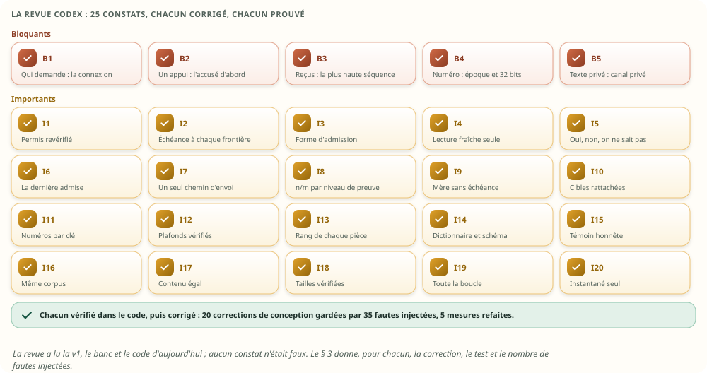

## 2. L'intérêt, démontré

Tu as demandé un passage qui montre pourquoi ranger en mémoire les ordres, et les appareils
physiques et virtuels qui les portent avec les valeurs, et ce que cela change à la mémoire. Le
voici, en deux tableaux : ce que cela permet, puis ce que cela coûte. Chaque ligne a sa preuve au
banc.

### 2.1 Ce que cela permet

| Ce que la maison sait faire | Aujourd'hui | Avec la mémoire des ordres | La preuve |
|---|---|---|---|
| Dire ce qu'un volet RTS a reçu en dernier (il n'a aucune valeur) | rien sur l'appareil ; le journal global, 60 lignes à l'écran | la fiche de l'ordre : « ouvrir, exécuté par la box, 18:20, par l'assistant », la même sur l'actif, le secours et chaque écran | test `la_derniere_commande_se_lit_partout_pareil` |
| Dire si une valeur suit la dernière commande, ou un geste à la main | impossible : rien ne relie un ordre à la valeur qui suit (V7 § 5.8) | oui, non, ou on ne sait pas, en 1,0 ns : « éteindre ce que la maison a allumé, pas ce qu'un humain a rallumé » | test `les_workflows_interrogent_les_ordres` |
| Réagir à un ordre, pas à une valeur | impossible | un déclencheur sur l'ordre : « quand on ferme le volet RTS, fermer celui de la chambre » | idem |
| Refuser une demande hors de sa structure, avant de l'envoyer | le hub, en 104 ns ; l'écran lit le `Kind` du point, sans effet ni retour | le hub, l'écran et l'agent, avec la même forme et les mêmes dictionnaires : 39 ns par le nom, 5,6 ns par le numéro, sur le même corpus et avec les mêmes décisions | `catalogue`, corpus commun ; test du corpus fixe |
| Ne laisser un invité commander que ses pièces | une vérification par requête REST (`rest.rs:119`) | le principal est celui de la connexion ; chaque cible est autorisée, groupes compris | test `un_invite_ne_commande_que_ses_pieces` |
| Une issue tardive ne touche jamais la mauvaise demande | les canaux le garantissent ; une exécution n'a pas de numéro de demande | la génération et l'époque du numéro | test `chaque_issue_tombe_sur_sa_demande`, et ses fautes injectées |
| Une retenue passe un redémarrage et une bascule, sans garder une autorisation échue | perdue au redémarrage, sans une ligne de journal | gardée ; à l'approbation, l'échéance, le permis et la forme sont revérifiés | tests `une_retenue_n_approuve_que_ce_qu_elle_montre`, `une_retenue_ne_garde_pas_une_autorisation_echue`, `une_carte_ne_s_approuve_que_sous_sa_forme` |
| Un appui renvoyé ne part qu'une fois, même après une bascule | reçus par fichier, sur une seule machine | l'appui attend l'accusé du secours ; les reçus sont dans la trace ; une reprise non sûre refuse la nouvelle tentative | tests `un_appui_n_est_ni_perdu_ni_double_par_la_bascule`, `un_appui_retente_ne_part_qu_une_fois`, essais de la reprise |
| Un ordre en vol à la bascule n'est jamais renvoyé, et sa vérité est dite | — (aucun secours) | « incertain », puis confirmé par le nouvel actif, par une lecture faite après la reprise | tests `aucun_ordre_n_est_rejoue`, `une_lecture_d_avant_la_reprise_ne_confirme_pas` |
| Un appareil virtuel montre et commande sans posséder | `members` : des appareils seulement ; un luminaire dit « fait » dès qu'une ampoule obéit (`moli-lights/src/lib.rs:498`) | une composition ; « 3 sur 4 », par niveau de preuve ; la garde lit les pièces des membres | tests `un_appareil_virtuel_compose_sans_posseder`, `un_groupe_approuve_se_repartit`, `un_groupe_coupe_par_la_bascule_garde_son_compte` |
| Un texte privé reste privé | il voyage avec la commande | il ne voyage que par le canal privé, et s'efface à la conclusion | test `un_texte_prive_ne_sort_que_par_le_canal_prive` |
| Un écran se recharge sans tout relire, et voit ce qu'il a perdu | `/api/snapshot` : toute la maison, en JSON | son état, filtré, par MQTT ; puis le flux de ses pièces, au rang de chacune | test `un_ecran_de_piece_voit_ses_trous` ; section `clients` |
| Un appareil retiré ne garde rien, sa place non plus | son étiquette et son état restent (nettoyage § 4.3) | la fiche de l'ordre est remise à zéro au lot ; un vieux numéro ne commande jamais l'appareil neuf | test `un_appareil_retire_n_est_plus_commande_et_sa_place_ne_garde_rien` |
| Laisser la tablette du salon à toute la famille | une session PIN : « un humain », trente jours, quel que soit celui qui la tient (`session.rs:153-158`) | anonyme : le confort ; le PIN de Charlie : les droits de Charlie, quelques minutes ; puis anonyme de nouveau | test `une_tablette_partagee_n_est_personne_sans_session` |
| Parler à la maison | la voix n'a pas de locuteur (`voice.rs:49-57`) : `assistant`, acteur « Moli » | une voix reconnue vaut sa personne pour le confort ; la porte se propose, même à la voix du propriétaire | test `une_voix_reconnue_ne_sert_que_le_confort` |
| Approuver une ouverture | tout porteur du code commun ; l'approbateur n'est pas nommé (`hub.rs:1313-1323`) | un adulte ou le propriétaire, à un écran, sur la révision vue, une fois ; le journal le nomme | tests `seul_un_approbateur_habilite_decide`, `une_ancienne_approbation_ne_vaut_pas_pour_la_carte_renouvelee` |
| Lancer une routine | depuis un appareil anonyme, ses scènes passent sans code (`automations.rs:274-284`), puis tout s'exécute en `automation` | les droits de qui la lance, dans la limite de son mandat | test `une_routine_lancee_garde_les_droits_de_qui_la_lance` |
| Un automatisme dont l'auteur s'en va | il continue : aucune identité d'auteur | refusé à sa prochaine exécution et mis à revoir ; adopté par le foyer, il continue | test `un_automatisme_ne_survit_pas_a_son_responsable_sauf_adopte` |
| Révoquer quelqu'un | ses sessions PIN restent ouvertes (liées à l'adresse), son flux SSE continue | rien de ce qu'il a demandé ne part plus, même déjà admis ; ses retenues tombent | test `une_revocation_avant_la_remise_ne_laisse_rien_partir` |
| Savoir qui a fait quoi, sans le dire à tous | `actor`, en texte, montré à tout le foyer | `ord/` sans identité ; le pair la tient ; chacun voit ses propres actes | test `ord_ne_dit_pas_qui` |

### 2.2 Ce que cela coûte, et ce que cela remplace

Chaque chiffre est mesuré à information égale : le témoin d'aujourd'hui suit la convention des
pilotes réels (§ 19.1), et chaque taille vient du compteur d'allocations ou de `size_of`.


| Ce qui est gardé, maison ×1 (×10) | Aujourd'hui | Avec la mémoire des ordres |
|---|---|---|
| La description des appareils, de leurs valeurs et de leurs ordres | 775 Kio (7,6 Mio) : `Device` et `PointSpec` | 360 Kio (3,4 Mio) : annuaires, `Def` de la mémoire v2, registre des ordres, catalogue, listes et compositions |
| … dont la structure et les fiches des ordres | dans les `PointSpec`, incomplète : ni effet, ni retour, ni suivi | 32,0 Kio : 16 formes et une fiche de 40 o par ordre |
| Une demande en vol | 590 o au mieux, en une dizaine d'allocations, sans compter les canaux ni les tâches | 72 o, dans une case ; au pic de la journée, 39 demandes en cours (64 à ×10) |
| Le journal en mémoire, 500 lignes | 138 Kio de textes | 23,4 Kio de lignes de 48 o ; les noms se résolvent à l'affichage |
| 50 retenues (le plafond) | 21,6 Kio | 11,2 Kio, mesuré : les demandes, leurs cartes, le reçu |
| Les reçus | trois fichiers métier (boutons, compteurs, minuteries), jusqu'à 1 Mio chacun | 10,2 Kio dans la journée du banc ; au plus 65,0 Kio pour 64 principaux |
| Les compositions des appareils virtuels | `members`, des noms | 2,7 Kio : 340 entrées de 8 o |
| Ce que l'assistant copie à chaque requête | 317 Kio (`Hub::snapshot` : les états de chaque appareil ; les descriptions, elles, sont partagées par `Arc`), en 134 µs | rien : l'inventaire se lit dans les colonnes |
| L'inventaire que lit le modèle | 17 988 jetons, estimés | 15 070 jetons, estimés : chaque structure écrite une fois, en unités humaines, avec ses choix |
| Ce qu'un écran charge pour démarrer, à contenu égal | 593 Ko de JSON | 114 Ko par MQTT, 20,8 pour un écran de deux pièces |

Trois lectures :

- **La mémoire des ordres coûte moins que ce qu'elle remplace.** Elle range des choses qui
  n'existent pas aujourd'hui (la structure complète, la dernière commande et sa preuve, les
  compositions, les permis), et la description entière reste 2,2 fois plus légère que celle
  d'aujourd'hui. La v1 annonçait 2,5 fois ; le témoin y était gonflé (§ 3.3).
- **Le gain le plus net est hors du hub** : la copie que fait l'assistant à chaque requête, et ce
  que charge un écran.
- **Rien de tout cela ne pèse à l'échelle d'une maison** : moins d'un Mio à ×1 ; les droits y
  ajoutent quelques kilo-octets (§ 11.11). Le choix se fait sur ce que la maison sait faire en plus
  (§ 2.1), et sur ce qu'elle ne fait plus de travers (§ 3), pas sur les octets.

## 3. Ce que les deux revues ont changé

**La première revue** (de la v1) est reprise telle quelle aux § 3.1 à § 3.4 ; **la seconde** (de la
v2, sur les droits) est au § 3.5, et ce que j'ai trouvé en plus en corrigeant, au § 3.6.

Codex a lu la v1, le banc, les quatre propositions liées et le code d'aujourd'hui, puis rendu 25
constats, chacun avec sa preuve (`fichier:ligne`, un scénario, un calcul). Je les ai repris un à un
dans le banc et dans le code : **aucun n'était faux**. Le tableau dit, pour chacun, ce que la v2
fait, le test qui le prouve, et combien de fautes injectées gardent la correction (§ 20.3). Les cinq
constats de mesure (I15 à I19) n'en ont pas : la preuve est la mesure refaite, et deux d'entre eux
sont tenus par des assertions (les mêmes décisions sur le corpus commun, les tailles des fiches).

### 3.1 Les cinq bloquants

| Constat | Ce que la v2 fait | La preuve |
|---|---|---|
| **B1** — Une ACL sur `req/<client>` n'autorise pas la cible nommée dans la demande ; l'origine et la personne étaient déclarées par le client | le **principal** est déduit du sujet, que l'ACL du courtier réserve à son compte ; l'origine et la personne viennent de lui ; chaque cible est autorisée par le hub, filles d'un groupe comprises ; seuls le hub et ses pairs publient `cmd/`, `ord/`, `res/` (§ 11) | test `un_invite_ne_commande_que_ses_pieces` ; 2 fautes |
| **B2** — Une trace copiée après coup ne garantit pas qu'un appui retenté après une bascule ne part pas deux fois | un **appui attend l'accusé du secours** avant de partir (≈ un aller-retour sur le réseau local, quelques centaines de µs) ; sans accusé au bout de 200 ms, l'actif inscrit chez le témoin que le secours a décroché, puis envoie ; une reprise après décrochage, ou sur un instantané ancien, n'est **pas sûre** : une nouvelle tentative d'un appui antérieur à la reprise est refusée, « incertain, ambiguë », jamais refaite (§ 12.6, § 17) | test `un_appui_n_est_ni_perdu_ni_double_par_la_bascule` ; essais de la reprise non sûre et du secours décroché ; 3 fautes |
| **B3** — La fenêtre de 32 reçus réautorisait un appui plus ancien qu'elle, et cédait la fenêtre d'un appelant au 65e | une fenêtre **par principal**, avec sa **plus haute séquence** : une clé plus ancienne que la fenêtre est refusée (`perimee`), la même clé pour un autre ordre ou d'autres arguments aussi (`conflit`) ; aucune fenêtre n'est jamais cédée. C'est la règle d'aujourd'hui (`occurrences.rs:302`), que la v1 avait perdue ; et **toute** demande externe porte sa clé, pas seulement les appuis (§ 12.5) | test des reçus ; 2 fautes |
| **B4** — La génération de 16 bits faisait le tour ; la clé d'une carte se confondait avec celle des paramètres | le numéro tient sur 64 bits : la case (16), **l'époque de l'actif** (16) et la génération (32) ; une case épuisée est condamnée ; cartes, paramètres et textes privés ont chacun leur tiroir (§ 12.1) | tests des cases condamnées et des époques ; 2 fautes, dont celle de la v1 sur la génération |
| **B5** — Le drapeau « texte privé » ne changeait rien : le texte voyageait sur `cmd/` et `ord/` | le texte est remplacé par sa longueur partout ; il ne voyage que par le **canal privé**, vers le module de l'appareil et le pair ; il s'efface à la conclusion ; l'état d'un client et l'instantané d'un actif sans demande vivante n'en ont aucun (§ 12.7) | test `un_texte_prive_ne_sort_que_par_le_canal_prive` : deux textes témoins, cherchés dans chaque sortie, chaque commande, chaque état ; 2 fautes |

### 3.2 Les vingt importants

| Constat | Ce que la v2 fait | La preuve |
|---|---|---|
| **I1** — Une authentification faite une fois ne vaut pas une autorisation vivante | le permis est revérifié à l'arrivée, à l'approbation et à l'envoi ; à sa fin (ou à une révocation), les retenues tombent, ce qui attend dans une voie en est retiré, les abonnements sont coupés (§ 11) | tests `une_retenue_ne_garde_pas_une_autorisation_echue`, essais de la révocation et du permis à l'approbation ; 3 fautes |
| **I2** — L'échéance de l'appelant était ignorée ; une retenue échue s'approuvait tant que le balayage n'était pas passé | l'échéance d'une demande est la plus courte de : 5 s, celle de l'appelant, la fin de son permis ; une demande déjà échue est refusée ; la décision vérifie elle-même l'échéance de la retenue (§ 12.2) | test `une_echeance_se_verifie_a_chaque_frontiere` ; 2 fautes |
| **I3** — Une demande relisait la forme courante de l'ordre | elle garde sa **forme d'admission** jusqu'au bout ; une approbation se lie à la forme et aux cibles montrées ; si elles ont changé, la demande est revalidée : refusée, ou une nouvelle carte à décider (§ 12.3) | test `une_carte_ne_s_approuve_que_sous_sa_forme` ; 1 faute |
| **I4** — Après une bascule, une valeur lue avant pouvait confirmer | seule une lecture **commencée après l'envoi** prouve un ordre, comme aujourd'hui (`orders.rs:273`) ; après une reprise, seule compte une lecture faite après la reprise (§ 13.2) | test `une_lecture_d_avant_la_reprise_ne_confirme_pas`, essai de la lecture d'avant l'envoi ; 2 fautes |
| **I5** — « La valeur vient-elle d'un ordre ? » donnait une compatibilité pour une causalité | trois réponses, tenues par l'ordre des événements (jamais en comparant des horloges) : **oui** si la première variation après l'envoi est celle demandée et que rien n'a changé depuis ; **non** si elle a changé depuis, ou si la commande a échoué ; **on ne sait pas** sinon. Un geste humain pendant la latence de l'appareil reste indécidable sans cause donnée par l'appareil, et le document le dit (§ 15) | test `les_workflows_interrogent_les_ordres` : les quatre cas ; 3 fautes |
| **I6** — La dernière commande et « en cours » se confondaient ; une suite tardive remplaçait une demande plus récente | la dernière commande est la **dernière demande admise** ; seule elle écrit la fiche ; « en cours » se compte à part (`actives`) (§ 13.1) | test `la_derniere_commande_est_la_derniere_admise` ; 1 faute |
| **I7** — Un groupe approuvé ne passait plus par le répartiteur | **un seul chemin d'envoi**, après la garde, pour une demande admise comme approuvée ; les filles d'une mère approuvée ne sont pas retenues de nouveau, et chacune est autorisée (§ 14) | test `un_groupe_approuve_se_repartit` ; 1 faute |
| **I8** — La progression de la mère n'était pas copiée ; « exécuté » comptait comme « confirmé » | la copie rejoue la progression à partir des traces des filles ; la mère compte par niveau de preuve et prend le plus faible (§ 14) | test `un_groupe_coupe_par_la_bascule_garde_son_compte`, essai des filles du hub ; 2 fautes |
| **I9** — La mère pouvait conclure pendant la création de ses filles, et gardait une échéance sans travail | elle connaît toutes ses cibles avant la première fille ; elle n'a pas d'échéance à elle, et ne réveille personne (§ 14) | essais ; 2 fautes |
| **I10** — Une cible ne disait pas de quel ordre de groupe elle dépendait | chaque cible porte le rang de son ordre de groupe ; une cible est l'ordre d'un appareil **physique** (pas de groupe de groupes), de forme compatible ; 64 cibles au plus (§ 14) | essais des compositions ; 2 fautes |
| **I11** — Des plages contiguës et des rangs ne couvraient pas une vraie redéclaration | une redéclaration garde les numéros **par clé** ; les listes d'un appareil sont des numéros ; ce qui n'est plus déclaré est retiré ; les formes citent des clés (§ 9, § 18) | test `une_redeclaration_garde_les_numeros_par_cle` ; 1 faute |
| **I12** — Des plafonds tronquaient en silence ; aucun ne bornait les retenues | chaque plafond (255 valeurs, ordres ou membres par appareil ; 64 cibles ; 50 retenues ; 4 096 demandes en cours ; 16 paramètres) est vérifié avant toute mutation, avec une erreur (§ 12.4) | essais ; 1 faute |
| **I13** — Une copie filtrée ne voyait pas ses pertes avec le seul rang `s` | chaque sortie porte aussi **le rang de sa pièce** ; un écran vérifie la continuité de chacune de ses pièces ; une époque nouvelle le fait se recharger (§ 16.3) | test `un_ecran_de_piece_voit_ses_trous` ; 1 faute |
| **I14** — La validation commune ne vérifiait ni les dictionnaires, ni les objets | un code d'énumération doit être au dictionnaire, pas seulement entre les bornes ; un objet doit suivre son schéma plat ; un schéma imbriqué est refusé à la déclaration ; un corpus fixe écrit chaque décision attendue (§ 10.4) | test du corpus fixe ; 2 fautes |
| **I15** — Le témoin d'aujourd'hui était gonflé | il suit la convention des pilotes réels : un seul point `control` pour les appuis d'un appareil, aucun état pour un point en écriture seule (§ 19.1) | section `catalogue` |
| **I16** — 114 ns contre 39 ns ne mesuraient pas les mêmes décisions | un corpus commun de 1 025 intentions, valides et hors bornes ; les deux validations décident pareil sur les 1 025, puis sont chronométrées (§ 19.1) | section `catalogue` : une assertion arrête le banc si une décision diffère |
| **I17** — Les gains des écrans et de l'assistant venaient aussi d'informations retirées | l'état d'un client porte ce que porte `/api/snapshot` ; le gain est décomposé en partage, encodage et filtrage ; l'inventaire garde les unités et les choix ; les jetons sont dits estimés (§ 16.4, § 19) | section `clients` |
| **I18** — Deux tailles de fiches étaient fausses ; plusieurs postes étaient des forfaits | chaque fiche a sa taille vérifiée à la compilation ; chaque poste est mesuré par le compteur d'allocations, ou dit d'où il vient (§ 19) | `size_of` vérifié à la compilation ; `taille_*` dans la série |
| **I19** — « Le processeur de la journée » laissait du travail hors du chronomètre | la boucle entière, hub, kit et appareils simulés, en temps processeur (`getrusage`) (§ 12.8) | section `demandes` |
| **I20** — Le redémarrage de la soirée reprenait les baux à l'ancien moteur | la machine repart des seuls octets de l'instantané (hub et moteur) et de la configuration (§ 17.3) | test `un_bail_se_retablit_apres_la_bascule_et_le_redemarrage` ; 1 faute |

### 3.3 Ce que la v1 annonçait, ce que la v2 mesure

| Chiffre | v1 | v2 | Pourquoi l'écart |
|---|---|---|---|
| Fiche d'un appareil | 16 o annoncés (20 réels) | 16 o, vérifiés | une liste de numéros au lieu de deux plages |
| Fiche d'un ordre | 32 o | 40 o | le numéro de 64 bits, les demandes vivantes, la preuve |
| Forme ; paramètre | 24 o annoncés (20 réels) ; 16 o | 24 o ; 20 o | les clés sur 16 bits |
| Demande ; ligne de journal | 64 o ; 40 o | 72 o ; 48 o | la séquence, le principal, l'époque, la forme d'admission, les compteurs d'un groupe |
| La description, aujourd'hui ×1 | 828 Kio | 775 Kio | le témoin à la convention des pilotes |
| La description, proposée ×1 | 337 Kio | 360 Kio | la `Def` de la mémoire v2 comptée pour ce qu'elle est (16 o), les listes |
| Valider : aujourd'hui, par le nom, par le numéro | 114 ; 39 ; 4,1 ns | 104 ; 39 ; 5,6 ns | le même corpus, les mêmes décisions ; le dictionnaire vérifié |
| 50 retenues, proposé | 6,2 Kio (un forfait) | 11,2 Kio, mesurés | les cartes, le reçu, la table |
| Les reçus | 8,1 Kio | 10,2 Kio ; borne 65,0 Kio | une fenêtre par principal ; la borne dite |
| Un écran démarre | 631 → 118 Ko | 593 → 114 Ko | à contenu égal, décomposé (§ 16.4) |
| L'inventaire de l'assistant | 17 885 → 14 227 jetons | 17 988 → 15 070 jetons, estimés | unités et choix gardés |
| La journée ×1 | 8,7 ms (temps écoulé, partiel) | 5,8 ms de processeur, toute la boucle | la mesure refaite ; le hub v2 alloue moins |

### 3.4 Ce qui tenait

Codex le dit, et le banc le confirme : l'inventaire du code d'aujourd'hui (§ 5) était juste ; la
séparation des valeurs et des ordres, les formes immuables, les références à génération, la
distinction consigne et appui, les issues bornées par le retour, la composition sans propriétaire et
le « n/m » d'un groupe sont de bons principes. Une précision : la copie que fait l'assistant partage
les descriptions par `Arc` ; elle copie les états de chaque appareil, pas tous les `PointSpec`.

Ce que la revue n'a pas pu vérifier, et la v2 non plus : le transport MQTT réel, notre version du
courtier, le navigateur, le matériel. Les garanties distribuées sont démontrées par la soirée et les
essais, dans un seul processus ; elles restent à éprouver sur deux machines (§ 23, marche 7).

### 3.5 La seconde revue : les droits

Codex a relu la v2, son banc et le code d'aujourd'hui sous l'angle que tu as donné : qui donne un
ordre, pour qui, avec quelle preuve, sous quel mandat ; et ce qu'on avait oublié dans la mémoire et
dans le moteur. [Son rapport](ordres-appareils-revue-droits.md) compte **23 constats** : 10
bloquants, 13 importants, chacun avec sa preuve. En parallèle, un agent Claude a fait l'inventaire
de ce que le code d'aujourd'hui décide, sans rien à défendre (§ 5.4). J'ai recoupé chaque constat
dans le banc et dans le code : **aucun n'était faux**. Le tableau dit ce que la v3 fait, le test qui
le prouve, et combien de fautes injectées gardent la correction (§ 20.3).

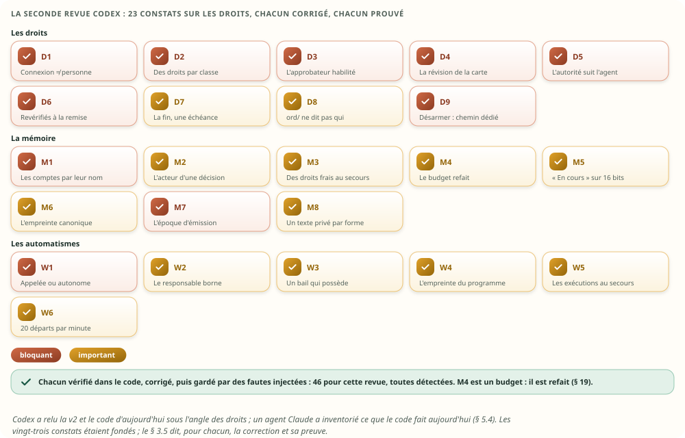

| Constat | Ce que la v3 fait | La preuve |
|---|---|---|
| **D1** — bloquant — La connexion était assimilée à une personne | trois identités : la connexion (le principal), la personne et sa preuve, le mandat, établies par le serveur ; une tablette partagée n'est personne ; un PIN personnel y ouvre une session de quelques minutes, qui finit d'elle-même ; un satellite ne donne qu'un indice : sa personne pour le confort (ton choix), jamais plus qu'un inconnu pour le sensible (§ 11.1, § 11.2) | tests `une_tablette_partagee_n_est_personne_sans_session`, `une_voix_reconnue_ne_sert_que_le_confort`, `une_voix_reconnue_vaut_sa_personne_pour_le_confort` ; 4 fautes |
| **D2** — bloquant — Le permis par pièces n'était pas un droit sur les ordres ; l'invité contournait la garde | une classe par ordre, dans sa forme ; une table rôles × classes ; la garde devient « proposer », pour tous les canaux et toutes les personnes ; l'origine « écran » ne retire aucune restriction (§ 11.3, § 11.4) | test `un_invite_ne_fait_pas_tout_dans_sa_piece`, corpus de 24 décisions ; 3 fautes |
| **D3** — bloquant — L'approbateur n'avait pas à être autorisé sur l'opération | approuver est un droit à part : un écran, une preuve personnelle, le droit d'approuver la classe sur toutes les pièces de l'ordre, ou être la personne pour qui l'agent a demandé (§ 11.6) | test `seul_un_approbateur_habilite_decide` ; 3 fautes |
| **D4** — bloquant — Une ancienne approbation pouvait accepter une carte renouvelée | chaque carte a sa révision ; la décision la nomme ; elle est consommée une fois ; une carte renouvelée en prend une neuve (§ 11.6) | test `une_ancienne_approbation_ne_vaut_pas_pour_la_carte_renouvelee` ; 1 faute |
| **D5** — bloquant — L'assistant et MCP ne transmettaient pas l'autorité personnelle | un agent agit pour une personne par un mandat du serveur, et garde les plafonds de cette personne et ceux de son canal ; l'assistant porte l'autorité de l'écran qui lui parle ; un client ne se dit ni exécution du moteur, ni fille d'un groupe (§ 11.2) | tests `un_agent_garde_les_plafonds_de_sa_personne_et_de_son_canal`, `un_client_ne_declare_pas_son_autorite` ; 1 faute, et une de W1 |
| **D6** — bloquant — Une révocation pouvait laisser partir une commande encore dans le hub | les droits sont revérifiés à la remise au module, le dernier point avant l'envoi ; ce qui attend l'accusé du secours tombe tout de suite (§ 11.7) | test `une_revocation_avant_la_remise_ne_laisse_rien_partir` ; 2 fautes |
| **D7** — important — L'expiration d'un permis n'était pas une échéance de réveil | la fin d'un compte ou d'une personne dont une demande vit est une échéance du hub (§ 11.7) | test `la_fin_d_une_invitation_reveille_le_hub`, sans battement ; 2 fautes |
| **D8** — important — Voir une pièce donnait trop ; l'audit nominatif n'avait pas de politique | `ord/` ne porte ni la personne, ni sa preuve ; le pair les reçoit par une sortie privée ; un écran voit lesquelles des dernières commandes sont les siennes ; l'audit est un droit à part (§ 11.8) | test `ord_ne_dit_pas_qui` ; 2 fautes |
| **D9** — bloquant — Le contrat générique ne suffisait pas pour l'alarme | une classe « désarmer » : refusée à l'arrivée, cause `dedie`, jamais retenue ni approuvée, dans aucun mandat ; le code passe par le chemin privé de l'alarme (§ 11.9) | test `desarmer_ne_passe_jamais_par_les_ordres`, corpus ; 2 fautes |
| **M1** — bloquant — Les principaux étaient des positions de configuration | les comptes se relisent par leur nom ; un compte supprimé devient une tombe sans droits ; une copie s'aligne sur l'actif ; les plafonds sont des refus (§ 11.10) | test `les_comptes_se_relisent_par_leur_nom` ; 2 fautes |
| **M2** — important — `qui` confondait les identités ; le journal perdait l'approbateur | la ligne d'une décision porte l'approbateur ; la personne de la demande a son champ (`pour`), à part de l'acteur technique (`qui`) (§ 11.6) | test `seul_un_approbateur_habilite_decide` ; 1 faute |
| **M3** — important — La réplication des droits n'était pas raccordée au contrat HA | les droits (personnes, comptes, table, mandats) passent au pair par leur nom, au rang `s`, avec les sessions ; une réduction de droits attend l'accusé du secours, sinon le témoin dit qu'il a décroché ; un secours promu sans reprise sûre fait proposer le sensible, que seul un propriétaire approuve, jusqu'à ce qu'il confirme les droits (§ 11.7, § 17) | tests `un_secours_aux_droits_incertains_retient_le_sensible`, `une_revocation_attend_l_accuse_du_secours` ; 4 fautes |
| **M4** — important — Le budget n'incluait pas le modèle ; la fiche d'exécution de 64 o devait changer | les droits sont mesurés (§ 11.11, § 19) ; la fiche d'exécution de la mémoire v2 passe à 72 o (§ 15.1, § 21) ; la borne des reçus est dite pour 256 comptes (§ 12.5) | section `demandes` ; un budget, sans faute à injecter |
| **M5** — important — Le compteur des demandes vivantes saturait à 255 | 16 bits, dans la même fiche de 40 o (§ 13.1) | test `en_cours_compte_au_dela_de_255` ; 1 faute |
| **M6** — important — L'empreinte des arguments ne garantissait pas le conflit | nombre, type, longueur et valeur de chaque argument, sur 64 bits (§ 12.5) | test `des_arguments_differents_ne_passent_pas_pour_les_memes` ; 1 faute |
| **M7** — bloquant — Une répétition de la première tentative contournait la reprise non sûre | chaque demande externe dit l'époque de la session sur laquelle elle a été émise ; après une reprise non sûre, un appui inconnu d'une session d'avant, ou sans époque, est ambigu ; l'époque de cette reprise est gardée dans l'instantané (§ 12.6, § 17.2) | test `une_premiere_tentative_d_avant_la_reprise_reste_ambigue` ; 3 fautes |
| **M8** — important — Plusieurs textes privés s'écrasaient | une forme a au plus un texte privé ; une autre est refusée à la déclaration (§ 12.7) | test `une_declaration_hors_des_bornes_des_droits_est_refusee` ; 1 faute |
| **W1** — bloquant — Un déclencheur humain pouvait acquérir les droits généraux du moteur | deux contrats : appelée (les droits de qui la lance, son canal, le mandat), autonome (son responsable, le mandat) ; un mandat ne couvre que son manifeste ; un déclencheur que d'autres peuvent provoquer ne lance rien de sensible sans décision explicite (§ 15.1) | tests `une_routine_lancee_garde_les_droits_de_qui_la_lance`, `un_mandat_ne_couvre_que_son_manifeste`, `un_declencheur_ouvert_ne_lance_pas_le_sensible_sans_decision` ; 4 fautes |
| **W2** — important — La validation du graphe n'était pas une validation des droits du responsable | à la validation, le manifeste ; le responsable doit pouvoir l'approuver lui-même ; seul un propriétaire fait adopter par le foyer ; un mandat refusé à l'exécution met l'automatisme à revoir (§ 15.1) | test `un_automatisme_ne_survit_pas_a_son_responsable_sauf_adopte` ; 3 fautes |
| **W3** — important — Les baux créaient un effet futur sans conserver son autorité | le bail s'ouvre au succès de son ordre ; à son terme, il ne rétablit que si sa commande est encore la dernière et que la valeur la suit ; le rétablissement est une demande neuve, sous le mandat, revérifiée (§ 15.1) | test `un_bail_ne_retablit_que_ce_qu_il_possede` ; 2 fautes |
| **W4** — important — Une exécution persistée pouvait reprendre dans un autre programme | elle porte l'empreinte de son programme : réordonné, elle le retrouve ; changé, elle s'arrête (§ 15.1) | test `une_execution_ne_change_pas_de_programme` ; 1 faute |
| **W5** — important — La bascule n'éprouvait pas la réplication des exécutions | chaque transition part sur `wf/ex/<c>`, au pair seulement (§ 15.1, § 17) | test `une_execution_reprend_sur_le_secours_entre_deux_etapes` ; 1 faute |
| **W6** — important — Les déclencheurs sur ordres pouvaient produire des rafales sans borne | 20 départs par minute et par automatisme, comme aujourd'hui ; une transition d'une demande lance une fois (§ 15.1) | test `deux_automatismes_ne_se_relancent_pas_sans_fin` ; 2 fautes |

Ce que Codex proposait et que la v3 ne prend pas : **un contexte d'autorité partagé de 32 octets**,
cité par référence depuis chaque demande, dernière commande et ligne. Il est plus général, mais il
lui faut un cycle de vie (Codex l'écrit : « libérer à la conclusion crée des références pendantes,
ne jamais libérer crée une fuite »). Les trois identités tiennent dans les octets que la v2
réservait : rien ne grandit, et rien n'est à libérer (§ 8).

### 3.6 Cinq trous de plus, trouvés en corrigeant

Les essais ont fait apparaître cinq trous que ni la revue ni l'inventaire ne nommaient :

| Le trou | Ce que la v3 fait | La preuve |
|---|---|---|
| Une demande reçue pouvait se dire **fille d'une demande vivante** et hériter de son autorité | une fille naît du répartiteur, jamais d'une demande reçue : refusée, cause `droits` | test `un_client_ne_declare_pas_son_autorite` ; la faute « D5 » |
| Une demande **sans époque d'émission** passait pour neuve après une reprise non sûre | elle est d'une session inconnue, donc d'avant : ambiguë pour un appui | test `une_premiere_tentative_d_avant_la_reprise_reste_ambigue` ; une faute de M7 |
| Une **reprise sûre après une reprise non sûre** effaçait l'ambiguïté d'avant | l'époque de la dernière reprise non sûre est rangée dans l'instantané | idem ; une faute de M7 |
| Sur un secours aux droits incertains, **un adulte approuvait encore le sensible**, avec des droits peut-être révoqués entre-temps | seul un propriétaire approuve, puis confirme les droits | test `un_secours_aux_droits_incertains_retient_le_sensible` ; une faute de M3 |
| Une reprise **« sûre » pour les appuis ne l'était pas pour les droits** : la dernière révocation pouvait se perdre parmi les sorties qu'une bascule perd (HA v2 § 6.5) | une réduction de droits attend l'accusé du secours, comme un appui ; sans lui, le témoin dit que le secours a décroché | test `une_revocation_attend_l_accuse_du_secours` ; une faute de M3 |

## 4. La question, reformulée

Technique **« Comment pourrait-on… »** :

1. Comment pourrait-on donner au hub, au moteur, aux modules, aux écrans, aux agents et au secours
   la même connaissance de l'appareil, de l'ordre et de sa structure, sans copier les définitions
   dix fois ?
2. Comment pourrait-on garder les ordres à part des valeurs, en ne les reliant que par référence, et
   par une référence qu'une redéclaration ne casse pas ?
3. Comment pourrait-on tenir chaque demande, de son arrivée à son issue et à sa suite, dans des
   fiches de taille fixe, sans qu'une issue tardive tombe jamais sur la mauvaise demande ?
4. Comment pourrait-on ne laisser commander que ce que chacun a le droit de commander, au moment où
   l'ordre part, et pas seulement au moment où il arrive ?
5. Comment pourrait-on laisser un workflow interroger les ordres comme il interroge les valeurs,
   sans lui faire croire plus qu'on ne sait ?
6. Comment pourrait-on assembler des appareils virtuels à partir des physiques, et les servir tels
   quels aux interfaces ?
7. Comment pourrait-on garder tout cela exact à travers une bascule, un redémarrage et un nettoyage,
   sans jamais rejouer un appui, ni le perdre en silence ?
8. Comment pourrait-on servir les clients sans module de traduction, et sans qu'un écran filtré
   ignore ce qu'il a perdu ?
9. Comment pourrait-on savoir **pour qui** un ordre est donné, sans croire ce que dit le client, et
   sans confondre la tablette avec celui qui la tient ?
10. Comment pourrait-on décider par **ce que l'ordre engage** (allumer, ouvrir, filmer, désarmer),
    et pas seulement par la pièce ?
11. Comment pourrait-on faire d'**approuver** un droit, et non un clic ?
12. Comment pourrait-on garantir qu'un **automatisme** ne fasse jamais plus que celui qui en répond,
    ni que celui qui le déclenche ?

Ce qui prouvera la réponse, fixé avant de chercher :

| Critère | La preuve |
|---|---|
| Chacun connaît l'appareil, l'ordre et sa structure, sans copie qui diverge | les copies du catalogue (secours, écran) égales à celle du hub ; un écran valide comme le hub |
| Une valeur n'est jamais un ordre | deux registres ; un volet RTS sans aucune valeur |
| Aucune issue ne tombe sur la mauvaise demande | des tests, et des fautes injectées qui les font échouer |
| Personne ne commande hors de ses droits, même après coup | un invité, un permis qui finit, une révocation, une approbation tardive |
| Aucun appui n'est rejoué, aucun n'est perdu sans le dire : module mort, bascule, redémarrage | chaque envoi compté, une fois ; une reprise non sûre refuse au lieu de deviner |
| Ce qui a été demandé en dernier se lit partout pareil, et dit sa preuve | la fiche de chaque ordre, comparée ; « oui, non, on ne sait pas » |
| La mémoire reste petite, et les chiffres sont honnêtes | mesurés à ×1, ×10, ×100, à information égale, à côté d'aujourd'hui |
| Une connexion n'est pas une personne ; une preuve faible n'étend rien | la tablette, la voix, l'agent mandaté : des essais, et un corpus fixe de décisions |
| Approuver exige un droit, sur la carte vue, une fois | les approbateurs refusés ; la révision rejouée, refusée |
| Un automatisme ne dépasse ni son responsable, ni qui le lance | la routine de Charlie ; la nuit d'Alice ; le bouton de l'entrée |
| Personne ne voit qui a fait quoi sans en avoir le droit | `ord/` sans identité ; « mien » ; le pair identique |

## 5. Ce qui manque


### 5.1 Dans la conception

| Où | Ce qui y est | Ce qui n'y est pas |
|---|---|---|
| V7 § 5.1, § 5.6, § 20.2, § 20.7 | le contrat d'un ordre : la méta d'un point écrivable (effet, retour par code, bornes d'ordre, suivi, réveillable, sensibilité), les neuf issues, les voies, `req/`, `cmd/`, `res/` | une fiche qui garde la structure ; la dernière commande ; la mémoire des demandes |
| V7 § 11.4.4, mémoire v2 § 5.1 | `Def` de 16 o par point, dont **un octet `sens`** : sémantique, lecture, écriture | tout le reste de la structure d'un ordre |
| Mémoire v2 § 8.4 | l'exécution de 64 o porte `demande`, « l'ordre en vol dont elle attend l'issue » | la demande elle-même : rien ne dit où elle vit ni ce qu'elle pèse |
| HA v2 § 3, § 7 | les retenues et les baux sont critiques, sur `wf/` ; un ordre envoyé sans issue devient « incertain » à la bascule | comment le secours sait quels ordres ont pu partir, et ce qu'il fait d'un appui retenté |
| Nettoyage § 9 | un appareil retiré n'est plus commandé ; ses retenues et ses baux se terminent | la fiche d'un ordre, et ce qu'en garde une place libérée |

La structure est donc **décrite** (sur MQTT) mais **rangée nulle part** ; l'état d'un ordre en cours
n'a pas de place ; et les ordres, comme dans le code, sont restés des points.

### 5.2 Dans le code d'aujourd'hui

**Inventaire** de tout ce qui garde quelque chose d'un ordre, relevé fichier par fichier
(`a835893`) ; la revue l'a recoupé sur un large échantillon :

| Ce qui est gardé | Où | Ce que c'est |
|---|---|---|
| La structure | `Device.points: Vec<PointSpec>` dans `Model.devices` (`moli-core/src/model.rs:10`, `moli-runtime/src/hub.rs:512`) | un ordre est un point écrivable (`Access { read, write }`, `spec.rs:119`) ; sa structure est le `Kind` du point : bornes, choix ; ni effet, ni retour, ni suivi |
| La validation | `Hub::prepare` (`hub.rs:1731`) | le `PointId` découpé (un `DeviceId` alloué), le `BTreeMap` des appareils, le point cherché en ligne, l'accès, `validate` |
| La garde | `verdict`, `sensitive`, `rooms_of` (`hub.rs:1095-1152`) | la sémantique du point (`Control`, `Lock`), les pièces de l'appareil et de ses `members` |
| Les droits | `guest_may` (`moli-api/src/rest.rs:119`), le permis d'un invité revérifié à l'envoi (`hub.rs:1798`) et au transport (`driver.rs:157`), et chaque seconde par le flux SSE (`sse.rs:101`) | **une autorisation vivante** : la v1 l'avait perdue en passant à MQTT ; la v2 la garde (§ 11) |
| Une demande en cours | `CommandRequest` (`driver.rs:66`) dans la file du pilote (64 places, `hub.rs:64`), un `oneshot`, un `AtomicU8`, et chez l'appelant `Delivery`, `Observer` et une fermeture qui écrira la ligne de journal (`hub.rs:343-431`) | l'état d'un ordre est réparti entre la tâche de l'appelant et celle du pilote ; il n'a pas de numéro |
| L'échéance | `command_timeout` 5 s (`hub.rs:122`) ; `REPLY_MARGIN` 400 ms, `MIN_LEFT` 1 s (`orders.rs:18-21`) | — |
| La voie d'un pilote | `OrderLine` (`orders.rs:25`) ; `Confirmations` : 32 valeurs attendues au plus, et **seule une lecture commencée après l'accusé confirme** (`orders.rs:209-228`, `orders.rs:273`) | dans chaque pilote qui l'utilise, pas dans tous |
| Les retenues | `Approvals { pending }`, 50 au plus, 10 min (`hub.rs:173-247`) ; la décision vérifie l'échéance et garde le permis de l'invité (`hub.rs:1313-1403`) | en mémoire seulement : **perdues au redémarrage**, sans ligne qui les conclue |
| Les reçus | boutons, compteurs, minuteries : 64 appelants, 32 reçus chacun, **la plus haute séquence**, les conflits et les clés périmées refusés (`occurrences.rs:133-171`, `occurrences.rs:302`, `counters.rs:11-14`) | durables, mais sur une seule machine |
| Les scènes | `Scenes { active, ended (64), points, leases }` (`scenes.rs:135-147`) : une scène coordonne ses appareils, 512 au plus | une dernière commande… le temps d'une scène |
| Le journal | 500 `Arc<JournalEntry>` en mémoire, en textes (`hub.rs:542-545`), et un fichier JSON Lines rogné à 8 Mio (`journal_log.rs:20-21`) | le seul endroit où l'on retrouve ce qu'un ordre a donné |
| La dernière commande | **nulle part dans le hub** ; l'écran garde la sienne, par point, 8 s (`web/src/lib/hub.svelte.js:17-18, 217-246`) | un volet RTS n'affiche rien de ce qu'il a reçu |
| Ce que lit l'assistant | `Hub::snapshot` à chaque requête (`moli-assistant/src/lib.rs:1139`), puis l'inventaire (`house.rs:115`) | les états de toute la maison copiés à chaque question ; les descriptions partagées par `Arc` |
| Ce que lisent les agents | `list_devices`, `get_device`, `send_command(point, valeur)` (`moli-api/src/mcp.rs:344-441`) | la structure d'un ordre se devine dans le `Kind` du point |

**Les ordres déguisés en valeurs.** Au moins neuf pilotes déclarent des points en écriture seule. Ce
sont des ordres sans valeur, rangés comme des valeurs :

| Pilote | Le « point » | Où |
|---|---|---|
| Telegram, téléphones | `notify`, `push` : un texte à envoyer | `moli-telegram/src/lib.rs:171`, `moli-phones/src/lib.rs:653` |
| Sonos | `announce` | `moli-sonos/src/lib.rs:201` |
| Philips | `text`, `key`, `media_control` | `moli-philips/src/lib.rs:337, 351, 402` |
| Roborock, Landroid | `control` (démarrer, pause, stop…) | `moli-roborock/src/model.rs:163`, `moli-landroid/src/model.rs:255` |
| Nuki | l'ouverture | `moli-nuki/src/model.rs:185` |
| TaHoma (RTS) | `control` : une énumération des gestes, aucun état (`moli-overkiz/src/model.rs:145`, et son test, `model.rs:604`) | `moli-overkiz/src/model.rs:124` |
| Aides | les commandes des minuteries et des compteurs | `moli-helpers/src/lib.rs:196, 267` |

### 5.3 Trois défauts trouvés en chemin

- **Une retenue disparaît au redémarrage, sans trace.** Les retenues ne vivent qu'en mémoire
  (`hub.rs:442`, aucune option de fichier dans `HubOptions`) ; le journal garde la ligne « en
  attente d'approbation », jamais sa fin. L'agent a pourtant reçu « elle expire dans 10 minutes »
  (`mcp.rs:431-437`).
- **Aucune dernière commande.** Un ordre et la valeur qui suit ne sont reliés nulle part (la V7 le
  notait déjà, § 5.8). L'écran garde sa propre attente, 8 s, par point (`hub.svelte.js:238-241`) ;
  un autre écran ne sait rien de l'ordre en cours.
- **L'assistant copie les états de toute la maison à chaque requête** (`Hub::snapshot`,
  `lib.rs:1139`) : 317 Kio alloués puis rendus, à ×1, pour en tirer quelques lignes par appareil.

### 5.4 Les droits dans le code d'aujourd'hui

Un agent Claude en a fait l'**inventaire**, fichier par fichier, en lecture seule ([son
rapport](ordres-appareils-droits-aujourdhui.md)) ; j'en ai revérifié sept faits dans le code, tous
exacts. Ce qu'il faut en retenir, pour ta question :

| Ce qui décide | Aujourd'hui | Où |
|---|---|---|
| Qui agit | l'**origine** (`Origin`, huit valeurs), jamais la personne. La personne (`Caller.person`) s'arrête à la couche HTTP : ni la commande, ni l'approbation, ni le pilote, ni le journal ne la portent, sauf en texte libre dans `actor` | `moli-core/src/event.rs:126-147` ; `moli-api/src/caller.rs:123` |
| La seule preuve « humaine » | une **session PIN**, ouverte avec **le code commun de la maison**, liée à l'appelant (une adresse, un e-mail Access, une personne), trente jours | `moli-api/src/session.rs:153-158`, `:421-431` |
| Les rôles | `owner`, `member`, `guest` ; `member` n'a aucun effet ; aucun enfant | `moli-api/src/people.rs:63-69` |
| Un appareil anonyme du réseau local | « le foyer » : il lit tout, et commande partout, sauf les pièces protégées, les machines et les serrures | `caller.rs:133-138`, `:241-254` |
| L'invité | cloisonné à ses pièces, avec un permis vivant revérifié jusqu'à l'émission, **s'il est connecté** ; sinon, sur le Wi-Fi, il est le foyer | `people.rs:623-641` ; `caller.rs:324-337` |
| La voix, l'assistant, MCP | aucune personne : `assistant` (acteur « Moli »), `mcp` (sans authentification), `api` (acteur déclaré par le client) | `moli-runtime/src/voice.rs:49-57` ; `moli-api/src/mcp.rs:19-46` |
| L'approbation | `resolve_approval` ne vérifie que l'origine `ui` : tout porteur du code approuve tout ; l'approbateur n'est pas nommé | `moli-runtime/src/hub.rs:1313-1323` |
| Un automatisme | il agit en `automation`, que la garde ne retient jamais ; il ignore qui l'a déclenché | `moli-runtime/src/guard.rs:131-135` ; `moli-automation/src/run.rs:503-540` |
| L'alarme | un moteur et des profils spécifiés, **pas raccordés** : ni pilote, ni routes, ni consommateur du clavier | `moli-api/src/alarm_access.rs:1` ; `docs/components/alarme.md` |

Ce qui tient, et que la v3 reprend : le permis vivant de l'invité (`CommandPermit`), revérifié
jusqu'à l'émission dans treize pilotes ; le permis parent des scènes (`scene_execution.rs:357`) ;
l'approbation d'un automatisme liée à l'empreinte de son graphe ; le chemin privé de l'alarme.

Les trous, classés par gravité :

| Gravité | Le trou | Où |
|---|---|---|
| **Élevé** | **E1** — la personne n'est pas propagée au-delà de HTTP : aucune décision du hub ne peut dépendre de qui agit | `driver.rs:19-24`, `:66-82` ; `event.rs:76-100` |
| **Élevé** | **E2** — le code de la maison est commun et anonyme : approuver, valider, commander les chambres, ouvrir une porte, regarder une caméra de chambre, pour tout porteur du code, trente jours, tablette partagée comprise | `session.rs:153-158` ; `rest.rs:252-280` |
| **Élevé** | **E3** — l'approbation sans droit sur l'ordre, sans séparation entre demandeur et approbateur ; l'approbateur d'un automatisme n'est jamais nommé | `hub.rs:1313-1323` ; `moli-automation/src/lib.rs:108-116` |
| **Élevé** | **E4** — l'escalade par automatisme : un automatisme validé agit en `automation`, et peut être déclenché par un état ou une occurrence que n'importe qui produit (un agent qui appuie sur un bouton virtuel) | `guard.rs:131-135` ; `run.rs:503-540` |
| **Élevé** | **E5** — un appareil anonyme lance une routine dont une scène atteint une chambre ou une serrure : `household_may_run` ignore les scènes | `moli-api/src/automations.rs:274-284` |
| **Élevé** | **E6** — le réseau local est le foyer ; l'invité n'est cloisonné que connecté | `caller.rs:241-254`, `:324-337` |
| **Moyen** | MCP sans authentification : le journal, les positions, l'historique, des commandes à l'acteur choisi | `mcp.rs:19-46` |
| **Moyen** | une révocation n'est pas vivante pour un membre : son flux SSE continue, ses sessions PIN restent ouvertes, ses automatismes tournent | `sse.rs:97-112` ; `people.rs:977-1017` |
| **Moyen** | la voix n'a ni locuteur ni pièce | `voice.rs:7-12`, `:49-57` |
| **Moyen** | les rôles presque vides : ni droits par personne, ni enfant | `people.rs:63-69` |
| **Moyen** | une traçabilité lacunaire : `actor` mêle l'attesté et le déclaré ; le lancement d'un automatisme n'est pas journalisé | `rest.rs:86-94` ; `hub.rs:180-192` |
| **Moyen** | un invité qui connaît le code ouvre la serrure de sa pièce sans approbation | `rest.rs:559-605` |
| **Moyen** | l'alarme est spécifiée, pas raccordée | `alarm_access.rs:1` |
| **Moyen** | des approbations sans auteur et volatiles : une demande en remplace une autre, un afflux en évince, tout disparaît au redémarrage | `hub.rs:1239-1259` |
| **Moyen** | tout appelant du foyer, ou MCP, annule la scène d'un autre | `scene_hub.rs:325-344` |
| **Faible** | six de moindre portée : la vue de l'invité laisse passer la liste des pilotes et le statut de la garde ; les notifications vont à tous les téléphones ; les pièces de l'invité comparées par égalité exacte ; un acteur « tableau de bord » pour un script ; quatre écarts entre la documentation et le code ; le foyer anonyme renomme un appareil | le rapport, § 5 |

Ces trous sont ceux du code d'aujourd'hui. La v3 les ferme dans la conception ; le code ne change
que si tu la valides. Les plus graves se corrigent sans attendre la mémoire des ordres (§ 23, marche
1) : à ta demande, les six sont au backlog, « Droits E1 » à « Droits E6 » (§ 22).

## 6. Qui doit connaître quoi

Ta phrase, prise au pied de la lettre : **l'appareil, l'ordre, la structure de l'ordre**. Pour
chaque composant, ce qu'il en connaît, ce qu'il garde, et par où il l'apprend :


| Qui | L'appareil | L'ordre | La structure | Ce qu'il garde des ordres | Il l'apprend par |
|---|---|---|---|---|---|
| **Le hub** | registre, fiche de 16 o, liste, composition | registre, fiche de 40 o | toutes les formes, leur classe, les clés, les dictionnaires | tout : catalogue, demandes, reçus, retenues et cartes, journal ; les comptes, les personnes, la table des droits, les mandats, les sessions | les déclarations des modules ; la configuration des comptes et des personnes ; la validation des automatismes |
| **Le moteur** | son numéro | le numéro de l'ordre, dans le nœud « commander » | la forme, à la compilation | ses exécutions (`demande`), ses baux, dans son instantané | `meta/`, `meta/forme/`, `ord/` |
| **Un module** | ses appareils (natif ↔ numéro) | le numéro, dans `cmd/` | celle de la demande, dans `cmd/` ; elle borne son issue | ses voies, ses ordres en vol, ses suivis | lui-même ; le canal privé pour un texte privé |
| **Un écran, l'appli, un site** | nom, numéro, pièce, composition, disponibilité | nom, numéro | la forme et les dictionnaires en cache, par numéro | les dernières commandes de ses pièces, le rang de chacune, lesquelles sont « miennes » ; jamais qui a fait les autres | MQTT : `etat/`, `meta/`, `meta/forme/`, `ord/`, `val/`, filtrés par ses droits (§ 16) |
| **Un agent, l'assistant** | le nom | le nom | un outil par ordre, tiré de la forme, en unités humaines | rien | MCP, REST |
| **Le secours** | le même registre | le même registre | les mêmes formes | tout ce que tient le hub, canal privé compris : les droits par leur nom, l'identité de chaque trace, les exécutions du moteur ; il accuse chaque rang | le flux critique et l'état complet (HA v2) |
| **La base, l'archive** | le nom | le nom | — | le journal des ordres, par les noms | `run/`, puis `hist/ops` |

Deux règles de la mémoire v2 suffisent à tenir tout cela :

- **un seul propriétaire, des copies** (§ 7) : le hub écrit, les autres reçoivent ;
- **un numéro inconnu se redemande, il ne se devine pas** (§ 4.4) : vrai pour une forme, un
  dictionnaire et un point.

## 7. Les idées

### 7.1 Ailleurs, comment fait-on ?

Technique des **analogies** :

| Où | Ce qu'ils font | Ce qu'on en retient |
|---|---|---|
| **Matter, Zigbee (ZCL)** | un cluster a des **attributs** (des valeurs) et des **commandes** (des ordres), numérotés à part ; une commande a des champs typés ; les commandes sensibles sont « minutées » ; chaque accès est contrôlé par une liste par nœud et par sujet | **séparer les valeurs et les ordres** ; **autoriser chaque commande**, pas seulement la connexion |
| **CANopen** | le dictionnaire d'objets : chaque entrée a un numéro, un type, un accès, des bornes ; tous les nœuds le connaissent par un fichier de description | **un catalogue partagé, par numéro**, publié une fois |
| **Home Assistant** | des services à schéma, les capacités de chaque entité, et un **contexte** attaché à chaque changement : qui, et par quel service | **la dernière commande et sa cause, quand l'appareil la donne** ; un outil par ordre pour les agents |
| **Le contrôle aérien** | une bande par vol, de taille fixe ; la clairance, puis son collationnement | **une fiche par demande** ; la confirmation par ce qui revient, et seulement après l'émission |
| **Les paiements** | une clé d'idempotence par requête, une fenêtre, et la règle : une requête qu'on ne peut plus départager est refusée, jamais rejouée | **les reçus, la plus haute séquence, la reprise non sûre** |
| **Les registres de schémas (Kafka)** | un message porte le numéro de son schéma ; le lecteur le demande une fois et le garde | **`meta/forme/<f>`**, en cache par numéro |

### 7.2 SCAMPER sur « un ordre est un point écrivable »

| Lettre | La question | L'idée |
|---|---|---|
| **S**ubstituer | Et si un ordre n'était pas un point ? | un registre des ordres, à part (retenu) |
| **C**ombiner | Et si les retenues étaient des demandes ? | un état `RETENUE` dans la même fiche (retenu) |
| **A**dapter | Et si on reprenait les exécutions de la v2 ? | cases réutilisées, génération, et l'époque de l'actif (retenu) |
| **M**odifier | Et si le retour par code de la V7 devenait un ordre par geste ? | ouvrir, fermer et stop ont chacun leur forme (retenu) |
| **P**roduire autre chose | Et si la fiche de l'ordre servait aux workflows ? | règles et déclencheurs sur un ordre (retenu) |
| **É**liminer | Et si l'écran n'avait plus de module de traduction ? | les clients par MQTT (§ 16, ton choix) |
| **R**enverser | Et si c'était la valeur qui citait l'ordre ? | écarté : une valeur ne sait rien des ordres (mémoire v2 § 8.2) |

### 7.3 Brainstorming inversé : comment rater la mémoire des ordres ?

La v1 avait sa liste ; la revue y a ajouté ce qu'elle avait laissé passer (en gras).

| Pour rater | Il suffirait de… | Le garde-fou |
|---|---|---|
| Une issue qui tombe sur la mauvaise demande | réutiliser la case sans génération | la génération ; une faute injectée le vérifie |
| **Un numéro redonné par celui qui reprend** | **repartir des générations de l'ancien actif** | **l'époque dans le numéro** |
| Un ordre rejoué après une bascule | renvoyer ce qui était remis à un module de l'ancien actif | « incertain », jamais renvoyé ; chaque envoi est compté |
| **Un appui fait deux fois par une reprise** | **croire qu'une trace copiée « après » protège un effet fait « avant »** | **l'accusé du secours avant l'effet ; la reprise non sûre refuse** |
| **Un vieil appui rejoué** | **ne garder que les 32 derniers reçus** | **la plus haute séquence ; « périmée »** |
| **Un invité qui ouvre la porte** | **autoriser le sujet, pas la cible ; croire l'origine que le client déclare** | **le principal de la connexion ; chaque cible autorisée** |
| **Une autorisation qui survit à son permis** | **la vérifier une fois** | **un permis revérifié à chaque frontière** |
| Une carte d'approbation qui approuve autre chose | décider par le numéro de case, **ou sur une forme qui a changé** | la carte porte l'ordre, **la forme et les cibles** montrés |
| Un ordre envoyé hors de sa structure | faire confiance au client, **ou ne vérifier que les bornes** | le hub valide toujours, **dictionnaire et schéma compris** |
| Un écran qui commande l'appareil neuf avec un vieux numéro | ignorer la génération de l'ordre | un numéro de l'ancienne génération est inconnu |
| Une copie dont les échéances dérivent | lui envoyer l'horloge monotone de l'actif | l'échéance voyage en heure murale |
| Une valeur prise pour l'œuvre d'un ordre | comparer la valeur seule, **ou des horloges** | **l'ordre des événements, et « on ne sait pas » quand on ne sait pas** |
| **Une confirmation par une vieille lecture** | **accepter toute valeur qui arrive après l'envoi** | **une lecture commencée après l'envoi** |
| Un groupe qui dit « fait » quand une ampoule a obéi | compter les réussites, pas les cibles, **ou confondre « exécuté » et « confirmé »** | « échec, partiel, n/m », **par niveau de preuve** |
| **Un texte privé publié** | **poser le drapeau sans s'en servir** | **le canal privé ; deux textes témoins cherchés partout** |
| **Un chiffre flatteur** | **construire le témoin depuis le nouveau modèle** | **le témoin à la convention des pilotes ; le même corpus ; `size_of`** |

### 7.4 Remise en cause et jeu de rôles : sept canaux demandent un ordre

Trois hypothèses tenaient la v2 debout, sans qu'on les dise ; technique de la **remise en cause des
hypothèses** :

| L'hypothèse | Pourquoi elle tombe |
|---|---|
| « Une connexion est une personne » | la tablette du salon sert à toute la famille ; le satellite entend qui parle ; un agent agit pour quelqu'un |
| « Un humain à l'écran a le droit d'approuver » | Charlie sait cliquer sur une carte ; savoir cliquer n'est pas avoir le droit d'ouvrir |
| « Un automatisme validé a tous les droits » | il agit pour quelqu'un, ou pour la maison ; son déclencheur peut être pressé par n'importe qui |

Puis le **jeu de rôles** : chacun demande un ordre, et l'on regarde ce que le hub sait de lui.

| Le rôle | Ce qu'il demande | Ce que le hub sait aujourd'hui | Ce que la v3 décide |
|---|---|---|---|
| La tablette du salon, de passage | « ouvre la porte » | une session PIN de trente jours : « un humain » | personne : la porte se propose, un adulte décide |
| Charlie, son PIN personnel sur la tablette | « allume ma chambre » ; « ouvre la porte » | le même « humain » | sa chambre, oui ; la porte, non : ce n'est pas sa pièce |
| Bob, à voix haute | « ouvre la porte » | `assistant`, acteur « Moli » | un indice : la porte se propose ; il confirme sur son téléphone |
| L'agent d'Alice | « allume la caméra du salon, pour Alice » | `mcp`, l'acteur qu'il se choisit | le mandat d'Alice et son canal : proposé ; Alice confirme |
| Un invité | « ouvre la serrure de ma pièce » | cloisonné s'il est connecté, sinon le foyer | proposé : un adulte décide |
| Le bouton de l'entrée | il sonne, et « Sonnette ouvre » veut ouvrir | `automation` : jamais retenu | à revoir, sauf décision explicite de son responsable |
| « Nuit », validée par Alice, partie depuis | « éteins tout » | `automation` | refusée à sa prochaine exécution, mise à revoir ; adoptée par le foyer, elle continue |

### 7.5 Brainstorming inversé : comment voler un droit ?

| Pour voler | Il suffirait de… | Le garde-fou |
|---|---|---|
| Les droits du propriétaire | taper le code commun sur sa tablette | la session est personnelle, et finit d'elle-même |
| Le droit d'ouvrir, à la voix | imiter la voix du propriétaire | une voix reconnue ne vaut que pour le confort |
| Une approbation, par qui ne peut pas | montrer la carte à un enfant | approuver est un droit, par classe et par pièce |
| Une approbation, pour autre chose | changer les cibles après l'affichage, puis rejouer le clic | la révision de la carte, consommée une fois |
| Un droit, après sa révocation | être déjà admis, pas encore remis au module | les droits revérifiés à la remise |
| Les droits d'un automatisme | provoquer l'état qu'il guette | un déclencheur ouvert ne lance rien de sensible sans décision ; son mandat |
| L'autorité d'une exécution | déclarer une autorité, ou se dire fille d'un groupe | seul un principal interne nomme une exécution ; une fille naît du répartiteur |
| Une approbation, pendant une bascule | approuver sur un secours qui n'a pas reçu la révocation | des droits frais, ou le propriétaire seul |
| Un appui, deux fois | répéter le message d'origine après une reprise | l'époque d'émission |
| L'emploi du temps des autres | lire `ord/` | `ord/` ne dit pas qui |
| Le désarmement | faire retenir un désarmement, puis le faire approuver | désarmer n'est jamais retenu, ni approuvé, ni dans un mandat |

## 8. Les options, et le choix à critères visibles

**Analyse morphologique** : six dimensions, et leurs options.

| Dimension | Options |
|---|---|
| D1. Où ranger la structure | S1 dans `Def` (48 o pour chaque point) · S2 une colonne par point · S3 une fiche par ordre · **S4 une fiche par ordre et des formes partagées** · S5 relire la méta à chaque demande |
| D2. Ce qu'est un ordre | N1 un point écrivable (aujourd'hui) · **N2 une entrée à lui, dans son registre, à paramètres** · N3 un point et un code |
| D3. Les demandes | E1 des tâches et des canaux (aujourd'hui) · **E2 des fiches, cases, génération et époque** · E3 une table par identifiant · E4 chacun garde la sienne |
| D4. Les retenues | R1 à part (aujourd'hui) · **R2 un état de la demande** |
| D5. La dernière commande | L1 nulle part (aujourd'hui) · L2 dans la valeur · **L3 dans la fiche de l'ordre** |
| D6. Ce qui passe au secours | H1 rien · **H2 chaque pas, sur `ord/`, et l'accusé avant un appui** · H3 la demande, pour la renvoyer |

**Sélection à critères visibles** : simplicité, mémoire, justesse (aucune mauvaise issue, aucun
rejeu), cohérence avec la mémoire v2, le nettoyage et la HA v2, lisibilité pour les écrans et les
agents. De 1 à 3 chacun :

| Option | Simplicité | Mémoire | Justesse | Cohérence | Lisibilité | Total |
|---|---|---|---|---|---|---|
| S1 la structure dans `Def` | 3 | 1 | 2 | 1 | 2 | 9 |
| S3 une fiche par ordre | 3 | 2 | 3 | 3 | 2 | 13 |
| **S4 fiche et formes partagées** | 2 | 3 | 3 | 3 | 3 | **14** |
| S5 relire la méta | 2 | 2 | 1 | 1 | 1 | 7 |
| N1 un point écrivable | 3 | 1 | 1 | 1 | 1 | 7 |
| **N2 un registre des ordres** | 2 | 3 | 3 | 3 | 3 | **14** |
| E1 tâches et canaux | 2 | 1 | 2 | 1 | 1 | 7 |
| **E2 cases, génération, époque** | 3 | 3 | 3 | 3 | 2 | **14** |
| L2 dans la valeur | 2 | 1 | 1 | 1 | 2 | 7 |
| **L3 dans la fiche de l'ordre** | 3 | 3 | 3 | 3 | 3 | **15** |
| H3 renvoyer après la bascule | 1 | 2 | 1 | 1 | 2 | 7 |
| **H2 chaque pas sur `ord/`, l'accusé avant un appui** | 2 | 3 | 3 | 3 | 3 | **14** |

Le choix : **S4, N2, E2, R2, L3, H2.** La revue rappelle qu'une grille de scores ne prouve pas
qu'une complexité est nécessaire ; le plan (§ 23) en tient compte : il livre d'abord le catalogue et
le suivi dans le code d'aujourd'hui, et ne serre les fiches à leur taille fixe qu'une fois les
règles de sécurité et de reprise éprouvées.

Pour les droits, une seconde **analyse morphologique** :

| Dimension | Options |
|---|---|
| R1. Où vit l'identité | I1 dans la connexion (la v2) · **I2 trois identités, dans les fiches : le principal, la personne et sa preuve, le mandat** · I3 un contexte d'autorité partagé de 32 o, cité par référence (la proposition de Codex) |
| R2. Comment décider | P1 par l'origine (aujourd'hui) · P2 par la pièce (la v2) · **P3 par la classe, une table de rôles, les pièces et le contexte** · P4 un langage de politiques |
| R3. Qui approuve | A1 tout porteur du code (aujourd'hui) · A2 les propriétaires seuls · **A3 quiconque est habilité pour la classe et les pièces, ou la personne pour qui l'agent a demandé** |
| R4. Ce que fait un automatisme | X1 les droits du moteur (aujourd'hui, la v2) · X2 toujours ceux de son auteur · **X3 appelé : ceux de qui le lance ; autonome : ceux de son responsable, dans un mandat ; adopté par le foyer : son mandat** |
| R5. Qui voit qui | V1 tout le foyer (aujourd'hui) · V2 par pièce (la v2) · **V3 l'état à tous, l'identité au pair, ses actes à chacun** |

| Option | Simplicité | Mémoire | Justesse | Cohérence | Lisibilité | Total |
|---|---|---|---|---|---|---|
| **I2 trois identités, dans les fiches** | 3 | 3 | 3 | 3 | 2 | **14** |
| I3 un contexte partagé de 32 o | 1 | 2 | 3 | 2 | 2 | 10 |
| **P3 classe, table, pièces, contexte** | 2 | 3 | 3 | 3 | 3 | **14** |
| P4 un langage de politiques | 1 | 2 | 2 | 1 | 1 | 7 |
| **A3 habilité, par classe et par pièce** | 2 | 3 | 3 | 3 | 3 | **14** |
| A2 les propriétaires seuls | 3 | 3 | 2 | 2 | 3 | 13 |
| **X3 appelé ou autonome, sous un mandat** | 2 | 3 | 3 | 3 | 2 | **13** |
| X2 toujours les droits de l'auteur | 3 | 3 | 2 | 2 | 2 | 12 |
| **V3 l'état à tous, l'identité au pair** | 2 | 3 | 3 | 3 | 3 | **14** |

Le choix : **I2, P3, A3, X3, V3** ; tu as retenu A3, X3 et V3 (§ 22). A2 n'est pas loin : c'était la
configuration de départ que Codex suggérait pour les ouvertures ; elle reste un réglage de la table,
pas du code. I3 serait la marche suivante si un jour il fallait porter davantage (une cause
d'exécution, une référence de preuve) : la v3 n'en a pas besoin, et il lui faudrait un cycle de vie
(§ 3.5).

## 9. Les valeurs et les ordres, séparés

**Premiers principes.** Une valeur arrive de l'appareil, quand il veut ; elle a une qualité, une
fraîcheur, une précédente. Un ordre part de la maison, quand quelqu'un le demande ; il a des
paramètres, une échéance, une issue, une suite, et quelqu'un qui en répond. Ils ne vivent pas au
même rythme, n'ont pas la même durée de vie, et ne sont pas lus par les mêmes : une condition lit
une valeur, une action donne un ordre.


Les règles :

1. **Deux registres**, celui du nettoyage deux fois : les valeurs (`appareil/clé`) et les ordres
   (`appareil/ordre`). Chacun a ses numéros (place 24 bits, génération 7 bits), ses noms, ses
   fiches. Les numéros sont typés : `Point`, `Ordre`, `Appareil` (mémoire v2 § 4.3).
2. **Un appareil a une liste** : les numéros de ses valeurs, puis ceux de ses ordres. Un volet RTS a
   quatre ordres et aucune valeur ; un capteur a des valeurs et aucun ordre. La v1 voulait deux
   plages de places qui se suivent ; une redéclaration qui ajoute une valeur aurait dû tout
   déplacer.
3. **Le seul lien est une référence, portée par la forme de l'ordre, par la clé de la valeur** : la
   valeur qui le prouve (`confirme`) et celle que règle chaque paramètre (`regle`). La clé ne dépend
   ni de l'appareil, ni de l'ordre des déclarations : deux lampes du même modèle partagent la même
   forme, et une valeur ajoutée au milieu ne déplace rien.
4. **Une valeur ne sait rien des ordres**, comme elle ne sait rien des workflows (mémoire v2 § 8.2,
   règle 3). C'est l'ordre qui cite la valeur, jamais l'inverse.
5. **Sur MQTT, deux familles** : les valeurs sur `val/`, les ordres sur `ord/` (§ 10.5).

La migration ne réécrit aucun pilote (§ 23) :

| Aujourd'hui | Avec deux registres |
|---|---|
| un point lisible et écrivable (`on` d'une lampe) | une valeur `on`, et un ordre `on` à un paramètre, dont la forme dit : la valeur `on` le prouve, à la tolérance près |
| un point en écriture seule (`notify`, `control`, `unlatch`) | un ordre seul, sans valeur |
| une énumération d'ordres (`control` : ouvrir, stop, fermer) | d'abord un ordre à un paramètre, puis, quand le module le veut, un ordre par geste : chacun sa forme, son retour, son suivi |

## 10. L'appareil, l'ordre, la structure


### 10.1 Les fiches

Bloc technique — les trois fiches (extraits du banc, `tools/ordres-banc/src/`, sans `unsafe` ;
chaque taille est vérifiée à la compilation par `const _: () = assert!(size_of::<…>() == …)`) :

```rust
/// Un appareil : sa liste (ses valeurs, puis ses ordres : des numéros), sa composition, sa pièce. 16 o.
#[repr(C)]
pub struct App {
    pub liste: u32, pub compo: u32,
    pub piece: u16,
    pub nb_points: u8, pub nb_ordres: u8, pub nb_compo: u8,
    pub genre: u8,            // physique, virtuel
    pub _r: u16,
}

/// Un ordre : sa forme, sa dernière commande, ses demandes vivantes, sa preuve. 40 o, une par ordre ;
/// l'appareil de chaque ordre est une colonne à part (v3).
#[repr(C)]
pub struct Fiche {
    pub valeur: i64,          // le premier paramètre de la dernière commande
    pub instant_ms: u64,      // son dernier pas (murale)
    pub demande: Ref,         // la dernière demande ADMISE : une issue tardive d'une autre ne la remplace pas
    pub qui: u32,             // l'acteur technique : un agent, une exécution du moteur
    pub forme: u16,
    pub pour: u16,            // la personne pour qui elle a été faite ; jamais sur ord/ (v3)
    pub actives: u16,         // combien de demandes de cet ordre vivent : « en cours » ; 16 bits (v3)
    pub issue: u8,            // celle de la dernière commande ; « en cours » ; 0 : jamais commandé
    pub origine: u8,
    pub changes: u8,          // les variations de la valeur prouvée depuis l'envoi de la dernière commande
    pub preuve: u8,           // prouvée par un changement ; le premier ; modifiée depuis
    pub preuve_pour: u8,      // ce qu'on savait de la personne : aucune, indice, personnelle (v3)
    pub _r: u8,
}

/// La structure d'un ordre, partagée. 24 o, plus ses paramètres et ses valeurs attendues.
#[repr(C)]
pub struct Forme {
    pub params: u32, pub attendus: u32,   // début de ses paramètres, de ses valeurs attendues
    pub confirme: u16,        // la CLÉ de la valeur qui prouve l'ordre
    pub suivi_s: u16, pub tolerance: u16, pub schema: u16,
    pub nb_params: u8, pub nb_attendus: u8,
    pub effet: u8,            // consigne (la dernière gagne) | appui (chacun compte)
    pub retour: u8,           // état | pont | accusé | aucun : l'issue ne le dépasse jamais
    pub drapeaux: u8,         // à l'arrêt, réveillable, ouvre, contrôle, texte privé, au hub, attendu = paramètre, groupe
    pub _r: [u8; 3],          // [0] : la classe de l'ordre, déclarée ou déduite (v3)
}

/// Un paramètre, au canon : 20 o. Les bornes sont celles de l'ordre (V7 G24).
#[repr(C)]
pub struct Param {
    pub min: i32, pub max: i32, pub pas: u16,
    pub dico: u16,            // le dictionnaire d'une énumération
    pub regle: u16,           // la CLÉ de la valeur que ce paramètre règle
    pub nature: u8, pub echelle: i8, pub unite: u8,
    pub _r: [u8; 3],
}
```

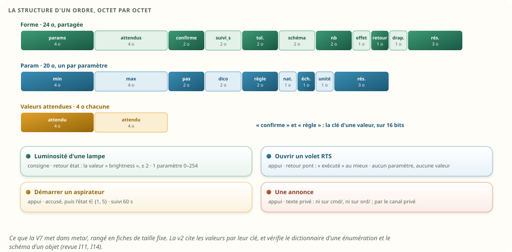

Ce que la forme contient est exactement la méta d'un ordre de la V7 (§ 5.1), mise en fiches :

| La V7, sur `meta/` | La forme |
|---|---|
| `effet` : consigne ou appui | `effet` |
| `retour` par code : `etat`, `pont`, `accuse`, `aucun` | `retour`, `confirme`, les valeurs attendues ; un code d'énumération qui avait son propre retour devient son propre ordre |
| `suivi_s` (180 s au plus) | `suivi_s` |
| bornes d'ordre, à part de la validité | `min`, `max`, `pas` de chaque paramètre |
| `reveillable`, `sensible: texte_prive`, `proprietaire: hub` | les drapeaux |
| `semantic` lu par la garde (`Control`, `Lock` qui ouvre) | les drapeaux « contrôle » et « ouvre » ; et la **classe** de l'ordre (v3, § 11.4) |
| objet court au schéma déclaré | `schema` : un objet plat (des clés, des textes, des entiers, des booléens) |

### 10.2 Une forme ne change jamais

Une forme est **immuable** : une structure nouvelle est une forme nouvelle, avec un numéro neuf. Un
écran, un agent ou le moteur qui l'a en cache n'a donc jamais à la vérifier ; il demande seulement
celles qu'il ne connaît pas. Une redéclaration (un micrologiciel qui change les bornes d'une
consigne) change la forme de l'ordre, pas la forme elle-même (§ 18) ; une demande en cours garde la
sienne (§ 12.3).

### 10.3 Le catalogue en mesures

| Le catalogue des ordres | ×1 | ×10 | ×100 |
|---|---|---|---|
| Appareils (dont virtuels) | 525 (29) | 5 243 (283) | 52 407 (2 807) |
| Valeurs | 2 264 | 22 640 | 226 400 |
| Ordres | 802 | 8 468 | 82 592 |
| Formes ; paramètres ; clés | 16 ; 12 ; 23 | 16 ; 12 ; 23 | 16 ; 12 ; 23 |
| Registre des ordres (noms, générations, statuts), mesuré | 44,4 Kio | 499 Kio | 4,6 Mio |
| Catalogue (formes, clés, dictionnaires, fiches de 40 o), mesuré | 37,0 Kio | 366 Kio | 3,5 Mio |
| Valider une demande, par le nom ; par le numéro | 39 ns ; 5,6 ns | 48 ns ; 5,9 ns | 56 ns ; 6,1 ns |
| Aujourd'hui, `Hub::prepare`, le même corpus | 104 ns | 152 ns | non construit |

Les ordres et les appareils virtuels de la maison du banc sont une **hypothèse** : un modèle par
classe d'appareil (annexe A.2). À ×10 et ×100, la maison répète les mêmes modèles ; une vraie maison
plus grande aurait un peu plus de formes, jamais une par ordre.

### 10.4 La validation commune

Le hub, l'écran et l'agent valident avec **la même fonction**, la même forme et les mêmes
dictionnaires : le nombre de paramètres, les bornes, le pas, **le code au dictionnaire** (un code
entre les bornes mais absent du dictionnaire est refusé), la longueur d'un texte, et **le schéma
d'un objet** : des clés déclarées, chacune une fois, au bon type. Un schéma que la validation ne
sait pas vérifier (un objet imbriqué, un tableau) est refusé dès la déclaration de la forme : rien
ne passe sans être vérifié.

L'égalité entre le hub et l'écran ne prouve rien si les deux appellent la même fonction incomplète :
un **corpus fixe** écrit chaque décision attendue (dix-sept cas, dont un code absent du
dictionnaire, une clé inconnue, une clé en double, un objet imbriqué, un texte qui n'est pas du
JSON). La soirée vérifie en plus que l'écran décide comme le hub sur 3 344 demandes tirées au
hasard.

### 10.5 Sur MQTT

Bloc technique — la méta d'un appareil, une forme, une demande, un ordre, une issue, une trace
(proposé) :

```text
meta/salon_lampe        {"points":{"on":{"n":1234,"kind":"binary"},"brightness":{"n":1235,…}},
                         "ordres":{"on":{"n":87,"f":3},"brightness":{"n":88,"f":4},"color_temp":{"n":89,"f":9}}}
meta/forme/4            {"f":4,"e":1,"r":1,"c":"brightness","d":64,"s":0,"t":2,"p":[[2,0,254,1,0,0,0,"brightness"]],"a":[]}
req/ecran-salon         {"q":4127,"o":"salon_lampe/brightness","v":[128],"e":1792675629123,"n":1}
cmd/z2m/salon_lampe/brightness   {"d":"4027/7/12","i":88,"f":4,"v":[128],"e":1792675629123,"E":7}
in/z2m/$issue           {"d":"4027/7/12","i":1}
res/ecran-salon         {"q":4127,"i":1,"ms":312}
ord/salon_lampe/brightness       {"d":"4027/7/12","e":"conclue","v":128,"i":1,"o":"ui","t":1792675624435,"E":7,"s":918301,"p":0,"sp":40211}
prive/hub-b             {"d":"4027/7/13","t":"…"}
```

| Ce qui change dans le contrat de la V7 (§ 7) | Pourquoi |
|---|---|
| `meta/<appareil>` sépare `points` et `ordres` ; chaque ordre porte son numéro `n` et sa forme `f` | deux registres ; le numéro voyage déjà (décision v2 § 4.4) |
| `meta/forme/<f>`, critique, publiée une fois ; elle cite des clés | la structure partagée, en cache par numéro |
| `req/<client>` : le sujet dit le principal ; le message porte sa séquence `q`, l'ordre `o`, les paramètres `v`, son échéance `e`, la tentative `n` | l'ACL du courtier réserve le sujet au compte ; la clé d'idempotence de toute demande ; l'échéance de l'appelant |
| `cmd/<module>/<appareil>/<ordre>` porte `d` (case, époque, génération), `i`, la forme `f` | la forme d'admission ; l'époque sépare deux actifs |
| `ord/<appareil>/<ordre>` : chaque pas d'une demande, au rang `s` et au rang de sa pièce `sp` | la dernière commande partout ; le secours sait ce qui a pu partir ; un écran filtré voit ses trous |
| `prive/<pair>` : le texte privé d'une demande vivante, vers le seul pair ; le module le lit à l'envoi | un texte privé ne passe ni par `cmd/`, ni par `ord/` |

Le message `meta/` d'une maison ×1 pèse 306 Ko quand chaque ordre porte sa structure, comme dans la
V7, et 242 Ko avec les formes, dont 1,5 Ko pour les 16 formes elles-mêmes. L'écart est modeste, car
les valeurs dominent `meta/` ; ce qui compte est qu'un client n'apprend chaque structure qu'une
fois.

## 11. Qui a le droit de donner un ordre

Ta question : « quand c'est un utilisateur, via une tablette, la voix ou autre, on rajoute
l'identifiant de l'utilisateur : comment gérer les droits ? » La réponse courte : **un identifiant
ne vaut que par sa provenance.** Codex le dit ainsi : « ajouter un identifiant utilisateur ne suffit
pas : il faut établir sa provenance ». La v3 garde à part trois choses, que le serveur établit et
que le client ne déclare jamais : la connexion, la personne et ce qu'on en sait, le mandat.


### 11.1 Six questions pour chaque ordre

Technique du **Starbursting** : les questions auxquelles un ordre doit pouvoir répondre avant de
partir, et où chaque réponse est rangée.

| La question | Qui y répond | Où c'est rangé |
|---|---|---|
| **Qui** le demande ? | la connexion : le sujet `req/<compte>`, que l'ACL du courtier réserve à son compte | le **profil** du compte, 32 o : ses pièces, sa fin, les classes qu'il commande ou propose, la meilleure preuve qu'il sait donner |
| **Pour qui** ? | une session personnelle, l'appli d'une personne, le mandat d'un agent ; sinon personne | la **personne**, 32 o : son rôle, ses pièces, sa fenêtre, ses exceptions ; `pour` dans la demande |
| **Avec quelle preuve** ? | le canal : une appli personnelle prouve, une voix ne donne qu'un indice | `preuve` dans la demande : aucune, indice, personnelle |
| **Quoi** ? | la forme de l'ordre | sa **classe**, dans la forme |
| **Où** ? | les pièces que l'ordre atteint, celles des cibles et des membres d'un groupe comprises | 64 bits, une par pièce |
| **Sous quel mandat** ? | la validation de l'automatisme | le **mandat**, 16 o : son manifeste, son responsable |

La septième, **quand**, est celle de la v2, étendue : à chaque frontière (§ 11.7).

### 11.2 Chaque canal, et ce qu'il prouve

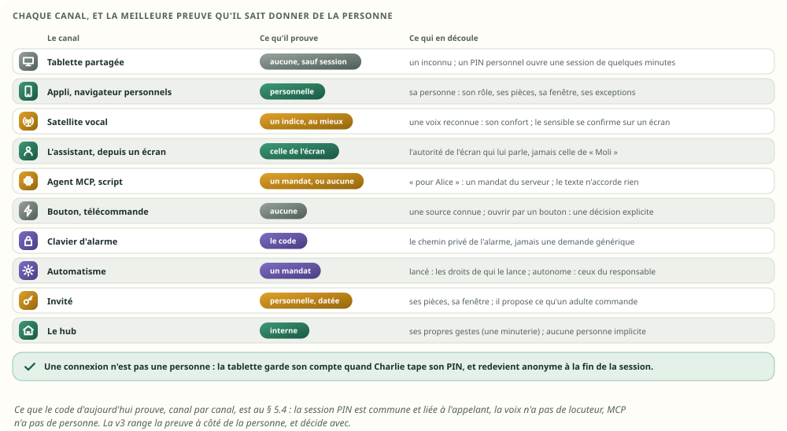

| Canal | Aujourd'hui (§ 5.4) | La v3 |
|---|---|---|
| **Tablette murale partagée** | une session PIN : « un humain », liée à l'adresse de l'appareil, trente jours | un compte d'écran **sans personne** : le profil « inconnu ». Un **PIN personnel** ouvre une **session personnelle** de quelques minutes : les demandes suivantes prennent la personne et sa preuve ; à la fin de la session, ou quand on la ferme, la tablette redevient anonyme d'elle-même. La session passe au pair |
| **Appli, navigateur personnels** | `Caller.person`, par une session personnelle ou Access | le compte porte sa personne, fixe, avec une preuve personnelle |
| **Téléphone appairé** | un jeton de remontée, sans personne (`caller.rs:287`) | il remonte ; il ne commande rien sans session personnelle |
| **Satellite vocal (ESPHome, Wyoming)** | aucun locuteur ; `assistant`, acteur « Moli » (`voice.rs:49`) | un compte de satellite, **gardé** (rien dans une chambre sans un humain) ; une voix reconnue est un **indice** : pour le confort (le confort, le média, le climat, les messages), elle vaut sa personne, ton choix ; pour le sensible, jamais plus qu'une voix inconnue : l'accès, l'alarme et les machines se proposent, la vie privée et le système sont refusés |
| **L'assistant, depuis un écran** | `Turn`, sans `Caller` (`assistant.rs:30`) | il porte l'autorité de l'écran qui lui parle jusqu'à ses outils, et son inventaire est filtré par ces droits ; jamais celle de « Moli » |
| **Agent MCP, script** | aucune personne ; MCP sans authentification (`mcp.rs:19`) | un compte d'agent, gardé ; **pour une personne**, par un mandat du serveur (`.pour(Alice)`) : il garde les plafonds d'Alice et ceux de son canal ; ce que dit le texte n'accorde rien |
| **Bouton, télécommande** | une occurrence, sans personne (`occurrence.rs:30`) | une source connue, et personne ; un automatisme qu'il déclenche est « ouvert » (§ 15.1) |
| **Clavier d'alarme** | un chemin privé vers un profil d'alarme (`keypad.rs:1`) | inchangé : le code ne passe jamais par les ordres (§ 11.9) |
| **Automatisme** | `automation`, jamais retenu (`guard.rs:131`) | appelé ou autonome, sous un mandat (§ 15.1) |
| **Invité** | ses pièces et un permis vivant, **s'il est connecté** | une personne de rôle « invité » : ses pièces, sa fenêtre ; il propose l'accès et les machines |
| **Le hub** | `system` | ses propres gestes (une minuterie), sans personne implicite |

Bloc technique — l'identité, dans le banc (`tools/ordres-banc/src/droits.rs` ; chaque taille est
vérifiée à la compilation) :

```rust
/// Le profil d'un compte : ce que la connexion permet, quelle que soit la personne. 32 o.
#[repr(C)]
pub struct Profil {
    pub pieces: u64,              // les pièces qu'il atteint, une par bit (64 au plus)
    pub fin_mur_ms: u64,          // la fin de son permis : une invitation, une révocation
    pub qui: u32,                 // ce que le journal nomme
    pub personne: u16,            // la personne fixe du compte (une appli personnelle, un agent mandaté)
    pub oui: u16, pub proposer: u16,   // les classes qu'il commande, celles qu'il seulement propose
    pub origine: u8,
    pub preuve_max: u8,           // la meilleure preuve que ce canal sait établir (un satellite : un indice)
    pub drapeaux: u8,             // interne ; décide (un écran) ; gardé (un agent, un satellite)
    pub _r: [u8; 3],
}

/// Une personne. 32 o.
#[repr(C)]
pub struct Personne {
    pub pieces: u64,
    pub debut_mur_ms: u64, pub fin_mur_ms: u64,   // sa fenêtre
    pub role: u8,                 // inconnu, propriétaire, adulte, enfant, invité, service
    pub drapeaux: u8,
    pub refuse: u16,              // les classes qui lui sont refusées en plus de son rôle
    pub _r: u32,
}

/// Une session personnelle sur un appareil partagé : le PIN de Charlie, pour quelques minutes. 16 o.
#[repr(C)]
pub struct Session { pub fin_mur_ms: u64, pub personne: u16, pub preuve: u8, pub _r: [u8; 5] }
```

### 11.3 La décision : non, proposer, oui

La décision est **le plus petit** de ce que permettent :

1. **le canal** : le compte est vivant, l'ordre est dans ses pièces, et sa classe est parmi celles
   qu'il commande (oui) ou qu'il seulement propose ;
2. **la personne** : dans sa fenêtre et dans ses pièces, la case de la table pour son rôle et cette
   classe, moins ses exceptions. Une voix reconnue (un indice) vaut sa personne **pour le confort**,
   ce qui n'est pas sensible (ton choix) ; **pour le sensible, sans preuve personnelle, au plus la
   ligne « inconnu »** : là, un indice ne fait que restreindre. Sans personne, la ligne
   « inconnu » ;
3. **le contexte** : une **pièce protégée** (une chambre) fait proposer si le canal est gardé (un
   agent, un satellite) ou s'il n'y a pas de preuve personnelle ; un **secours aux droits
   incertains** fait proposer tout ce qui est sensible (§ 17) ;
4. **le mandat** d'un automatisme : il ne commande que son manifeste (§ 15.1) ;
5. **l'ordre lui-même** : désarmer, jamais (§ 11.9).

« Proposer » est la garde d'aujourd'hui, généralisée : elle ne dépend plus seulement de l'origine
(un agent, ou pas), mais de la classe, de la personne et du canal. Un invité à son écran propose
l'ouverture de sa propre porte, comme un agent.

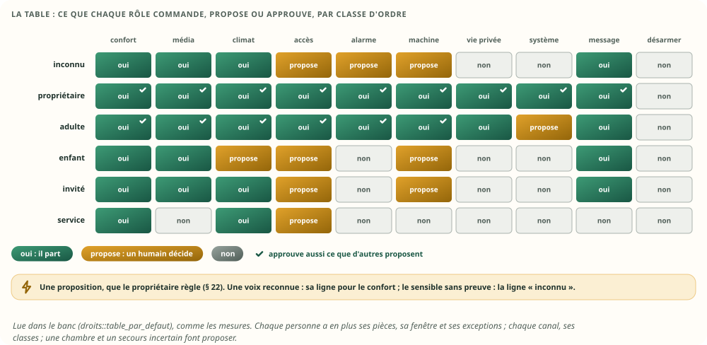

La table par défaut est une **proposition**, que le propriétaire règle (§ 22). Une **exception
personnelle** retire une classe à quelqu'un, quel que soit son rôle (Alice, sans le média). Le
corpus fixe du banc écrit 24 décisions attendues, de la tablette sans personne à l'invité, en
passant par la voix et l'agent : une table fausse ou une règle oubliée le fait échouer.

Bloc technique — la décision (extrait du banc, `droits::decider`, abrégé) :

```rust
pub fn decider(table: &Table, t: u64, a: &Autorite, c: u8, ps: u64, ctx: Contexte) -> u8 {
    let b = classe::bit(c);
    let mut n = match a.profil {                       // le canal
        Some(p) if t >= p.fin_mur_ms || ps & !p.pieces != 0 => return NON,
        Some(p) if p.oui & b != 0 => OUI,
        Some(p) if p.proposer & b != 0 => PROPOSER,
        _ => NON,
    };
    let inconnu = table[INCONNU][c] & 3;
    let np = match a.personne {                         // la personne, et ce qu'on en sait
        None if a.systeme => OUI,                       // le hub, un mandat adopté par le foyer
        None => inconnu,
        Some(p) if hors_de_sa_fenetre(p, t) || ps & !p.pieces != 0 => return NON,
        Some(p) => {
            let x = if p.refuse & b != 0 { NON } else { table[p.role][c] & 3 };
            let confort = a.preuve == INDICE && b & SENSIBLES == 0;   // une voix reconnue, ton choix
            if a.preuve >= PERSONNELLE || confort { x } else { x.min(inconnu) }
        }
    };
    n = n.min(np);
    if ps & ctx.protegees != 0 && (canal_garde(a) || a.preuve < PERSONNELLE) { n = n.min(PROPOSER) }
    if !ctx.droits_frais && b & SENSIBLES != 0 { n = n.min(PROPOSER) }
    if let Some(m) = a.mandat && (!vivant(m) || m.classes & b == 0 || ps & !m.pieces != 0) { return NON }
    if c == DESARMER { return NON }
    n
}
```

### 11.4 La classe d'un ordre

- **Elle est dans la forme**, dans l'un des trois octets que la v2 réservait : la forme reste à
  24 octets, et deux structures de classes différentes sont deux formes.
- **Le module la déclare** ; à défaut, elle se déduit des drapeaux que la V7 connaît déjà :
  « ouvre » donne l'accès, « contrôle » une machine, « texte privé » un message, et le reste est du
  confort. Une classe inconnue est refusée à la déclaration.
- **Le geste sûr et le geste sensible sont deux ordres** : verrouiller et déverrouiller, armer et
  désarmer. Codex rappelle qu'aujourd'hui la sensibilité dépend des arguments (`spec.rs:248`) ; la
  v3 la porte par l'ordre, puisque chaque geste a désormais le sien (§ 9).
- **Une cible de groupe a la classe de son ordre de groupe** : un « tout éteindre » de confort ne
  cache pas une serrure ; une telle composition est refusée à la déclaration.

### 11.5 Les chambres et les canaux gardés

La règle d'aujourd'hui, « là où dort un enfant, un humain décide », reste, et se précise : un canal
**gardé** (un agent, un satellite, un script) ne commande rien dans une chambre sans un humain,
quelle que soit la personne pour qui il agit ; une demande **sans preuve personnelle** non plus (la
tablette anonyme). Charlie, son PIN tapé, commande sa chambre ; son agent la propose.

### 11.6 Approuver n'est pas commander

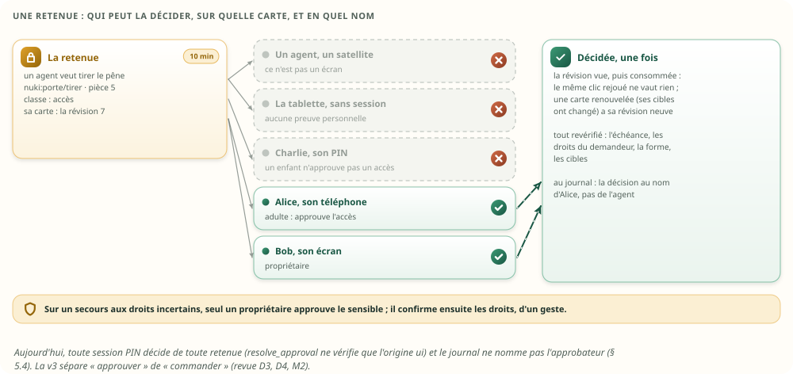

- **Qui** : depuis un écran (pas un agent, pas un satellite), avec une preuve personnelle, quelqu'un
  dont la case porte « approuve » pour cette classe, sur toutes les pièces de l'ordre, dans sa
  fenêtre ; **ou** la personne pour qui l'agent a demandé, si elle pourrait le faire elle-même
  (Alice confirme sur son téléphone ce qu'elle a demandé à son agent). Par défaut : le propriétaire
  tout, sauf désarmer ; l'adulte le confort, le média, le climat, l'accès, l'alarme et les
  machines ; ni l'enfant, ni l'invité, ni le service, ni une tablette sans session.
- **Sur quoi** : la carte porte une **révision** ; la décision la nomme, et la **consomme** une
  fois. Une carte renouvelée (sa forme ou ses cibles ont changé) prend une révision neuve : l'ancien
  clic, rejoué, ne vaut rien.
- **Tout est revérifié** à cet instant, comme en v2 : l'échéance, les droits de celui qui demandait,
  la forme, les cibles.
- **En quel nom** : la ligne de la décision porte l'approbateur, son compte et sa personne, pas le
  demandeur ; la demande garde, elle, la personne pour qui elle a été faite.

### 11.7 La durée des droits

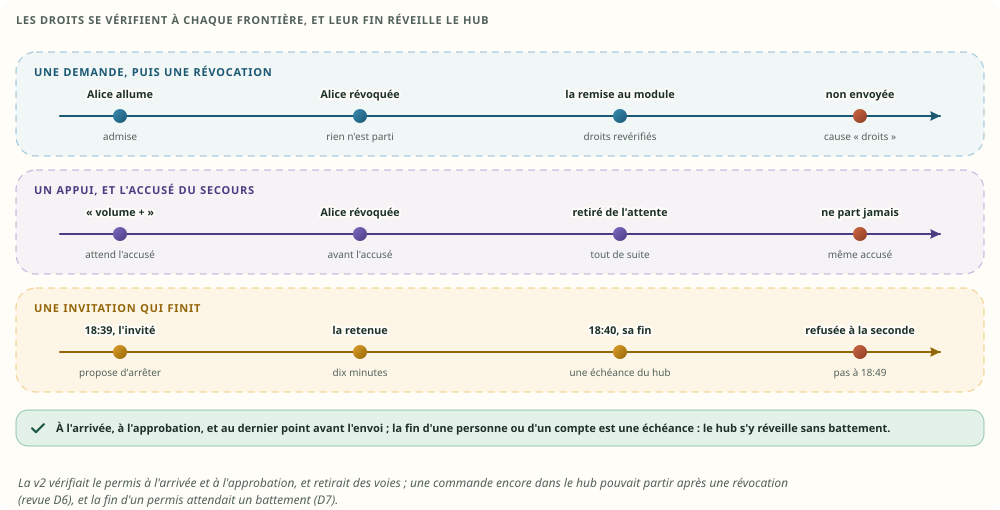

- Les droits se décident **à l'arrivée, à l'approbation, et à la remise au module**, le dernier
  point avant l'envoi : une personne révoquée, ou dont la configuration a changé, entre l'admission
  et la remise ne fait rien partir (« non envoyé, droits »). Ce qui attend l'accusé du secours tombe
  tout de suite ; ce qui est dans une voie en est retiré, comme en v2.
- **La fin d'une personne ou d'un compte dont une demande vit est une échéance du hub** : il s'y
  réveille de lui-même, sans battement ; la retenue de l'invité tombe à la seconde de la fin de son
  invitation, pas dix minutes après.
- Une révocation ferme les sessions personnelles de la personne, fait tomber ses retenues, et passe
  au pair avec les droits.
- **Une réduction de droits est acquise quand le secours l'a accusée**, comme un appui (§ 12.6) :
  sans accusé au bout de 200 ms, l'actif inscrit chez le témoin que le secours a décroché ; un
  secours promu ensuite ne croit pas ses droits frais (§ 17.2). Sinon, la dernière révocation
  pouvait se perdre dans une bascule « sûre ».

Ce que la soirée rejoue : un invité, qui n'a que le bureau, se voit refuser la porte d'entrée et le
groupe du séjour (qui atteint le salon et une chambre) ; la pause de l'imprimante du bureau, une
machine, est proposée, puis approuvée par Bob ; la demande porte l'invité, pas la personne qu'il
prétendait être. L'agent du gardien, mandaté par lui (un service, l'entrée jusqu'à 18 h 40), voit sa
retenue refusée à 18 h 40 précises, et l'approbation de 18 h 50 échoue.

### 11.8 Ce que chacun voit


- **`ord/` dit ce qui s'est passé, jamais qui** : la trace publique porte l'ordre, la valeur,
  l'issue, l'heure ; ni la personne, ni la preuve qu'on en a, ni dans la demande, ni dans la fiche
  de l'ordre, ni dans la ligne de journal.
- **Le pair** les reçoit par une sortie privée, juste après la trace, et finit identique à l'actif.
  La trace publique reste la même sortie, au même rang de sa pièce : un écran ne voit aucun faux
  trou ; l'identité voyage au rang du canal privé, que seul le pair suit.
- **Un écran** reçoit, avec l'état de ses pièces, un octet par ordre : cette dernière commande
  est-elle la mienne ? Rien de l'identité des autres.
- **L'audit nominatif**, qui a fait quoi, est un droit à part, que le propriétaire attribue (§ 22) ;
  il se lit dans l'historique, pas dans le flux.

### 11.9 L'alarme

Désarmer garde son chemin privé, avec son code (`docs/components/alarme.md`) : une classe
« désarmer », refusée à l'arrivée par le chemin générique (cause `dedie`), jamais retenue ni
approuvée, dans aucun mandat, et qu'aucune table ni aucun profil n'ouvre. Armer est une demande
ordinaire de la classe « alarme » : un agent la propose. Le code ne voyage jamais dans une demande
générique.

### 11.10 Les comptes et les personnes, dans le temps

- **Un compte garde son numéro.** L'instantané range les comptes par leur nom ; au redémarrage, la
  configuration, même réordonnée, est alignée sur lui. Un compte supprimé devient une **tombe** sans
  aucun droit ; un compte nouveau prend un numéro après les autres. Une copie s'aligne de même sur
  l'actif. Les demandes, les reçus et le journal citent donc toujours le bon compte.
- **Les plafonds sont des refus** : 256 comptes, 64 personnes ; jamais une panne.
- Ce que la v3 ne fait pas : **réutiliser la place d'une tombe** (il faudrait une génération, comme
  pour les appareils) ; 256 comptes suffisent à une maison.

### 11.11 Ce que les droits coûtent

| Ce qui est gardé, ou fait | Combien |
|---|---|
| Le profil d'un compte | 32 o ; le compte entier, session comprise, 80 o plus son nom ; 256 comptes : 20,0 Kio |
| Une personne | 32 o plus son nom ; 64 personnes : 2,0 Kio |
| Une session personnelle | 16 o, dans son compte |
| La table rôles × classes | 60 o |
| Le mandat d'un automatisme | 16 o |
| La personne, sa preuve et le mandat d'une demande ; la personne d'une dernière commande | rien de plus : la demande reste à 72 o, la fiche d'un ordre à 40 o, la ligne de journal à 48 o |
| L'appareil de chaque ordre | une colonne à part, 4 o par ordre (3,1 Kio à ×1) : sa place dans la fiche sert maintenant à la personne ; le catalogue passe de 33,9 à 37,0 Kio |
| Un bail du moteur | 40 o (32 en v2) : la demande qui l'a ouvert, et son mandat |
| Décider | 3,6 ns ; pour un ordre de la maison, ses pièces comprises, 30 ns |
| Une demande de la journée, toute la boucle | 1,94 µs de processeur, contre 1,58 µs en v2 (+23 %) ; à ×100, 4,07 contre 3,41 µs. Deux décisions par demande (à l'arrivée, à la remise), l'empreinte canonique, et une sortie de plus vers le pair quand la personne est connue ; les micro-mesures que la v3 ne touche pas restent égales à celles de la v2 (valider par le numéro : 5,61 ns contre 5,69) |
| Les sorties critiques de la journée | 13 492 (1,9 Mo), contre 10 924 (1,8 Mo) en v2 : l'identité d'une trace part au pair dans une sortie à elle |

## 12. Les demandes

### 12.1 La fiche de 72 octets, et son numéro

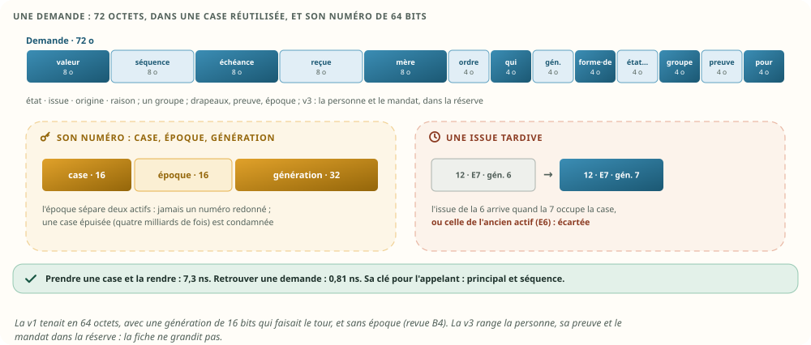

Bloc technique — la demande (extrait du banc) :

```rust
/// Une demande : 72 o, dans une case réutilisée.
#[repr(C)]
pub struct Demande {
    pub valeur: i64,        // le premier paramètre (un texte est au tiroir)
    pub seq: u64,           // la séquence de l'appelant : avec le principal, la clé d'idempotence
    pub echeance_ms: u64,   // monotone : la plus courte de 5 s, l'appelant, la fin du permis
    pub recue_ms: u64,      // murale : son arrivée
    pub parent: Ref,        // la demande mère d'un ordre de groupe
    pub ordre: u32,
    pub qui: u32,           // l'acteur technique : un agent, une exécution du moteur
    pub generation: u32,
    pub forme: u16,         // la forme d'admission : son interprétation ne change plus
    pub de: u16,            // le principal, jamais déclaré par le client
    pub etat: u8, pub issue: u8, pub origine: u8, pub raison: u8,
    pub cibles: u8, pub conclues: u8, pub confirmees: u8, pub executees: u8,   // un groupe
    pub drapeaux: u8,       // paramètres au tiroir, approuvée, texte privé
    pub preuve: u8,         // ce qu'on sait de la personne (v3)
    pub epoque: u16,        // l'époque de l'actif qui l'a prise
    pub pour: u16,          // la personne pour qui elle est faite (v3)
    pub mandat: u16,        // le mandat d'un automatisme, qui la borne (v3)
}
/// Son numéro : la case (16 bits), l'époque (16 bits), la génération (32 bits). Il voyage dans
/// cmd/ et dans l'issue du module ; c'est le champ `demande` d'une exécution (mémoire v2 § 8.4).
pub struct Ref(pub u64);
```

Les règles :

- **la case se réutilise, le numéro entier jamais** : la génération (32 bits : quatre milliards de
  réutilisations d'une même case : 136 ans à une demande par seconde, 50 jours à mille) écarte une
  issue tardive ; une case qui atteindrait la dernière est condamnée, la règle du nettoyage, et une
  autre prend le relais (65 536 cases) ;
- **l'époque sépare deux actifs** : celui qui reprend ne peut pas redonner un numéro que l'ancien a
  pris sans le lui transmettre (une issue de l'ancien monde n'attrape jamais une demande du
  nouveau) ;
- **l'identité d'une demande, pour son appelant, est sa clé** (le principal et la séquence) : `res/`
  répond par la séquence ; une carte d'approbation porte le numéro ;
- **ce qui quitte la machine est en heure murale** (HA v2 § 6), l'échéance comprise.

### 12.2 Les échéances, à chaque frontière

- À l'arrivée : une demande dont l'échéance de l'appelant est passée est refusée (`echue`) ; sinon
  son échéance est **la plus courte de** 5 s, celle de l'appelant, la fin du permis du compte, et
  celle de la personne.
- À la décision d'une retenue : la décision vérifie elle-même l'échéance (dix minutes), sans
  attendre que le balayage passe : une approbation à l'instant de l'échéance est refusée. C'est ce
  que fait le code d'aujourd'hui (`hub.rs:1341`).
- À l'approbation : seule une retenue encore valide ouvre une échéance neuve, elle-même bornée par
  le permis.
- Dans la voie : le kit n'envoie jamais un ordre au-delà de son échéance moins sa marge (`MIN_LEFT`,
  `REPLY_MARGIN`).

### 12.3 La forme d'admission

Une demande garde **la forme sous laquelle elle a été acceptée** : ses arguments, sa confirmation,
son suivi se lisent dans cette forme jusqu'au bout, même si l'ordre est redéclaré pendant qu'elle
vit. Une retenue se lie à **la forme et aux cibles montrées** sur sa carte. À l'approbation, si
elles ont changé, la demande est revalidée contre la forme du moment : refusée si elle ne tient
plus ; sinon, **une nouvelle carte** est présentée (« forme changée »), et c'est elle qu'un humain
approuve. Un écran qui approuve encore l'ancienne carte est refusé.

### 12.4 Les plafonds

Chaque plafond est vérifié avant toute mutation, avec une erreur : 255 valeurs, ordres ou membres
par appareil ; 64 cibles par ordre de groupe ; 16 paramètres et 32 valeurs attendues par forme ;
65 535 formes ; **50 retenues** (aujourd'hui : `MAX_PENDING`) ; 4 096 demandes en cours, un groupe
réservant ses filles avant de partir. Un refus ne prend aucune case et ne publie rien.

### 12.5 Les reçus

Une fenêtre **par principal** : sa **plus haute séquence**, et ses 32 derniers reçus de 32 octets. À
l'arrivée d'une demande externe :

| La clé | Le verdict |
|---|---|
| déjà prise, même ordre, mêmes arguments | la même demande, la même issue : elle ne part pas deux fois |
| déjà prise, un autre ordre ou d'autres arguments | refusée, `conflit` |
| plus ancienne que la fenêtre (séquence ≤ la plus haute − 32) | refusée, `perimee` : on ne peut plus savoir si elle est partie |
| neuve | elle est prise |

C'est la règle d'aujourd'hui (`occurrences.rs:302`) ; la v1 l'avait affaiblie. Une fenêtre n'est
jamais cédée à un autre principal : le nombre de principaux est borné par leur table, et la mémoire
des reçus avec : 65,0 Kio pour 64 comptes, 260 Kio pour 256, le plafond (la revue M4 l'avait
relevé). « Les mêmes arguments » se juge par une **empreinte canonique** de 64 bits : le nombre
d'arguments, puis le type, la longueur et la valeur de chacun ; deux textes découpés autrement,
`["ab", "c"]` et `["a", "bc"]`, sont deux demandes (revue M6). **Toute** demande externe porte sa
clé, pas seulement les appuis : un doublon du transport ne refait rien. Les reçus voyagent dans la
trace : le secours les a.

### 12.6 Un appui et le secours

Une consigne rejouée ne change rien (la même valeur une seconde fois) ; un appui rejoué le refait.
D'où une règle de plus pour les appuis que le hub ne fait pas lui-même :

- **un appui attend l'accusé du secours avant de partir** : sa trace (sa clé, son reçu) au rang `s`,
  puis l'accusé du secours pour ce rang, puis seulement l'envoi au module. Le prix : un aller-retour
  sur le réseau local, quelques centaines de microsecondes, pour les seuls appuis ;
- **sans accusé au bout de 200 ms**, l'actif inscrit chez le témoin (celui de la HA v2) que le
  secours a décroché, **puis** envoie ; le secours qui a décroché se refait par l'état complet ;
- **sans secours**, l'appui part aussitôt.

Et pour dire qu'un appui a été émis **avant** une reprise, la v3 ne croit ni l'horloge, ni le
compteur de tentatives du client : chaque demande externe dit **l'époque de la session** sur
laquelle elle a été émise (celle de l'état qu'il suit). Après une reprise non sûre, un appui dont la
clé est inconnue et dont l'époque est antérieure, ou absente, est ambigu, même s'il se dit
« première tentative » (revue M7). Ce que cela garantit est au § 17.2.

### 12.7 Les textes privés

Un ordre dont la forme dit « texte privé » (une annonce, un message) :

- le texte est remplacé par **sa longueur** dans les arguments publics : sur `cmd/`, dans la trace
  sur `ord/`, au journal, dans l'état d'un client ;
- il est gardé au **tiroir privé** du hub, et ne voyage que par le **canal privé** : vers le pair
  (au cas où une retenue serait décidée après une bascule), et vers le module de l'appareil, qui le
  lit au moment d'envoyer ;
- il **s'efface à la conclusion**, chez l'actif comme chez le pair ;
- l'instantané du hub, sur son disque, garde ceux des demandes encore vivantes ;
- **une forme a au plus un texte privé** : le tiroir n'en garde qu'un par demande ; une forme qui en
  déclarerait deux est refusée (revue M8). Le jour où il en faudra deux, chacun aura sa place.

La soirée envoie deux textes témoins, une annonce et un message de l'assistant, et les cherche dans
chaque sortie publique, chaque commande, l'état d'un client et l'instantané : trouvés 0 fois ; lus
par le module, tenus par le pair, puis effacés partout.

### 12.8 En mesures

| Une demande, mesurée | ×1 | ×10 | ×100 |
|---|---|---|---|
| Prendre une case et la rendre | 7,3 ns | 7,2 ns | 7,3 ns |
| Retrouver une demande par son numéro | 0,81 ns | 0,65 ns | 0,81 ns |
| Une journée : demandes ; renvoyées avec la même clé ; refusées | 3 000 ; 116 ; 26 | 30 000 ; 1 226 ; 322 | 300 000 ; 11 919 ; 3 277 |
| Au plus, en même temps | 39 | 64 | 114 |
| La table des demandes ; les reçus | 4,8 ; 10,2 Kio | 4,8 ; 10,2 Kio | 9,5 ; 10,2 Kio |
| Processeur de toute la boucle (hub, kit, appareils simulés), la journée | 5,8 ms | 62 ms | 1 221 ms |
| … par demande | 1,9 µs | 2,1 µs | 4,1 µs |
| Sorties critiques dans la journée | 13 492 (1,9 Mo) | 139 504 (19,3 Mo) | 1 393 654 (193 Mo) |

Le temps processeur est celui de `getrusage`, sur la boucle entière ; il ne compte ni la
sérialisation, ni le courtier, ni le réseau, ni de vrais pilotes. La journée du banc est une
**hypothèse** : 3 000 demandes par jour à ×1, dont 30 % en rafales de 40 (des scènes) ; 60 %
viennent du moteur, 35 % d'un écran, 5 % d'agents et de scripts ; 2 % sont hors de leur forme ; une
demande externe sur dix est renvoyée avec sa clé. Le hub se réveille au plus proche ; rien ne tourne
entre deux.

### 12.9 Le cycle

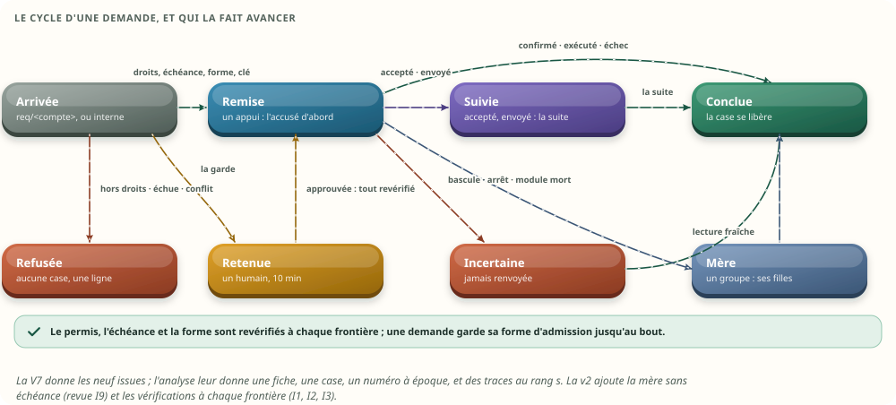

| État | Ce qui l'y amène | Ce qui l'en sort |
|---|---|---|
| (aucune case) | hors de sa forme, ordre inconnu ou retiré, hors des droits, échue, clé en conflit ou périmée, tentative ambiguë, un plafond, désarmer (`dedie`) | — : une ligne de journal, une issue `refuse` (ou `incertain`, ambiguë) |
| **Retenue** | la décision « proposer » : la classe, la personne et sa preuve, le canal, une chambre, un secours aux droits incertains ; ou un groupe dont une cible est interdite (`sous_ensemble`) | un humain habilité décide, à l'écran, sur la révision vue ; l'échéance, les droits, la forme revérifiés ; un sous-ensemble, son demandeur seul le confirme ou y renonce ; ou 10 min passent ; ou le compte ou la personne finit |
| **Remise** | la décision dit oui ; un appui attend l'accusé du secours ; les droits revérifiés une dernière fois ; puis `cmd/` au module | l'issue du module, avant l'échéance |
| **Mère** | un ordre de groupe : elle attend ses filles, sans échéance à elle | la dernière fille conclue |
| **Suivie** | `accepte`, `envoye` ou `incertain`, quand la forme a un suivi | la suite, une fois ; ou le hub conclut à la fin du suivi |
| Conclue | toute autre issue, ou la suite | la case se libère, ses tiroirs aussi ; la fiche de l'ordre garde la dernière commande |

### 12.10 Les voies, côté module

Le kit de la V7 (§ 20.2) ne change pas ; il range ses voies par **numéro** :

- **une voie par appareil, qui n'existe que tant qu'elle porte un ordre** ;
- un ordre en vol ; jusqu'à 8 en attente ;
- une consigne qui attend cède à la suivante **du même ordre**, si rien ne les sépare ; un appui
  n'est jamais fusionné ;
- l'échéance revérifiée juste avant l'envoi ; un ordre ne part **qu'une fois** ; ce que le hub
  retire (un permis révoqué) sort de la voie s'il n'est pas parti ;
- **l'issue est bornée par le retour de la forme** : un volet RTS ne rend jamais « confirmé » ;
- **seule une lecture commencée après l'envoi prouve l'ordre** (§ 13.2), et une valeur en mouvement
  ne confirme qu'à l'arrêt.

## 13. La dernière commande, et sa preuve

### 13.1 La dernière commande

Chaque ordre garde, dans sa fiche de 40 octets, **sa dernière commande** : la dernière demande
admise pour lui (l'ordre d'admission décide), sa valeur, son dernier pas, qui, par où, et son issue.
Une issue ou une suite tardive d'une demande plus ancienne ne la remplace jamais. **« En cours »**
se compte à part : le nombre de demandes de cet ordre qui vivent, retenues, remises ou suivies, sur
16 bits : le plafond de 4 096 demandes tient (la v2 le comptait sur 8 bits, qui saturaient à 255 ;
revue M5). La fiche garde aussi **pour qui** la dernière commande a été faite, et la preuve qu'on en
avait : jamais publiés sur `ord/` (§ 11.8).

| À quoi elle sert | Exemple |
|---|---|
| Montrer l'état d'un appareil qui n'en a pas | « Ouvrir : exécuté par la box, 18:20, par l'assistant » sur un volet RTS |
| Montrer ce qui est en cours, sur tous les écrans | « Chauffe-eau : 54 °C, accepté ; une autre consigne encore suivie » |
| Dire si la valeur suit la commande | § 13.2 et § 15 |
| Interroger depuis un workflow | la dernière commande, son origine, son âge, « en cours » (§ 15) |

Elle remplace l'attente de 8 secondes que garde chaque écran (`hub.svelte.js:17-18`), et l'écho
« optimiste » que la V7 voulait retirer de deux pilotes (Tapo et Sonos, § 5.9). Une place d'ordre
libérée par un lot remet sa fiche à zéro (§ 18).

### 13.2 La preuve

- **Seule une lecture commencée après l'envoi confirme** : le kit compare l'heure de début de la
  lecture à celle de l'envoi, comme aujourd'hui (`orders.rs:273`) ; après une reprise, le hub
  n'accepte pour une demande héritée qu'une lecture commencée après la reprise (le module qui
  démarre relit ses appareils) ; une lecture ancienne qui arrive en retard ne confirme rien.
- **La fiche tient la preuve, dans l'ordre des événements** : à l'envoi, le compte des variations de
  la valeur prouvée repart de zéro ; à la confirmation, la fiche note si la preuve est une
  variation, et si c'est la première ; ensuite, toute variation la marque « modifiée depuis ».
  Aucune horloge n'est comparée : l'ordre est celui du hub, rejoué tel quel par chaque copie.

## 14. Les appareils physiques et virtuels

**Premiers principes** : une valeur ou un ordre n'a qu'**un propriétaire**, l'appareil dont le
module, ou le hub, le produit. Un autre appareil peut le **montrer**, s'en **servir pour calculer**,
ou le **commander** : il le cite, il ne le possède pas.


| Ce qu'un appareil virtuel fait d'un autre | Le rôle | Exemple |
|---|---|---|
| Il montre une de ses valeurs ou un de ses ordres, à sa place dans sa page | **affiche** | l'« Entrée » montre la serrure, le volet RTS, la lampe |
| Une de ses valeurs se calcule avec | **source** | la température moyenne d'une pièce |
| Un de ses ordres de groupe le commande | **cible**, rattachée à cet ordre de groupe | « allumer le séjour » commande les quatre « on » ; « luminosité du séjour », les luminosités |
| C'est un appareil membre : la garde lit sa pièce | **membre** | une ampoule du séjour est dans la chambre |

Bloc technique — la composition (extrait du banc) :

```rust
/// Une entrée de composition : 8 o. Le numéro garde sa génération.
#[repr(C)]
pub struct Membre {
    pub numero: u32,      // une valeur, un ordre ou un appareil, selon `sorte`
    pub rang: u8,         // sa place dans la page de l'appareil virtuel
    pub sorte: u8,        // valeur, ordre, appareil
    pub role: u8,         // affiche, source, cible, membre
    pub source: u8,       // pour une cible : le rang de son ordre de groupe dans l'appareil virtuel
}
```

Les règles :

- **Une cible dit de quel ordre de groupe elle dépend.** Un groupe qui a « allumer » et
  « luminosité » ne mélange pas leurs cibles. Une cible est l'ordre d'un appareil **physique** (pas
  de groupe de groupes, donc pas de cycle), de forme compatible avec son ordre de groupe (même
  effet, mêmes paramètres, des bornes de groupe comprises dans celles de la cible) ; 64 au plus. Une
  composition invalide est refusée à la déclaration.
- **Un ordre de groupe est une demande mère et une fille par cible.** La mère connaît toutes ses
  cibles avant la première fille ; elle n'a pas d'échéance à elle (ses filles sont bornées) ; chaque
  fille est une demande ordinaire, du même principal, autorisée, avec son module, sa voie et son
  issue. La mère conclut quand toutes ont conclu, **au niveau de preuve le plus faible** :
  `confirme` si toutes sont confirmées, `execute` si toutes ont au moins été exécutées (quatre
  volets RTS), sinon `echec`, cause `partiel`, avec n/m (V7 G17). Aujourd'hui, un luminaire répond
  « fait » dès qu'une ampoule a obéi (`moli-lights/src/lib.rs:498`).
- **Un groupe retenu puis approuvé passe par le même chemin** : la mère approuvée se répartit sur
  les cibles de sa carte, et ses filles ne sont pas retenues de nouveau.
- **Une cible interdite : le choix, annoncé avant** (ton choix, § 22). Le groupe n'est ni refusé en
  bloc, ni exécuté en partie d'office : la demande est retenue (cause `sous_ensemble`), et sa carte
  annonce le sous-ensemble permis, « 2 cibles sur 3 ». **Seul le demandeur** le confirme, depuis sa
  connexion ou à un écran avec une preuve personnelle, ou y renonce ; un adulte ne choisit pas pour
  lui. **Confirmer n'est pas approuver** : si une cible du sous-ensemble se propose (une chambre
  demandée par un agent), la demande reste retenue, sur une carte neuve, jusqu'à un humain habilité.
  Si le groupe change pendant le choix, ce qui a été montré part tant que chacune de ses cibles en
  reste une ; sinon, le sous-ensemble du moment est à choisir de nouveau. Sans aucune cible permise,
  ou si la pièce de l'appareil virtuel est interdite : refusé, sans rien annoncer. Le choix ne
  s'annonce qu'à une personne : un automatisme dont le responsable a perdu une cible est refusé, et
  mis à revoir, comme pour toute perte de droits (§ 15.1).
- **La progression passe la bascule** : la copie rejoue le compte de la mère à partir des traces des
  filles ; le nouvel actif conclut la mère avec le bon n/m.
- **Qui répartit** (ton choix du 24 octobre, § 22) : le hub, pour un groupe simple ; un module
  virtuel, quand il faut une stratégie (le relais en dernier recours). Le code d'aujourd'hui a déjà
  un coordinateur, celui des scènes (`scenes.rs`) : la revue suggère d'y loger d'abord la
  répartition. Le banc ne mesure que la répartition par le hub.
- **La garde lit toutes les pièces qu'un ordre atteint** : celle de l'appareil virtuel, et celles
  des appareils de ses cibles et de ses membres (la règle d'aujourd'hui, `rooms_of`, étendue aux
  cibles).
- **Une interface lit la page d'un appareil d'un seul geste** : 203 ns par page à ×1, noms compris ;
  « cette valeur est aussi dans… », 510 ns en parcourant les compositions.
- **Une référence inerte se dit, elle ne se remplace pas** : « retiré », « membre retiré ».

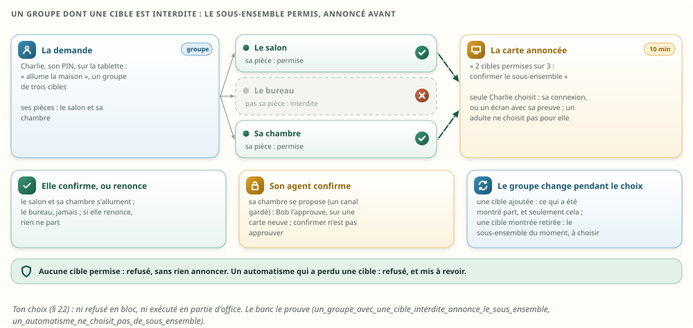

Dans la maison ×1 du banc : 29 appareils virtuels et 340 entrées, soit 2,7 Kio.

## 15. Les workflows interrogent les ordres

Le programme cite les valeurs par numéro (mémoire v2 § 8.2, règle 1) ; il cite désormais aussi les
ordres. Une règle reste une fiche de 16 octets ; son `genre` dit ce qu'elle lit.

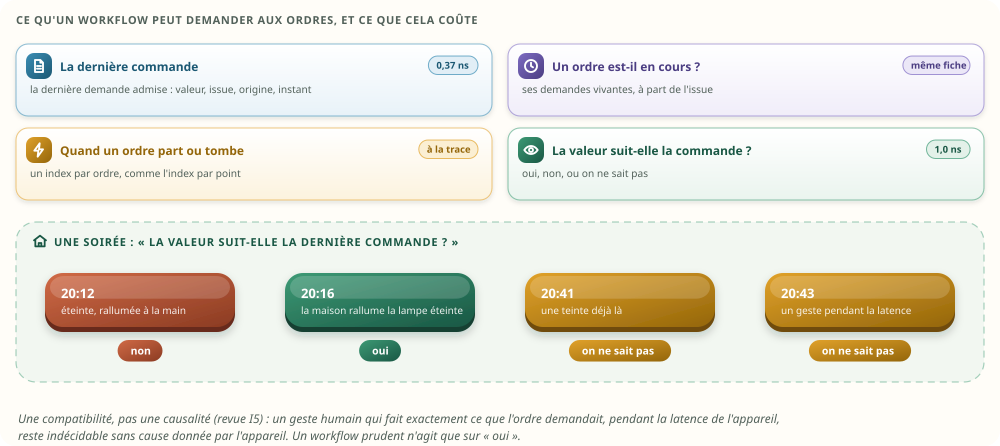

| Ce qu'un workflow demande | La règle | Ce qu'elle lit | Mesuré |
|---|---|---|---|
| Quelle est la dernière commande ? | `DERNIERE` | la fiche de l'ordre : le premier paramètre | 0,37 ns |
| A-t-elle abouti ? qui l'a donnée ? il y a combien de temps ? | `ISSUE`, `ORIGINE`, `DEPUIS` | l'issue, l'origine, l'instant | la même fiche (non chronométré à part) |
| Un ordre est-il en cours ? | `EN_COURS` | les demandes vivantes de l'ordre, à part de l'issue | la même fiche (non chronométré à part) |
| La valeur suit-elle la dernière commande ? | `VIENT_DE` | oui, non, ou on ne sait pas (ci-dessous) | 1,0 ns |
| Réagir quand un ordre part ou tombe | un déclencheur sur l'ordre | l'index par ordre, comme l'index par point | à la trace |

**`VIENT_DE` répond, et dit quand il ne sait pas** :

| La réponse | Quand | L'exemple de la soirée |
|---|---|---|
| **oui** | la dernière commande est confirmée, la première variation de la valeur après l'envoi est celle demandée, et rien n'a changé depuis | 20:16 : la maison rallume la lampe éteinte |
| **non** | la valeur a changé depuis la preuve ; ou la commande a échoué, a été refusée ou n'est pas partie ; ou jamais commandé | 20:12 : quelqu'un a éteint et rallumé à l'interrupteur |
| **on ne sait pas** | pas de preuve (exécuté, accepté, envoyé, incertain, en cours) ; la valeur était déjà là avant la commande ; plusieurs variations avant la preuve | 20:41 : une teinte déjà là ; 20:43 : un geste à la main pendant la latence |

C'est une **compatibilité**, pas une causalité : si un humain fait exactement le geste demandé
pendant la latence de l'appareil (quelques centaines de millisecondes), la première variation est la
sienne, et rien ne permet de la distinguer de celle de l'ordre. Un protocole qui donne la cause
(certains appareils Zigbee disent « physique » ou « numérique ») permettrait de répondre mieux ;
sans elle, la règle est conservatrice : un workflow qui veut « éteindre ce que la maison a allumé »
ne le fait que sur **oui**.

Trois usages que le banc rejoue :

- **Éteindre ce que la maison a allumé, pas ce qu'un humain a rallumé.** À 20:00, « Extinction
  auto » laisse la lampe : un humain l'avait allumée (`ORIGINE`). À 20:10, quelqu'un l'éteint et la
  rallume à l'interrupteur : non. À 20:15, la maison la rallume : oui ; à 20:40, l'extinction
  l'éteint.
- **Réagir à un ordre sans valeur.** « Quand on ferme le volet RTS du salon, fermer celui de la
  chambre » : seul un déclencheur sur son ordre peut y réagir.
- **Être prévenu d'un ordre qui n'aboutit pas.** « Si le verrouillage de la porte n'est pas
  confirmé » : un déclencheur sur l'ordre, avec les issues `envoye`, `incertain` et `echec`.

### 15.1 Qui répond d'un automatisme

Tu demandais aussi ce qu'on avait oublié dans le moteur. Le moteur de la v2 donnait chaque ordre
sous son propre compte, avec ses droits à lui : un invité qui presse un bouton pouvait faire ouvrir
la porte par un automatisme (revue W1 ; c'est aussi le défaut E4 d'aujourd'hui, § 5.4).

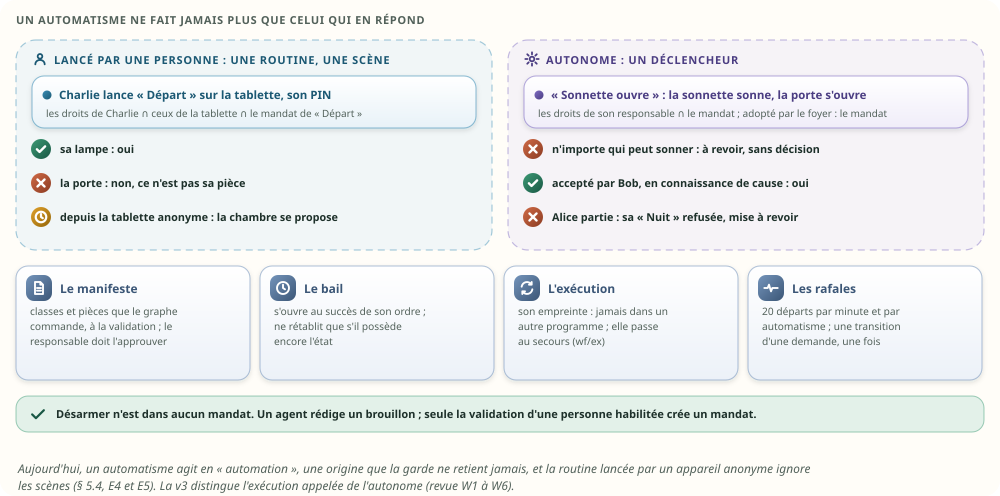

| La règle | Ce qu'elle dit | Le banc |
|---|---|---|
| **Le manifeste** | à la validation, le moteur calcule ce que le graphe commande, ses classes et ses pièces : c'est le **mandat** de l'automatisme, publié au pair avec les droits | `un_mandat_ne_couvre_que_son_manifeste` |
| **Son responsable** | la personne qui l'a validé ; elle doit pouvoir approuver elle-même chaque classe du manifeste, sur ses pièces ; un enfant ne valide pas ; désarmer n'est dans aucun mandat ; un agent rédige un brouillon, il ne crée aucun mandat | `un_automatisme_ne_survit_pas_a_son_responsable_sauf_adopte`, `desarmer_ne_passe_jamais_par_les_ordres` |
| **Appelé** | une routine, une scène, lancée par une personne : chaque ordre garde les droits de la personne, ceux de sa connexion, et le mandat ; un refus est celui de la personne : l'automatisme n'est pas mis à revoir | `une_routine_lancee_garde_les_droits_de_qui_la_lance` |
| **Autonome** | un déclencheur : les droits du responsable, dans le mandat ; s'il perd ses droits, l'exécution est refusée et l'automatisme passe « à revoir » | `un_automatisme_ne_survit_pas_a_son_responsable_sauf_adopte` |
| **Adopté par le foyer** | un propriétaire le fait adopter : il ne dépend plus d'une personne, seulement de son mandat ; il survit au départ de son auteur | idem |
| **L'urgence** | ton choix : un automatisme adopté par le foyer, sur une source qualifiée (un détecteur que nul ordre ne règle), dans son seul mandat ; il agit même si son auteur est parti ; jamais un mode qui contourne les droits, et désarmer n'est dans aucun mandat | `une_urgence_est_un_mandat_du_foyer` |
| **Un déclencheur ouvert** | la trace d'un ordre, ou une valeur qu'un ordre règle : n'importe qui peut la provoquer. Un mandat sensible (accès, alarme, machine, vie privée, système) ne part pas sur un tel déclencheur sans une décision explicite de son responsable ; un capteur que nul ordre ne règle n'est pas ouvert | `un_declencheur_ouvert_ne_lance_pas_le_sensible_sans_decision` |
| **Le bail** | il s'ouvre au **succès** de son ordre ; à son terme, il ne rétablit que s'il **possède** encore l'état : sa commande est la dernière de l'ordre, et la valeur la suit (`VIENT_DE` n'est pas « non ») ; le rétablissement est une demande neuve, sous le mandat, revérifiée | `un_bail_ne_retablit_que_ce_qu_il_possede` |
| **L'empreinte** | une exécution porte l'empreinte de son programme : réordonné, elle le retrouve ; changé, elle s'arrête (mémoire v2 § 8.3) | `une_execution_ne_change_pas_de_programme` |
| **Au secours** | chaque transition d'une exécution part sur `wf/ex/<c>`, au pair seulement : le secours continue entre deux étapes | `une_execution_reprend_sur_le_secours_entre_deux_etapes` |
| **Les rafales** | 20 départs par minute et par automatisme, comme aujourd'hui (`docs/components/automatismes.md`) ; une transition d'une demande lance une fois, pas chaque republication de sa trace | `deux_automatismes_ne_se_relancent_pas_sans_fin` |

Bloc technique — l'autorité d'une exécution et le mandat (extraits du banc) :

```rust
/// L'autorité d'une demande du moteur, que seul un principal interne peut donner.
pub struct AutoriteMoteur {
    pub appele: bool,   // une personne l'a lancée : ses droits et ceux de sa connexion bornent chaque ordre
    pub de: u16,        // la connexion de l'appelant
    pub pour: u16, pub preuve: u8,
    pub mandat: u16,    // l'automatisme + 1 : il borne ce qu'elle commande
}

/// Le mandat d'un automatisme : son manifeste, et qui en répond. 16 o.
#[repr(C)]
pub struct Mandat {
    pub pieces: u64, pub classes: u16,
    pub responsable: u16,   // la personne qui l'a validé ; ses droits bornent le mandat
    pub drapeaux: u8,       // adopté par le foyer ; vivant
    pub _r: [u8; 3],
}
```

Ce que cela change à la mémoire v2 (§ 8.4), dont le banc ne joue qu'un moteur réduit : la fiche
d'exécution porte la demande sur 8 octets au lieu de 4 (son numéro à époque, § 12.1), l'empreinte de
son programme à la place de l'octet de version (4 octets au lieu de 1), et un octet pour dire si
elle est appelée : **72 octets au lieu de 64**, ce que la revue avait calculé (M4). L'autorité d'une
exécution appelée (le compte, la personne, la preuve : 5 octets) va dans un tiroir, comme les
textes : les exécutions autonomes, les plus nombreuses, n'en ont pas besoin. C'est une
**proposition, à mesurer** dans le banc de la mémoire v2. Le bail du banc des ordres passe de 32 à
40 octets : la demande qui l'a ouvert, et son mandat.

## 16. Les clients se chargent par MQTT

### 16.1 Ta remarque, et ton choix

Tu avais prévu que les clients passent par un module dédié : la V7 a son module WebSocket.
Maintenant que l'appareil, ses ordres et ses valeurs sont tous en mémoire, **un client peut se
charger et se recharger directement par MQTT**, comme le secours de la HA v2. Tu l'as choisi le 24
octobre. La revue l'a gardé, avec deux exigences que la v2 tient : une autorisation vivante (§ 11)
et une continuité vérifiable pour un écran filtré (§ 16.3).


### 16.2 Trois façons, côte à côte

| | Aujourd'hui : SSE et REST | La V7 : un module WebSocket | **MQTT direct** |
|---|---|---|---|
| L'état au démarrage | `/api/snapshot`, toute la maison en JSON : 593 Ko à ×1 | l'état filtré, par blocs de 64 Kio | `etat/demande` → l'état du client, filtré par ses droits : 114 Ko, en 28 morceaux de 4 Kio ; 20,8 Ko pour deux pièces |
| Le direct | un événement SSE par changement | le module filtre `val/` et pousse des trames | l'abonnement aux sujets permis : `meta/`, `meta/forme/`, `ord/`, `val/`, `avail/` |
| Un trou | tout recharger | `retard`, puis un nouvel état | le rang de la pièce le montre ; l'état de la pièce, rechargé |
| Un ordre et son issue | `POST /api/command` ; l'issue par le flux | sur la connexion | `req/<compte>` ; l'issue sur `res/<compte>` |
| Les droits | une session par requête ; le permis d'un invité réévalué chaque seconde (`sse.rs:101`) | la session, à l'ouverture | le compte de la connexion, et la personne de sa session ; les droits revérifiés à chaque frontière ; à leur changement, le courtier coupe et l'écran se recharge |
| L'historique, les médias | REST, compressé | par blocs | REST, comme aujourd'hui |
| Ce que le hub construit | tout, à chaque fois : 730 µs | le module garde ses écrans | l'état d'un client, à la demande : 87 µs à ×1 |

### 16.3 Un écran filtré voit ses trous

Le rang `s` numérote **toutes** les sorties critiques : un écran du salon qui reçoit 10 puis 12 ne
sait pas si 11 concernait une chambre qu'il ne voit pas ou s'il l'a perdu. La v2 donne à chaque
sortie **le rang de sa pièce** (`sp`) : un compteur par pièce, plus un pour ce qui concerne tout le
monde (les formes, le lot) ; le canal privé et les baux du moteur ont le leur, que seul le pair
voit. L'état d'un client porte, en tête, l'époque, le rang `s` et le rang de chacune de ses pièces.
Un trou dans une pièce fait recharger son état ; ce que l'état chargé contient déjà n'est pas un
trou ; une époque nouvelle (une bascule, un redémarrage) fait se recharger. Le prix : quatre octets
par sortie, un compteur par pièce.

Ce que la soirée rejoue : un écran du salon perd un message ; il voit le trou au message suivant de
sa pièce, et se recharge : 1 trou, aucun faux trou venu d'une autre pièce, 4 chargements en tout (le
premier, après le trou, après la bascule, après le redémarrage), et à la fin les mêmes dernières
commandes que le hub.

### 16.4 Ce qu'un écran charge, à contenu égal

L'état d'un client porte ce que porte `/api/snapshot` : les appareils, leur disponibilité, leurs
valeurs avec leur nature, leur unité, leur échelle et leur dictionnaire, leurs ordres avec leur
dernière commande et « en cours », leur composition, les retenues qu'il voit, les libellés ; et,
pour chaque ordre, si sa dernière commande est la sienne (v3), sans rien de l'identité des autres.
Le gain se décompose :

| Ce qu'un écran charge, maison ×1 (×10) | Ko | Ce qui change |
|---|---|---|
| Aujourd'hui, `/api/snapshot`, JSON | 593 (5 971) | — |
| Le même contenu, proposé, en JSON | 142 (1 457) | **le partage** (chaque forme, chaque dictionnaire, chaque libellé une fois) et des tableaux au lieu de noms de champs répétés |
| Le même contenu, en binaire | 114 (1 150) | **l'encodage** |
| Un écran de deux pièces | 20,8 (191) | **le filtrage** |

Le transport (MQTT sur WebSocket, contre SSE) n'est pas mesuré ici.

### 16.5 Ce qu'il coûte, et ce qu'il faut régler

| Une connexion d'écran | Par écran | 64 écrans (le plafond) | D'où vient le chiffre |
|---|---|---|---|
| SSE d'aujourd'hui | 39,1 Kio | 2,5 Mio | V7 § 14.2.5, mesuré |
| WebSocket réglé (le module de la V7) | 11 Kio | 0,7 Mio | idem |
| MQTT, `rumqttd` tel quel | ≈ 62 Kio | ≈ 3,9 Mio | V7 § 11.4.2, mesuré : deux tampons de 200 éléments alloués d'avance par connexion |
| MQTT, notre version de `rumqttd`, tampons de 32 | ≈ 10 Kio, plus le cadre WebSocket | ≈ 0,7 Mio | **estimé**, à mesurer |

Ce qu'il faut, en plus de ce que la V7 prévoit déjà (des comptes et des ACL par sujet) :

- un **écouteur WebSocket** du courtier (`rumqttd` 0.20 l'a : la fonctionnalité `websocket`, active
  par défaut) ;
- **des tampons par connexion réglables** dans notre version de `rumqttd` (aujourd'hui une
  constante, `MAX_CHANNEL_CAPACITY` = 200) ;
- **l'état d'un client, filtré par ses droits**, construit par le hub à la demande ;
- **la coupure d'un abonnement** quand un permis change (le courtier déconnecte, l'écran se
  recharge) ;
- **un sujet de réponse par compte**, `res/<compte>` ;
- côté navigateur, **une bibliothèque MQTT sur WebSocket**, à choisir et à mesurer.

Sans le réglage des tampons, le choix tient encore : 3 Mio de plus à 64 écrans, dans le budget de
32 Mio (V7 § 11.3).

## 17. La haute disponibilité


### 17.1 Ce qui passe au secours

| Ce qui passe | Comment | Pourquoi |
|---|---|---|
| Le catalogue : registres, formes, clés, fiches des ordres, listes, compositions | `meta/`, `meta/forme/`, au rang `s` | le secours connaît l'appareil, l'ordre et sa structure, comme l'actif |
| Chaque pas d'une demande remise ou retenue | `ord/`, au rang `s`, avec la fiche de la demande, celle de l'ordre, le reçu, la carte ; l'échéance en heure murale | le secours sait ce qui a pu partir, tient la dernière commande et les reçus |
| La progression d'un groupe | rejouée par la copie à partir des traces des filles | la mère conclut juste après une bascule |
| Les textes privés des demandes vivantes | `prive/`, au rang `s`, vers le seul pair | une retenue de message décidée après une bascule |
| Les retenues, les baux | `ord/` et `wf/`, comme le prévoit la HA v2 | une décision humaine et un rétablissement ne se perdent pas |
| Un appui | son accusé, avant l'envoi | § 17.2 |
| Les droits : les personnes, les comptes, la table, les mandats, leur révision | une sortie privée, au rang `s`, **par les noms** ; les sessions personnelles aussi | le secours décide comme l'actif, avec les mêmes numéros (revue M1, M3) |
| L'identité de chaque trace | une sortie privée, juste après la trace publique | `ord/` ne la porte pas ; le pair, si (revue D8) |
| Les exécutions du moteur | `wf/ex/<c>`, à chaque transition, au pair seulement | le secours continue une exécution entre deux étapes (revue W5) |
| Les demandes refusées | jamais : une ligne d'historique seulement (`run/`) | elles n'ont jamais quitté le hub |

### 17.2 Un appui ne part ni deux fois, ni en silence

La HA v2 admet qu'une bascule perde les dernières sorties en vol (§ 6.5). Une trace copiée **après**
ne protège donc pas un appui fait **avant** : c'était le bloquant B2. La v2 :

| Le cas | Ce qui se passe | La garantie |
|---|---|---|
| Le secours est en phase | l'appui attend l'accusé de sa trace ; l'actif tombe avant l'accusé : l'appui n'est jamais parti | le secours promu connaît tout appui parti ; une nouvelle tentative inconnue de lui n'est jamais partie : elle part, une fois. **Reprise sûre** |
| Le secours décroche | au bout de 200 ms sans accusé, l'actif l'inscrit chez le témoin, **puis** envoie | le secours promu lit le témoin : **reprise non sûre** |
| Pas de secours | l'appui part aussitôt | un redémarrage sur un instantané pris avant l'appui est une **reprise non sûre** ; un arrêt figé, dont l'instantané est le dernier, est sûr |
| Une reprise non sûre | une nouvelle tentative d'un appui dont la première est antérieure à la reprise, et que la mémoire ne connaît pas, est refusée : « incertain, ambiguë » | **au plus une fois** : jamais refait ; jamais perdu en silence. Une consigne retentée, elle, repart (la même valeur deux fois ne change rien) ; une demande neuve aussi |

Une réduction de droits suit la règle d'un appui : elle attend l'accusé du secours, et sans lui au
bout de 200 ms, le témoin dit que le secours a décroché (§ 11.7).

Ce qui dit qu'une demande précède la reprise, c'est **l'époque de la session** sur laquelle le
client l'a émise, pas la tentative ni l'heure qu'il déclare : un message répété tel quel, « première
tentative », reste ambigu (revue M7). L'époque de la dernière reprise non sûre est rangée dans
l'instantané : un arrêt propre plus tard ne l'efface pas.

Et les droits : une reprise non sûre a pu manquer une révocation. Le secours promu sans reprise sûre
**fait proposer tout ce qui est sensible** (accès, alarme, machines, vie privée, système), et seul
un propriétaire l'approuve, jusqu'à ce qu'un propriétaire confirme les droits, d'un geste ; le
confort continue (revue M3).

### 17.3 À la bascule, au redémarrage

| Ce qui était en cours | Après | Le banc |
|---|---|---|
| Une demande remise (partie ou encore dans la voie) | « incertain », cause `bascule` ; **jamais renvoyée** ; le nouvel actif la suit 30 s au moins, et la confirme sur `val/` par une lecture faite après la reprise | la luminosité partie 100 ms avant : confirmée ; la position restée dans la voie : incertaine, jamais partie, et une vieille lecture de 60 ne la confirme pas |
| Un appui qui attendait l'accusé | jamais parti ; une nouvelle tentative, sur une reprise sûre, part une fois | le « volume + » de 20:59:59.97 |
| Une demande suivie | sa suite arrive au nouvel actif, qui conclut | le chauffe-eau, accepté avant, confirmé après |
| Une mère | elle garde son compte ; elle conclut avec le bon n/m | le séjour éteint à 20:59:58 : 3 sur 4 |
| Une retenue | la carte reste ; l'humain décide sur le nouvel actif ; tout est revérifié | décidée à 21:05 ; l'autre expire à 21:09:40, à la seconde, même devant une approbation |
| Un bail | rétabli à son terme, par le nouvel actif | 21:01:30 |
| Les numéros | le nouvel actif prend une **époque** nouvelle ; un redémarrage aussi | une issue de l'ancien monde n'attrape rien |
| Les comptes | relus par leur nom, dans l'ordre de l'instantané ; une tombe pour un compte supprimé | essai `les_comptes_se_relisent_par_leur_nom` |
| Une exécution du moteur entre deux étapes | le secours la continue, d'après `wf/ex/` | essai `une_execution_reprend_sur_le_secours_entre_deux_etapes` |
| Les copies et les écrans | une époque nouvelle les fait se recharger par l'état complet | la copie reprise à 19 h 45 se refait sur le nouvel actif |

Le redémarrage suit la même règle (HA v2 § 16) : l'arrêt figé donne une seconde aux demandes
remises, puis les dit incertaines ; un appui qui attendait encore l'accusé ne part pas. L'instantané
range le catalogue, les demandes, les reçus, les retenues et leurs cartes, les textes privés des
demandes vivantes, les baux et les exécutions du moteur, et les droits : la fin et la session de
chaque compte, par son nom, les personnes, la table, les mandats ; **la machine repart de ces seuls
octets** et de la configuration (les comptes et leurs secrets, les pièces protégées). La v1
reprenait les baux à l'ancien moteur.

## 18. Le nettoyage, et une structure qui change

| Ce qui arrive | Ce que deviennent les ordres |
|---|---|
| **Retirer** un appareil (nettoyage § 9) | ses ordres ne sont plus commandés : refus, cause `retire` ; ses retenues et ses baux se terminent ; les demandes déjà remises vont à leur issue ; les automatismes qui le citent passent « à revoir » |
| **Le lot** | les places de ses ordres sont libérées, comme celles de ses valeurs ; **la fiche de l'ordre est remise à zéro** ; un vieux numéro ne commande jamais l'appareil neuf ; les listes et les compositions mortes sont tassées, au même rang chez chaque copie |
| **Une redéclaration** | les valeurs et les ordres **gardent leur numéro par clé** ; une clé nouvelle prend une place ; une clé qui n'est plus déclarée est retirée ; une forme nouvelle remplace l'ancienne pour l'ordre, et les demandes en cours gardent la leur ; le programme se recompile ; un automatisme dont la valeur ne tient plus passe « à revoir » |
| **La succession** (nettoyage § 10) | les définitions sont récrites par les noms ; une forme incompatible met l'automatisme « à revoir » |
| **Le déménagement** | les ordres suivent comme les valeurs : fiches, listes, compositions, demandes, retenues, reçus et baux |

La soirée rejoue une redéclaration de la lampe du salon : une valeur ajoutée au milieu (`energy`),
une retirée (`linkquality`). Les trois autres gardent leur numéro, la nouvelle en prend un, la
retirée n'est plus vivante, et une luminosité demandée ensuite est prouvée par la luminosité, pas
par la valeur qui a pris son rang.

## 19. Ce que tout consomme : le budget revérifié

### 19.1 Un témoin honnête

La v1 construisait la maison d'aujourd'hui depuis le nouveau modèle : un point `Button` par ordre
d'un volet RTS, un état pour chaque point. La v2 suit **la convention des pilotes réels** :

- une consigne écrit sa valeur : le point est lisible et écrivable, avec les bornes de l'ordre ;
- les appuis d'un appareil partagent **un seul point `control`**, une énumération en écriture seule
  (le volet RTS d'`overkiz`, `model.rs:145`) ;
- un texte a son point en écriture seule ; un ordre à paramètre sans valeur réglée aussi ;
- **aucun état pour un point en écriture seule** (le test d'`overkiz` l'exige, `model.rs:604`).

La maison du banc donne aux volets RTS quelques valeurs génériques qu'un vrai n'a pas : elles sont
les mêmes des deux côtés. Les validations sont chronométrées sur **le même corpus** : 1 025
intentions (valides, et hors bornes pour un paramètre numérique), traduites dans la forme
d'aujourd'hui ; les deux décident pareil sur 1 025, avant tout chronomètre. Le pas, la longueur d'un
texte et le nombre d'arguments, qu'aujourd'hui ne vérifie pas, n'y sont pas.

### 19.2 Le budget

Tu as demandé de revérifier ce que cette revue de la mémoire consomme, par rapport aux assistants,
aux autres composants et aux anciennes versions. Chaque ligne dit d'où vient son chiffre.

| Ce qui est en mémoire, maison ×1 (×10) | Combien | D'où vient le chiffre |
|---|---|---|
| **Aujourd'hui, Sarah Home entière, installation réelle** | 4,0 à 7,2 Mio de mémoire anonyme, pour une maison de 71 appareils et plus | `docs/PERFORMANCE.md`, mesuré |
| Le budget du cœur | 32 Mio | idem |
| La V7 écrite avec les types d'aujourd'hui ; optimisée | 23,5 (136,6) ; 6,5 (27,0) Mio | V7 § 11.4.1, mesuré |
| … dont le courtier, optimisé | 4,30 (17,51) Mio | idem |
| … dont les valeurs, remesurées par la mémoire v2 (colonnes, santé, échéances, annuaire) | 0,27 (2,66) Mio | mémoire v2 § 5.1, mesuré |
| … dont les workflows, remesurés par la mémoire v2 | 0,23 (2,2) Mio | mémoire v2 § 8.5, mesuré |
| En plus de la V7 : la file du pont de la HA v2 (10 000 sorties de 46 o) | 0,45 Mio | HA v2 § 6.5, mesuré |
| **En plus : les ordres (registre, catalogue, demandes, reçus, journal, 50 retenues)** | 131 Kio (0,9 Mio) | ce banc, compteur d'allocations |
| **En plus : les listes et compositions des appareils** | 14,6 Kio (149 Kio) | ce banc : 4 o par valeur et par ordre, 8 o par entrée |
| La borne des reçus, 64 comptes ; 256, le plafond | 65,0 Kio ; 260 Kio | calculée (`size_of`) |
| **En plus : les droits** (256 comptes, 64 personnes, la table ; les mandats, 16 o par automatisme) | 22,1 Kio au plafond, noms en sus | calculée (`size_of`, § 11.11) |
| Les connexions des écrans, 64 au plus | 0,7 à 3,9 Mio selon le transport (§ 16.5) | V7, mesuré ; estimé pour MQTT réglé |
| **Ce que l'analyse retire** : le journal en textes, les retenues en textes, la copie de l'assistant | 125 Kio en permanence, 317 Kio par requête de l'assistant | ce banc |

Et à côté :

| Ce qui n'est pas le cœur | Combien | D'où |
|---|---|---|
| Home Assistant, sur la même machine | ≈ 2,1 Gio | `docs/PERFORMANCE.md`, mesuré |
| Le compagnon Hermes, hors du cœur, s'il est installé | 1 à 4 Go | la note « assistant-agents » du projet |
| L'inventaire que l'assistant envoie au modèle, à chaque requête | 17 988 jetons aujourd'hui ; 15 070 avec les formes, les unités et les choix | ce banc, **estimé** : un jeton pour quatre caractères, aucun tokeniseur hors ligne |

Ce que le tableau dit :

- **Toute la revue de la mémoire (v2, nettoyage, HA v2, ordres) tient dans le budget** : à ×1, la V7
  optimisée pèse 6,5 Mio ; les ordres, les listes et les compositions y ajoutent 0,14 Mio. Mais ces
  chiffres viennent de bancs distincts : **le budget de 32 Mio reste à vérifier sur le cœur
  intégré**, à l'échelle de la maison (§ 23, marche 7). ×100 sert d'essai de croissance, pas de
  certificat.
- **Par rapport aux anciennes versions**, la mémoire des ordres ne revient pas sur les gains : elle
  remplace une description 2,2 fois plus lourde, et des textes de journal et de retenues.
- **Par rapport aux assistants**, le cœur est minuscule : Sarah Home entière pèse un trois-centième
  de Home Assistant, et le compagnon Hermes, s'il existe, des centaines de fois le cœur. Pour
  l'assistant, la mémoire des ordres change surtout deux choses : il ne copie plus la maison à
  chaque question, et son inventaire perd 16 % de ses jetons, en gardant les unités et les choix. Le
  gain est modeste : les noms dominent l'inventaire.

## 20. La vérification de bout en bout

### 20.1 La soirée

Un actif, sa copie de secours (qui accuse chaque rang), une copie reprise par l'état complet à 19 h
45, un écran à cache, un écran du salon qui suit le rang de sa pièce ; huit principaux et six
personnes (Bob, Alice, Charlie, Dan, un invité, un gardien) ; la maison ×1 du banc, plus quinze
appareils nommés, dont deux virtuels ; neuf automatismes, dont Bob répond. En gras, ce que la v2
ajoutait ; la v3 rejoue la même soirée avec ses droits, et les essais ciblés font le reste (§ 20.2).

| Heure | Ce qui arrive | Ce que la mémoire des ordres doit faire |
|---|---|---|
| 18:00 | la maison se déclare | catalogues identiques chez le secours et chez l'écran ; l'écran a demandé chaque forme une fois ; il valide comme le hub (3 344 décisions sur 3 344) |
| 18:05 | la lampe ; une luminosité de 300 ; puis 128 | confirmée ; refusée par le hub, jamais envoyée ; confirmée |
| 18:10 | un mouvement au couloir | un bail : la veilleuse, 2 min |
| 18:20 | l'assistant ouvre le volet RTS | « exécuté » par la box ; la dernière commande, sur un appareil sans valeur |
| **18:22** | **un invité, le bureau seulement** | **la porte et le groupe refusés (`droits`) ; la pause de l'imprimante du bureau, une machine, proposée, puis approuvée par Bob ; la demande porte l'invité** |
| 18:30 → 18:41 | un agent veut tirer le pêne, puis mettre l'imprimante en pause | deux retenues ; la mauvaise carte refusée ; la bonne approuvée (l'appui attend l'accusé du secours) ; l'autre expire |
| **18:35 → 18:50** | **l'agent d'un gardien, l'entrée jusqu'à 18 h 40, veut tirer le pêne** | **retenu ; refusé à 18:40 (`droits`) ; l'approbation de 18:50 échoue ; jamais tiré** |
| 18:40 → 18:43 | le groupe du séjour ; le même par un agent, **approuvé** | « échec, partiel », 3 sur 4 ; **l'approuvé se répartit, quatre filles, aucune retenue de nouveau, 3 sur 4** |
| 18:45 | trois « volume + », puis trois consignes ; **l'écran du salon perd un message** | les appuis partent dans l'ordre ; 20 et 25 remplacés ; 30 confirmé ; **l'écran voit le trou et se recharge** |
| **18:46 → 18:47** | **une annonce et un message privés** | **ni sur `cmd/`, ni sur `ord/`, ni dans un état ; lus par le module, tenus par le pair, effacés** |
| 18:50 | une sonnette, par un script qui retente avec la même clé | un seul appui, la même issue |
| **18:52** | **une demande déjà échue** | **refusée (`echue`)** |
| 19:00 → 19:20 | l'aspirateur ; le chauffe-eau, **puis une autre consigne depuis un écran** ; la télé endormie | accepté puis confirmé ; **la suite tardive de la première ne remplace pas la seconde dans la fiche, « en cours » vaut 1** ; envoyé puis confirmé |
| 19:30 | une pause de l'aspirateur, et son module meurt | « incertain », cause `module`, jamais renvoyé |
| 19:35 | une issue tardive pour une ancienne occupante d'une case | écartée par la génération |
| 20:00 → 20:43 | « Extinction auto », l'interrupteur, « Lumière du soir », **une teinte déjà là, un geste pendant la latence** | **non à 20:12, oui à 20:16 ; éteinte à 20:40 ; on ne sait pas à 20:41 et à 20:43** |
| 20:45 → 20:50 | on ferme le volet RTS ; la serrure ne confirme pas | « Volets du soir » réagit à l'ordre ; « Alerte serrure » part sur `envoye` |
| **20:59:58** | **le groupe du séjour, éteint** | **trois ampoules confirmées avant la bascule, comptées par la copie** |
| 21:00 | **le pont se coupe ; un « volume + » 30 ms avant** ; l'actif s'arrête net | le secours devient l'actif : l'ordre parti, incertain puis confirmé ; celui de la voie, incertain, jamais parti, **et une vieille lecture ne le confirme pas** ; **le « volume + » n'est jamais parti ; retenté à 21:06:30, il part une fois** ; **le groupe conclut 3 sur 4** ; le bail rétabli à 21:01:30 ; une retenue décidée à 21:05, **l'autre refusée à 21:09:40, même devant une approbation** ; la sonnette retentée ne part pas |
| 22:00 | arrêt figé, instantané, redémarrage **depuis les seuls octets** | la retenue, le suivi, l'ordre vers la télé et le bail passent ; le bail, ouvert au succès de son ordre et échu pendant l'arrêt, est rétabli avec 2 s de retard |
| 22:20 | le volet RTS est retiré | refusé ; deux automatismes « à revoir » ; l'Entrée le montre « retiré » |
| un mois plus tard | le lot ; un volet io neuf ; le chauffe-eau se redéclare à 60 °C au plus ; **la lampe se redéclare avec une valeur en plus et une en moins** | fiches à zéro ; un vieux numéro refusé ; 62 °C refusé ; 63 °C revalidé et refusé ; **55 °C : une nouvelle carte, l'ancienne refusée, la nouvelle approuvée et confirmée** ; **les numéros suivent les clés** |

### 20.2 Ce que les tests exigent

Les 28 tests de la soirée :

| Test | Ce qu'il exige |
|---|---|
| `chacun_connait_l_appareil_l_ordre_et_sa_structure` | la même mémoire chez l'actif, le secours et la copie par état complet ; les mêmes dernières commandes chez l'écran ; l'écran valide comme le hub ; une forme demandée une fois |
| `les_valeurs_et_les_ordres_ne_se_melangent_pas` | un volet RTS sans valeur, avec quatre ordres |
| `une_valeur_hors_de_sa_forme_n_atteint_aucun_module` | 300 sur 0–254, 62 °C sur 40–60 : refusés au hub |
| `chaque_issue_tombe_sur_sa_demande` | les issues attendues ; l'issue tardive écartée |
| `les_consignes_se_fusionnent_les_appuis_jamais` | trois appuis exécutés, deux consignes remplacées |
| `une_retenue_n_approuve_que_ce_qu_elle_montre` | la mauvaise carte, l'expiration, la bascule, le redémarrage, la revalidation, l'expiration à la seconde |
| `un_invite_ne_commande_que_ses_pieces` | B1 |
| `une_retenue_ne_garde_pas_une_autorisation_echue` | I1 |
| `une_echeance_se_verifie_a_chaque_frontiere` | I2 |
| `une_carte_ne_s_approuve_que_sous_sa_forme` | I3 |
| `aucun_ordre_n_est_rejoue` | chaque envoi une fois ; module mort, bascule, arrêt |
| `une_lecture_d_avant_la_reprise_ne_confirme_pas` | I4 |
| `un_appui_n_est_ni_perdu_ni_double_par_la_bascule` | B2 |
| `la_derniere_commande_se_lit_partout_pareil` | les fiches de l'écran égales à celles du hub ; le volet RTS |
| `la_derniere_commande_est_la_derniere_admise` | I6 |
| `un_appui_retente_ne_part_qu_une_fois` | une sonnette, même retentée après la bascule |
| `un_bail_se_retablit_apres_la_bascule_et_le_redemarrage` | trois rétablissements, dont un en retard, depuis l'instantané seul (I20) |
| `les_workflows_interrogent_les_ordres` | I5 : non, oui, on ne sait pas, deux fois |
| `un_appareil_virtuel_compose_sans_posseder` | les pages, « 3 sur 4 », « aussi dans » |
| `un_groupe_approuve_se_repartit` | I7 |
| `un_groupe_coupe_par_la_bascule_garde_son_compte` | I8 |
| `un_appareil_retire_n_est_plus_commande_et_sa_place_ne_garde_rien` | refus, « à revoir », fiches à zéro, vieux numéro refusé |
| `une_structure_qui_change_met_l_automatisme_a_revoir` | la redéclaration ; l'écran à vieux cache |
| `une_redeclaration_garde_les_numeros_par_cle` | I11 |
| `la_copie_et_l_etat_complet_finissent_identiques` | les empreintes ; l'instantané relu identique |
| `un_texte_prive_ne_sort_que_par_le_canal_prive` | B5 |
| `un_ecran_de_piece_voit_ses_trous` | I13 |
| `le_journal_dit_pourquoi` | les avis, les départs |

Les dix essais ciblés (`essais.rs`) : la reprise non sûre (B2), le secours décroché (B2), les filles
du hub qui concluent aussitôt (I8, I9), la mère sans échéance (I9), les compositions invalides (I10,
I12), deux ordres de groupe et leurs cibles (I10), les plafonds (I12), la révocation (I1), le permis
revérifié à l'approbation (I1), la lecture d'avant l'envoi (I4). Et les tests unitaires : le
catalogue (dont le corpus fixe, I14), les demandes (les reçus, B3 ; les cases condamnées et les
époques, B4), et les six du registre repris du nettoyage.

Les 29 essais ciblés des droits (`essais_droits.rs`), un par règle ou par choix :

| Essai | Ce qu'il exige |
|---|---|
| `une_tablette_partagee_n_est_personne_sans_session` | D1 : anonyme, le confort ; la porte et une chambre proposées ; la caméra refusée ; le PIN de Charlie, ses droits à elle, quelques minutes ; puis anonyme de nouveau ; la session ne va qu'au pair |
| `une_voix_reconnue_ne_sert_que_le_confort` | D1 : la voix du propriétaire n'ouvre pas plus qu'une voix inconnue ; celle de Charlie n'a que ses pièces et ses classes ; un visage reconnu par la tablette non plus |
| `un_client_ne_declare_pas_son_autorite` | D5, W1 : ni une autorité d'exécution, ni un acteur, ni une mère déclarés par le client |
| `un_invite_ne_fait_pas_tout_dans_sa_piece` | D2 : sa lampe, oui ; sa serrure, proposée ; il ne l'approuve pas lui-même |
| `un_agent_garde_les_plafonds_de_sa_personne_et_de_son_canal` | D5 : l'agent d'Alice, l'agent de Charlie ; Alice confirme pour son agent ; une exception personnelle |
| `seul_un_approbateur_habilite_decide` | D3, M2 : ni un agent, ni une tablette, ni un enfant ; Alice oui, et la ligne à son nom |
| `une_revocation_attend_l_accuse_du_secours` | M3 : sans accusé, le témoin dit que le secours a décroché, et le secours promu ne croit pas ses droits frais ; avec, rien |
| `une_ancienne_approbation_ne_vaut_pas_pour_la_carte_renouvelee` | D4 : la révision, consommée une fois |
| `un_groupe_avec_une_cible_interdite_annonce_le_sous_ensemble` | ton choix : Charlie, deux cibles sur trois annoncées ; un écran ne choisit pas pour elle ; elle confirme, et le bureau ne s'allume jamais ; son agent confirme, puis Bob approuve sa chambre ; un refus ; le groupe qui change pendant le choix ; aucune cible permise |
| `un_automatisme_ne_choisit_pas_de_sous_ensemble` | ton choix, et W2 : Alice perd le bureau ; « Tout éteindre », dont elle répond, n'annonce rien : refusé, à revoir |
| `une_revocation_avant_la_remise_ne_laisse_rien_partir` | D6 : admise puis révoquée ; une configuration changée ; un appui qui attendait l'accusé |
| `la_fin_d_une_invitation_reveille_le_hub` | D7 : la retenue tombe à la seconde, sans battement |
| `un_secours_aux_droits_incertains_retient_le_sensible` | M3 : le sensible proposé, le propriétaire seul l'approuve, puis confirme ; le confort continue |
| `desarmer_ne_passe_jamais_par_les_ordres` | D9 : ni le propriétaire, ni un agent, ni un automatisme |
| `les_comptes_se_relisent_par_leur_nom` | M1 : une configuration réordonnée, une tombe, un compte nouveau, une copie alignée |
| `en_cours_compte_au_dela_de_255` | M5 : 300 demandes d'un même ordre |
| `des_arguments_differents_ne_passent_pas_pour_les_memes` | M6 : `["ab", "c"]` contre `["a", "bc"]` |
| `une_premiere_tentative_d_avant_la_reprise_reste_ambigue` | M7 : le message répété tel quel, sans époque, puis après un arrêt propre |
| `une_declaration_hors_des_bornes_des_droits_est_refusee` | M8, D2 : deux textes privés, une classe inconnue, une pièce de trop, une cible d'une autre classe, les plafonds |
| `ord_ne_dit_pas_qui` | D8 : aucune identité sur `ord/`, le pair identique, « mien » pour chacun |
| `une_routine_lancee_garde_les_droits_de_qui_la_lance` | W1, E5 : Charlie, la tablette anonyme, Bob |
| `un_mandat_ne_couvre_que_son_manifeste` | W1 : hors du manifeste, refusé |
| `un_declencheur_ouvert_ne_lance_pas_le_sensible_sans_decision` | W1 : la sonnette, la lampe, le capteur |
| `un_automatisme_ne_survit_pas_a_son_responsable_sauf_adopte` | W2 : Alice partie ; le foyer ; un enfant ; un adulte qui fait adopter |
| `une_urgence_est_un_mandat_du_foyer` | ton choix : un détecteur de fumée ; Bob parti, l'automatisme du foyer allume le couloir et ouvre la porte, sans attendre personne ; celui qui voudrait désarmer est à revoir |
| `un_bail_ne_retablit_que_ce_qu_il_possede` | W3 : une commande humaine, un geste au mur, personne ; un ordre refusé |
| `une_execution_ne_change_pas_de_programme` | W4 : réordonné, puis changé |
| `une_execution_reprend_sur_le_secours_entre_deux_etapes` | W5 : l'actif tombe entre deux étapes |
| `deux_automatismes_ne_se_relancent_pas_sans_fin` | W6 : deux automatismes qui se relancent ; une minute plus tard ; une transition républiée |

Et le corpus de 24 décisions des droits (`droits.rs`), avec ceux de l'approbation et du mandat. En
tout, 85 tests.

### 20.3 La preuve qu'ils savent échouer

Un test vert ne prouve rien s'il ne sait pas échouer : **104 fautes injectées**. Les 53 de la v2 :
18 de la v1, et 35 pour la première revue (B1 à B5, I1 à I14, I20) ; six de leurs motifs suivent le
code v3 (les pièces du canal, l'acteur déclaré, la tentative ambiguë, les droits à l'approbation, la
voie après une révocation, le répartiteur). Puis 46 pour la seconde revue, au moins une par constat
de conception (D1 à D9, M1 à M8 sauf M4, W1 à W6) ; et 5 pour tes choix (le groupe, l'urgence).
Chacune doit faire échouer au moins un test (`tools/ordres-banc/sorties/mutations.txt` ; celles de
la v2, `mutations-v2.txt`).

| Faute injectée | Tests en échec |
|---|---|
| une issue tardive touche la demande qui occupe la case (génération ignorée) | 2 : `une_case_reutilisee_change_de_generation`, `chaque_issue_tombe_sur_sa_demande` |
| le hub ne valide plus les arguments contre la forme | 1 : `une_valeur_hors_de_sa_forme_n_atteint_aucun_module` |
| la voie fusionne aussi les appuis | 1 : `les_consignes_se_fusionnent_les_appuis_jamais` |
| la voie fusionne une consigne par-dessus un autre ordre | 1 : `les_consignes_se_fusionnent_les_appuis_jamais` |
| une décision tombe sur une autre carte que celle montrée | 1 : `une_retenue_n_approuve_que_ce_qu_elle_montre` |
| la bascule renvoie ce qui était remis à un module | 3 : `une_execution_reprend_sur_le_secours_entre_deux_etapes`, `aucun_ordre_n_est_rejoue`, `une_lecture_d_avant_la_reprise_ne_confirme_pas` |
| un module mort rend « non envoyé » au lieu d'« incertain » | 1 : `aucun_ordre_n_est_rejoue` |
| la copie ne tient pas la dernière commande des ordres | 5 : `ord_ne_dit_pas_qui`, `la_copie_et_l_etat_complet_finissent_identiques`, `la_derniere_commande_se_lit_partout_pareil`, `chacun_connait_l_appareil_l_ordre_et_sa_structure`, `un_bail_se_retablit_apres_la_bascule_et_le_redemarrage` |
| la copie ne tient pas les reçus | 3 : `ord_ne_dit_pas_qui`, `la_copie_et_l_etat_complet_finissent_identiques`, `chacun_connait_l_appareil_l_ordre_et_sa_structure` |
| la copie garde l'échéance monotone de l'actif | 3 : `aucun_ordre_n_est_rejoue`, `une_echeance_se_verifie_a_chaque_frontiere`, `une_retenue_n_approuve_que_ce_qu_elle_montre` |
| le lot ne remet pas à zéro la fiche d'un ordre libéré | 1 : `un_appareil_retire_n_est_plus_commande_et_sa_place_ne_garde_rien` |
| un client à vieux cache commande le nouvel occupant de la place | 1 : `un_appareil_retire_n_est_plus_commande_et_sa_place_ne_garde_rien` |
| la garde ne lit que la pièce de l'appareil virtuel, pas celles de ses cibles et membres | 4 : `un_automatisme_ne_choisit_pas_de_sous_ensemble`, `un_groupe_avec_une_cible_interdite_annonce_le_sous_ensemble`, `une_ancienne_approbation_ne_vaut_pas_pour_la_carte_renouvelee`, `un_groupe_approuve_se_repartit` |
| un ordre de groupe se dit confirmé dès qu'une cible a obéi | 3 : `un_appareil_virtuel_compose_sans_posseder`, `un_groupe_coupe_par_la_bascule_garde_son_compte`, `un_groupe_approuve_se_repartit` |
| le hub ne suit plus les demandes héritées d'une bascule ou d'un arrêt | 1 : `aucun_ordre_n_est_rejoue` |
| une valeur en mouvement confirme en passant par la cible | 1 : `aucun_ordre_n_est_rejoue` |
| un bail échu pendant un arrêt n'est plus rétabli | 1 : `un_bail_se_retablit_apres_la_bascule_et_le_redemarrage` |
| un écran garde l'ancienne structure d'un ordre redéclaré | 1 : `une_structure_qui_change_met_l_automatisme_a_revoir` |
| B1 · le canal commande hors de ses pièces | 1 : `une_approbation_reverifie_le_permis` |
| B1 · la demande prend l'acteur que le client déclare | 2 : `un_client_ne_declare_pas_son_autorite`, `un_invite_ne_commande_que_ses_pieces` |
| B2 · un appui part sans attendre l'accusé du secours | 3 : `un_secours_qui_decroche_est_inscrit_avant_l_envoi`, `une_revocation_avant_la_remise_ne_laisse_rien_partir`, `un_appui_n_est_ni_perdu_ni_double_par_la_bascule` |
| B2 · une tentative ambiguë est refaite après une reprise non sûre | 3 : `une_reprise_non_sure_refuse_une_tentative_ambigue`, `un_secours_qui_decroche_est_inscrit_avant_l_envoi`, `une_premiere_tentative_d_avant_la_reprise_reste_ambigue` |
| B2 · l'actif envoie sans inscrire le décrochage chez le témoin | 2 : `un_secours_qui_decroche_est_inscrit_avant_l_envoi`, `une_revocation_attend_l_accuse_du_secours` |
| B3 · une clé plus ancienne que la fenêtre repart | 1 : `un_appel_retente_retrouve_son_recu_et_un_vieux_rejeu_est_refuse` |
| B3 · la même clé pour un autre ordre passe pour la même demande | 2 : `un_appel_retente_retrouve_son_recu_et_un_vieux_rejeu_est_refuse`, `des_arguments_differents_ne_passent_pas_pour_les_memes` |
| B4 · un numéro d'une autre époque désigne la demande de la case | 1 : `un_numero_d_une_autre_epoque_ne_designe_rien` |
| B5 · un texte privé voyage en clair sur cmd/ et ord/ | 1 : `un_texte_prive_ne_sort_que_par_le_canal_prive` |
| B5 · un texte privé reste en mémoire après la conclusion | 3 : `chacun_connait_l_appareil_l_ordre_et_sa_structure`, `la_copie_et_l_etat_complet_finissent_identiques`, `un_texte_prive_ne_sort_que_par_le_canal_prive` |
| I1 · l'approbation ne revérifie pas les droits du demandeur | 1 : `une_approbation_reverifie_le_permis` |
| I1 · la fin d'un permis ne fait rien tomber | 1 : `la_fin_d_une_invitation_reveille_le_hub` |
| I1 · une révocation laisse partir ce qui attend dans la voie | 1 : `une_revocation_retire_ce_qui_n_est_pas_parti` |
| I2 · l'échéance de l'appelant est ignorée | 1 : `une_echeance_se_verifie_a_chaque_frontiere` |
| I2 · une retenue échue s'approuve tant que le balayage n'est pas passé | 2 : `une_echeance_se_verifie_a_chaque_frontiere`, `une_retenue_n_approuve_que_ce_qu_elle_montre` |
| I3 · une approbation vaut pour une forme qu'elle n'a pas montrée | 4 : `un_groupe_avec_une_cible_interdite_annonce_le_sous_ensemble`, `une_ancienne_approbation_ne_vaut_pas_pour_la_carte_renouvelee`, `une_carte_ne_s_approuve_que_sous_sa_forme`, `une_retenue_n_approuve_que_ce_qu_elle_montre` |
| I4 · une lecture d'avant la reprise confirme une demande héritée | 1 : `une_lecture_d_avant_la_reprise_ne_confirme_pas` |
| I4 · une lecture d'avant l'envoi prouve l'ordre en vol | 1 : `une_lecture_commencee_avant_l_envoi_ne_prouve_rien` |
| I5 · une variation avant la preuve passe pour l'œuvre de l'ordre | 1 : `les_workflows_interrogent_les_ordres` |
| I5 · une confirmation sans variation passe pour l'œuvre de l'ordre | 1 : `les_workflows_interrogent_les_ordres` |
| I5 · un geste à la main après la preuve passe inaperçu | 2 : `un_bail_ne_retablit_que_ce_qu_il_possede`, `les_workflows_interrogent_les_ordres` |
| I6 · une issue tardive remplace la dernière commande | 1 : `la_derniere_commande_est_la_derniere_admise` |
| I7 · un groupe approuvé ne passe pas par le répartiteur | 3 : `un_groupe_avec_une_cible_interdite_annonce_le_sous_ensemble`, `une_ancienne_approbation_ne_vaut_pas_pour_la_carte_renouvelee`, `un_groupe_approuve_se_repartit` |
| I8 · la copie ne rejoue pas la progression d'un groupe | 3 : `la_copie_et_l_etat_complet_finissent_identiques`, `chacun_connait_l_appareil_l_ordre_et_sa_structure`, `un_groupe_coupe_par_la_bascule_garde_son_compte` |
| I8 · des exécutions font une confirmation | 1 : `un_groupe_attend_toutes_ses_cibles_meme_conclues_aussitot` |
| I9 · la mère conclut dès sa première fille | 5 : `une_mere_n_a_pas_d_echeance`, `un_groupe_attend_toutes_ses_cibles_meme_conclues_aussitot`, `un_appareil_virtuel_compose_sans_posseder`, `un_groupe_approuve_se_repartit`, `un_groupe_coupe_par_la_bascule_garde_son_compte` |
| I9 · la mère garde une échéance à elle | 1 : `une_mere_n_a_pas_d_echeance` |
| I10 · un ordre de groupe commande les cibles des autres | 1 : `deux_ordres_de_groupe_ont_chacun_leurs_cibles` |
| I10 · un groupe cible l'ordre d'un autre groupe | 1 : `une_composition_invalide_est_refusee` |
| I11 · une clé qui n'est plus déclarée reste en service | 1 : `une_redeclaration_garde_les_numeros_par_cle` |
| I12 · la 51e retenue est acceptée | 1 : `les_plafonds_refusent_avant_de_muter` |
| I13 · une sortie ne fait pas avancer le rang de sa pièce | 1 : `un_ecran_de_piece_voit_ses_trous` |
| I14 · un code hors du dictionnaire passe entre les bornes | 1 : `la_validation_suit_la_forme_sur_un_corpus_fixe` |
| I14 · un objet hors de son schéma passe | 1 : `la_validation_suit_la_forme_sur_un_corpus_fixe` |
| I20 · l'instantané du moteur oublie les baux | 1 : `un_bail_se_retablit_apres_la_bascule_et_le_redemarrage` |
| D1 · un indice vaut une preuve : la voix reconnue a les droits de sa personne, même pour le sensible | 2 : `les_decisions_suivent_le_corpus`, `une_voix_reconnue_ne_sert_que_le_confort` |
| D1 · une voix reconnue ne vaut rien pour le confort | 1 : `une_voix_reconnue_vaut_sa_personne_pour_le_confort` |
| D1 · la voix reconnue vaut une preuve personnelle | 1 : `une_voix_reconnue_ne_sert_que_le_confort` |
| D1 · une session personnelle échue garde sa personne | 1 : `une_tablette_partagee_n_est_personne_sans_session` |
| D2 · la personne ne compte plus : le canal décide seul | 8 : `une_voix_reconnue_vaut_sa_personne_pour_le_confort`, `les_decisions_suivent_le_corpus`, `la_fin_d_une_invitation_reveille_le_hub`, `un_agent_garde_les_plafonds_de_sa_personne_et_de_son_canal`, `un_invite_ne_fait_pas_tout_dans_sa_piece`, `une_tablette_partagee_n_est_personne_sans_session`, `une_voix_reconnue_ne_sert_que_le_confort`, `un_invite_ne_commande_que_ses_pieces` |
| D2 · une personne commande hors de ses pièces | 8 : `les_decisions_suivent_le_corpus`, `un_automatisme_ne_choisit_pas_de_sous_ensemble`, `un_agent_garde_les_plafonds_de_sa_personne_et_de_son_canal`, `un_groupe_avec_une_cible_interdite_annonce_le_sous_ensemble`, `une_revocation_avant_la_remise_ne_laisse_rien_partir`, `une_voix_reconnue_ne_sert_que_le_confort`, `une_routine_lancee_garde_les_droits_de_qui_la_lance`, `une_tablette_partagee_n_est_personne_sans_session` |
| D2 · une chambre ne retient plus un canal gardé | 3 : `les_decisions_suivent_le_corpus`, `un_agent_garde_les_plafonds_de_sa_personne_et_de_son_canal`, `un_groupe_avec_une_cible_interdite_annonce_le_sous_ensemble` |
| D3 · quiconque peut commander approuve | 2 : `seul_un_habilite_approuve`, `un_invite_ne_fait_pas_tout_dans_sa_piece` |
| D3 · un agent ou un satellite approuve | 1 : `seul_un_habilite_approuve` |
| D3 · une retenue se décide sans habilitation | 4 : `seul_un_approbateur_habilite_decide`, `un_agent_garde_les_plafonds_de_sa_personne_et_de_son_canal`, `un_invite_ne_fait_pas_tout_dans_sa_piece`, `un_secours_aux_droits_incertains_retient_le_sensible` |
| D4 · une ancienne révision décide de la carte renouvelée | 3 : `une_ancienne_approbation_ne_vaut_pas_pour_la_carte_renouvelee`, `un_groupe_avec_une_cible_interdite_annonce_le_sous_ensemble`, `une_carte_ne_s_approuve_que_sous_sa_forme` |
| W1 · un client déclare l'autorité d'une exécution | 1 : `un_client_ne_declare_pas_son_autorite` |
| D5 · un client se dit fille d'une demande vivante et hérite de son autorité | 1 : `un_client_ne_declare_pas_son_autorite` |
| D6 · la remise au module ne revérifie pas les droits | 1 : `une_revocation_avant_la_remise_ne_laisse_rien_partir` |
| D6 · une personne révoquée laisse partir ce qui attend l'accusé du secours | 1 : `une_revocation_avant_la_remise_ne_laisse_rien_partir` |
| D7 · la fin d'une personne ne réveille pas le hub | 1 : `la_fin_d_une_invitation_reveille_le_hub` |
| D7 · la fin d'une personne ne fait rien tomber | 2 : `la_fin_d_une_invitation_reveille_le_hub`, `une_retenue_ne_garde_pas_une_autorisation_echue` |
| D8 · ord/ porte la personne | 1 : `ord_ne_dit_pas_qui` |
| D8 · le pair ne reçoit pas l'identité | 4 : `seul_un_approbateur_habilite_decide`, `ord_ne_dit_pas_qui`, `la_copie_et_l_etat_complet_finissent_identiques`, `chacun_connait_l_appareil_l_ordre_et_sa_structure` |
| D9 · désarmer se retient et s'approuve par le chemin générique | 1 : `desarmer_ne_passe_jamais_par_les_ordres` |
| D9 · une table ou un profil ouvre le désarmement | 1 : `les_decisions_suivent_le_corpus` |
| M1 · l'instantané relit les comptes par position | 1 : `les_comptes_se_relisent_par_leur_nom` |
| M1 · la copie garde ses positions | 1 : `les_comptes_se_relisent_par_leur_nom` |
| M2 · la décision est journalisée au nom du demandeur | 1 : `seul_un_approbateur_habilite_decide` |
| M3 · un secours promu sans reprise sûre croit ses droits frais | 2 : `une_revocation_attend_l_accuse_du_secours`, `un_secours_aux_droits_incertains_retient_le_sensible` |
| M3 · un secours aux droits incertains laisse passer le sensible | 3 : `les_decisions_suivent_le_corpus`, `un_secours_aux_droits_incertains_retient_le_sensible`, `une_revocation_attend_l_accuse_du_secours` |
| M3 · une révocation n'attend pas l'accusé du secours | 1 : `une_revocation_attend_l_accuse_du_secours` |
| M3 · un adulte approuve le sensible sur un secours aux droits incertains | 1 : `un_secours_aux_droits_incertains_retient_le_sensible` |
| M5 · le compteur d'un ordre sature à 255 | 1 : `en_cours_compte_au_dela_de_255` |
| M6 · l'empreinte concatène les textes | 1 : `des_arguments_differents_ne_passent_pas_pour_les_memes` |
| M7 · une première tentative d'avant la reprise repart | 1 : `une_premiere_tentative_d_avant_la_reprise_reste_ambigue` |
| M7 · une demande qui ne dit pas sa session passe pour neuve | 1 : `une_premiere_tentative_d_avant_la_reprise_reste_ambigue` |
| M7 · une reprise sûre plus tard efface l'ambiguïté d'avant | 1 : `une_premiere_tentative_d_avant_la_reprise_reste_ambigue` |
| M8 · deux textes privés dans une forme | 1 : `une_declaration_hors_des_bornes_des_droits_est_refusee` |
| W1 · une routine lancée par une personne prend le mandat de son responsable | 2 : `un_bail_ne_retablit_que_ce_qu_il_possede`, `une_routine_lancee_garde_les_droits_de_qui_la_lance` |
| W1 · un automatisme commande hors de son manifeste | 1 : `un_mandat_ne_couvre_que_son_manifeste` |
| W1 · un déclencheur ouvert lance une action sensible sans décision | 1 : `un_declencheur_ouvert_ne_lance_pas_le_sensible_sans_decision` |
| W2 · un responsable accorde un mandat qu'il n'approuverait pas | 2 : `un_mandat_ne_depasse_pas_son_responsable`, `un_automatisme_ne_survit_pas_a_son_responsable_sauf_adopte` |
| W2 · un non-propriétaire fait adopter un automatisme par le foyer | 1 : `un_automatisme_ne_survit_pas_a_son_responsable_sauf_adopte` |
| W2 · un mandat refusé à l'exécution ne met pas l'automatisme à revoir | 2 : `un_automatisme_ne_choisit_pas_de_sous_ensemble`, `un_automatisme_ne_survit_pas_a_son_responsable_sauf_adopte` |
| W3 · un bail s'ouvre sur un ordre refusé | 1 : `un_bail_ne_retablit_que_ce_qu_il_possede` |
| W3 · un bail rétablit par-dessus un humain | 1 : `un_bail_ne_retablit_que_ce_qu_il_possede` |
| W4 · une exécution reprend dans un autre programme | 1 : `une_execution_ne_change_pas_de_programme` |
| W5 · les exécutions ne passent pas au secours | 1 : `une_execution_reprend_sur_le_secours_entre_deux_etapes` |
| W6 · pas de quota de départs | 1 : `deux_automatismes_ne_se_relancent_pas_sans_fin` |
| W6 · une même transition relance l'automatisme | 1 : `deux_automatismes_ne_se_relancent_pas_sans_fin` |
| choix · un groupe exécute d'office son sous-ensemble permis | 1 : `un_groupe_avec_une_cible_interdite_annonce_le_sous_ensemble` |
| choix · un automatisme se voit annoncer un sous-ensemble au lieu d'être mis à revoir | 1 : `un_automatisme_ne_choisit_pas_de_sous_ensemble` |
| choix · un autre que le demandeur confirme le sous-ensemble | 1 : `un_groupe_avec_une_cible_interdite_annonce_le_sous_ensemble` |
| choix · confirmer le sous-ensemble vaut approbation | 1 : `un_groupe_avec_une_cible_interdite_annonce_le_sous_ensemble` |
| choix · un automatisme adopté par le foyer meurt avec son auteur | 2 : `un_automatisme_ne_survit_pas_a_son_responsable_sauf_adopte`, `une_urgence_est_un_mandat_du_foyer` |

Bilan : 104 mutations détectées sur 104 ; code restauré.

### 20.4 Ce que le banc a appris

- **Ce qui quitte une machine est en heure murale, y compris dans une trace** (v1).
- **Une voie n'existe que tant qu'elle porte un ordre** (v1).
- **« A demandé la forme » ne prouve pas « s'en sert »** (v1).
- **Une règle juste fait échouer un scénario faux.** Les reçus refusent une séquence plus ancienne
  que leur fenêtre : la première soirée v2, dont un même écran numérotait ses demandes dans le
  désordre, se faisait refuser ses propres demandes. La règle avait raison ; un principal numérote
  dans l'ordre.
- **Une bascule a aussi des copies qui en savent plus que le secours.** La copie reprise par l'état
  complet avait reçu de l'ancien actif une sortie que le secours n'a jamais eue ; après la bascule,
  elle voyait un rang en double. D'où l'époque dans chaque sortie : une époque nouvelle fait se
  recharger.
- **Un écran qui se recharge au milieu d'un lot n'a pas perdu ce que son état contient déjà.**
- **Mesurer, c'est aussi savoir ce qu'on mesure** : 50 retenues comptaient d'abord le tampon des
  sorties, qui part sur MQTT.
- v3 — **un droit qui se défend en double ne se teste pas en simple.** Le banc refuse les pièces
  d'un invité deux fois, par son compte et par sa personne : la faute qui retire l'une passait
  inaperçue tant qu'aucun essai n'isolait l'autre. Chaque défense a maintenant le sien.
- v3 — **un essai qui ne remet pas ce que le moteur demande ne voit pas le rétablissement d'un
  bail** : le premier banc des essais ne passait au kit qu'avant les échéances du moteur.
- v3 — **les règles nouvelles changent la soirée, et c'est voulu** : l'imprimante de l'invité est
  maintenant proposée, puis approuvée ; le bail s'ouvre au succès de son ordre, et son retard au
  redémarrage passe de 3 à 2 s.

## 21. Ce que l'analyse changerait, si tu la valides

Rien n'est modifié dans les propositions précédentes. Voici ce qu'il faudrait y reporter :

| Document | Ce qui changerait |
|---|---|
| V7 § 5.1, § 7 | un ordre n'est plus un point écrivable : `meta/<appareil>` sépare `points` et `ordres` ; `meta/forme/<f>` (des clés) ; `req/<compte>` porte la séquence, l'échéance et la tentative ; `cmd/` porte `d` (case, époque, génération), `i` et la forme ; l'issue du module revient avec `d` ; `ord/` remplace `evt/` pour les demandes ; `prive/<pair>` |
| V7 § 11.4.5 | les ACL : un compte ne publie que sur `req/<son compte>` ; seuls le hub et son pair publient `cmd/`, `ord/`, `res/`, `prive/` ; la coupure d'un abonnement quand un permis change |
| V7 § 14 | les clients par MQTT, ton choix : le module WebSocket disparaît ; le rang de chaque pièce |
| Mémoire v2 § 4.3, § 5.1 | un troisième type de numéro, `Ordre` ; l'octet `sens` ne dit plus « écriture » ; le registre des ordres et le catalogue, à part des valeurs ; les clés des valeurs, une fois |
| Mémoire v2 § 8 | les règles sur un ordre (`VIENT_DE` à trois réponses) ; l'index par ordre ; le nœud « commander » cite un ordre |
| HA v2 § 3, § 6, § 7, § 15 | `ord/`, `meta/forme/` et `prive/` au rang `s` ; l'époque et le rang de pièce dans chaque sortie ; les reçus dans la trace ; l'accusé du secours avant un appui ; le témoin garde le décrochage ; la reprise sûre ou non |
| Nettoyage § 9 à § 12 | les places d'ordres libérées avec celles des valeurs ; la fiche remise à zéro ; les listes tassées ; la redéclaration par clés ; la compatibilité des formes dans la succession |
| V7 § 5.1, § 7, § 11.4.5 (v3) | la forme porte la **classe** ; `req/<compte>` porte l'**époque d'émission** et, pour un canal qui sait le donner, l'**indice** d'une personne ; une session personnelle ouverte et fermée par le hub ; les ACL coupent aussi à la fin d'une session ; une retenue de groupe peut porter la cause `sous_ensemble` et « n/m », que seul son demandeur confirme |
| Mémoire v2 § 8.3, § 8.4 (v3) | la fiche d'exécution passe de 64 à **72 o** : la demande sur 8 o, l'empreinte du programme à la place de la version, un octet « appelée » ; l'autorité d'une exécution appelée dans un tiroir ; le mandat de chaque automatisme (16 o), son responsable ; les baux de 40 o |
| HA v2 § 3, § 7 (v3) | les droits (personnes, comptes, table, mandats), les sessions, l'identité des traces et les exécutions au rang `s`, vers le seul pair ; la fraîcheur des droits après une reprise non sûre |
| `docs/components/automatismes.md` (v3) | le responsable, le mandat, l'exécution appelée ou autonome, le déclencheur ouvert ; le quota de 20 départs par minute, gardé |
| `docs/components/alarme.md` (v3) | rien : son contrat tient, et la v3 le confirme (désarmer n'est jamais un ordre générique) |

## 22. Les choix

Décidé ici, parce que tes remarques, une décision déjà prise ou un constat de la revue le
tranchent :

| Sujet | Décision | Pourquoi |
|---|---|---|
| Valeurs et ordres | deux registres, un lien par référence, **par clé** | ta remarque ; I11 |
| La structure | des formes partagées et immuables, en cache par numéro | la règle du numéro inconnu (v2 § 4.4) |
| Les demandes | fiches de 72 o, cases, génération de 32 bits, **époque** | la règle des exécutions (v2 § 8.4) ; B4 |
| Qui demande | **le principal de la connexion ; un permis vivant ; chaque cible autorisée** | B1, I1 |
| Les reçus | **une fenêtre par principal, la plus haute séquence ; toute demande externe a sa clé** | B3 ; la règle d'aujourd'hui |
| Un appui et le secours | **l'accusé avant l'envoi ; le témoin garde le décrochage ; au plus une fois** | B2 |
| Un texte privé | **le canal privé, effacé à la conclusion** | B5 ; V7 § 5.1 |
| « La valeur vient-elle d'un ordre ? » | **oui, non, on ne sait pas ; conservatrice** | I5 |
| Un ordre de groupe | une mère, des filles, « n/m » **par niveau de preuve** ; des cibles physiques, rattachées, 64 au plus | V7 G17 ; I8, I10 |
| Un écran filtré | **le rang de chaque pièce** | I13 |
| Qui donne un ordre | **trois identités : le principal, la personne et sa preuve, le mandat** ; une voix reconnue vaut sa personne pour le confort, jamais pour le sensible | D1, D5 ; ton choix |
| Comment décider | **la classe de l'ordre, une table de rôles, les pièces, le contexte** ; non, proposer, oui | D2 |
| Approuver | **un droit à part, sur la révision vue, une fois ; l'approbateur au journal** | D3, D4, M2 |
| Quand | **à l'arrivée, à l'approbation, à la remise ; la fin, une échéance** | D6, D7 |
| Qui voit qui | **`ord/` sans identité ; le pair la tient ; à chacun ses actes** | D8 |
| Désarmer | **jamais par les ordres** | D9 ; le contrat de l'alarme |
| Un automatisme | **appelé ou autonome, sous un mandat calculé ; un responsable ; adopté par le foyer** | W1, W2 |

Décidé par toi le 24 octobre ; ces choix valent si tu valides l'analyse, et la v3 n'en change
aucun :

| Question | Ta réponse | Ce qui en découle |
|---|---|---|
| Les clients se chargent-ils par MQTT ? | **MQTT direct** | les écrans, l'appli et les tablettes par MQTT sur WebSocket ; REST et MCP pour les scripts et les agents ; les tampons de notre `rumqttd` à régler, puis à mesurer (§ 16.5, marche 8) |
| Une retenue passe-t-elle le redémarrage ? | **oui, gardée** | dans l'instantané, avec sa carte et sa révision ; à l'approbation, l'échéance, les droits et la forme sont revérifiés (§ 11.6, § 12.2, § 12.3) |
| Le nom de la famille des traces | **`ord/`** | `evt/` reste aux occurrences des valeurs |
| Un ordre de groupe : qui le répartit ? | **les deux** | le hub pour un groupe simple ; un module quand il faut une stratégie (§ 14) |

Et tes huit réponses sur les droits, du même jour, aux questions de Codex. Six suivent sa
recommandation ; deux s'en écartent, et la v3 les suit : la voix (B plutôt que A) et le groupe (C
plutôt que A). La table se règle ensuite sans toucher au code.

| Question | Ta réponse | Ce qui en découle |
|---|---|---|
| **La tablette partagée** | **un profil commun, et une session personnelle** | anonyme : le confort, la porte proposée ; un PIN personnel ouvre une session de quelques minutes, au nom de sa personne, qui finit d'elle-même (§ 11.2) |
| **La voix** | **reconnue pour le confort** | une voix reconnue vaut sa personne pour le confort, le média, le climat, les messages ; pour le sensible, au plus une voix inconnue : l'accès, l'alarme et les machines se proposent, la vie privée et le système sont refusés (§ 11.3) |
| **Les enfants** | **un profil nominatif** | une personne par enfant, ses pièces, la ligne « enfant » de la table, des exceptions personnelles ; révocable (§ 11.3, § 11.5) |
| **Un automatisme dont l'auteur part** | **il s'arrête, sauf adopté** | refusé à sa prochaine exécution et mis à revoir ; adopté par le foyer, sur décision d'un propriétaire, il continue (§ 15.1) |
| **Approuver un ordre sensible** | **une personne habilitée par la table** | un adulte ou le propriétaire, selon la table, sur toutes les pièces de l'ordre ; réserver les ouvertures aux propriétaires est un réglage de la table, pas du code (§ 11.6) |
| **Qui voit qui a fait quoi** | **ses actes à chacun, l'audit réservé** | `ord/` sans identité ; un écran sait si la dernière commande est la sienne ; l'audit nominatif est un droit que le propriétaire attribue (§ 11.8) |
| **Un groupe avec une cible interdite** | **le choix, annoncé avant** | ni refusé en bloc, ni exécuté en partie d'office : le sous-ensemble permis est annoncé à la personne qui demande, qui seule le confirme ou y renonce ; une cible qui se propose attend ensuite un humain habilité ; un automatisme, lui, reste refusé et mis à revoir (§ 14) |
| **L'urgence (un incendie)** | **des actions mandatées** | un automatisme adopté par le foyer, sur une source qualifiée, dans son seul mandat ; jamais un mode qui contourne les droits, ni un désarmement implicite (§ 15.1) |

Et les six trous élevés du code d'aujourd'hui (§ 5.4, E1 à E6) sont au backlog, à ta demande : un
ticket chacun, « Droits E1 » à « Droits E6 », avec sa preuve, son risque et la correction attendue,
qui suit tes choix ; ils se corrigent sans attendre la mémoire des ordres (§ 23, marche 1).

Questions ouvertes, qui ne bloquent pas l'analyse :

| Question | Recommandation |
|---|---|
| L'attente de l'accusé du secours pour un appui (quelques centaines de µs sur le réseau local) te convient-elle, plutôt qu'une garantie plus faible ? | oui : elle ne touche que les appuis, et c'est ce qui rend « au plus une fois » vrai |
| Les protocoles qui disent la cause d'un changement (Zigbee « physique » ou « numérique », un bouton qui dit qui) méritent-ils d'être lus pour `VIENT_DE` ? | plus tard, pilote par pilote, quand un automatisme en a besoin |
| La bibliothèque MQTT du navigateur | à choisir et à mesurer à la marche 8 |

## 23. Le plan, si tu la valides

La revue propose de livrer d'abord le catalogue et le suivi dans le code d'aujourd'hui, et de ne
serrer les fiches à leur taille fixe qu'une fois les règles de sécurité et de reprise éprouvées. Le
plan la suit ; chaque marche est utile seule :

1. **Sans attendre la mémoire v2 : les trois défauts du § 5.3, et les trous élevés des droits
   (§ 5.4).** Garder les retenues au redémarrage (ton choix) et écrire la ligne de journal qui
   conclut chacune ; tenir la dernière commande de chaque point écrivable dans le hub, et la servir
   aux écrans ; donner à l'assistant un inventaire sans copier la maison. Et pour les droits, dans
   le code d'aujourd'hui : faire descendre la personne jusqu'au hub et au journal (E1) ; une session
   personnelle courte à côté du PIN commun (E2) ; un approbateur habilité et nommé (E3) ; la garde
   sur les automatismes et sur les scènes d'une routine (E4, E5) ; le cloisonnement de l'invité même
   sans cookie (E6).
2. **Le catalogue typé et le suivi central, dans le code d'aujourd'hui** : un type `Ordre` (une
   forme) à côté de `PointSpec`, la migration d'un point écrivable vers une valeur et un ordre faite
   par le hub à la déclaration, sans réécrire un pilote ; les permis et les chemins de livraison
   d'aujourd'hui gardés ; les demandes et les dernières commandes exposées.
3. **Les principaux, les personnes, les droits, les reçus** : la clé de toute demande et son époque
   d'émission ; la fenêtre par principal ; la classe des ordres, la table, les sessions
   personnelles, l'approbateur habilité ; les droits revérifiés à chaque frontière (en reprenant
   `CommandPermit`).
4. **Le contrat MQTT** : `meta/` à deux familles, `meta/forme/`, `req/<compte>`, `cmd/` avec `d` et
   la forme, `ord/`, `prive/`, les ACL.
5. **Les workflows** : règles et déclencheurs sur un ordre, `VIENT_DE` à trois réponses ; le mandat,
   le responsable, l'exécution appelée ou autonome, le déclencheur ouvert, l'empreinte, le quota.
6. **Les appareils virtuels** : la composition, les cibles rattachées, l'ordre de groupe (d'abord
   par le coordinateur des scènes), la garde des membres, le sous-ensemble annoncé quand une cible
   est interdite (ton choix).
7. **La haute disponibilité, sur deux machines** : l'époque et le rang de pièce ; l'accusé avant un
   appui, le témoin ; la reprise sûre ou non ; **puis la mesure du cœur intégré**, qui certifie (ou
   non) le budget de 32 Mio.
8. **Les clients par MQTT** (ton choix) : l'écouteur WebSocket, les tampons réglés puis mesurés,
   l'état d'un client, la coupure d'un abonnement, la bibliothèque du navigateur.
9. **Les fiches de taille fixe** (72, 40, 24, 20, 16 o), une fois les règles éprouvées.
10. **Les pilotes, un par un** : un ordre par geste, quand leur module le veut (`control` → ouvrir,
    fermer, stop) ; la cause d'un changement, quand le protocole la donne.

## Annexe A — Le banc

### A.1 Comment il a été joué

- Le banc est rangé dans le dépôt, hors workspace : `tools/ordres-banc/` (son `README.md` dit
  comment tout rejouer). Il n'a aucune dépendance aux crates de Sarah Home. Il reprend tels quels la
  maison et les outils du banc mémoire, et le registre à génération du banc du nettoyage.
- Les structures d'aujourd'hui y sont recopiées : `PointSpec`, `Device`, `Hub::prepare`,
  `CommandRequest` et ce que garde son appelant, `JournalEntry`, `ApprovalRequest`, `Hub::snapshot`,
  l'inventaire de l'assistant, `/api/snapshot`. La maison d'aujourd'hui suit la convention des
  pilotes (§ 19.1).
- Compilé en Linux musl par `rust:1-alpine`, réglé comme la production (`opt-level = "s"`, LTO
  complet, une unité de code) ; chaque mesure dans un conteneur neuf limité à 2 CPU et 128 Mio, sans
  échange, trois fois ; la série garde la médiane.
- Mémoire : octets demandés à l'allocateur (le compteur du banc mémoire), et `size_of`, vérifié à la
  compilation. Temps : médiane de 11 à 201 tours ; la journée, en temps processeur (`getrusage`).
- Machine : Apple M4, Docker (Colima), conteneur `alpine:3`. Le Pi Zero 2 W sera plusieurs fois plus
  lent : les rapports tiennent, pas les valeurs absolues. Les séries v1 et v2 sont gardées dans
  `sorties/linux-v1/` et `sorties/linux-v2/`.

### A.2 Les limites

- **Les ordres de la maison du banc sont une hypothèse** : un modèle par classe d'appareil, un
  groupe pour 8 lampes et une « pièce » pour 10 capteurs. Le relevé des deux maisons reste à faire.
- **La journée de demandes est une hypothèse** : 3 000 par jour à ×1, aucune mesure réelle.
- **Les répliques d'aujourd'hui sont au mieux** : ni les canaux de Tokio, ni les tâches, ni la
  sérialisation ne sont comptés. Le code réel coûte plus.
- **À ×100, les structures d'aujourd'hui ne tiennent plus dans 128 Mio avec le reste** : le banc ne
  les construit qu'à ×1 et ×10.
- **Le banc ne joue ni le courtier, ni MQTT, ni deux machines** : les sorties critiques sont
  appliquées dans l'ordre, dans un seul processus ; l'accusé du secours y est immédiat ; le témoin
  est un drapeau. Les garanties distribuées sont démontrées par la soirée et les essais, pas
  éprouvées sur un réseau (§ 23, marche 7). Le coût d'une connexion MQTT est repris de la V7 ou
  estimé.
- **Le moteur est réduit** : un déclencheur, quelques pas ; la mémoire v2 a vérifié le reste.
- **Les droits sont joués, pas éprouvés** : ni un vrai PIN, ni une vraie session, ni une
  reconnaissance vocale, ni l'ACL d'un vrai courtier. La table par défaut est une proposition ; les
  personnes de la soirée sont inventées.

### A.3 Les résultats bruts

Sortie brute — `catalogue-x1.txt` :

```text
RESULTAT|catalogue|1|appareils|525.000|
RESULTAT|catalogue|1|appareils_virtuels|29.000|
RESULTAT|catalogue|1|valeurs|2264.000|
RESULTAT|catalogue|1|ordres|802.000|
RESULTAT|catalogue|1|formes|16.000|
RESULTAT|catalogue|1|parametres|12.000|
RESULTAT|catalogue|1|membres|340.000|
RESULTAT|catalogue|1|cles|23.000|
RESULTAT|catalogue|1|taille_app_o|16.000|o
RESULTAT|catalogue|1|taille_fiche_ordre_o|40.000|o
RESULTAT|catalogue|1|taille_forme_o|24.000|o
RESULTAT|catalogue|1|taille_param_o|20.000|o
RESULTAT|catalogue|1|taille_demande_o|72.000|o
RESULTAT|catalogue|1|taille_recu_o|32.000|o
RESULTAT|catalogue|1|taille_membre_o|8.000|o
RESULTAT|catalogue|1|taille_ligne_o|48.000|o
RESULTAT|catalogue|1|propose_registre_ordres_o|45415.000|o
RESULTAT|catalogue|1|propose_catalogue_o|37882.000|o
RESULTAT|catalogue|1|propose_structure_ordres_o|32736.000|o
RESULTAT|catalogue|1|propose_appareils_listes_compositions_o|122265.000|o
RESULTAT|catalogue|1|propose_annuaire_valeurs_o|126880.000|o
RESULTAT|catalogue|1|memoire_v2_def_valeurs_o|36224.000|o
RESULTAT|catalogue|1|propose_description_totale_o|368666.000|o
RESULTAT|catalogue|1|hub_du_banc_total_o|527614.000|o
RESULTAT|catalogue|1|valider_par_nom_ns|39.109|ns
RESULTAT|catalogue|1|valider_par_numero_ns|5.610|ns
RESULTAT|catalogue|1|lire_derniere_commande_ns|0.366|ns
RESULTAT|catalogue|1|vient_de_ns|1.017|ns
RESULTAT|catalogue|1|page_virtuel_ns|202.586|ns
RESULTAT|catalogue|1|aussi_dans_parcours_ns|510.469|ns
RESULTAT|catalogue|1|meta_structure_dans_chaque_ordre_o|306345.000|o
RESULTAT|catalogue|1|meta_avec_formes_o|242058.000|o
RESULTAT|catalogue|1|meta_formes_seules_o|1462.000|o
RESULTAT|catalogue|1|aujourdhui_description_o|793240.000|o
RESULTAT|catalogue|1|aujourdhui_points|2389.000|
RESULTAT|catalogue|1|aujourdhui_points_ecrivables|556.000|
RESULTAT|catalogue|1|aujourdhui_points_en_ecriture_seule|114.000|
RESULTAT|catalogue|1|volets_rts|18.000|
RESULTAT|catalogue|1|corpus_intentions|1025.000|
RESULTAT|catalogue|1|corpus_acceptees|661.000|
RESULTAT|catalogue|1|corpus_decisions_identiques|1025.000|
RESULTAT|catalogue|1|valider_aujourdhui_ns|104.277|ns
RESULTAT|catalogue|1|assistant_copie_de_la_maison_o|324633.000|o
RESULTAT|catalogue|1|assistant_copie_us|133.678|µs
RESULTAT|catalogue|1|assistant_inventaire_aujourdhui_car|71952.000|car
RESULTAT|catalogue|1|assistant_inventaire_propose_car|60280.000|car
RESULTAT|catalogue|1|assistant_inventaire_aujourdhui_jetons_estimes|17988.000|jetons
RESULTAT|catalogue|1|assistant_inventaire_propose_jetons_estimes|15070.000|jetons
RESULTAT|catalogue|1|assistant_inventaire_propose_us|372.073|µs
RESULTAT|catalogue|1|rss_fin|872.000|Kio
CONTENEUR|false|0
CONTENEUR|false|0
CONTENEUR|false|0
```

Sortie brute — `catalogue-x10.txt` :

```text
RESULTAT|catalogue|10|appareils|5243.000|
RESULTAT|catalogue|10|appareils_virtuels|283.000|
RESULTAT|catalogue|10|valeurs|22640.000|
RESULTAT|catalogue|10|ordres|8468.000|
RESULTAT|catalogue|10|formes|16.000|
RESULTAT|catalogue|10|parametres|12.000|
RESULTAT|catalogue|10|membres|3490.000|
RESULTAT|catalogue|10|cles|23.000|
RESULTAT|catalogue|10|taille_app_o|16.000|o
RESULTAT|catalogue|10|taille_fiche_ordre_o|40.000|o
RESULTAT|catalogue|10|taille_forme_o|24.000|o
RESULTAT|catalogue|10|taille_param_o|20.000|o
RESULTAT|catalogue|10|taille_demande_o|72.000|o
RESULTAT|catalogue|10|taille_recu_o|32.000|o
RESULTAT|catalogue|10|taille_membre_o|8.000|o
RESULTAT|catalogue|10|taille_ligne_o|48.000|o
RESULTAT|catalogue|10|propose_registre_ordres_o|511300.000|o
RESULTAT|catalogue|10|propose_catalogue_o|375186.000|o
RESULTAT|catalogue|10|propose_structure_ordres_o|339376.000|o
RESULTAT|catalogue|10|propose_appareils_listes_compositions_o|1019020.000|o
RESULTAT|catalogue|10|propose_annuaire_valeurs_o|1246576.000|o
RESULTAT|catalogue|10|memoire_v2_def_valeurs_o|362240.000|o
RESULTAT|catalogue|10|propose_description_totale_o|3514322.000|o
RESULTAT|catalogue|10|hub_du_banc_total_o|5156094.000|o
RESULTAT|catalogue|10|valider_par_nom_ns|47.733|ns
RESULTAT|catalogue|10|valider_par_numero_ns|5.940|ns
RESULTAT|catalogue|10|lire_derniere_commande_ns|0.406|ns
RESULTAT|catalogue|10|vient_de_ns|1.058|ns
RESULTAT|catalogue|10|page_virtuel_ns|244.424|ns
RESULTAT|catalogue|10|aussi_dans_parcours_ns|4704.172|ns
RESULTAT|catalogue|10|meta_structure_dans_chaque_ordre_o|3153818.000|o
RESULTAT|catalogue|10|meta_avec_formes_o|2456997.000|o
RESULTAT|catalogue|10|meta_formes_seules_o|1462.000|o
RESULTAT|catalogue|10|aujourdhui_description_o|7986368.000|o
RESULTAT|catalogue|10|aujourdhui_points|23969.000|
RESULTAT|catalogue|10|aujourdhui_points_ecrivables|5836.000|
RESULTAT|catalogue|10|aujourdhui_points_en_ecriture_seule|1216.000|
RESULTAT|catalogue|10|volets_rts|200.000|
RESULTAT|catalogue|10|corpus_intentions|1024.000|
RESULTAT|catalogue|10|corpus_acceptees|654.000|
RESULTAT|catalogue|10|corpus_decisions_identiques|1024.000|
RESULTAT|catalogue|10|valider_aujourdhui_ns|151.990|ns
RESULTAT|catalogue|10|assistant_copie_de_la_maison_o|3247311.000|o
RESULTAT|catalogue|10|assistant_copie_us|1796.024|µs
RESULTAT|catalogue|10|assistant_inventaire_aujourdhui_car|736413.000|car
RESULTAT|catalogue|10|assistant_inventaire_propose_car|612967.000|car
RESULTAT|catalogue|10|assistant_inventaire_aujourdhui_jetons_estimes|184103.000|jetons
RESULTAT|catalogue|10|assistant_inventaire_propose_jetons_estimes|153241.000|jetons
RESULTAT|catalogue|10|assistant_inventaire_propose_us|3397.075|µs
RESULTAT|catalogue|10|rss_fin|1112.000|Kio
CONTENEUR|false|0
CONTENEUR|false|0
CONTENEUR|false|0
```

Sortie brute — `catalogue-x100.txt` :

```text
RESULTAT|catalogue|100|appareils|52407.000|
RESULTAT|catalogue|100|appareils_virtuels|2807.000|
RESULTAT|catalogue|100|valeurs|226400.000|
RESULTAT|catalogue|100|ordres|82592.000|
RESULTAT|catalogue|100|formes|16.000|
RESULTAT|catalogue|100|parametres|12.000|
RESULTAT|catalogue|100|membres|34451.000|
RESULTAT|catalogue|100|cles|23.000|
RESULTAT|catalogue|100|taille_app_o|16.000|o
RESULTAT|catalogue|100|taille_fiche_ordre_o|40.000|o
RESULTAT|catalogue|100|taille_forme_o|24.000|o
RESULTAT|catalogue|100|taille_param_o|20.000|o
RESULTAT|catalogue|100|taille_demande_o|72.000|o
RESULTAT|catalogue|100|taille_recu_o|32.000|o
RESULTAT|catalogue|100|taille_membre_o|8.000|o
RESULTAT|catalogue|100|taille_ligne_o|48.000|o
RESULTAT|catalogue|100|propose_registre_ordres_o|4826260.000|o
RESULTAT|catalogue|100|propose_catalogue_o|3636642.000|o
RESULTAT|catalogue|100|propose_structure_ordres_o|3304336.000|o
RESULTAT|catalogue|100|propose_appareils_listes_compositions_o|8781862.000|o
RESULTAT|catalogue|100|propose_annuaire_valeurs_o|12063048.000|o
RESULTAT|catalogue|100|memoire_v2_def_valeurs_o|3622400.000|o
RESULTAT|catalogue|100|propose_description_totale_o|32930212.000|o
RESULTAT|catalogue|100|hub_du_banc_total_o|49310974.000|o
RESULTAT|catalogue|100|valider_par_nom_ns|56.183|ns
RESULTAT|catalogue|100|valider_par_numero_ns|6.057|ns
RESULTAT|catalogue|100|lire_derniere_commande_ns|0.488|ns
RESULTAT|catalogue|100|vient_de_ns|1.057|ns
RESULTAT|catalogue|100|page_virtuel_ns|296.041|ns
RESULTAT|catalogue|100|aussi_dans_parcours_ns|45762.938|ns
RESULTAT|catalogue|100|meta_structure_dans_chaque_ordre_o|31579359.000|o
RESULTAT|catalogue|100|meta_avec_formes_o|24785651.000|o
RESULTAT|catalogue|100|meta_formes_seules_o|1462.000|o
RESULTAT|catalogue|100|rss_fin|2496.000|Kio
CONTENEUR|false|0
CONTENEUR|false|0
CONTENEUR|false|0
```

Sortie brute — `clients-x1.txt` :

```text
RESULTAT|clients|1|aujourdhui_api_snapshot_json_o|593342.000|o
RESULTAT|clients|1|aujourdhui_api_snapshot_us|730.144|µs
RESULTAT|clients|1|propose_meme_contenu_json_o|141885.000|o
RESULTAT|clients|1|mqtt_etat_client_complet_o|114171.000|o
RESULTAT|clients|1|mqtt_etat_client_morceaux_4kio|28.000|
RESULTAT|clients|1|mqtt_etat_client_deux_pieces_o|20806.000|o
RESULTAT|clients|1|mqtt_etat_client_complet_us|86.632|µs
RESULTAT|clients|1|mqtt_etat_client_deux_pieces_us|20.001|µs
RESULTAT|clients|1|rss_fin|852.000|Kio
CONTENEUR|false|0
CONTENEUR|false|0
CONTENEUR|false|0
```

Sortie brute — `clients-x10.txt` :

```text
RESULTAT|clients|10|aujourdhui_api_snapshot_json_o|5970534.000|o
RESULTAT|clients|10|aujourdhui_api_snapshot_us|9339.268|µs
RESULTAT|clients|10|propose_meme_contenu_json_o|1456617.000|o
RESULTAT|clients|10|mqtt_etat_client_complet_o|1149640.000|o
RESULTAT|clients|10|mqtt_etat_client_morceaux_4kio|281.000|
RESULTAT|clients|10|mqtt_etat_client_deux_pieces_o|191346.000|o
RESULTAT|clients|10|mqtt_etat_client_complet_us|663.512|µs
RESULTAT|clients|10|mqtt_etat_client_deux_pieces_us|147.137|µs
RESULTAT|clients|10|rss_fin|1064.000|Kio
CONTENEUR|false|0
CONTENEUR|false|0
CONTENEUR|false|0
```

Sortie brute — `clients-x100.txt` :

```text
RESULTAT|clients|100|propose_meme_contenu_json_o|14811321.000|o
RESULTAT|clients|100|mqtt_etat_client_complet_o|11388658.000|o
RESULTAT|clients|100|mqtt_etat_client_morceaux_4kio|2781.000|
RESULTAT|clients|100|mqtt_etat_client_deux_pieces_o|1904977.000|o
RESULTAT|clients|100|mqtt_etat_client_complet_us|7882.771|µs
RESULTAT|clients|100|mqtt_etat_client_deux_pieces_us|1595.256|µs
RESULTAT|clients|100|rss_fin|2492.000|Kio
CONTENEUR|false|0
CONTENEUR|false|0
CONTENEUR|false|0
```

Sortie brute — `demandes-x1.txt` :

```text
RESULTAT|demandes|1|demandes|3000.000|
RESULTAT|demandes|1|renvois_meme_cle|116.000|
RESULTAT|demandes|1|refusees|26.000|
RESULTAT|demandes|1|envois|3104.000|
RESULTAT|demandes|1|pic_demandes_en_cours|39.000|
RESULTAT|demandes|1|cpu_journee_ms|5.822|ms
RESULTAT|demandes|1|cpu_par_demande_us|1.941|µs
RESULTAT|demandes|1|mur_journee_ms|5.969|ms
RESULTAT|demandes|1|reveils|7598.000|
RESULTAT|demandes|1|sorties_critiques_par_jour|13492.000|
RESULTAT|demandes|1|sorties_critiques_par_jour_o|1872815.000|o
RESULTAT|demandes|1|memoire_demandes_o|4864.000|o
RESULTAT|demandes|1|memoire_recus_o|10448.000|o
RESULTAT|demandes|1|memoire_recus_borne_64_principaux_o|66560.000|o
RESULTAT|demandes|1|memoire_journal_o|24000.000|o
RESULTAT|demandes|1|etat_complet_catalogue_o|35277.000|o
RESULTAT|demandes|1|etat_complet_demandes_o|203.000|o
RESULTAT|demandes|1|etat_complet_total_o|282644.000|o
RESULTAT|demandes|1|prendre_et_liberer_une_case_ns|7.334|ns
RESULTAT|demandes|1|retrouver_une_demande_ns|0.812|ns
RESULTAT|demandes|1|taille_profil_o|32.000|o
RESULTAT|demandes|1|taille_personne_o|32.000|o
RESULTAT|demandes|1|taille_session_o|16.000|o
RESULTAT|demandes|1|taille_mandat_o|16.000|o
RESULTAT|demandes|1|taille_table_o|60.000|o
RESULTAT|demandes|1|taille_principal_o|80.000|o
RESULTAT|demandes|1|taille_bail_o|40.000|o
RESULTAT|demandes|1|droits_decider_ns|3.625|ns
RESULTAT|demandes|1|droits_table_r0_c0|2.000|
RESULTAT|demandes|1|droits_table_r0_c1|2.000|
RESULTAT|demandes|1|droits_table_r0_c2|2.000|
RESULTAT|demandes|1|droits_table_r0_c3|1.000|
RESULTAT|demandes|1|droits_table_r0_c4|1.000|
RESULTAT|demandes|1|droits_table_r0_c5|1.000|
RESULTAT|demandes|1|droits_table_r0_c6|0.000|
RESULTAT|demandes|1|droits_table_r0_c7|0.000|
RESULTAT|demandes|1|droits_table_r0_c8|2.000|
RESULTAT|demandes|1|droits_table_r0_c9|0.000|
RESULTAT|demandes|1|droits_table_r1_c0|6.000|
RESULTAT|demandes|1|droits_table_r1_c1|6.000|
RESULTAT|demandes|1|droits_table_r1_c2|6.000|
RESULTAT|demandes|1|droits_table_r1_c3|6.000|
RESULTAT|demandes|1|droits_table_r1_c4|6.000|
RESULTAT|demandes|1|droits_table_r1_c5|6.000|
RESULTAT|demandes|1|droits_table_r1_c6|6.000|
RESULTAT|demandes|1|droits_table_r1_c7|6.000|
RESULTAT|demandes|1|droits_table_r1_c8|6.000|
RESULTAT|demandes|1|droits_table_r1_c9|0.000|
RESULTAT|demandes|1|droits_table_r2_c0|6.000|
RESULTAT|demandes|1|droits_table_r2_c1|6.000|
RESULTAT|demandes|1|droits_table_r2_c2|6.000|
RESULTAT|demandes|1|droits_table_r2_c3|6.000|
RESULTAT|demandes|1|droits_table_r2_c4|6.000|
RESULTAT|demandes|1|droits_table_r2_c5|6.000|
RESULTAT|demandes|1|droits_table_r2_c6|2.000|
RESULTAT|demandes|1|droits_table_r2_c7|1.000|
RESULTAT|demandes|1|droits_table_r2_c8|2.000|
RESULTAT|demandes|1|droits_table_r2_c9|0.000|
RESULTAT|demandes|1|droits_table_r3_c0|2.000|
RESULTAT|demandes|1|droits_table_r3_c1|2.000|
RESULTAT|demandes|1|droits_table_r3_c2|1.000|
RESULTAT|demandes|1|droits_table_r3_c3|1.000|
RESULTAT|demandes|1|droits_table_r3_c4|0.000|
RESULTAT|demandes|1|droits_table_r3_c5|1.000|
RESULTAT|demandes|1|droits_table_r3_c6|0.000|
RESULTAT|demandes|1|droits_table_r3_c7|0.000|
RESULTAT|demandes|1|droits_table_r3_c8|2.000|
RESULTAT|demandes|1|droits_table_r3_c9|0.000|
RESULTAT|demandes|1|droits_table_r4_c0|2.000|
RESULTAT|demandes|1|droits_table_r4_c1|2.000|
RESULTAT|demandes|1|droits_table_r4_c2|2.000|
RESULTAT|demandes|1|droits_table_r4_c3|1.000|
RESULTAT|demandes|1|droits_table_r4_c4|0.000|
RESULTAT|demandes|1|droits_table_r4_c5|1.000|
RESULTAT|demandes|1|droits_table_r4_c6|0.000|
RESULTAT|demandes|1|droits_table_r4_c7|0.000|
RESULTAT|demandes|1|droits_table_r4_c8|2.000|
RESULTAT|demandes|1|droits_table_r4_c9|0.000|
RESULTAT|demandes|1|droits_table_r5_c0|2.000|
RESULTAT|demandes|1|droits_table_r5_c1|0.000|
RESULTAT|demandes|1|droits_table_r5_c2|2.000|
RESULTAT|demandes|1|droits_table_r5_c3|1.000|
RESULTAT|demandes|1|droits_table_r5_c4|0.000|
RESULTAT|demandes|1|droits_table_r5_c5|0.000|
RESULTAT|demandes|1|droits_table_r5_c6|0.000|
RESULTAT|demandes|1|droits_table_r5_c7|0.000|
RESULTAT|demandes|1|droits_table_r5_c8|0.000|
RESULTAT|demandes|1|droits_table_r5_c9|0.000|
RESULTAT|demandes|1|droits_niveau_hub_ns|30.031|ns
RESULTAT|demandes|1|propose_retenues|50.000|
RESULTAT|demandes|1|propose_retenues_50_o|11458.000|o
RESULTAT|demandes|1|aujourdhui_une_demande_en_vol_o|590.000|o
RESULTAT|demandes|1|aujourdhui_journal_500_o|140950.000|o
RESULTAT|demandes|1|aujourdhui_retenues_50_o|22100.000|o
RESULTAT|demandes|1|rss_fin|868.000|Kio
CONTENEUR|false|0
CONTENEUR|false|0
CONTENEUR|false|0
```

Sortie brute — `demandes-x10.txt` :

```text
RESULTAT|demandes|10|demandes|30000.000|
RESULTAT|demandes|10|renvois_meme_cle|1226.000|
RESULTAT|demandes|10|refusees|322.000|
RESULTAT|demandes|10|envois|32215.000|
RESULTAT|demandes|10|pic_demandes_en_cours|64.000|
RESULTAT|demandes|10|cpu_journee_ms|62.235|ms
RESULTAT|demandes|10|cpu_par_demande_us|2.075|µs
RESULTAT|demandes|10|mur_journee_ms|62.366|ms
RESULTAT|demandes|10|reveils|76157.000|
RESULTAT|demandes|10|sorties_critiques_par_jour|139504.000|
RESULTAT|demandes|10|sorties_critiques_par_jour_o|19343635.000|o
RESULTAT|demandes|10|memoire_demandes_o|4864.000|o
RESULTAT|demandes|10|memoire_recus_o|10480.000|o
RESULTAT|demandes|10|memoire_recus_borne_64_principaux_o|66560.000|o
RESULTAT|demandes|10|memoire_journal_o|24000.000|o
RESULTAT|demandes|10|etat_complet_catalogue_o|364915.000|o
RESULTAT|demandes|10|etat_complet_demandes_o|395.000|o
RESULTAT|demandes|10|etat_complet_total_o|2793665.000|o
RESULTAT|demandes|10|prendre_et_liberer_une_case_ns|7.167|ns
RESULTAT|demandes|10|retrouver_une_demande_ns|0.652|ns
RESULTAT|demandes|10|taille_profil_o|32.000|o
RESULTAT|demandes|10|taille_personne_o|32.000|o
RESULTAT|demandes|10|taille_session_o|16.000|o
RESULTAT|demandes|10|taille_mandat_o|16.000|o
RESULTAT|demandes|10|taille_table_o|60.000|o
RESULTAT|demandes|10|taille_principal_o|80.000|o
RESULTAT|demandes|10|taille_bail_o|40.000|o
RESULTAT|demandes|10|droits_decider_ns|3.542|ns
RESULTAT|demandes|10|droits_niveau_hub_ns|38.877|ns
RESULTAT|demandes|10|aujourdhui_une_demande_en_vol_o|590.000|o
RESULTAT|demandes|10|aujourdhui_journal_500_o|140950.000|o
RESULTAT|demandes|10|aujourdhui_retenues_50_o|22100.000|o
RESULTAT|demandes|10|rss_fin|1024.000|Kio
CONTENEUR|false|0
CONTENEUR|false|0
CONTENEUR|false|0
```

Sortie brute — `demandes-x100.txt` :

```text
RESULTAT|demandes|100|demandes|300000.000|
RESULTAT|demandes|100|renvois_meme_cle|11919.000|
RESULTAT|demandes|100|refusees|3277.000|
RESULTAT|demandes|100|envois|321298.000|
RESULTAT|demandes|100|pic_demandes_en_cours|114.000|
RESULTAT|demandes|100|cpu_journee_ms|1220.514|ms
RESULTAT|demandes|100|cpu_par_demande_us|4.068|µs
RESULTAT|demandes|100|mur_journee_ms|1224.514|ms
RESULTAT|demandes|100|reveils|760771.000|
RESULTAT|demandes|100|sorties_critiques_par_jour|1393654.000|
RESULTAT|demandes|100|sorties_critiques_par_jour_o|192727064.000|o
RESULTAT|demandes|100|memoire_demandes_o|9728.000|o
RESULTAT|demandes|100|memoire_recus_o|10448.000|o
RESULTAT|demandes|100|memoire_recus_borne_64_principaux_o|66560.000|o
RESULTAT|demandes|100|memoire_journal_o|24000.000|o
RESULTAT|demandes|100|etat_complet_catalogue_o|3552247.000|o
RESULTAT|demandes|100|etat_complet_demandes_o|779.000|o
RESULTAT|demandes|100|etat_complet_total_o|27526211.000|o
RESULTAT|demandes|100|prendre_et_liberer_une_case_ns|7.292|ns
RESULTAT|demandes|100|retrouver_une_demande_ns|0.812|ns
RESULTAT|demandes|100|taille_profil_o|32.000|o
RESULTAT|demandes|100|taille_personne_o|32.000|o
RESULTAT|demandes|100|taille_session_o|16.000|o
RESULTAT|demandes|100|taille_mandat_o|16.000|o
RESULTAT|demandes|100|taille_table_o|60.000|o
RESULTAT|demandes|100|taille_principal_o|80.000|o
RESULTAT|demandes|100|taille_bail_o|40.000|o
RESULTAT|demandes|100|droits_decider_ns|3.459|ns
RESULTAT|demandes|100|droits_niveau_hub_ns|47.954|ns
RESULTAT|demandes|100|aujourdhui_une_demande_en_vol_o|590.000|o
RESULTAT|demandes|100|aujourdhui_journal_500_o|140950.000|o
RESULTAT|demandes|100|aujourdhui_retenues_50_o|22100.000|o
RESULTAT|demandes|100|rss_fin|2516.000|Kio
CONTENEUR|false|0
CONTENEUR|false|0
CONTENEUR|false|0
```

Sortie brute — `machine.txt` :

```text
machine : Apple M4
docker : 29.2.1 · 4 CPU · 8309014528 o
conteneurs : 2 CPU, 128 Mio sans échange, trois essais par mesure (médiane)
charge à la fin de la série : 4.97 12.26 18.27
```

Sortie brute — `soiree-x1.txt` :

```text
RESULTAT|soiree|1|duree_ms|16.376|ms
RESULTAT|soiree|1|demandes_suivies|48.000|
RESULTAT|soiree|1|envois|59.000|
RESULTAT|soiree|1|sorties_critiques|1001.000|
RESULTAT|soiree|1|sorties_critiques_o|154499.000|o
RESULTAT|soiree|1|instantane_o|286049.000|o
RESULTAT|soiree|1|ecran_formes_demandees|35.000|
RESULTAT|soiree|1|ecran_perime_formes_demandees|1.000|
RESULTAT|soiree|1|releves_identiques|3.000|
RESULTAT|soiree|1|releves|3.000|
RESULTAT|soiree|1|validations_identiques|3344.000|
RESULTAT|soiree|1|validations|3344.000|
RESULTAT|soiree|1|ordres_du_catalogue|836.000|
RESULTAT|soiree|1|formes_du_catalogue|35.000|
RESULTAT|soiree|1|ecran_piece_trous|1.000|
RESULTAT|soiree|1|ecran_piece_rechargements|4.000|
RESULTAT|soiree|1|secrets_trouves_hors_canal_prive|0.000|
RESULTAT|soiree|1|rss_fin|880.000|Kio
CONTENEUR|false|0
CONTENEUR|false|0
CONTENEUR|false|0
```

Sortie brute — `tests.txt` :

```text
test catalogue::tests::deux_ordres_de_meme_structure_partagent_leur_forme ... ok
test demandes::tests::la_table_relue_garde_les_generations ... ok
test catalogue::tests::la_validation_suit_la_forme_sur_un_corpus_fixe ... ok
test catalogue::tests::le_catalogue_relu_est_identique ... ok
test demandes::tests::une_case_reutilisee_change_de_generation ... ok
test demandes::tests::une_case_epuisee_est_condamnee ... ok
test demandes::tests::un_numero_d_une_autre_epoque_ne_designe_rien ... ok
test demandes::tests::un_appel_retente_retrouve_son_recu_et_un_vieux_rejeu_est_refuse ... ok
test droits::tests::les_decisions_suivent_le_corpus ... ok
test droits::tests::seul_un_habilite_approuve ... ok
test droits::tests::un_mandat_ne_depasse_pas_son_responsable ... ok
test droits::tests::une_voix_reconnue_vaut_sa_personne_pour_le_confort ... ok
test essais::deux_ordres_de_groupe_ont_chacun_leurs_cibles ... ok
test essais::un_groupe_attend_toutes_ses_cibles_meme_conclues_aussitot ... ok
test essais::un_secours_qui_decroche_est_inscrit_avant_l_envoi ... ok
test essais::une_approbation_reverifie_le_permis ... ok
test essais::une_lecture_commencee_avant_l_envoi_ne_prouve_rien ... ok
test essais::une_mere_n_a_pas_d_echeance ... ok
test essais::une_reprise_non_sure_refuse_une_tentative_ambigue ... ok
test essais::une_revocation_retire_ce_qui_n_est_pas_parti ... ok
test essais_droits::desarmer_ne_passe_jamais_par_les_ordres ... ok
test essais_droits::des_arguments_differents_ne_passent_pas_pour_les_memes ... ok
test essais::les_plafonds_refusent_avant_de_muter ... ok
test essais_droits::la_fin_d_une_invitation_reveille_le_hub ... ok
test essais_droits::deux_automatismes_ne_se_relancent_pas_sans_fin ... ok
test essais::une_composition_invalide_est_refusee ... ok
test essais_droits::seul_un_approbateur_habilite_decide ... ok
test essais_droits::les_comptes_se_relisent_par_leur_nom ... ok
test essais_droits::un_agent_garde_les_plafonds_de_sa_personne_et_de_son_canal ... ok
test essais_droits::en_cours_compte_au_dela_de_255 ... ok
test essais_droits::ord_ne_dit_pas_qui ... ok
test essais_droits::un_automatisme_ne_choisit_pas_de_sous_ensemble ... ok
test essais_droits::un_client_ne_declare_pas_son_autorite ... ok
test essais_droits::un_automatisme_ne_survit_pas_a_son_responsable_sauf_adopte ... ok
test essais_droits::un_declencheur_ouvert_ne_lance_pas_le_sensible_sans_decision ... ok
test essais_droits::un_invite_ne_fait_pas_tout_dans_sa_piece ... ok
test essais_droits::un_mandat_ne_couvre_que_son_manifeste ... ok
test essais_droits::un_groupe_avec_une_cible_interdite_annonce_le_sous_ensemble ... ok
test essais_droits::un_bail_ne_retablit_que_ce_qu_il_possede ... ok
test essais_droits::une_ancienne_approbation_ne_vaut_pas_pour_la_carte_renouvelee ... ok
test essais_droits::un_secours_aux_droits_incertains_retient_le_sensible ... ok
test essais_droits::une_execution_ne_change_pas_de_programme ... ok
test essais_droits::une_declaration_hors_des_bornes_des_droits_est_refusee ... ok
test essais_droits::une_execution_reprend_sur_le_secours_entre_deux_etapes ... ok
test essais_droits::une_premiere_tentative_d_avant_la_reprise_reste_ambigue ... ok
test essais_droits::une_revocation_attend_l_accuse_du_secours ... ok
test essais_droits::une_revocation_avant_la_remise_ne_laisse_rien_partir ... ok
test essais_droits::une_routine_lancee_garde_les_droits_de_qui_la_lance ... ok
test essais_droits::une_tablette_partagee_n_est_personne_sans_session ... ok
test essais_droits::une_urgence_est_un_mandat_du_foyer ... ok
test numeros::tests::l_annuaire_relu_est_identique ... ok
test essais_droits::une_voix_reconnue_ne_sert_que_le_confort ... ok
test numeros::tests::les_plages_se_recollent_et_le_bout_se_rogne ... ok
test numeros::tests::le_tiroir_des_noms_se_tasse_sans_rien_perdre ... ok
test numeros::tests::une_copie_refuse_une_place_qui_n_est_pas_libre ... ok
test soiree::montrer::montrer ... ignored
test numeros::tests::une_place_liberee_sert_a_la_generation_suivante ... ok
test numeros::tests::une_generation_epuisee_condamne_la_place ... ok
test soiree::tests::aucun_ordre_n_est_rejoue ... ok
test soiree::tests::chacun_connait_l_appareil_l_ordre_et_sa_structure ... ok
test soiree::tests::chaque_issue_tombe_sur_sa_demande ... ok
test soiree::tests::la_copie_et_l_etat_complet_finissent_identiques ... ok
test soiree::tests::la_derniere_commande_est_la_derniere_admise ... ok
test soiree::tests::la_derniere_commande_se_lit_partout_pareil ... ok
test soiree::tests::le_journal_dit_pourquoi ... ok
test soiree::tests::les_consignes_se_fusionnent_les_appuis_jamais ... ok
test soiree::tests::les_valeurs_et_les_ordres_ne_se_melangent_pas ... ok
test soiree::tests::les_workflows_interrogent_les_ordres ... ok
test soiree::tests::un_appareil_virtuel_compose_sans_posseder ... ok
test soiree::tests::un_appui_n_est_ni_perdu_ni_double_par_la_bascule ... ok
test soiree::tests::un_appareil_retire_n_est_plus_commande_et_sa_place_ne_garde_rien ... ok
test soiree::tests::un_appui_retente_ne_part_qu_une_fois ... ok
test soiree::tests::un_bail_se_retablit_apres_la_bascule_et_le_redemarrage ... ok
test soiree::tests::un_ecran_de_piece_voit_ses_trous ... ok
test soiree::tests::un_groupe_coupe_par_la_bascule_garde_son_compte ... ok
test soiree::tests::un_groupe_approuve_se_repartit ... ok
test soiree::tests::un_invite_ne_commande_que_ses_pieces ... ok
test soiree::tests::une_carte_ne_s_approuve_que_sous_sa_forme ... ok
test soiree::tests::un_texte_prive_ne_sort_que_par_le_canal_prive ... ok
test soiree::tests::une_echeance_se_verifie_a_chaque_frontiere ... ok
test soiree::tests::une_redeclaration_garde_les_numeros_par_cle ... ok
test soiree::tests::une_retenue_n_approuve_que_ce_qu_elle_montre ... ok
test soiree::tests::une_lecture_d_avant_la_reprise_ne_confirme_pas ... ok
test soiree::tests::une_retenue_ne_garde_pas_une_autorisation_echue ... ok
test soiree::tests::une_structure_qui_change_met_l_automatisme_a_revoir ... ok
test soiree::tests::une_valeur_hors_de_sa_forme_n_atteint_aucun_module ... ok
test result: ok. 85 passed; 0 failed; 1 ignored; 0 measured; 0 filtered out; finished in 0.03s
rustc 1.99.1 (58cf8f9c3 2026-10-13)
```

