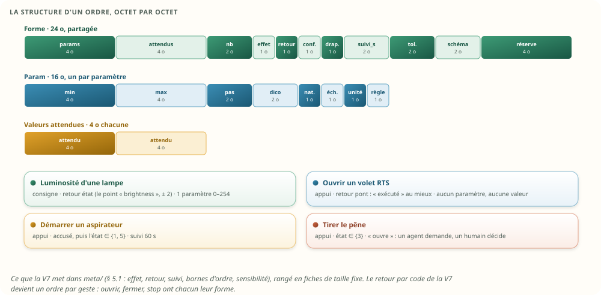
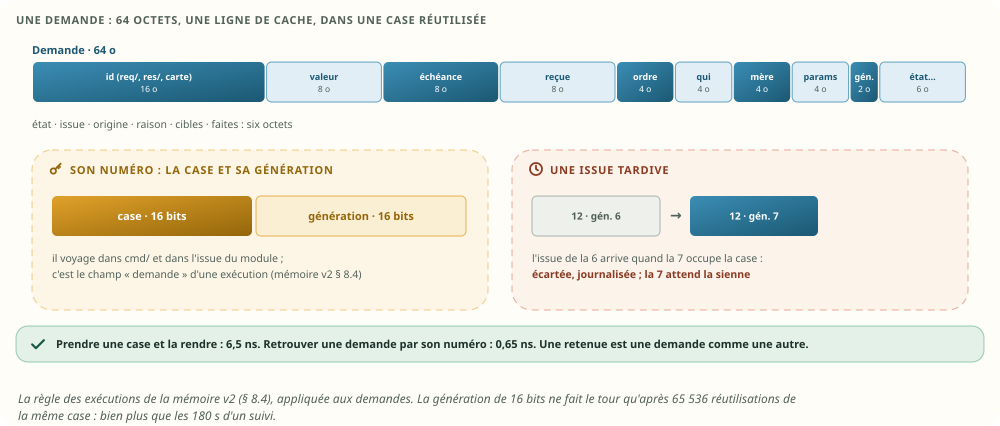
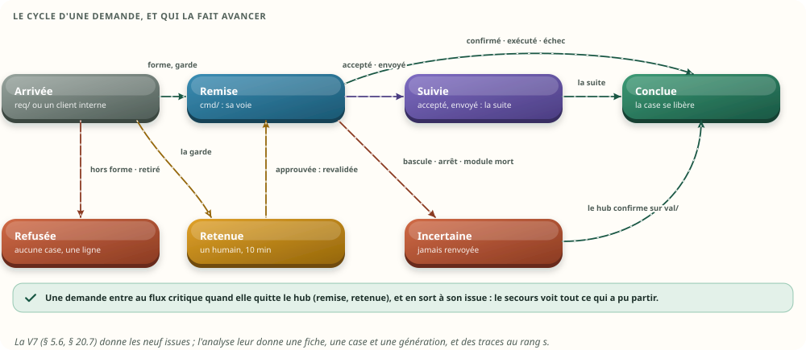
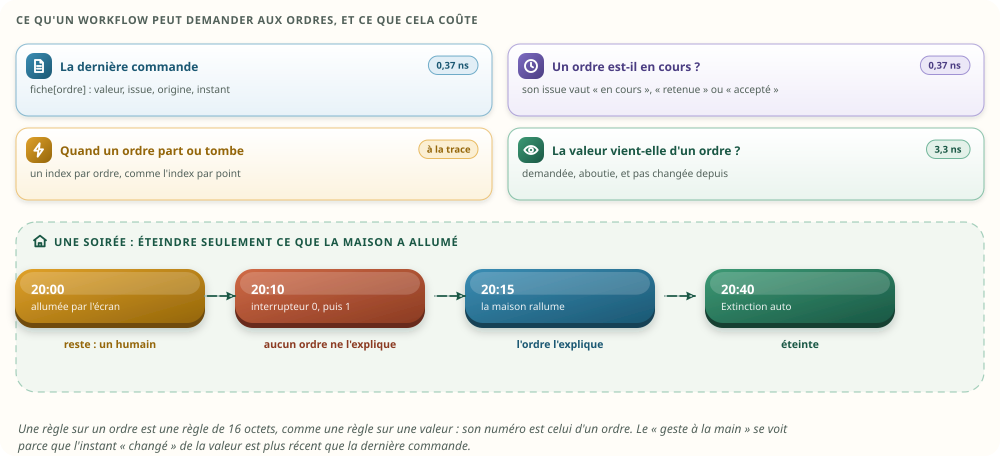

# Les ordres des appareils — Sarah Home : ce que chacun en connaît, et où c'est rangé

**Version remplacée.** Cette v1 est remplacée par la [v2](ordres-appareils-v2.md), du même jour, qui
corrige les vingt-cinq constats de la [revue Codex](ordres-appareils-revue-codex.md) : qui demande
vient de la connexion, un appui attend l'accusé du secours, les reçus gardent la plus haute
séquence, le numéro d'une demande porte l'époque, un texte privé ne passe que par un canal privé, et
vingt corrections de moindre portée. Elle reste pour l'historique ; ses chiffres viennent de la
première série du banc, gardée dans `tools/ordres-banc/sorties/linux-v1/`, et ses fautes injectées
dans `tools/ordres-banc/sorties/mutations-v1.txt`. Le banc, lui, a été repris pour la v2 : les
extraits de code ci-dessous sont ceux de la v1.

Date : 24 octobre 2026. Statut : **analyse, non validée**. Aucune modification du code ; aucune des
propositions précédentes n'est modifiée. Base analysée : `main` au commit `a835893`. S'appuie sur
l'[étude mémoire v2](memoire-v2.md), la [haute disponibilité v2](haute-disponibilite-v2.md), le
[nettoyage des équipements](nettoyage-equipements.md) et l'[analyse
V7](isolation-reactivite-runtime-v7.md). Le § 19 dit ce qu'elle leur changerait si tu la valides ;
le § 20 garde tes quatre choix du 24 octobre.

Ce que tu as demandé, dans l'ordre où tu l'as dit :

1. **Il manque un truc** : on ne voit pas où sont rangées en mémoire les actions sur les appareils.
   Les intégrer à la mémoire du hub et des autres, en restant cohérent avec le reste.
2. **« Il faut qu'ils connaissent l'appareil, l'ordre et la structure de l'ordre. »**
3. **Les ordres et les valeurs sont deux choses différentes** : les séparer.
4. Avec les actions en mémoire, **les workflows pourront mieux les interroger**.
5. **Des appareils physiques, et des appareils virtuels** qui assemblent des informations des
   physiques : une valeur ou un ordre peut appartenir à l'un, à l'autre ou aux deux. L'avoir en
   mémoire, puisque les interfaces et les sites en auront besoin ; et **revérifier ce que tout cela
   consomme**, par rapport aux assistants, aux autres composants et aux anciennes versions.
6. **Un passage qui démontre l'intérêt**, en montrant la différence de mémoire.
7. **Les clients se rechargeraient peut-être mieux directement par MQTT** que par un module dédié,
   maintenant que tout est en mémoire : les équipements, les ordres et les valeurs.

Méthode, et techniques employées, nommées au fil du texte :

- **« Comment pourrait-on… »** : la demande reformulée en questions ouvertes, et ce qui prouvera
  chaque réponse (§ 3) ;
- **premiers principes** : ce qu'est un ordre, et ce qu'il faut savoir de lui, du moment où il est
  demandé jusqu'à ce que la maison l'oublie (§ 8) ;
- **inventaire** : tout ce qui garde quelque chose d'un ordre, dans la conception et dans le code
  d'aujourd'hui, fichier par fichier (§ 4) ;
- **analogies** : Matter et le Zigbee (attributs et commandes), le dictionnaire d'objets de CANopen,
  Home Assistant (services et contexte), le contrôle aérien et ses bandes de vol, le jeu
  d'instructions d'un processeur, les registres de schémas (§ 6) ;
- **SCAMPER** et le **brainstorming inversé** (« comment rater la mémoire des ordres ? ») pour
  produire les options et les garde-fous (§ 6) ;
- **analyse morphologique**, puis **sélection à critères visibles** (§ 7) ;
- **un banc** : le catalogue, les demandes, un hub, un kit de modules, un moteur et des écrans
  réduits, mesurés à côté des structures d'aujourd'hui recopiées. Linux musl, 2 CPU et 128 Mio,
  trois essais par mesure. Rangé dans `tools/ordres-banc/` (annexe A) ;
- **une vérification de bout en bout** : une soirée de la maison, avec une bascule, un redémarrage,
  un module mort, un retrait, un lot et une structure qui change ; 28 tests, et 20 fautes injectées,
  toutes détectées (§ 18).

Vocabulaire :

- une **valeur** dit ce que l'appareil est (« la lampe est allumée ») ; c'est un point de la mémoire
  v2 ;
- un **ordre** dit ce que la maison peut lui demander (« allume-toi », « ouvre ») ; il a son numéro,
  à part de ceux des valeurs ;
- la **forme** d'un ordre est sa structure : ses paramètres, leurs bornes, son effet, son retour,
  son suivi. Elle est partagée par tous les ordres qui ont la même structure ;
- une **demande** est un ordre que quelqu'un vient de demander, avec ses paramètres, jusqu'à son
  **issue** (confirmé, exécuté, accepté, envoyé, incertain, non envoyé, échec, refusé, retenu : les
  neuf de la V7) ;
- le **retour** est ce que l'appareil sait dire après un ordre (une valeur qui revient, le pont qui
  dit « émis », un accusé, rien) ; l'**effet** dit si l'ordre est une **consigne** (la dernière
  gagne) ou un **appui** (chacun compte) ;
- le **suivi** est la fenêtre, après l'issue, pendant laquelle la suite peut encore arriver ;
- une **retenue** est une demande que la garde garde pour un humain ;
- un **reçu** retient l'issue d'un appui, pour qu'un appel retenté ne le fasse pas deux fois ;
- un **bail** (« pendant 2 min ») ouvre par un ordre et rétablit la valeur d'avant par un autre ;
- la **dernière commande** d'un ordre : ce qu'on lui a demandé en dernier, quand, qui, et l'issue ;
- un appareil **physique** tient ses valeurs et ses ordres de son module ; un appareil **virtuel**
  assemble des valeurs et des ordres d'autres appareils (sa **composition**), et peut en avoir à lui
  (une moyenne, un ordre de groupe) ;
- un **client** est ce qui montre la maison : un écran, l'appli, un site, une tablette au mur.

## 1. Le verdict en bref

- **Tu as raison, il manquait un étage entier.** La mémoire v2 range les valeurs ; pour un ordre,
  elle ne garde qu'un octet, `sens` (lecture, écriture). La V7 décrit bien la structure d'un ordre,
  mais seulement sur `meta/`, et aucune fiche ne la garde. Aujourd'hui, un ordre en cours vit dans
  des tâches, des canaux et des verrous ; la dernière commande n'existe nulle part ; les retenues
  disparaissent au redémarrage sans une ligne de journal (§ 4).
- **Les ordres et les valeurs, séparés** (§ 8). Deux registres, chacun avec ses numéros (une place
  et une génération, le registre du nettoyage), ses noms et ses fiches. Une valeur n'est jamais un
  ordre ; un ordre n'a jamais de valeur. Le seul lien est une référence : la forme d'un ordre dit
  quelle valeur de l'appareil le prouve, et quelle valeur chacun de ses paramètres règle.
  Aujourd'hui, au moins neuf pilotes déclarent des « points » en écriture seule, qui sont des ordres
  sans valeur déguisés en points (§ 4.2).
- **L'appareil, l'ordre et la structure de l'ordre, en trois fiches** (§ 9) :
  - l'appareil, 16 octets : où sont ses valeurs, où sont ses ordres, sa composition, sa pièce ;
  - l'ordre, 32 octets : sa forme, et sa dernière commande ;
  - la forme, 24 octets, plus 16 par paramètre et 4 par valeur attendue, partagée.

  Dans la maison ×1 du banc, 802 ordres partagent 16 formes ; à ×100, 82 592 ordres en partagent
  toujours 16 : la structure ne grandit pas avec la maison.
- **Chacun connaît les trois, par le même chemin** (§ 5) : le hub les tient ; le moteur, les
  modules, les écrans, les agents et le secours les apprennent par `meta/` et `meta/forme/`, gardent
  des numéros, et redemandent ce qu'ils ne connaissent pas. Un écran valide une valeur avec la même
  fonction et la même forme que le hub : 3 344 décisions sur 3 344 identiques au banc.
- **Les demandes ont leur fiche de 64 octets, dans une case réutilisée avec sa génération** (§ 10),
  comme les exécutions de la mémoire v2. Une issue tardive ne tombe jamais sur la demande qui a
  repris la case. Une retenue est une demande comme une autre ; un reçu tient en 32 octets.
- **Les workflows interrogent les ordres comme les valeurs, par numéro** (§ 13) : la dernière
  commande en 0,37 ns ; « la valeur vient-elle d'un ordre, ou d'un geste à la main ? » en 3,3 ns ;
  un déclencheur sur un ordre, par un index par ordre. Un volet RTS n'a aucune valeur : seul un
  déclencheur sur son ordre peut y réagir.
- **Les appareils virtuels composent sans posséder** (§ 12). Une valeur ou un ordre a un seul
  propriétaire ; un appareil virtuel le montre ou le commande par référence, 8 octets par entrée. Un
  ordre de groupe fait une demande mère et une fille par cible, et dit « 3 sur 4 » au lieu de
  « fait » ; la garde lit les pièces de ses membres.
- **Les clients peuvent se charger par MQTT, comme un secours** (§ 14). Un écran demande son état,
  filtré par ses droits : 118 Ko à ×1, au lieu des 631 Ko de JSON de `/api/snapshot` ; un écran de
  deux pièces, 20,7 Ko. Puis il suit le flux au rang `s`, avec la règle du numéro inconnu. Le module
  dédié de la V7 n'a plus rien à traduire. **Tu l'as choisi le 24 octobre** ; le prix est la
  connexion MQTT de chaque écran, à régler dans notre version du courtier (§ 14.4).
- **Ce que tout cela consomme reste petit** (§ 17) : la mémoire des ordres (catalogue, demandes,
  reçus, journal, retenues, compositions) pèse 131 Kio à ×1. Et elle remplace plus qu'elle
  n'ajoute :
  - le journal en mémoire passe de 138 à 19,5 Kio ;
  - l'assistant ne recopie plus 317 Kio de maison à chaque requête ;
  - son inventaire passe de 17 885 à 14 227 jetons environ.

  Le budget du cœur reste de 32 Mio ; Home Assistant en prend 2,1 Gio, et le compagnon Hermes, hors
  du cœur, 1 à 4 Go.
- **La haute disponibilité devient précise** (§ 15). Chaque pas d'une demande est une sortie
  critique sur `ord/`, au rang `s`. Le secours sait donc quelles demandes ont pu partir. À la
  bascule, il les dit « incertaines », sans jamais les renvoyer, puis les confirme lui-même sur
  `val/` : il connaît leur forme. Les retenues, les baux et les reçus passent la bascule et le
  redémarrage.
- **Vérifié de bout en bout** (§ 18) : la même mémoire des ordres sur l'actif, sa copie et une copie
  reprise par l'état complet, à chacun des 3 relevés. Les 28 tests passent ; les 20 fautes injectées
  sont toutes détectées.

- **Tes choix du 24 octobre** (§ 20) : les clients par MQTT direct ; une retenue gardée au
  redémarrage ; les traces sur `ord/` ; un ordre de groupe réparti par le hub, ou par un module
  quand il faut une stratégie. Ils valent si tu valides l'analyse, qui reste à valider.


## 2. L'intérêt, démontré

Tu as demandé un passage qui montre pourquoi ranger en mémoire les ordres, et les appareils
physiques et virtuels qui les portent avec les valeurs, et ce que cela change à la mémoire. Le
voici, en deux tableaux : ce que cela permet, puis ce que cela coûte. Chaque ligne a sa preuve au
banc.

### 2.1 Ce que cela permet

| Ce que la maison sait faire | Aujourd'hui | Avec la mémoire des ordres | La preuve |
|---|---|---|---|
| Dire ce qu'un volet RTS a reçu en dernier (il n'a aucune valeur) | rien sur l'appareil ; le journal global, 60 lignes à l'écran | la fiche de l'ordre : « ouvrir, exécuté par la box, 18:20, par l'assistant », la même sur l'actif, le secours et chaque écran | test `la_derniere_commande_se_lit_partout_pareil` |
| Savoir si une valeur vient d'un ordre, ou d'un geste à la main | impossible : rien ne relie un ordre à la valeur qui suit (V7 § 5.8) | une règle de 16 octets, 3,3 ns : « éteindre ce que la maison a allumé, pas ce qu'un humain a rallumé » | test `les_workflows_interrogent_les_ordres` |
| Réagir à un ordre, pas à une valeur | impossible | un déclencheur sur l'ordre, un index par ordre : « quand on ferme le volet RTS, fermer celui de la chambre » | idem |
| Refuser une valeur hors de sa structure, avant de l'envoyer | le hub, en 114 ns ; l'écran lit le `Kind` du point (bornes, choix), sans effet ni retour | le hub, l'écran et l'agent, avec la même forme et la même fonction : 39 ns par le nom, 4,1 ns par le numéro | test `chacun_connait_l_appareil_l_ordre_et_sa_structure` |
| Une issue tardive ne touche jamais la mauvaise demande, ni l'exécution d'après | les canaux le garantissent ; mais une exécution n'a pas de numéro de demande | la génération de la case | test `chaque_issue_tombe_sur_sa_demande`, et sa faute injectée |
| Une retenue passe un redémarrage et une bascule | perdue au redémarrage, sans une ligne de journal | gardée ; décidée plus tard, revalidée contre la forme du moment | test `une_retenue_n_approuve_que_ce_qu_elle_montre` |
| Un appui retenté ne part qu'une fois, même après une bascule | reçus par fichier, sur une seule machine | reçus dans la trace, sur toutes les copies | test `un_appui_retente_ne_part_qu_une_fois` |
| Un ordre en vol à la bascule n'est jamais renvoyé, et sa vérité est dite | — (aucun secours) | « incertain », puis confirmé par le hub du nouvel actif, qui connaît la forme | test `aucun_ordre_n_est_rejoue` |
| Un appareil virtuel montre et commande sans posséder | `members` : des appareils seulement ; un luminaire dit « fait » dès qu'une ampoule obéit | une composition de valeurs, d'ordres et d'appareils ; « 3 sur 4 » ; la garde lit les pièces des membres | test `un_appareil_virtuel_compose_sans_posseder` |
| Un écran se recharge sans tout relire | `/api/snapshot` : toute la maison, en JSON | son état, filtré, par MQTT ; puis le flux au rang `s` | section `clients` du banc |
| Un appareil retiré ne garde rien, sa place non plus | son étiquette et son état restent (nettoyage § 4.3) | la fiche de l'ordre est remise à zéro au lot ; un vieux numéro ne commande jamais l'appareil neuf | test `un_appareil_retire_n_est_plus_commande_et_sa_place_ne_garde_rien` |

### 2.2 Ce que cela coûte, et ce que cela remplace



| Ce qui est gardé, maison ×1 (×10) | Aujourd'hui | Avec la mémoire des ordres |
|---|---|---|
| La description des appareils, de leurs valeurs et de leurs ordres | 828 Kio (8,2 Mio) : `Device` et `PointSpec`, où un ordre est un point | 337 Kio (3,7 Mio) : valeurs (`Def` et annuaire), registre des ordres, catalogue, appareils et compositions |
| … dont la structure des ordres | dans les `PointSpec`, incomplète : ni effet, ni retour, ni suivi | 33,2 Kio : 16 formes et une fiche de 32 o par ordre, dernière commande comprise |
| Une demande en vol | 590 o au mieux, en une dizaine d'allocations, sans compter les canaux ni les tâches | 64 o, dans une case ; au pic de la journée, 36 demandes en cours (55 à ×10) |
| Le journal en mémoire, 500 lignes | 138 Kio de textes | 19,5 Kio de lignes de 40 o ; les noms se résolvent à l'affichage |
| 50 retenues (le plafond) | 21,6 Kio | 6,2 Kio : 50 demandes et leurs cartes |
| Les reçus d'idempotence | trois fichiers métier (boutons, compteurs, minuteries), jusqu'à 1 Mio chacun | 8,1 Kio dans la journée du banc : 32 o par reçu, 32 par appelant |
| Les compositions des appareils virtuels | `members`, des noms | 2,7 Kio : 340 entrées de 8 o |
| Ce que l'assistant copie à chaque requête | 317 Kio (`Hub::snapshot`), en 147 µs | rien : l'inventaire se lit dans les colonnes |
| L'inventaire que lit le modèle | 17 885 jetons environ | 14 227 jetons environ : chaque structure écrite une fois |
| Ce qu'un écran charge pour démarrer | 631 Ko de JSON | 118 Ko par MQTT, 20,7 pour un écran de deux pièces |

Trois lectures :

- **La mémoire des ordres coûte moins que ce qu'elle remplace.** Elle range des choses qui
  n'existent pas aujourd'hui (la structure complète, la dernière commande, les compositions), et la
  description entière reste 2,5 fois plus légère que celle d'aujourd'hui.
- **Le gain le plus net est hors du hub** : la copie de la maison que fait l'assistant à chaque
  requête, et ce que charge un écran.
- **Rien de tout cela ne pèse à l'échelle d'une maison** : moins d'un Mio à ×1. Le choix se fait sur
  ce que la maison sait faire en plus (§ 2.1), pas sur les octets.

## 3. La question, reformulée

Technique **« Comment pourrait-on… »** :

1. Comment pourrait-on donner au hub, au moteur, aux modules, aux écrans, aux agents et au secours
   la même connaissance de l'appareil, de l'ordre et de sa structure, sans copier les définitions
   dix fois ?
2. Comment pourrait-on garder les ordres à part des valeurs, en ne les reliant que par référence ?
3. Comment pourrait-on tenir chaque demande, de son arrivée à son issue et à sa suite, dans des
   fiches de taille fixe, sans qu'une issue tardive tombe jamais sur la mauvaise demande ?
4. Comment pourrait-on laisser un workflow interroger les ordres comme il interroge les valeurs ?
5. Comment pourrait-on assembler des appareils virtuels à partir des physiques, et les servir tels
   quels aux interfaces ?
6. Comment pourrait-on garder tout cela exact à travers une bascule, un redémarrage et un nettoyage,
   sans jamais rejouer un ordre ?
7. Comment pourrait-on servir les clients sans module de traduction ?

Ce qui prouvera la réponse, fixé avant de chercher :

| Critère | La preuve |
|---|---|
| Chacun connaît l'appareil, l'ordre et sa structure, sans copie qui diverge | les copies du catalogue (secours, écran) égales à celle du hub ; un écran valide comme le hub |
| Une valeur n'est jamais un ordre | deux registres ; un volet RTS sans aucune valeur |
| Aucune issue ne tombe sur la mauvaise demande, ni sur le mauvais appareil | des tests, et des fautes injectées qui les font échouer |
| Aucun ordre n'est rejoué : module mort, bascule, redémarrage | chaque envoi compté, une fois |
| Ce qui a été demandé en dernier se lit partout pareil | la fiche de chaque ordre, comparée |
| La mémoire reste petite, et le dit | mesurée à ×1, ×10, ×100, à côté d'aujourd'hui |

## 4. Ce qui manque

### 4.1 Dans la conception

| Où | Ce qui y est | Ce qui n'y est pas |
|---|---|---|
| V7 § 5.1, § 5.6, § 20.2, § 20.7 | le contrat d'un ordre : la méta d'un point écrivable (effet, retour par code, bornes d'ordre, suivi, réveillable, sensibilité), les neuf issues, les voies, `req/`, `cmd/`, `res/` | une fiche qui garde la structure ; la dernière commande ; la mémoire des demandes |
| V7 § 11.4.4, mémoire v2 § 5.1 | `Def` de 16 o par point, dont **un octet `sens`** : sémantique, lecture, écriture | tout le reste de la structure d'un ordre |
| Mémoire v2 § 8.4 | l'exécution de 64 o porte `demande`, « l'ordre en vol dont elle attend l'issue » | la demande elle-même : rien ne dit où elle vit ni ce qu'elle pèse |
| HA v2 § 3, § 7 | les retenues et les baux sont critiques, sur `wf/` ; un ordre envoyé sans issue devient « incertain » à la bascule | comment le secours sait quels ordres ont pu partir |
| Nettoyage § 9 | un appareil retiré n'est plus commandé ; ses retenues et ses baux se terminent | la fiche d'un ordre, et ce qu'en garde une place libérée |

La structure est donc **décrite** (sur MQTT) mais **rangée nulle part** ; l'état d'un ordre en cours
n'a pas de place ; et les ordres, comme dans le code, sont restés des points.

### 4.2 Dans le code d'aujourd'hui

**Inventaire** de tout ce qui garde quelque chose d'un ordre, relevé fichier par fichier
(`a835893`) :

| Ce qui est gardé | Où | Ce que c'est |
|---|---|---|
| La structure | `Device.points: Vec<PointSpec>` dans `Model.devices` (`moli-core/src/model.rs:10`, `moli-runtime/src/hub.rs:512`) | un ordre est un point écrivable (`Access { read, write }`, `spec.rs:119`) ; sa structure est le `Kind` du point : bornes, choix ; ni effet, ni retour, ni suivi |
| La validation | `Hub::prepare` (`hub.rs:1731`) | le `PointId` découpé (un `DeviceId` alloué), le `BTreeMap` des appareils, le point cherché en ligne, l'accès, `validate` |
| La garde | `verdict`, `sensitive`, `rooms_of` (`hub.rs:1095-1152`) | la sémantique du point (`Control`, `Lock`), les pièces de l'appareil et de ses `members` |
| Une demande en cours | `CommandRequest` (`driver.rs:66`) dans la file du pilote (64 places, `hub.rs:64`), un `oneshot` pour la réponse, un `AtomicU8` pour savoir qui l'a, et chez l'appelant `Delivery`, `Observer` et une fermeture qui écrira la ligne de journal (`hub.rs:343-431`) | l'état d'un ordre est réparti entre la tâche de l'appelant et celle du pilote ; il n'a pas de numéro |
| L'échéance | `command_timeout` 5 s (`hub.rs:122`) ; `REPLY_MARGIN` 400 ms, `MIN_LEFT` 1 s (`orders.rs:18-21`) | — |
| La voie d'un pilote | `OrderLine` : une file, un ordre en vol, une capacité (`orders.rs:25`) ; `Confirmations` : 32 valeurs attendues au plus (`orders.rs:209-228`) | dans chaque pilote qui l'utilise, pas dans tous |
| Les retenues | `Approvals { pending: BTreeMap<u64, Arc<ApprovalRequest>> }`, 50 au plus, 10 min (`hub.rs:173-247`) | en mémoire seulement : **perdues au redémarrage**, sans ligne qui les conclue |
| Les reçus | boutons, compteurs, minuteries : 64 appelants, 32 reçus chacun, un fichier métier par famille (`occurrences.rs:133-171`, `counters.rs:11-14`) | durables, mais sur une seule machine |
| Les scènes | `Scenes { active, ended (64), points, leases }` (`scenes.rs:135-147`) : une scène « tient » ses appareils, 512 au plus | une dernière commande… le temps d'une scène |
| Le journal | 500 `Arc<JournalEntry>` en mémoire, en textes (`hub.rs:542-545`), et un fichier JSON Lines rogné à 8 Mio (`journal_log.rs:20-21`) | le seul endroit où l'on retrouve ce qu'un ordre a donné |
| La dernière commande | **nulle part dans le hub** ; l'écran garde la sienne, par point, 8 s (`web/src/lib/hub.svelte.js:17-18, 217-246`) | un volet RTS n'affiche rien de ce qu'il a reçu |
| Ce que lit l'assistant | `Hub::snapshot` à chaque requête (`moli-assistant/src/lib.rs:1139`), puis l'inventaire (`house.rs:115`) : 8 points par appareil, les écrivables d'abord | toute la maison recopiée, à chaque question |
| Ce que lisent les agents | `list_devices`, `get_device`, `send_command(point, valeur)` (`moli-api/src/mcp.rs:344-441`) | la structure d'un ordre se devine dans le `Kind` du point |

**Les ordres déguisés en valeurs.** Au moins neuf pilotes déclarent des points en écriture seule. Ce
sont des ordres sans valeur, rangés comme des valeurs :

| Pilote | Le « point » | Où |
|---|---|---|
| Telegram, téléphones | `notify`, `push` : un texte à envoyer | `moli-telegram/src/lib.rs:171`, `moli-phones/src/lib.rs:653` |
| Sonos | `announce` | `moli-sonos/src/lib.rs:201` |
| Philips | `text`, `key`, `media_control` | `moli-philips/src/lib.rs:337, 351, 402` |
| Roborock, Landroid | `control` (démarrer, pause, stop…) | `moli-roborock/src/model.rs:163`, `moli-landroid/src/model.rs:255` |
| Nuki | l'ouverture | `moli-nuki/src/model.rs:185` |
| TaHoma (RTS) | `control` | `moli-overkiz/src/model.rs:124` |
| Aides | les commandes des minuteries et des compteurs | `moli-helpers/src/lib.rs:196, 267` |

Dans la mémoire v2, chacun aurait sa place de valeur : une fiche `Vif` de 40 octets, son nom dans
l'annuaire, ses échéances. Il n'aurait pourtant jamais de valeur.

### 4.3 Trois défauts trouvés en chemin

- **Une retenue disparaît au redémarrage, sans trace.** Les retenues ne vivent qu'en mémoire
  (`hub.rs:442`, aucune option de fichier dans `HubOptions`) ; le journal garde la ligne « en
  attente d'approbation », jamais sa fin. L'agent a pourtant reçu « elle expire dans 10 minutes »
  (`mcp.rs:431-437`).
- **Aucune dernière commande.** Un ordre et la valeur qui suit ne sont reliés nulle part (la V7 le
  notait déjà, § 5.8). L'écran garde sa propre attente, 8 s, par point (`hub.svelte.js:238-241`) ;
  un autre écran ne sait rien de l'ordre en cours.
- **L'assistant recopie toute la maison à chaque requête** (`Hub::snapshot`, `lib.rs:1139`) :
  317 Kio alloués puis rendus, à ×1, pour en tirer quelques lignes par appareil.

## 5. Qui doit connaître quoi

Ta phrase, prise au pied de la lettre : **l'appareil, l'ordre, la structure de l'ordre**. Pour
chaque composant, ce qu'il en connaît, ce qu'il garde, et par où il l'apprend :



| Qui | L'appareil | L'ordre | La structure | Ce qu'il garde des ordres | Il l'apprend par |
|---|---|---|---|---|---|
| **Le hub** | registre, fiche de 16 o, composition | registre, fiche de 32 o | toutes les formes | tout : catalogue, demandes, reçus, retenues, journal | les déclarations des modules |
| **Le moteur** | son numéro | le numéro de l'ordre, dans le nœud « commander » | la forme, à la compilation : il refuse une valeur hors bornes, ou « vérifier » sur un ordre sans retour | ses exécutions (`demande`), ses baux | `meta/`, `meta/forme/`, `ord/` |
| **Un module** | ses appareils (natif ↔ numéro) | le numéro, dans `cmd/` | celle qu'il déclare ; elle borne son issue | ses voies, ses ordres en vol, ses suivis | lui-même |
| **Un écran, l'appli, un site** | nom, numéro, pièce, composition | nom, numéro | la forme en cache, par numéro : curseur, bornes, boutons | ses demandes, les dernières commandes | MQTT : `etat/`, `meta/`, `meta/forme/`, `ord/`, `val/` (§ 14) |
| **Un agent, l'assistant** | le nom | le nom | un outil par ordre, tiré de la forme | rien | MCP, REST |
| **Le secours** | le même registre | le même registre | les mêmes formes | catalogue, demandes remises, reçus, retenues, baux | le flux critique et l'état complet (HA v2) |
| **La base, l'archive** | le nom | le nom | — | le journal des ordres, par les noms | `run/`, puis `hist/ops` |

Deux règles de la mémoire v2 suffisent à tenir tout cela :

- **un seul propriétaire, des copies** (§ 7) : le hub écrit, les autres reçoivent ;
- **un numéro inconnu se redemande, il ne se devine pas** (§ 4.4) : vrai pour une forme comme pour
  un point.

## 6. Les idées

### 6.1 Ailleurs, comment fait-on ?

Technique des **analogies** :

| Où | Ce qu'ils font | Ce qu'on en retient |
|---|---|---|
| **Matter, Zigbee (ZCL)** | un cluster a des **attributs** (des valeurs) et des **commandes** (des ordres), numérotés à part ; une commande a des champs typés ; les commandes sensibles sont « minutées » (une échéance) | **séparer les valeurs et les ordres**, donner aux ordres leurs numéros et des paramètres typés ; l'échéance, nous l'avons déjà |
| **CANopen** | le dictionnaire d'objets : chaque entrée a un numéro, un type, un accès, des bornes ; tous les nœuds le connaissent par un fichier de description | **un catalogue partagé, par numéro**, publié une fois |
| **Home Assistant** | des services à schéma (`light.turn_on` et ses champs), les capacités de chaque entité, et un **contexte** attaché à chaque changement : qui, et par quel service | **la dernière commande et sa cause** ; un outil par ordre pour les agents |
| **Le contrôle aérien** | une bande par vol, de taille fixe, déplacée de case en case ; la clairance, puis son collationnement | **une fiche par demande**, qui change d'état ; la confirmation par ce qui revient |
| **Le jeu d'instructions d'un processeur** | un code d'opération, puis des opérandes dans un format fixé par le code | **la forme dit le format des paramètres** ; la demande ne porte que des nombres |
| **Les registres de schémas (Kafka)** | un message porte le numéro de son schéma ; le lecteur le demande une fois et le garde | **`meta/forme/<f>`**, en cache par numéro |

### 6.2 SCAMPER sur « un ordre est un point écrivable »

| Lettre | La question | L'idée |
|---|---|---|
| **S**ubstituer | Et si un ordre n'était pas un point ? | un registre des ordres, à part (retenu) |
| **C**ombiner | Et si les retenues étaient des demandes ? | un état `RETENUE` dans la même fiche (retenu) |
| **A**dapter | Et si on reprenait les exécutions de la v2 ? | cases réutilisées, génération (retenu) |
| **M**odifier | Et si le retour par code de la V7 devenait un ordre par geste ? | ouvrir, fermer et stop ont chacun leur forme ; plus de table par code (retenu) |
| **P**roduire autre chose | Et si la fiche de l'ordre servait aux workflows ? | règles et déclencheurs sur un ordre (retenu) |
| **É**liminer | Et si l'écran n'avait plus de module de traduction ? | les clients par MQTT (§ 14, ton choix) |
| **R**enverser | Et si c'était la valeur qui citait l'ordre ? | écarté : une valeur ne sait rien des ordres, comme elle ne sait rien des workflows (mémoire v2 § 8.2) |

### 6.3 Brainstorming inversé : comment rater la mémoire des ordres ?

| Pour rater | Il suffirait de… | Le garde-fou |
|---|---|---|
| Une issue qui tombe sur la mauvaise demande | réutiliser la case sans génération | la génération ; une faute injectée le vérifie |
| Un ordre rejoué après une bascule | renvoyer ce qui était remis à un module de l'ancien actif | « incertain », jamais renvoyé ; chaque envoi est compté |
| Une carte d'approbation qui approuve autre chose | décider par le numéro de case | la carte porte l'identifiant de la demande et l'ordre montré |
| Un ordre envoyé hors de sa structure | faire confiance au client | le hub valide toujours ; l'écran aussi, avec la même forme |
| Un écran qui commande l'appareil neuf avec un vieux numéro | ignorer la génération de l'ordre | un numéro de l'ancienne génération est inconnu |
| Une copie dont les échéances dérivent | lui envoyer l'horloge monotone de l'actif | l'échéance voyage en heure murale ; une faute injectée le vérifie |
| Une valeur prise pour l'œuvre d'un ordre | comparer la valeur seule | comparer aussi l'instant « changé » à la dernière commande |
| Un groupe qui dit « fait » quand une ampoule a obéi | compter les réussites, pas les cibles | « échec, partiel, n/m » |

## 7. Les options, et le choix à critères visibles

**Analyse morphologique** : six dimensions, et leurs options.

| Dimension | Options |
|---|---|
| D1. Où ranger la structure | S1 dans `Def` (48 o pour chaque point) · S2 une colonne par point · S3 une fiche par ordre · **S4 une fiche par ordre et des formes partagées** · S5 relire la méta à chaque demande |
| D2. Ce qu'est un ordre | N1 un point écrivable (aujourd'hui) · **N2 une entrée à lui, dans son registre, à paramètres** · N3 un point et un code |
| D3. Les demandes | E1 des tâches et des canaux (aujourd'hui) · **E2 des fiches de 64 o, cases et génération** · E3 une table par identifiant · E4 chacun garde la sienne |
| D4. Les retenues | R1 à part (aujourd'hui) · **R2 un état de la demande** |
| D5. La dernière commande | L1 nulle part (aujourd'hui) · L2 dans la valeur · **L3 dans la fiche de l'ordre** |
| D6. Ce qui passe au secours | H1 rien · **H2 chaque pas, sur `ord/`** · H3 la demande, pour la renvoyer |

**Sélection à critères visibles** : simplicité, mémoire, justesse (aucune mauvaise issue, aucun
rejeu), cohérence avec la mémoire v2, le nettoyage et la HA v2, lisibilité pour les écrans et les
agents. De 1 à 3 chacun :

| Option | Simplicité | Mémoire | Justesse | Cohérence | Lisibilité | Total |
|---|---|---|---|---|---|---|
| S1 la structure dans `Def` | 3 | 1 | 2 | 1 | 2 | 9 |
| S3 une fiche par ordre | 3 | 2 | 3 | 3 | 2 | 13 |
| **S4 fiche et formes partagées** | 2 | 3 | 3 | 3 | 3 | **14** |
| S5 relire la méta | 2 | 2 | 1 | 1 | 1 | 7 |
| N1 un point écrivable | 3 | 1 | 1 | 1 | 1 | 7 |
| **N2 un registre des ordres** | 2 | 3 | 3 | 3 | 3 | **14** |
| E1 tâches et canaux | 2 | 1 | 2 | 1 | 1 | 7 |
| **E2 cases et génération** | 3 | 3 | 3 | 3 | 2 | **14** |
| L2 dans la valeur | 2 | 1 | 1 | 1 | 2 | 7 |
| **L3 dans la fiche de l'ordre** | 3 | 3 | 3 | 3 | 3 | **15** |
| H3 renvoyer après la bascule | 1 | 2 | 1 | 1 | 2 | 7 |
| **H2 chaque pas sur `ord/`** | 3 | 3 | 3 | 3 | 3 | **15** |

Le choix : **S4, N2, E2, R2, L3, H2.** N1 est la forme d'aujourd'hui et de la V7 : c'est elle que ta
remarque sur les valeurs et les ordres écarte. N2 a un prix : une migration des pilotes (§ 21). Elle
se fait d'abord un point écrivable pour un ordre, sans réécrire un pilote.

## 8. Les valeurs et les ordres, séparés

**Premiers principes.** Une valeur arrive de l'appareil, quand il veut ; elle a une qualité, une
fraîcheur, une précédente. Un ordre part de la maison, quand quelqu'un le demande ; il a des
paramètres, une échéance, une issue, une suite. Ils ne vivent pas au même rythme, n'ont pas la même
durée de vie, et ne sont pas lus par les mêmes : une condition lit une valeur, une action donne un
ordre. Les ranger dans la même fiche, c'est comme ranger les commandes d'un restaurant dans son
stock.



Les règles :

1. **Deux registres**, celui du nettoyage deux fois : les valeurs (`appareil/clé`) et les ordres
   (`appareil/ordre`). Chacun a ses numéros (place 24 bits, génération 7 bits), ses noms, ses
   fiches. Les numéros sont typés : `Point`, `Ordre`, `Appareil` (mémoire v2 § 4.3).
2. **Un appareil a deux plages** qui se suivent, l'une dans chaque registre : ses valeurs, ses
   ordres. Un volet RTS a quatre ordres et aucune valeur ; un capteur a des valeurs et aucun ordre.
3. **Le seul lien est une référence, portée par la forme de l'ordre** : le rang, dans l'appareil, de
   la valeur qui le prouve (`confirme`) et de celle que règle chaque paramètre (`regle`). Le rang ne
   dépend pas de l'appareil : deux lampes du même modèle partagent la même forme.
4. **Une valeur ne sait rien des ordres**, comme elle ne sait rien des workflows (mémoire v2 § 8.2,
   règle 3). C'est l'ordre qui cite la valeur, jamais l'inverse.
5. **Sur MQTT, deux familles** : les valeurs sur `val/`, les ordres sur `ord/` (§ 9.3).

La migration ne réécrit aucun pilote (§ 21) :

| Aujourd'hui | Avec deux registres |
|---|---|
| un point lisible et écrivable (`on` d'une lampe) | une valeur `on`, et un ordre `on` à un paramètre, dont la forme dit : la valeur `on` le prouve, à la tolérance près |
| un point en écriture seule (`notify`, `control`, `unlatch`) | un ordre seul, sans valeur |
| une énumération d'ordres (`control` : ouvrir, stop, fermer) | d'abord un ordre à un paramètre, puis, quand le module le veut, un ordre par geste : chacun sa forme, son retour, son suivi |

## 9. L'appareil, l'ordre, la structure



### 9.1 Les fiches

Bloc technique — les trois fiches (extraits du banc, `tools/ordres-banc/src/`, sans `unsafe`) :

```rust
/// Un appareil : où sont ses valeurs et ses ordres (deux plages), sa composition, sa pièce. 16 o.
#[repr(C)]
pub struct App {
    pub premier_point: u32, pub premier_ordre: u32, pub compo: u32,
    pub nb_points: u8, pub nb_ordres: u8, pub nb_compo: u8,
    pub genre: u8,            // physique, virtuel
    pub piece: u16,
}

/// Un ordre : sa forme, et ce qu'on lui a demandé en dernier. 32 o, une par ordre.
#[repr(C)]
pub struct Fiche {
    pub valeur: i64,          // le premier paramètre de la dernière commande (rang du tiroir pour un texte)
    pub instant_ms: u64,      // quand elle est partie, ou quand son issue est tombée (murale)
    pub appareil: u32,        // le numéro de l'appareil
    pub qui: u32,             // une exécution, une personne, un agent : un rang
    pub demande: u32,         // la demande qui la porte (case | génération)
    pub forme: u16,
    pub issue: u8,            // la dernière ; « en cours » ; 0 : jamais commandé
    pub origine: u8,
}

/// La structure d'un ordre, partagée. 24 o, plus ses paramètres et ses valeurs attendues.
#[repr(C)]
pub struct Forme {
    pub params: u32, pub attendus: u32,   // début de ses paramètres, de ses valeurs attendues
    pub nb_params: u8, pub nb_attendus: u8,
    pub effet: u8,            // consigne (la dernière gagne) | appui (chacun compte)
    pub retour: u8,           // état | pont | accusé | aucun : l'issue ne le dépasse jamais
    pub confirme: u8,         // le rang, dans l'appareil, de la valeur qui prouve l'ordre
    pub drapeaux: u8,         // à l'arrêt, réveillable, ouvre, contrôle, texte privé, au hub, attendu = paramètre, groupe
    pub suivi_s: u16, pub tolerance: u16, pub schema: u16,
}

/// Un paramètre, au canon : 16 o. Les bornes sont celles de l'ordre (V7 G24), à part de la validité d'une lecture.
#[repr(C)]
pub struct Param {
    pub min: i32, pub max: i32, pub pas: u16,
    pub dico: u16,            // les codes d'une énumération (le dictionnaire partagé de la mémoire v2)
    pub nature: u8, pub echelle: i8, pub unite: u8,
    pub regle: u8,            // le rang de la valeur que ce paramètre règle
}
```



Ce que la forme contient est exactement la méta d'un ordre de la V7 (§ 5.1), mise en fiches :

| La V7, sur `meta/` | La forme |
|---|---|
| `effet` : consigne ou appui | `effet` |
| `retour` par code : `etat`, `pont`, `accuse`, `aucun` | `retour`, `confirme`, les valeurs attendues ; un code d'énumération qui avait son propre retour devient son propre ordre |
| `suivi_s` (180 s au plus) | `suivi_s` |
| bornes d'ordre, à part de la validité | `min`, `max`, `pas` de chaque paramètre |
| `reveillable`, `sensible: texte_prive`, `proprietaire: hub` | les drapeaux |
| `semantic` lu par la garde (`Control`, `Lock` qui ouvre) | les drapeaux « contrôle » et « ouvre » |
| objet court au schéma déclaré | `schema` |

### 9.2 Une forme ne change jamais

Une forme est **immuable** : une structure nouvelle est une forme nouvelle, avec un numéro neuf. Un
écran, un agent ou le moteur qui l'a en cache n'a donc jamais à la vérifier ; il demande seulement
celles qu'il ne connaît pas. Une redéclaration (un micrologiciel qui change les bornes d'une
consigne) change la forme de l'ordre, pas la forme elle-même (§ 16).

Le catalogue en mesures :

| Le catalogue des ordres | ×1 | ×10 | ×100 |
|---|---|---|---|
| Appareils (dont virtuels) | 525 (29) | 5 243 (283) | 52 407 (2 807) |
| Valeurs | 2 264 | 22 640 | 226 400 |
| Ordres | 802 | 8 468 | 82 592 |
| Formes ; paramètres | 16 ; 12 | 16 ; 12 | 16 ; 12 |
| Registre des ordres (noms, générations, statuts) | 57,4 Kio | 574 Kio | 6,3 Mio |
| Catalogue (formes, fiches de 32 o) | 33,2 Kio | 513 Kio | 4,0 Mio |
| Valider une demande, par le nom ; par le numéro | 39 ns ; 4,1 ns | 53 ns ; 5,0 ns | 63 ns ; 4,5 ns |
| Aujourd'hui, `Hub::prepare` | 114 ns | 172 ns | non construit |

Les ordres et les appareils virtuels de la maison du banc sont une **hypothèse** : un modèle par
classe d'appareil, six variantes de bornes pour la teinte d'une lampe (annexe A.2). À ×10 et ×100,
la maison répète les mêmes modèles ; une vraie maison plus grande aurait un peu plus de formes,
jamais une par ordre.

### 9.3 Sur MQTT

Bloc technique — la méta d'un appareil, une forme, un ordre, une issue, une trace (proposé) :

```text
meta/salon_lampe        {"points":{"on":{"n":1234,"kind":"binary"},"brightness":{"n":1235,…}},
                         "ordres":{"on":{"n":87,"f":3},"brightness":{"n":88,"f":4},"color_temp":{"n":89,"f":9}}}
meta/forme/4            {"f":4,"e":1,"r":1,"c":1,"d":64,"s":0,"t":2,"p":[[2,0,254,1,0,0,0,1]],"a":[]}
req/ui                  {"id":"01J9Z8K3M4N5P6Q7R8S9T0V1W2","o":"salon_lampe/brightness","v":[128],"e":1792675629123}
cmd/z2m/salon_lampe/brightness   {"d":4027,"i":88,"v":[128],"e":1792675629123,"E":7}
in/z2m/$issue           {"d":4027,"i":1}
res/ui                  {"id":"01J9Z8K3M4N5P6Q7R8S9T0V1W2","i":1,"ms":312}
ord/salon_lampe/brightness       {"d":4027,"e":"conclue","v":128,"i":1,"o":"ui","t":1792675624435,"s":918301}
```

| Ce qui change dans le contrat de la V7 (§ 7) | Pourquoi |
|---|---|
| `meta/<appareil>` sépare `points` et `ordres` ; chaque ordre porte son numéro `n` et sa forme `f` | deux registres ; le numéro voyage déjà (décision v2 § 4.4) |
| `meta/forme/<f>`, critique, publiée une fois | la structure partagée, en cache par numéro |
| `req/` cite l'**ordre** (`o`), plus le point (`p`) ; `v` est la liste des paramètres | un ordre peut avoir 0, 1 ou plusieurs paramètres |
| `cmd/<module>/<appareil>/<ordre>` porte `d`, le numéro de la demande, et `i`, celui de l'ordre | le module range ses voies par numéro ; son issue revient avec `d`, et la génération écarte une issue tardive |
| `ord/<appareil>/<ordre>` : chaque pas d'une demande, au rang `s` | la dernière commande partout ; le secours sait ce qui a pu partir (§ 15). La V7 traçait l'issue sur `evt/`, qui reste aux occurrences des valeurs |

Le message `meta/` d'une maison ×1 pèse 295 Ko quand chaque ordre porte sa structure, comme dans la
V7, et 242 Ko avec les formes, dont 1,2 Ko pour les 16 formes elles-mêmes. L'écart est modeste, car
les valeurs dominent `meta/` ; ce qui compte est qu'un client n'apprend chaque structure qu'une
fois.

## 10. Les demandes

### 10.1 La fiche de 64 octets



Bloc technique — la demande (extrait du banc) :

```rust
/// Une demande : 64 o, une ligne de cache, dans une case réutilisée.
#[repr(C)]
pub struct Demande {
    pub id: u128,           // l'identifiant de req/ et res/ ; une carte d'approbation le porte ; jamais redonné
    pub valeur: i64,        // le premier paramètre (rang du tiroir pour un texte)
    pub echeance_ms: u64,   // monotone : l'issue (5 s), la fin du suivi, ou celle de la retenue (10 min)
    pub recue_ms: u64,      // murale : son arrivée
    pub ordre: u32,         // le numéro de l'ordre : la forme et l'appareil s'en déduisent
    pub qui: u32,           // une exécution (case | génération), une personne, un agent
    pub parent: u32,        // la demande mère d'un ordre de groupe
    pub params: u32,        // les paramètres suivants, dans le tiroir
    pub generation: u16,
    pub etat: u8, pub issue: u8, pub origine: u8, pub raison: u8,
    pub cibles: u8, pub faites: u8,   // un ordre de groupe : n/m (V7 G17)
}
/// Son numéro : la case (16 bits) et sa génération (16 bits). Il voyage dans cmd/ et dans l'issue du
/// module ; c'est le champ `demande` d'une exécution (mémoire v2 § 8.4).
pub struct Ref(pub u32);
```

Trois règles, reprises des exécutions de la mémoire v2 :

- **la case se réutilise, le numéro entier jamais** : la génération écarte une issue tardive (une
  issue pour (12, 6) quand (12, 7) occupe la case) ;
- **l'identité est l'identifiant de la demande**, pas son numéro : une carte d'approbation, une
  réponse sur `res/` portent l'identifiant de 128 bits ; le numéro est un rang de l'installation ;
- **l'échéance est la seule qui se compte à la milliseconde** : 5 s, et la marge de 400 ms du kit.
  Ce qui quitte la machine est en heure murale (HA v2 § 6).

| Une demande, mesurée | ×1 | ×10 | ×100 |
|---|---|---|---|
| Prendre une case et la rendre | 6,5 ns | 6,3 ns | 6,4 ns |
| Retrouver une demande par son numéro | 0,65 ns | 0,65 ns | 0,65 ns |
| Une journée : demandes ; refusées hors de leur forme | 3 000 ; 53 | 30 000 ; 571 | 300 000 ; 5 744 |
| Au plus, en même temps | 36 | 55 | 121 |
| La table des demandes ; les reçus | 4,1 ; 8,1 Kio | 4,1 ; 8,1 Kio | 8,2 ; 8,1 Kio |
| Processeur du hub et du kit, toute la journée | 8,7 ms | 95 ms | 1 279 ms |
| … par demande, appareils simulés compris | 2,9 µs | 3,2 µs | 4,3 µs |
| Réveils dans la journée | 7 562 | 75 625 | 755 517 |

La journée du banc : 3 000 demandes par jour à ×1, dont 30 % en rafales de 40 (des scènes) ; 60 %
viennent des automatismes, 35 % des écrans, 5 % des agents ; 2 % sont hors de leur forme ; un appui
sur cinq porte une clé d'idempotence, et un sur dix est retenté. C'est une **hypothèse** : aucune
mesure de la maison réelle n'existe encore. Le hub se réveille au plus proche : une arrivée, une
réponse, une échéance ; rien ne tourne entre deux (mémoire v2 § 6.3).

### 10.2 Le cycle



| État | Ce qui l'y amène | Ce qui l'en sort |
|---|---|---|
| (aucune case) | hors de sa forme, ordre inconnu ou retiré, refusé par la garde | — : une ligne de journal, une issue `refuse` |
| **Retenue** | la garde : un agent sur un ordre qui ouvre ou qui arrête une machine, une pièce protégée | un humain décide, sur l'écran, en nommant l'ordre vu ; ou 10 min passent |
| **Remise** | la garde laisse passer ; `cmd/` au module | l'issue du module, avant l'échéance |
| **Suivie** | `accepte`, `envoye` ou `incertain`, quand la forme a un suivi | la suite, une fois ; ou le hub conclut à la fin du suivi |
| Conclue | toute autre issue, ou la suite | la case se libère ; la fiche de l'ordre garde la dernière commande |

### 10.3 Les retenues

Une retenue est **une demande dans l'état `RETENUE`**, avec une échéance de 10 minutes. Sa carte (le
nom de l'appareil et ses pièces au moment de la retenue, pour qu'on ne la déguise pas en le
renommant) va dans le tiroir des textes. Trois règles, dont deux existent déjà
(`hub.rs:1313-1403`) :

- seul un humain décide, depuis l'écran, et il nomme l'ordre qu'il a vu ;
- approuvée, la demande est **revalidée contre la forme du moment**, puis remise avec une échéance
  neuve ;
- **nouveau** : la retenue est critique (HA v2 l'avait déjà mise sur `wf/`) ; elle passe le
  redémarrage et la bascule, au lieu de disparaître. C'est ton choix du 24 octobre (§ 20) : elle est
  gardée dans l'instantané, avec sa carte.

### 10.4 Les reçus

Un appui (une sonnette, un compteur, une minuterie) porte une clé d'idempotence : l'espace de
l'appelant (32 chiffres hexadécimaux) et un rang. Le hub garde, par appelant, ses 32 derniers reçus,
comme aujourd'hui (`occurrences.rs:133-134`), mais dans une seule table de fiches de 32 octets.
**Nouveau** : le reçu voyage avec la trace de la demande ; le secours l'a donc, et un appui retenté
après une bascule ne part pas deux fois.

### 10.5 Les voies, côté module

Le kit de la V7 (§ 20.2) ne change pas ; il range ses voies par **numéro** :

- **une voie par appareil, qui n'existe que tant qu'elle porte un ordre** ;
- un ordre en vol ; jusqu'à 8 en attente ;
- une consigne qui attend cède à la suivante **du même ordre**, si rien ne les sépare ; un appui
  n'est jamais fusionné ;
- l'échéance et l'appelant revérifiés juste avant l'envoi ; un ordre ne part **qu'une fois** ;
- **l'issue est bornée par le retour de la forme** : un volet RTS ne rend jamais « confirmé ». Une
  valeur en mouvement ne confirme qu'à l'arrêt : passer par la cible n'est pas y arriver.

La voie garde, pour l'ordre en vol, ce qu'elle attend : 32 octets (le numéro de la demande, celui de
l'ordre, la valeur attendue, l'instant de l'envoi). La forme lui donne le reste.

## 11. La dernière commande

Chaque ordre garde, dans sa fiche de 32 octets, **ce qu'on lui a demandé en dernier** : la valeur,
l'instant, qui, par où, et l'issue. Elle s'écrit à chaque pas de la demande, et part sur `ord/`.

| À quoi elle sert | Exemple |
|---|---|
| Montrer l'état d'un appareil qui n'en a pas | « Ouvrir : exécuté par la box, 18:20, par l'assistant » sur un volet RTS |
| Montrer ce qui est en cours, sur tous les écrans | « Allumer : en cours » sur l'écran qui ne l'a pas demandé |
| Expliquer une valeur | « allumée par l'automatisme Couloir à 21:00 » |
| Interroger depuis un workflow | la dernière commande, son origine, son âge (§ 13) |

Elle remplace l'attente de 8 secondes que garde chaque écran (`hub.svelte.js:17-18`), et l'écho
« optimiste » que la V7 voulait retirer de deux pilotes (Tapo et Sonos, § 5.9).

Une place d'ordre libérée par un lot remet sa fiche à zéro : un appareil neuf ne montre jamais la
dernière commande de l'ancien (§ 16).

## 12. Les appareils physiques et virtuels

**Premiers principes** : une valeur ou un ordre n'a qu'**un propriétaire**, l'appareil dont le
module, ou le hub, le produit. Un autre appareil peut le **montrer**, s'en **servir pour calculer**,
ou le **commander** : il le cite, il ne le possède pas.



| Ce qu'un appareil virtuel fait d'un autre | Le rôle | Exemple |
|---|---|---|
| Il montre une de ses valeurs ou un de ses ordres, à sa place dans sa page | **affiche** | l'« Entrée » montre la serrure, le volet RTS, la lampe |
| Une de ses valeurs se calcule avec | **source** | la température moyenne d'une pièce (les agrégats d'aujourd'hui, `aggregate.rs`) |
| Un de ses ordres de groupe le commande | **cible** | « allumer le séjour » commande les quatre ampoules |
| C'est un appareil membre : la garde lit sa pièce | **membre** | une ampoule du séjour est dans la chambre |

Bloc technique — la composition (extrait du banc) :

```rust
/// Une entrée de composition : 8 o. Le numéro garde sa génération : une place libérée puis
/// réutilisée ne fait jamais entrer l'appareil neuf dans la composition de l'ancien.
#[repr(C)]
pub struct Membre {
    pub numero: u32,      // une valeur, un ordre ou un appareil, selon `sorte`
    pub rang: u16,        // sa place dans la page de l'appareil virtuel
    pub sorte: u8,        // valeur, ordre, appareil
    pub role: u8,         // affiche, source, cible, membre
}
```

Les règles :

- **Un ordre de groupe est une demande mère et une fille par cible.** Chaque fille est une demande
  ordinaire, avec son module, sa voie et son issue. La mère conclut quand la dernière fille a
  conclu : `confirme` si toutes ont obéi, sinon `echec`, cause `partiel`, avec n/m (V7 G17).
  Aujourd'hui, un luminaire répond « fait » dès qu'une ampoule a obéi (V7 § 5.9).
- **Qui répartit** (ton choix du 24 octobre, § 20) : le hub, pour un groupe simple ; un module
  virtuel, quand il faut une stratégie, comme le relais en dernier recours. Dans les deux cas,
  chaque fille est une demande ordinaire, liée à sa mère. Le banc ne mesure que la répartition par
  le hub.
- **La garde lit toutes les pièces qu'un ordre atteint** : celle de l'appareil virtuel, et celles
  des appareils de ses cibles et de ses membres. C'est la règle d'aujourd'hui (`rooms_of`,
  `hub.rs:1133-1152`), étendue aux cibles.
- **Une interface lit la page d'un appareil, physique ou virtuel, d'un seul geste** : ses valeurs,
  ses ordres, puis ce qu'il emprunte, dans l'ordre de ses rangs. Mesuré : 207 ns par page à ×1, noms
  compris. « Cette valeur est aussi dans… » se calcule en parcourant les compositions : 506 ns à ×1,
  sans index à tenir.
- **Une référence inerte se dit, elle ne se remplace pas** : un membre retiré s'affiche « retiré » ;
  un membre dont la place a été réutilisée s'affiche « membre retiré », jamais sous le nom du nouvel
  occupant.
- **Sur MQTT, `meta/<appareil>` d'un appareil virtuel porte sa composition**, en numéros : un écran
  dessine la page sans rien demander d'autre.

Dans la maison ×1 du banc : 29 appareils virtuels (un groupe pour 8 lampes, une « pièce » pour 10
capteurs) et 340 entrées, soit 2,7 Kio.

## 13. Les workflows interrogent les ordres

Tu l'as dit : avec les actions en mémoire, un workflow peut les interroger. La mémoire v2 a fixé que
le programme cite les valeurs par numéro (§ 8.2, règle 1) ; il cite désormais aussi les ordres, par
leur numéro. Une règle reste une fiche de 16 octets ; son `genre` dit ce qu'elle lit.



| Ce qu'un workflow demande | La règle | Ce qu'elle lit | Mesuré |
|---|---|---|---|
| Quelle est la dernière commande ? | `DERNIERE` | la fiche de l'ordre : le premier paramètre | 0,37 ns |
| A-t-elle abouti ? | `ISSUE` | l'issue, dans un masque | idem |
| Qui l'a donnée ? | `ORIGINE` | l'origine, dans un masque | idem |
| Il y a combien de temps ? | `DEPUIS` | l'instant de la fiche | idem |
| Un ordre est-il en cours ? | `EN_COURS` | « en cours », « retenue » ou « accepté » | idem |
| La valeur vient-elle d'un ordre ? | `EXPLIQUE` | la dernière commande a abouti, la valeur est celle demandée, et l'instant « changé » de la valeur n'est pas plus récent que la commande | 3,3 ns |
| Réagir quand un ordre part ou tombe | un déclencheur sur l'ordre | l'index par ordre, `debut[o]..debut[o+1]`, comme l'index par point | à la trace |

Trois usages que le banc rejoue :

- **Éteindre ce que la maison a allumé, pas ce qu'un humain a rallumé.** À 20:00, « Extinction
  auto » laisse la lampe du salon : un humain l'avait allumée (`ORIGINE`). À 20:10, quelqu'un
  l'éteint et la rallume à l'interrupteur : la valeur est la même qu'avant, mais aucun ordre ne
  l'explique, puisqu'elle a changé après la dernière commande (`EXPLIQUE` faux). À 20:15, la maison
  la rallume ; à 20:40, l'extinction l'éteint.
- **Réagir à un ordre sans valeur.** « Quand on ferme le volet RTS du salon, fermer celui de la
  chambre » : un volet RTS n'a aucune valeur, seul un déclencheur sur son ordre peut y réagir.
- **Être prévenu d'un ordre qui n'aboutit pas.** « Si le verrouillage de la porte n'est pas
  confirmé » : un déclencheur sur l'ordre, avec les issues `envoye`, `incertain` et `echec`.

La cause d'une exécution partie sur un ordre tient dans sa fiche de 64 octets (mémoire v2 § 8.4),
sans un octet de plus : le nœud déclencheur dit que c'est un ordre ; `cause_point` porte son numéro,
`cause_valeur` l'issue, `cause_precedente` la demande.

## 14. Les clients se chargent par MQTT

### 14.1 Ta remarque

Tu avais prévu que les clients passent par un module dédié : la V7 a son module WebSocket, qui
traduit le courtier en trames et filtre par écran (§ 14.1). Maintenant que l'appareil, ses ordres et
ses valeurs sont tous en mémoire, dans des fiches numérotées et publiées sur MQTT, **un client peut
se charger et se recharger directement par MQTT**. C'est ce que fait déjà le secours de la HA v2 :
un état complet, puis le flux au rang `s`.


### 14.2 Trois façons, côte à côte

| | Aujourd'hui : SSE et REST | La V7 : un module WebSocket | **L'analyse : MQTT direct** |
|---|---|---|---|
| L'état au démarrage | `/api/snapshot`, toute la maison en JSON : 631 Ko à ×1 (la V7 en mesurait 469 Kio pour les deux maisons) | l'état filtré, par blocs de 64 Kio | `etat/demande` → l'état du client, filtré par ses droits : 118 Ko, en 29 morceaux de 4 Kio ; 20,7 Ko pour deux pièces |
| Le direct | un événement SSE par changement | le module filtre `val/` et pousse des trames | l'abonnement aux sujets permis : `meta/`, `meta/forme/`, `ord/`, `val/`, `avail/` |
| Un trou | tout recharger | `retard`, puis un nouvel état | le rang `s` le montre ; un tronçon de la file, sinon l'état complet (HA v2 § 6) |
| Un ordre et son issue | `POST /api/command` ; l'issue par le flux | sur la connexion | `req/` publié avec le compte de l'écran ; l'issue sur `res/<client>` |
| L'origine d'un ordre | déclarée par un en-tête (`x-moli-origin`), prouvée à chaque requête par la session du PIN et l'adresse de l'appelant (`moli-api/src/rest.rs:70-84`, `session.rs:1-20`) | la session, à l'ouverture de la connexion | **le compte de la connexion MQTT**, authentifié une fois par le jeton que donne le PIN ; les ACL du courtier bornent ce qu'il lit et écrit |
| L'historique, les médias | REST, compressé | par blocs | REST, comme aujourd'hui : la V7 ne met jamais l'historique sur MQTT (§ 12.4.1) |
| Ce que le hub construit | tout, à chaque fois | le module garde ses écrans | l'état d'un client, à la demande : 65 µs à ×1, contre 740 µs pour `/api/snapshot` |

### 14.3 Ce que MQTT direct apporte

- **Un seul protocole pour tous les consommateurs** : un écran devient une copie partielle, avec le
  même état complet, le même rang `s`, les mêmes caches par numéro et la même règle du numéro
  inconnu que le secours. Ce qui est prouvé pour le secours (HA v2 § 18 : aucune perte, copies
  identiques) vaut pour l'écran.
- **Plus rien à traduire** : le module dédié disparaît. Ses rôles se répartissent entre le courtier
  (la connexion, les ACL), le hub (l'état d'un client, filtré) et REST (l'historique, les médias,
  l'authentification).
- **L'origine d'un ordre est celle de la connexion** : le compte MQTT de l'écran, authentifié une
  fois, avec le jeton que donne le PIN. Aujourd'hui, un en-tête la déclare et la session la prouve à
  chaque requête ; la garantie est la même, la vérification se fait une fois.
- **Moins d'octets** : un écran de deux pièces charge 20,7 Ko au lieu de toute la maison.

### 14.4 Ce qu'il coûte, et ce qu'il faut régler

| Une connexion d'écran | Par écran | 64 écrans (le plafond) | D'où vient le chiffre |
|---|---|---|---|
| SSE d'aujourd'hui | 39,1 Kio | 2,5 Mio | V7 § 14.2.5, mesuré |
| WebSocket réglé (le module de la V7) | 11 Kio | 0,7 Mio | idem |
| MQTT, `rumqttd` tel quel | ≈ 62 Kio | ≈ 3,9 Mio | V7 § 11.4.2, mesuré : deux tampons de 200 éléments alloués d'avance par connexion |
| MQTT, notre version de `rumqttd`, tampons de 32 | ≈ 10 Kio, plus le cadre WebSocket | ≈ 0,7 Mio | **estimé**, à mesurer |

Ce qu'il faut pour le faire, en plus de ce que la V7 prévoit déjà (des comptes et des ACL par sujet,
30 à 44 ns par message vérifié, V7 § 11.4.5) :

- un **écouteur WebSocket** du courtier (`rumqttd` 0.20 l'a : la fonctionnalité `websocket`, active
  par défaut) ;
- **des tampons par connexion réglables** dans notre version de `rumqttd` (aujourd'hui une
  constante, `MAX_CHANNEL_CAPACITY` = 200) ;
- **l'état d'un client, filtré par ses droits**, construit par le hub à la demande ; un invité ne
  voit que ses pièces, comme aujourd'hui (`sse.rs:1-8`) ;
- **un sujet de réponse par client**, `res/<client>`, au plus 64 : la V7 voulait des sujets stables
  pour que les caches du courtier ne grossissent pas (§ 5.5) ;
- côté navigateur, **une bibliothèque MQTT sur WebSocket**, à choisir et à mesurer.

Ce qui reste hors de MQTT : l'historique (V7 § 12.4.1), les images et les médias (HA v2 § 8), et
l'authentification par le PIN, qui donne le jeton du compte MQTT.

### 14.5 La recommandation, et ton choix

**MQTT direct pour les clients de la maison** (écrans, appli, tablettes au mur), si notre version de
`rumqttd` règle ses tampons par connexion ; **REST et MCP pour les scripts et les agents**, comme la
V7. Sans ce réglage, le module WebSocket de la V7 reste moins cher par écran ; à 64 écrans, l'écart
est d'environ 3 Mio, dans un budget de 32.

**Tu as choisi MQTT direct le 24 octobre** (§ 20). Régler les tampons par connexion de notre
`rumqttd`, puis mesurer la connexion d'un écran, devient une tâche de la marche 8 (§ 21). Sans ce
réglage, le choix tient encore : 3 Mio de plus à 64 écrans.

## 15. La haute disponibilité



La HA v2 fixe les règles ; l'analyse dit où sont les fiches et ce qui passe :

| Ce qui passe au secours | Comment | Pourquoi |
|---|---|---|
| Le catalogue : registres, formes, fiches des ordres, compositions | `meta/`, `meta/forme/`, au rang `s` | le secours connaît l'appareil, l'ordre et sa structure, comme l'actif |
| Chaque pas d'une demande remise ou retenue | `ord/`, au rang `s`, avec la fiche de la demande et celle de l'ordre ; l'échéance en heure murale | le secours sait ce qui a pu partir, et tient la dernière commande |
| Les reçus | dans la trace de la demande | un appui retenté après une bascule ne part pas deux fois |
| Les retenues, les baux | `wf/`, comme le prévoit la HA v2 | une décision humaine et un rétablissement ne se perdent pas |
| Les demandes refusées | jamais : une ligne d'historique seulement (`run/`) | elles n'ont jamais quitté le hub |

À la bascule :

| Ce qui était en cours | Après | Le banc |
|---|---|---|
| Une demande remise (partie ou encore dans la voie) | « incertain », cause `bascule` ; **jamais renvoyée** ; le hub du nouvel actif la suit 30 s au moins, et la confirme sur `val/` s'il le peut, puisqu'il connaît la forme | la luminosité partie 100 ms avant : confirmée ; la position restée dans la voie : incertaine, jamais partie |
| Une demande suivie | sa suite arrive au nouvel actif, qui conclut | le chauffe-eau, accepté avant, confirmé après |
| Une retenue | la carte reste ; l'humain décide sur le nouvel actif ; revalidée | décidée à 21:05 |
| Un bail | rétabli à son terme, par le nouvel actif | 21:01:30 |

**Le défaut que le banc a trouvé** : la première version de la copie gardait l'échéance d'une
demande telle que l'actif la comptait, dans son horloge monotone. Les deux machines n'ayant pas
démarré à la même heure, les suivis et les retenues du secours duraient une demi-heure de trop, et
aucun test ne le voyait, car aucun ne vérifiait les heures. L'échéance voyage maintenant en heure
murale, chaque machine la reconvertit ; un test vérifie qu'une retenue faite avant la bascule expire
à la seconde chez le nouvel actif, et une faute injectée le prouve.

Le redémarrage suit la même règle (HA v2 § 16) : l'arrêt figé donne une seconde aux demandes
remises, puis les dit incertaines ; l'instantané range catalogue, demandes, reçus, retenues et
baux ; au démarrage, le hub suit lui-même ce qui était suivi.

## 16. Le nettoyage, et une structure qui change

| Ce qui arrive | Ce que deviennent les ordres |
|---|---|
| **Retirer** un appareil (nettoyage § 9) | ses ordres ne sont plus commandés : une demande est refusée, cause `retire` ; ses retenues se terminent ; ses baux se terminent sans rien rétablir ; les demandes déjà remises vont à leur issue (on ne rattrape pas un ordre parti) ; les automatismes qui le citent passent « à revoir » |
| **Le lot** | les places de ses ordres sont libérées, comme celles de ses valeurs ; **la fiche de l'ordre est remise à zéro** ; un appareil neuf reprend la place à la génération suivante ; un vieux numéro, gardé par un client, ne le commande jamais |
| **La succession** (nettoyage § 10) | les définitions sont récrites par les noms ; **si la forme de l'ordre neuf n'est pas compatible** (des bornes plus étroites, un paramètre de moins), l'automatisme passe « à revoir » au lieu de partir |
| **Une redéclaration** (un micrologiciel change les bornes) | une forme nouvelle ; l'ordre en change ; le programme se recompile ; un automatisme dont la valeur ne tient plus passe « à revoir » ; une retenue approuvée plus tard est revalidée et refusée si elle ne tient plus |
| **Le déménagement** | les ordres suivent comme les valeurs : fiches, compositions, demandes, retenues, reçus et baux |

Une forme que plus aucun ordre ne porte reste dans le catalogue : quelques dizaines par refonte, de
32 à 100 octets chacune. Elle ne part qu'avec un déménagement.

## 17. Ce que tout consomme : le budget revérifié

Tu as demandé de revérifier ce que cette revue de la mémoire consomme, par rapport aux assistants,
aux autres composants et aux anciennes versions. Le tableau ajoute, poste par poste, ce que chaque
proposition a mesuré.

| Ce qui est en mémoire, maison ×1 (×10) | Combien | D'où vient le chiffre |
|---|---|---|
| **Aujourd'hui, Sarah Home entière, installation réelle** | 4,0 à 7,2 Mio de mémoire anonyme, pour une maison de 71 appareils et plus | `docs/PERFORMANCE.md`, mesuré |
| Le budget du cœur | 32 Mio | idem |
| La V7 écrite avec les types d'aujourd'hui ; optimisée | 23,5 (136,6) ; 6,5 (27,0) Mio | V7 § 11.4.1, mesuré |
| … dont le courtier, optimisé | 4,30 (17,51) Mio | idem |
| … dont les valeurs, remesurées par la mémoire v2 (colonnes, santé, échéances, annuaire) | 0,27 (2,66) Mio | mémoire v2 § 5.1, mesuré |
| … dont les workflows, remesurés par la mémoire v2 (programme, exécutions, attentes, réseau) | 0,23 (2,2) Mio | mémoire v2 § 8.5, mesuré |
| En plus de la V7 : la file du pont de la HA v2 (10 000 sorties de 46 o) | 0,45 Mio | HA v2 § 6.5, mesuré |
| **En plus : les ordres (registre, catalogue, demandes, reçus, journal, retenues)** | 129 Kio (1,1 Mio) | ce banc |
| **En plus : les compositions des appareils virtuels** | 2,7 Kio (27,3 Kio) | ce banc |
| Les connexions des écrans, 64 au plus | 0,7 à 3,9 Mio selon le transport (§ 14.4) | V7, mesuré ; estimé pour MQTT réglé |
| **Ce que l'analyse retire** : le journal en textes, les retenues en textes, la copie de l'assistant | 133 Kio en permanence, 317 Kio par requête de l'assistant | ce banc |

Et à côté :

| Ce qui n'est pas le cœur | Combien | D'où |
|---|---|---|
| Home Assistant, sur la même machine | ≈ 2,1 Gio | `docs/PERFORMANCE.md`, mesuré |
| Le compagnon Hermes, hors du cœur, s'il est installé | 1 à 4 Go | la note « assistant-agents » du projet |
| L'inventaire que l'assistant envoie au modèle, à chaque requête | 17 885 jetons environ aujourd'hui ; 14 227 avec les formes | ce banc (4 caractères par jeton, une estimation) |

Ce que le tableau dit :

- **Toute la revue de la mémoire (v2, nettoyage, HA v2, ordres) tient dans le budget** : à ×1, la V7
  optimisée pèse 6,5 Mio ; les ordres et les compositions y ajoutent 0,13 Mio. Le poste qui compte
  reste le courtier (4,3 Mio), puis les connexions des écrans.
- **Par rapport aux anciennes versions**, la mémoire des ordres ne revient pas sur les gains : elle
  remplace la description d'aujourd'hui, 2,5 fois plus lourde, et des textes de journal et de
  retenues.
- **Par rapport aux assistants**, le cœur est minuscule : Sarah Home entière pèse un trois-centième
  de Home Assistant, et le compagnon Hermes, s'il existe, des centaines de fois le cœur. Ce que la
  mémoire des ordres change pour l'assistant est ailleurs : il ne recopie plus la maison à chaque
  question, et son inventaire perd 20 % de ses jetons. Le gain est modeste : les noms dominent
  l'inventaire.

## 18. La vérification de bout en bout

### 18.1 La soirée

Un actif, sa copie de secours, une copie reprise par l'état complet à 19 h 45, et deux écrans qui
gardent les formes en cache par numéro. La maison ×1 du banc, plus quinze appareils nommés, dont
deux virtuels ; neuf automatismes.

| Heure | Ce qui arrive | Ce que la mémoire des ordres doit faire |
|---|---|---|
| 18:00 | la maison se déclare | catalogues identiques chez le secours et chez l'écran ; l'écran a demandé chaque forme une fois ; il valide comme le hub (3 344 décisions sur 3 344) |
| 18:05 | la lampe, depuis l'écran ; une luminosité de 300 (hors de 0–254) ; puis 128 | confirmée ; **refusée par le hub, jamais envoyée** ; confirmée |
| 18:10 | un mouvement au couloir | un bail : la veilleuse, 2 min ; rétablie à 18:12 |
| 18:20 | l'assistant ouvre le volet RTS | « exécuté » par la box ; la dernière commande, sur un appareil sans valeur |
| 18:30 → 18:41 | un agent veut tirer le pêne, puis mettre l'imprimante en pause | deux retenues ; une décision sur la mauvaise carte est refusée ; la bonne est approuvée et confirmée ; l'autre expire |
| 18:40 → 18:42 | le groupe du séjour, une ampoule coupée au mur ; puis le même ordre par un agent | « échec, partiel » (3 sur 4) ; l'agent est retenu : une ampoule est en chambre |
| 18:45 | trois « volume + », puis trois consignes de volume en 150 ms | les trois appuis partent dans l'ordre ; 20 et 25 sont remplacés ; 30 est confirmé |
| 18:50 | une sonnette, par un appel qui retente avec la même clé | un seul appui, la même issue |
| 19:00 → 19:20 | l'aspirateur ; le chauffe-eau ; la télé endormie | accepté puis confirmé par l'état ; accepté puis la suite 150 s plus tard ; envoyé puis confirmé quand elle reparaît |
| 19:30 | une pause de l'aspirateur, et son module meurt | « incertain », cause `module`, jamais renvoyé |
| 19:35 | une issue tardive pour une ancienne occupante d'une case | écartée par la génération |
| 20:00 → 20:40 | « Extinction auto », l'interrupteur, « Lumière du soir » | la lampe allumée par un humain reste ; l'interrupteur n'est expliqué par aucun ordre ; éteinte à 20:40 |
| 20:45 → 20:50 | on ferme le volet RTS ; la serrure ne confirme pas | « Volets du soir » réagit à l'ordre ; « Alerte serrure » part sur `envoye` |
| 21:00 | **l'actif s'arrête net** : un bail, deux retenues, un suivi, un ordre parti, un ordre dans la voie | le secours devient l'actif : l'ordre parti est incertain puis confirmé ; celui de la voie, incertain, jamais parti ; le suivi conclu ; le bail rétabli à 21:01:30 ; une retenue décidée à 21:05, l'autre expirée à 21:09:40, à la seconde ; la sonnette retentée ne part pas |
| 22:00 | **arrêt figé, instantané, redémarrage** | la retenue, le suivi, l'ordre vers la télé et le bail passent ; le bail, échu pendant l'arrêt, est rétabli avec 3 s de retard |
| 22:20 | le volet RTS est retiré | refusé ; deux automatismes « à revoir » ; l'Entrée le montre « retiré » |
| un mois plus tard | le lot ; un volet io neuf reprend ses places ; le chauffe-eau se redéclare à 60 °C au plus | fiches à zéro ; un vieux numéro refusé ; l'Entrée dit « membre retiré » ; 62 °C refusé ; la retenue de 63 °C revalidée et refusée ; l'écran à vieux cache demande la seule forme nouvelle et refuse 62 °C lui aussi |

### 18.2 Ce que les tests exigent, et la preuve qu'ils savent échouer

| Test | Ce qu'il exige |
|---|---|
| `chacun_connait_l_appareil_l_ordre_et_sa_structure` | la même mémoire chez l'actif, le secours et la copie par état complet ; les mêmes dernières commandes chez l'écran ; l'écran valide comme le hub ; une forme demandée une fois |
| `les_valeurs_et_les_ordres_ne_se_melangent_pas` | un volet RTS sans valeur, avec quatre ordres ; les ordres ne prennent aucune place de valeur |
| `une_valeur_hors_de_sa_forme_n_atteint_aucun_module` | 300 sur 0–254, 62 °C sur 40–60 : refusés au hub |
| `chaque_issue_tombe_sur_sa_demande` | les issues attendues ; l'issue tardive écartée |
| `les_consignes_se_fusionnent_les_appuis_jamais` | trois appuis exécutés, deux consignes remplacées |
| `une_retenue_n_approuve_que_ce_qu_elle_montre` | la mauvaise carte, l'expiration, la bascule, le redémarrage, la revalidation, un groupe en pièce protégée, l'expiration à la seconde chez le nouvel actif |
| `aucun_ordre_n_est_rejoue` | chaque envoi une fois ; module mort, bascule, arrêt : incertains, puis confirmés quand c'est possible ; la confirmation à l'arrêt, pas au passage |
| `la_derniere_commande_se_lit_partout_pareil` | les fiches de l'écran égales à celles du hub, à chaque relevé ; le volet RTS |
| `un_appui_retente_ne_part_qu_une_fois` | une sonnette, même retentée après la bascule |
| `un_bail_se_retablit_apres_la_bascule_et_le_redemarrage` | trois rétablissements, dont un en retard |
| `les_workflows_interrogent_les_ordres` | l'extinction, l'interrupteur, le volet, l'alerte |
| `un_appareil_virtuel_compose_sans_posseder` | les pages, « 3 sur 4 », « aussi dans » |
| `un_appareil_retire_n_est_plus_commande_et_sa_place_ne_garde_rien` | refus, « à revoir », fiches à zéro, vieux numéro refusé, membre retiré |
| `une_structure_qui_change_met_l_automatisme_a_revoir` | la redéclaration ; l'écran à vieux cache |
| `la_copie_et_l_etat_complet_finissent_identiques` | les empreintes, l'instantané relu identique |
| `le_journal_dit_pourquoi` | les avis, les départs |

Plus 12 tests unitaires (catalogue, demandes, et les 6 du registre repris du nettoyage). Un test
vert ne prouve rien s'il ne sait pas échouer : **20 fautes injectées**, chacune fait échouer au
moins un test (`sorties/mutations-v1.txt`) :

| Faute injectée | Tests en échec |
|---|---|
| une issue tardive touche la demande qui occupe la case (génération ignorée) | 2 |
| le hub ne valide plus les arguments contre la forme | 1 |
| la voie fusionne aussi les appuis | 1 |
| la voie fusionne une consigne par-dessus un autre ordre | 1 |
| une décision tombe sur une autre carte que celle montrée | 1 |
| une retenue approuvée n'est pas revalidée contre la forme d'aujourd'hui | 1 |
| la bascule renvoie ce qui était remis à un module | 1 |
| un module mort rend « non envoyé » au lieu d'« incertain » | 1 |
| la copie ne tient pas la dernière commande des ordres | 3 |
| la copie ne tient pas les reçus des appuis | 2 |
| la copie garde l'échéance monotone de l'actif | 2 |
| le lot ne remet pas à zéro la fiche d'un ordre libéré | 1 |
| un client à vieux cache commande le nouvel occupant de la place | 1 |
| la garde ne lit que la pièce de l'appareil virtuel | 1 |
| un ordre de groupe se dit confirmé dès qu'une cible a obéi | 1 |
| le hub ne suit plus les demandes héritées d'une bascule ou d'un arrêt | 1 |
| une valeur en mouvement confirme en passant par la cible | 1 |
| un bail échu pendant un arrêt n'est plus rétabli | 1 |
| une valeur rallumée à l'interrupteur passe pour l'œuvre de l'ordre | 1 |
| un écran garde l'ancienne structure d'un ordre redéclaré | 1 |

### 18.3 Ce que le banc a appris

- **Ce qui quitte une machine est en heure murale, y compris dans une trace.** Le défaut était dans
  le banc lui-même (§ 15) : la règle était écrite, le code ne la tenait pas, et seule une
  vérification des heures l'a montré.
- **Une voie n'existe que tant qu'elle porte un ordre.** Le premier kit gardait toutes les voies et
  les parcourait à chaque événement : la journée ×10 coûtait 64 s de processeur. Corrigé, elle en
  coûte 95 ms. La règle de la V7 (§ 20.2) n'est pas un détail.
- **« A demandé la forme » ne prouve pas « s'en sert ».** La dernière faute injectée passait tant
  que le test ne faisait pas valider une valeur à l'écran.
- **Le hub qui connaît la forme sait conclure à la place d'un module.** Après une bascule ou un
  arrêt, plus aucun module ne se souvient des ordres en vol ; le hub les confirme sur `val/`.

## 19. Ce que l'analyse changerait, si tu la valides

Rien n'est modifié dans les propositions précédentes. Voici ce qu'il faudrait y reporter :

| Document | Ce qui changerait |
|---|---|
| V7 § 5.1, § 7 | un ordre n'est plus un point écrivable : `meta/<appareil>` sépare `points` et `ordres` ; `meta/forme/<f>` ; `cmd/<module>/<appareil>/<ordre>` porte `d` et `i` ; l'issue du module revient avec `d` ; la trace d'une demande passe de `evt/` à `ord/` |
| V7 § 14 | les clients par MQTT, ton choix : le module WebSocket disparaît |
| Mémoire v2 § 4.3, § 5.1 | un troisième type de numéro, `Ordre` ; l'octet `sens` ne dit plus « écriture » ; le registre des ordres et le catalogue, à part des valeurs |
| Mémoire v2 § 8 | les règles sur un ordre ; l'index par ordre ; le nœud « commander » cite un ordre ; la cause d'un départ sur un ordre |
| HA v2 § 3, § 7, § 15 | `ord/` et `meta/forme/` au rang `s` ; les reçus dans la trace ; la règle « incertain, puis le hub conclut » |
| Nettoyage § 9 à § 12 | les places d'ordres libérées avec celles des valeurs ; la fiche remise à zéro ; la compatibilité des formes dans la succession |

## 20. Les choix

Décidé ici, sans question, parce que tes remarques ou une décision déjà prise le tranchent :

| Sujet | Décision | Pourquoi |
|---|---|---|
| Valeurs et ordres | deux registres, un lien par référence | ta remarque ; le brainstorming inversé |
| La structure | des formes partagées et immuables, en cache par numéro | la règle du numéro inconnu (v2 § 4.4) |
| Les demandes | fiches de 64 o, cases et génération | la règle des exécutions (v2 § 8.4) |
| Ce qui passe au secours | chaque pas d'une demande, sur `ord/` | la règle « incertain, jamais renvoyé » (HA v2 § 15) devient vérifiable |
| Un ordre de groupe | une mère, des filles, « n/m » | V7 G17 |

Décidé par toi le 24 octobre. Ces choix valent si tu valides l'analyse, qui reste à valider :

| Question | Ta réponse | Ce qui en découle |
|---|---|---|
| Les clients se chargent-ils par MQTT ? | **MQTT direct** | les écrans, l'appli et les tablettes par MQTT sur WebSocket ; REST et MCP pour les scripts et les agents ; le module WebSocket de la V7 disparaît ; les tampons par connexion de notre `rumqttd` à régler, puis à mesurer (§ 14.5, marche 8) |
| Une retenue passe-t-elle le redémarrage ? | **oui, gardée** | dans l'instantané, avec sa carte ; approuvée, elle est revalidée contre la forme du moment (§ 10.3, marche 1) |
| Le nom de la famille des traces | **`ord/`** | chaque pas d'une demande sur `ord/<appareil>/<ordre>` ; `evt/` reste aux occurrences des valeurs (§ 15) |
| Un ordre de groupe : qui le répartit ? | **les deux** | le hub pour un groupe simple ; un module virtuel quand il faut une stratégie, comme le relais en dernier recours (§ 12) |

Reste à choisir, le moment venu : la bibliothèque MQTT du navigateur (§ 14.4, marche 8).

## 21. Le plan, si tu la valides

Chaque marche est utile seule, dans l'ordre :

1. **Sans attendre la mémoire v2 : les trois défauts du § 4.3.** Garder les retenues au redémarrage
   (ton choix) et écrire la ligne de journal qui conclut chacune ; tenir la dernière commande de
   chaque point écrivable dans le hub, et la servir aux écrans ; donner à l'assistant un inventaire
   sans recopier la maison.
2. **Les ordres, à part des valeurs, dans le modèle** (`moli-core`) : un type `Ordre` à côté de
   `PointSpec`, sa forme ; la migration d'un point écrivable vers une valeur et un ordre, faite par
   le hub à la déclaration, sans réécrire un pilote.
3. **Les demandes en fiches, et leur numéro** ; les retenues comme un état ; les reçus dans une
   table.
4. **Le contrat MQTT** : `meta/` à deux familles, `meta/forme/`, `cmd/` avec `d` et `i`, `ord/`.
5. **Les workflows** : règles et déclencheurs sur un ordre.
6. **Les appareils virtuels** : la composition, l'ordre de groupe, la garde des membres.
7. **La haute disponibilité** : `ord/` et les reçus au rang `s` ; la règle de la bascule.
8. **Les clients par MQTT** (ton choix) : l'écouteur WebSocket, les tampons réglés puis mesurés,
   l'état d'un client, `res/<client>`, la bibliothèque du navigateur.
9. **Les pilotes, un par un** : un ordre par geste, quand leur module le veut (`control` → ouvrir,
   fermer, stop).

## Annexe A — Le banc

### A.1 Comment il a été joué

- Le banc est rangé dans le dépôt, hors workspace : `tools/ordres-banc/` (son `README.md` dit
  comment tout rejouer). Il n'a aucune dépendance aux crates de Sarah Home. Il reprend tels quels la
  maison et les outils du banc mémoire, et le registre à génération du banc du nettoyage.
- Les structures d'aujourd'hui y sont recopiées : `PointSpec`, `Device`, `Hub::prepare`,
  `CommandRequest` et ce que garde son appelant, `JournalEntry`, `ApprovalRequest`, `Hub::snapshot`,
  l'inventaire de l'assistant, `/api/snapshot`.
- Compilé en Linux musl par `rust:1-alpine`, réglé comme la production (`opt-level = "s"`, LTO
  complet, une unité de code) ; chaque mesure dans un conteneur neuf limité à 2 CPU et 128 Mio, sans
  échange, trois fois ; la série garde la médiane (`tools/memoire-banc/scripts/mediane.py`).
- Mémoire : octets demandés à l'allocateur (le compteur du banc mémoire). Temps : médiane de 11 à
  201 tours, ordres tirés au hasard.
- Machine : Apple M4, Docker (Colima), conteneur `alpine:3`. Le Pi Zero 2 W sera plusieurs fois plus
  lent : les rapports tiennent, pas les valeurs absolues.

### A.2 Les limites

- **Les ordres de la maison du banc sont une hypothèse** : un modèle par classe d'appareil (lampes,
  volets RTS et io, prises, vannes), six variantes de bornes pour la teinte d'une lampe ; un groupe
  pour 8 lampes et une « pièce » pour 10 capteurs. Le relevé des deux maisons reste à faire.
- **La journée de demandes est une hypothèse** : 3 000 par jour à ×1, aucune mesure réelle.
- **Les répliques d'aujourd'hui sont au mieux** : ni les canaux de Tokio, ni les tâches, ni la
  sérialisation ne sont comptés. Le code réel coûte plus.
- **À ×100, les structures d'aujourd'hui ne tiennent plus dans 128 Mio avec le reste** : le banc ne
  les construit qu'à ×1 et ×10.
- **Le banc ne joue ni le courtier, ni MQTT** : les sorties critiques sont appliquées dans l'ordre,
  sans perte (la HA v2 a fait la preuve du transport). Le coût d'une connexion MQTT sur WebSocket
  est repris de la V7 ou estimé (§ 14.4), pas mesuré ici.
- **Le terme d'un bail est gardé en heure murale** dans le banc ; la conception le garde en horloge
  monotone (mémoire v2 § 6.5), et ne le convertit qu'en sortant.
- Le moteur est réduit : un déclencheur, quelques pas ; la mémoire v2 a vérifié le reste.

### A.3 Les résultats bruts

Sortie brute — `catalogue-x1.txt` :

```text
RESULTAT|catalogue|1|appareils|525.000|
RESULTAT|catalogue|1|appareils_virtuels|29.000|
RESULTAT|catalogue|1|valeurs|2264.000|
RESULTAT|catalogue|1|ordres|802.000|
RESULTAT|catalogue|1|formes|16.000|
RESULTAT|catalogue|1|parametres|12.000|
RESULTAT|catalogue|1|membres|340.000|
RESULTAT|catalogue|1|propose_registre_ordres_o|58752.000|o
RESULTAT|catalogue|1|propose_catalogue_o|34036.000|o
RESULTAT|catalogue|1|propose_appareils_compositions_o|51584.000|o
RESULTAT|catalogue|1|propose_valeurs_def_annuaire_o|200576.000|o
RESULTAT|catalogue|1|propose_description_totale_o|344948.000|o
RESULTAT|catalogue|1|hub_du_banc_total_o|414952.000|o
RESULTAT|catalogue|1|aujourdhui_description_o|848056.000|o
RESULTAT|catalogue|1|aujourdhui_points_ecrivables|802.000|
RESULTAT|catalogue|1|aujourdhui_points_en_ecriture_seule|464.000|
RESULTAT|catalogue|1|valider_par_nom_ns|38.818|ns
RESULTAT|catalogue|1|valider_par_numero_ns|4.110|ns
RESULTAT|catalogue|1|lire_derniere_commande_ns|0.366|ns
RESULTAT|catalogue|1|valeur_expliquee_ns|3.336|ns
RESULTAT|catalogue|1|page_virtuel_ns|206.897|ns
RESULTAT|catalogue|1|aussi_dans_parcours_ns|505.859|ns
RESULTAT|catalogue|1|meta_structure_dans_chaque_ordre_o|294845.000|o
RESULTAT|catalogue|1|meta_avec_formes_o|241784.000|o
RESULTAT|catalogue|1|meta_formes_seules_o|1188.000|o
RESULTAT|catalogue|1|valider_aujourdhui_ns|113.729|ns
RESULTAT|catalogue|1|assistant_copie_de_la_maison_o|324633.000|o
RESULTAT|catalogue|1|assistant_copie_us|147.125|µs
RESULTAT|catalogue|1|assistant_inventaire_aujourdhui_car|71540.000|car
RESULTAT|catalogue|1|assistant_inventaire_propose_car|56908.000|car
RESULTAT|catalogue|1|assistant_inventaire_aujourdhui_jetons|17885.000|jetons
RESULTAT|catalogue|1|assistant_inventaire_propose_jetons|14227.000|jetons
RESULTAT|catalogue|1|assistant_inventaire_propose_us|314.542|µs
RESULTAT|catalogue|1|rss_fin|736.000|Kio
CONTENEUR|false|0
CONTENEUR|false|0
CONTENEUR|false|0
```

Sortie brute — `catalogue-x10.txt` :

```text
RESULTAT|catalogue|10|appareils|5243.000|
RESULTAT|catalogue|10|appareils_virtuels|283.000|
RESULTAT|catalogue|10|valeurs|22640.000|
RESULTAT|catalogue|10|ordres|8468.000|
RESULTAT|catalogue|10|formes|16.000|
RESULTAT|catalogue|10|parametres|12.000|
RESULTAT|catalogue|10|membres|3490.000|
RESULTAT|catalogue|10|propose_registre_ordres_o|587776.000|o
RESULTAT|catalogue|10|propose_catalogue_o|525556.000|o
RESULTAT|catalogue|10|propose_appareils_compositions_o|429056.000|o
RESULTAT|catalogue|10|propose_valeurs_def_annuaire_o|2307840.000|o
RESULTAT|catalogue|10|propose_description_totale_o|3850228.000|o
RESULTAT|catalogue|10|hub_du_banc_total_o|4343016.000|o
RESULTAT|catalogue|10|aujourdhui_description_o|8550248.000|o
RESULTAT|catalogue|10|aujourdhui_points_ecrivables|8468.000|
RESULTAT|catalogue|10|aujourdhui_points_en_ecriture_seule|4956.000|
RESULTAT|catalogue|10|valider_par_nom_ns|53.020|ns
RESULTAT|catalogue|10|valider_par_numero_ns|5.005|ns
RESULTAT|catalogue|10|lire_derniere_commande_ns|0.488|ns
RESULTAT|catalogue|10|valeur_expliquee_ns|4.272|ns
RESULTAT|catalogue|10|page_virtuel_ns|178.594|ns
RESULTAT|catalogue|10|aussi_dans_parcours_ns|4776.047|ns
RESULTAT|catalogue|10|meta_structure_dans_chaque_ordre_o|3031402.000|o
RESULTAT|catalogue|10|meta_avec_formes_o|2456723.000|o
RESULTAT|catalogue|10|meta_formes_seules_o|1188.000|o
RESULTAT|catalogue|10|valider_aujourdhui_ns|171.713|ns
RESULTAT|catalogue|10|assistant_copie_de_la_maison_o|3247311.000|o
RESULTAT|catalogue|10|assistant_copie_us|1780.629|µs
RESULTAT|catalogue|10|assistant_inventaire_aujourdhui_car|730721.000|car
RESULTAT|catalogue|10|assistant_inventaire_propose_car|579031.000|car
RESULTAT|catalogue|10|assistant_inventaire_aujourdhui_jetons|182680.000|jetons
RESULTAT|catalogue|10|assistant_inventaire_propose_jetons|144757.000|jetons
RESULTAT|catalogue|10|assistant_inventaire_propose_us|2725.297|µs
RESULTAT|catalogue|10|rss_fin|980.000|Kio
CONTENEUR|false|0
CONTENEUR|false|0
CONTENEUR|false|0
```

Sortie brute — `catalogue-x100.txt` :

```text
RESULTAT|catalogue|100|appareils|52407.000|
RESULTAT|catalogue|100|appareils_virtuels|2807.000|
RESULTAT|catalogue|100|valeurs|226400.000|
RESULTAT|catalogue|100|ordres|82592.000|
RESULTAT|catalogue|100|formes|16.000|
RESULTAT|catalogue|100|parametres|12.000|
RESULTAT|catalogue|100|membres|34451.000|
RESULTAT|catalogue|100|propose_registre_ordres_o|6602752.000|o
RESULTAT|catalogue|100|propose_catalogue_o|4195572.000|o
RESULTAT|catalogue|100|propose_appareils_compositions_o|4284416.000|o
RESULTAT|catalogue|100|propose_valeurs_def_annuaire_o|24692224.000|o
RESULTAT|catalogue|100|propose_description_totale_o|39774964.000|o
RESULTAT|catalogue|100|hub_du_banc_total_o|42992872.000|o
RESULTAT|catalogue|100|valider_par_nom_ns|63.110|ns
RESULTAT|catalogue|100|valider_par_numero_ns|4.477|ns
RESULTAT|catalogue|100|lire_derniere_commande_ns|0.569|ns
RESULTAT|catalogue|100|valeur_expliquee_ns|4.842|ns
RESULTAT|catalogue|100|page_virtuel_ns|303.513|ns
RESULTAT|catalogue|100|aussi_dans_parcours_ns|47743.594|ns
RESULTAT|catalogue|100|meta_structure_dans_chaque_ordre_o|30384646.000|o
RESULTAT|catalogue|100|meta_avec_formes_o|24785377.000|o
RESULTAT|catalogue|100|meta_formes_seules_o|1188.000|o
RESULTAT|catalogue|100|rss_fin|2072.000|Kio
CONTENEUR|false|0
CONTENEUR|false|0
CONTENEUR|false|0
```

Sortie brute — `clients-x1.txt` :

```text
RESULTAT|clients|1|aujourdhui_api_snapshot_json_o|631321.000|o
RESULTAT|clients|1|aujourdhui_api_snapshot_us|739.585|µs
RESULTAT|clients|1|mqtt_etat_client_complet_o|117532.000|o
RESULTAT|clients|1|mqtt_etat_client_morceaux_4kio|29.000|
RESULTAT|clients|1|mqtt_etat_client_deux_pieces_o|20695.000|o
RESULTAT|clients|1|mqtt_etat_client_complet_us|65.167|µs
RESULTAT|clients|1|mqtt_etat_client_deux_pieces_us|14.291|µs
RESULTAT|clients|1|rss_fin|720.000|Kio
CONTENEUR|false|0
CONTENEUR|false|0
CONTENEUR|false|0
```

Sortie brute — `clients-x10.txt` :

```text
RESULTAT|clients|10|aujourdhui_api_snapshot_json_o|6381333.000|o
RESULTAT|clients|10|aujourdhui_api_snapshot_us|8009.935|µs
RESULTAT|clients|10|mqtt_etat_client_complet_o|1193664.000|o
RESULTAT|clients|10|mqtt_etat_client_morceaux_4kio|292.000|
RESULTAT|clients|10|mqtt_etat_client_deux_pieces_o|197548.000|o
RESULTAT|clients|10|mqtt_etat_client_complet_us|661.626|µs
RESULTAT|clients|10|mqtt_etat_client_deux_pieces_us|122.792|µs
RESULTAT|clients|10|rss_fin|936.000|Kio
CONTENEUR|false|0
CONTENEUR|false|0
CONTENEUR|false|0
```

Sortie brute — `clients-x100.txt` :

```text
RESULTAT|clients|100|mqtt_etat_client_complet_o|11839735.000|o
RESULTAT|clients|100|mqtt_etat_client_morceaux_4kio|2891.000|
RESULTAT|clients|100|mqtt_etat_client_deux_pieces_o|1977077.000|o
RESULTAT|clients|100|mqtt_etat_client_complet_us|6734.140|µs
RESULTAT|clients|100|mqtt_etat_client_deux_pieces_us|1408.419|µs
RESULTAT|clients|100|rss_fin|2068.000|Kio
CONTENEUR|false|0
CONTENEUR|false|0
CONTENEUR|false|0
```

Sortie brute — `demandes-x1.txt` :

```text
RESULTAT|demandes|1|demandes|3000.000|
RESULTAT|demandes|1|refusees|53.000|
RESULTAT|demandes|1|envois|3165.000|
RESULTAT|demandes|1|pic_demandes_en_cours|36.000|
RESULTAT|demandes|1|cpu_journee_ms|8.716|ms
RESULTAT|demandes|1|cpu_par_demande_us|2.905|µs
RESULTAT|demandes|1|reveils|7562.000|
RESULTAT|demandes|1|sorties_critiques_par_jour|11100.000|
RESULTAT|demandes|1|sorties_critiques_par_jour_o|1113791.000|o
RESULTAT|demandes|1|memoire_demandes_o|4224.000|o
RESULTAT|demandes|1|memoire_recus_o|8320.000|o
RESULTAT|demandes|1|memoire_journal_o|20000.000|o
RESULTAT|demandes|1|etat_complet_catalogue_o|26096.000|o
RESULTAT|demandes|1|etat_complet_demandes_o|112.000|o
RESULTAT|demandes|1|etat_complet_total_o|234610.000|o
RESULTAT|demandes|1|prendre_et_liberer_une_case_ns|6.458|ns
RESULTAT|demandes|1|retrouver_une_demande_ns|0.652|ns
RESULTAT|demandes|1|aujourdhui_une_demande_en_vol_o|590.000|o
RESULTAT|demandes|1|aujourdhui_journal_500_o|140950.000|o
RESULTAT|demandes|1|aujourdhui_retenues_50_o|22100.000|o
RESULTAT|demandes|1|propose_retenues_50_o|6400.000|o
RESULTAT|demandes|1|rss_fin|712.000|Kio
CONTENEUR|false|0
CONTENEUR|false|0
CONTENEUR|false|0
```

Sortie brute — `demandes-x10.txt` :

```text
RESULTAT|demandes|10|demandes|30000.000|
RESULTAT|demandes|10|refusees|571.000|
RESULTAT|demandes|10|envois|31829.000|
RESULTAT|demandes|10|pic_demandes_en_cours|55.000|
RESULTAT|demandes|10|cpu_journee_ms|95.358|ms
RESULTAT|demandes|10|cpu_par_demande_us|3.179|µs
RESULTAT|demandes|10|reveils|75625.000|
RESULTAT|demandes|10|sorties_critiques_par_jour|111055.000|
RESULTAT|demandes|10|sorties_critiques_par_jour_o|11153873.000|o
RESULTAT|demandes|10|memoire_demandes_o|4224.000|o
RESULTAT|demandes|10|memoire_recus_o|8320.000|o
RESULTAT|demandes|10|memoire_journal_o|20000.000|o
RESULTAT|demandes|10|etat_complet_catalogue_o|271408.000|o
RESULTAT|demandes|10|etat_complet_demandes_o|169.000|o
RESULTAT|demandes|10|etat_complet_total_o|2343663.000|o
RESULTAT|demandes|10|prendre_et_liberer_une_case_ns|6.333|ns
RESULTAT|demandes|10|retrouver_une_demande_ns|0.652|ns
RESULTAT|demandes|10|aujourdhui_une_demande_en_vol_o|590.000|o
RESULTAT|demandes|10|aujourdhui_journal_500_o|140950.000|o
RESULTAT|demandes|10|aujourdhui_retenues_50_o|22100.000|o
RESULTAT|demandes|10|propose_retenues_50_o|6400.000|o
RESULTAT|demandes|10|rss_fin|836.000|Kio
CONTENEUR|false|0
CONTENEUR|false|0
CONTENEUR|false|0
```

Sortie brute — `demandes-x100.txt` :

```text
RESULTAT|demandes|100|demandes|300000.000|
RESULTAT|demandes|100|refusees|5744.000|
RESULTAT|demandes|100|envois|319406.000|
RESULTAT|demandes|100|pic_demandes_en_cours|121.000|
RESULTAT|demandes|100|cpu_journee_ms|1278.773|ms
RESULTAT|demandes|100|cpu_par_demande_us|4.263|µs
RESULTAT|demandes|100|reveils|755517.000|
RESULTAT|demandes|100|sorties_critiques_par_jour|1116665.000|
RESULTAT|demandes|100|sorties_critiques_par_jour_o|112059087.000|o
RESULTAT|demandes|100|memoire_demandes_o|8448.000|o
RESULTAT|demandes|100|memoire_recus_o|8320.000|o
RESULTAT|demandes|100|memoire_journal_o|20000.000|o
RESULTAT|demandes|100|etat_complet_catalogue_o|2643376.000|o
RESULTAT|demandes|100|etat_complet_demandes_o|550.000|o
RESULTAT|demandes|100|etat_complet_total_o|23096639.000|o
RESULTAT|demandes|100|prendre_et_liberer_une_case_ns|6.375|ns
RESULTAT|demandes|100|retrouver_une_demande_ns|0.652|ns
RESULTAT|demandes|100|aujourdhui_une_demande_en_vol_o|590.000|o
RESULTAT|demandes|100|aujourdhui_journal_500_o|140950.000|o
RESULTAT|demandes|100|aujourdhui_retenues_50_o|22100.000|o
RESULTAT|demandes|100|propose_retenues_50_o|6400.000|o
RESULTAT|demandes|100|rss_fin|2080.000|Kio
CONTENEUR|false|0
CONTENEUR|false|0
CONTENEUR|false|0
```

Sortie brute — `machine.txt` :

```text
machine : Apple M4
docker : 29.2.1 · 4 CPU · 8309014528 o
conteneurs : 2 CPU, 128 Mio sans échange, trois essais par mesure (médiane)
charge à la fin de la série : 9.12 6.00 5.45
```

Sortie brute — `soiree-x1.txt` :

```text
RESULTAT|soiree|1|duree_ms|7.882|ms
RESULTAT|soiree|1|demandes_suivies|58.000|
RESULTAT|soiree|1|envois|42.000|
RESULTAT|soiree|1|sorties_critiques|753.000|
RESULTAT|soiree|1|sorties_critiques_o|95365.000|o
RESULTAT|soiree|1|instantane_o|233269.000|o
RESULTAT|soiree|1|ecran_formes_demandees|32.000|
RESULTAT|soiree|1|ecran_perime_formes_demandees|1.000|
RESULTAT|soiree|1|releves_identiques|3.000|
RESULTAT|soiree|1|releves|3.000|
RESULTAT|soiree|1|validations_identiques|3344.000|
RESULTAT|soiree|1|validations|3344.000|
RESULTAT|soiree|1|ordres_du_catalogue|836.000|
RESULTAT|soiree|1|formes_du_catalogue|32.000|
RESULTAT|soiree|1|rss_fin|732.000|Kio
CONTENEUR|false|0
CONTENEUR|false|0
CONTENEUR|false|0
```

Sortie brute — `tests.txt` :

```text
test catalogue::tests::la_validation_suit_la_forme ... ok
test catalogue::tests::deux_ordres_de_meme_structure_partagent_leur_forme ... ok
test demandes::tests::la_table_relue_garde_les_generations ... ok
test catalogue::tests::le_catalogue_relu_est_identique ... ok
test demandes::tests::un_appel_retente_retrouve_son_recu ... ok
test demandes::tests::une_case_reutilisee_change_de_generation ... ok
test numeros::tests::l_annuaire_relu_est_identique ... ok
test numeros::tests::les_plages_se_recollent_et_le_bout_se_rogne ... ok
test numeros::tests::une_copie_refuse_une_place_qui_n_est_pas_libre ... ok
test numeros::tests::le_tiroir_des_noms_se_tasse_sans_rien_perdre ... ok
test soiree::montrer::montrer ... ignored
test numeros::tests::une_place_liberee_sert_a_la_generation_suivante ... ok
test numeros::tests::une_generation_epuisee_condamne_la_place ... ok
test soiree::tests::aucun_ordre_n_est_rejoue ... ok
test soiree::tests::chacun_connait_l_appareil_l_ordre_et_sa_structure ... ok
test soiree::tests::chaque_issue_tombe_sur_sa_demande ... ok
test soiree::tests::la_copie_et_l_etat_complet_finissent_identiques ... ok
test soiree::tests::la_derniere_commande_se_lit_partout_pareil ... ok
test soiree::tests::le_journal_dit_pourquoi ... ok
test soiree::tests::les_consignes_se_fusionnent_les_appuis_jamais ... ok
test soiree::tests::les_valeurs_et_les_ordres_ne_se_melangent_pas ... ok
test soiree::tests::les_workflows_interrogent_les_ordres ... ok
test soiree::tests::un_appareil_retire_n_est_plus_commande_et_sa_place_ne_garde_rien ... ok
test soiree::tests::un_appareil_virtuel_compose_sans_posseder ... ok
test soiree::tests::un_appui_retente_ne_part_qu_une_fois ... ok
test soiree::tests::un_bail_se_retablit_apres_la_bascule_et_le_redemarrage ... ok
test soiree::tests::une_retenue_n_approuve_que_ce_qu_elle_montre ... ok
test soiree::tests::une_structure_qui_change_met_l_automatisme_a_revoir ... ok
test soiree::tests::une_valeur_hors_de_sa_forme_n_atteint_aucun_module ... ok
test result: ok. 28 passed; 0 failed; 1 ignored; 0 measured; 0 filtered out; finished in 0.01s
rustc 1.99.1 (58cf8f9c3 2026-10-13)
```

