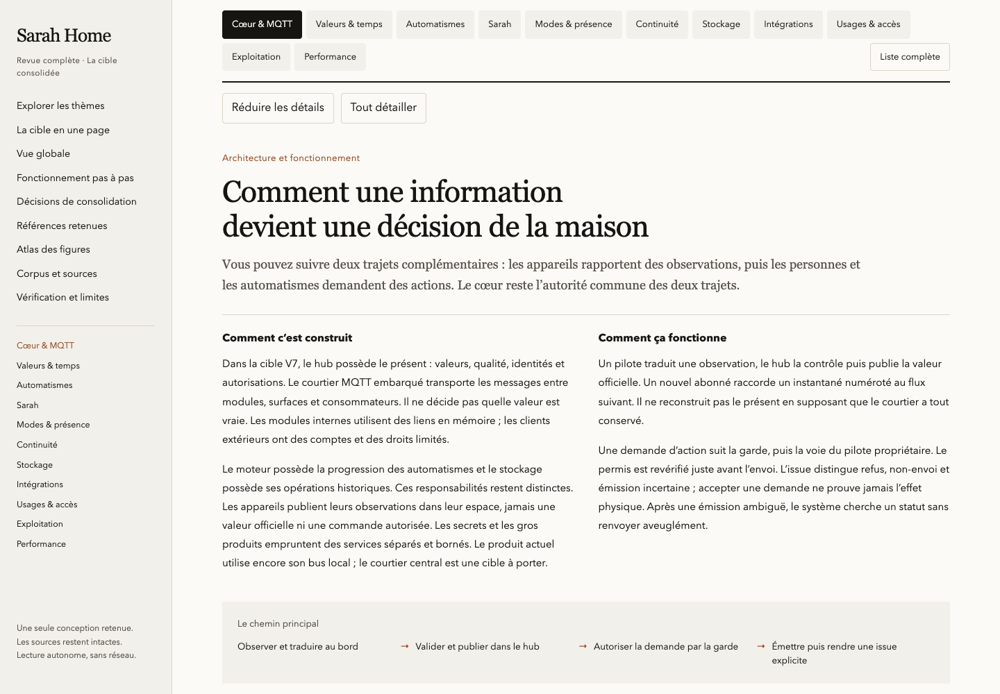
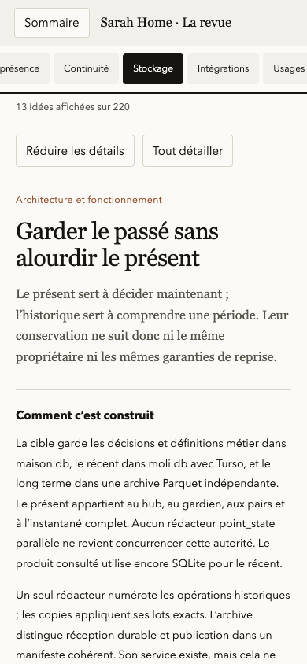

# Vérification de la revue complète

## Portée

La revue décrit une cible de conception unique. La lecture du code et des rapports établit séparément l'existant et les limites des preuves. Aucun banc métier n'est rejoué, aucun appareil n'est contacté et aucun déploiement n'est effectué.

L'inventaire initial contient 163 fichiers : 81 Markdown, 22 HTML, 55 SVG et 5 contrats OpenAPI. Il inclut les documents non suivis présents au début et exclut le nouveau dossier de revue. Chaque fichier est identifié par son chemin et son SHA-256 dans `corpus.json`.

## Contrôles reproductibles

Depuis la racine du dépôt :

```sh
python3 docs/revue-complete/construire.py
python3 docs/revue-complete/verifier.py
node --check docs/revue-complete/interaction.js
node docs/revue-complete/verifier-navigateur.cjs
```

La construction et le contrôle statique utilisent seulement la bibliothèque standard Python. Le contrôle de navigateur utilise Playwright disponible dans l'environnement et un Chrome installé ; leurs chemins peuvent être fournis par `MOLI_REVIEW_PLAYWRIGHT` et `MOLI_REVIEW_CHROME`.

Le CLI `dev-browser` a été essayé en premier. Son Chromium de test n'a pas démarré : framework manquant. L'attachement à Chrome n'a trouvé aucun port de débogage actif. Le contrôle du même fichier local utilise donc directement Playwright avec Chrome installé, sans serveur ni modification de l'outillage.

## Preuves produites

- `controle-construction.json` : couverture, références et conservation des sources.
- `controle-statique.json` : structure HTML, liens, images et autonomie réseau.
- `controle-navigateur.json` : interactions effectivement exécutées et résultats.
- `preuves/` : captures du document, de l'architecture, des détails et de la version mobile.

## Limites

Les références à la maquette et aux vidéos absentes du dépôt sont signalées dans la revue. Leurs descriptions sont attribuées aux textes qui les citent ; elles ne sont pas présentées comme une observation directe.

Les chiffres de banc restent attachés à leurs sources et à leurs conditions. Une simulation ou une taille de structure ne vaut pas mesure intégrée sur le matériel cible. Les choix nouveaux de cette consolidation sont identifiés comme tels ; ils ne sont ni attribués rétroactivement au propriétaire, ni déclarés livrés dans le code.

## Résultats constatés le 23 octobre 2026

- Couverture : **81 / 81 Markdown**, cinq contrats OpenAPI et index des 163 fichiers initiaux.
- Contenu : **31 thèmes, 220 idées, 75 figures, 34 décisions et 6 parcours**.
- Construction : **2399 références distinctes**, aucune source ou ligne invalide ; aucune différence SHA-256 sur les 163 originaux.
- Structure : **9 contrôles réussis** ; liens locaux valides, identifiants uniques, 100 placements d’images valides pour 75 figures distinctes et aucune ressource réseau de rendu.
- Navigateur : **14 contrôles réussis**, bureau 1440 × 1000 et mobile 390 × 844 ; aucune erreur JavaScript et aucune requête HTTP(S). Recherche, accents, filtres combinés, liens directs, détails, sources, zoom, menu mobile et préparation à l’impression exercés.
- Syntaxes JavaScript et Python contrôlées. Le contrôle générique de fuites du dépôt passe ; aucune liste noire privée n’est présente dans cet environnement.

Empreinte du HTML effectivement contrôlé : `ecb9838b8fca202192b011bae764d8669908c22a320e1e840d4f7ca75a46d2a5`. Le rapport navigateur porte la même empreinte.

### Captures du rendu contrôlé

- [vue ensemble bureau](preuves/vue-ensemble-bureau.png)
- [detail contrat](preuves/detail-contrat.png)
- [architecture globale](preuves/architecture-globale.png)
- [schema agrandi](preuves/schema-agrandi.png)
- [vue ensemble mobile](preuves/vue-ensemble-mobile.png)

## Onglets et explications, 24 octobre 2026

La présentation regroupe les 31 sous-thèmes en 11 onglets. Chaque onglet explique l’architecture, le fonctionnement, un chemin principal et un exemple. La « Liste complète » conserve les 220 idées sans duplication ; leurs données, la consolidation et le corpus ont les mêmes empreintes qu’avant la réorganisation.

- **11 contrôles statiques réussis**, dont conservation du contenu et affectation exhaustive des sous-thèmes.
- **17 contrôles de navigateur réussis** sur ordinateur et mobile : sélection des onglets, clavier, historique, recherche globale, lien direct, rechargement, sources, figures et impression.
- Aucun débordement horizontal de la page mobile, aucune erreur JavaScript et aucune requête HTTP(S).
- Les sources initiales restent intactes ; les 75 figures et les 34 décisions restent accessibles.

HTML contrôlé : `532590a91691d659feb7bb8383558fe908c15e9e0467c66c631f1574be091349`.




